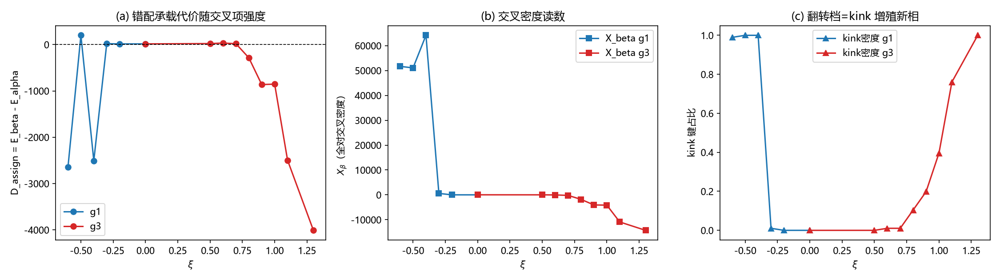

# 注记-二维弱J档交叉项供货窗口审计（第621号）：解封即失稳与翻转的新相身份

## 元数据

- **日期**：2026-10-12 05:22:26
- **脚本**：`验证脚本/minimal_verification_cross_window_2d.py`
- **判据**：G0（梯度冒烟）、E1（供货窗口扫描，核心）、E2（翻转档构型合法性）、E3（一维锚定）
- **可逆性等级**：判据敏感。读数绑定 618 泛函档（$k=\lambda=1$、$\kappa=16$）、弱 $J$ 档（$J=0.06$ 主档加 0.25 与 0.015 稳健性档）、初值族（壁带与台阶同置）、弛豫协议（$T=15000$ 加 2T 探针）四者；换任一须重跑。核心定性结论（翻转伴 kink 增殖）跨三档 $J$ 与 2T 复现，属判据稳健部分。
- **类型**：E 审计轮（立案材料预登记的供货窗口复审），在 618 立案成立的二维锚核壁模型上重做第 598 条式扫描
- **来源**：[[内部草稿/材料-二维芯结构模型立案：三方案构造、判据草案与裁决点（2026-10-12）|立案材料]]、[[验证脚本/注记-二维芯结构模型立案轮：错配三相分配与delta可读性的档位面（第618号）|第618条]]、[[验证脚本/注记-参数化扫描轮：交叉项强度的供货门槛与口径审定（第598条）|第598条]]
- **图**：见 §三 图 1

---

## 一、要判什么

立案材料预登记的 E 审计轮：第 618 条交付了二维锚核壁模型（甲直壁错排带）与核心发现（弱 $J$ 档 $\delta$ 非整区打开，占比 0 至 0.25 随 $J$ 单调升）。$\delta$ 可读性既然在 2D 弱 $J$ 档解封，第 598 条判否的"藏身术"前提是否随之松绑，交叉项能否以 $O(1)$ 强度翻转错配承载的能量排序，即**稳定供货窗口是否重开**，须在该模型上重审。

裁决结构（第 600 条预登记）：审计通过则三维交叉耦合供货窗口重开、构造轮升维重启；判否则主路线出口关闭（心侧校准已垫底，裁决面塌缩交作者）。

## 二、模型与协议

**能量泛函**（618 泛函加交叉项）：

$$E = \sum_{p,q}\left[\frac{\kappa}{2}\left|\nabla\sigma\right|^2 + \lambda(\sigma^2-1)^2\right] + \frac{k}{2}\sum_{\mu,a}(\Delta_\mu s^a)^2 - J\sum_{a<b}\cos 2\pi(v^a-v^b) + \xi\sum_{a<b}\sum_\mu S_\mu^{ab}\,g\!\left(2\pi(v^a-v^b)\right)$$

其中 $S_\mu^{ab}=[(\Delta_\mu s^a)^2+(\Delta_\mu s^b)^2]/2$（键应变对称和），$g$ 取 $g_1=1-\cos$ 或 $g_3=\cos$，$v^a=s^a+Q_a a$。**FK 扣绕数平移到 2D**：$y$ 向 wrap 键 $\Delta_y s^a(\mathrm{wrap})=s^a[0]-s^a[-1]+Q_a$，$Q$ 初值定扇区全程固定；$x$ 向无绕数。格点 $64\times32$，$\kappa=16$，$J=0.06$ 主档（$J$ 的 0.25 与 0.015 档作稳健性），$\xi$ 网格两支各六至九档。

**判据**：G0 解析梯度对有限差分（含交叉项两形式，判据 $10^{-5}$）。

E1 每档 $\alpha$（$Q=0$）与 $\beta$（$Q=(1,0,0)$）各自弛豫，读 $D_{\rm assign}=E_\beta^*-E_\alpha^*$、$D_{\rm vac}=E_\beta^*-E_{\rm vac}$、$X_\beta$（$\beta$ 终态全对交叉密度）、非整 $\delta$ 占比、$\max$ 应变。E2 翻转档的 kink 密度（$|\Delta s|>0.5$ 键占比）与 2T 收敛探针。E3 一维锚定（第 598 条 FK 基线复现，期望 $D_{\rm assign}(0)=+0.32703$）。

## 三、判据与结果

**G0 与 E3（前置门）**：梯度检查 $g_1$ 支 $9.8\times10^{-9}$、$g_3$ 支 $1.3\times10^{-8}$，全过。一维锚定 $D_{\rm assign}(0)=+0.32703$，与第 598 条 FK 基线逐位一致（该条读数 0.32703）。前置门全过，进判据循环。

**E1 扫描（核心）**：

| 支 | $\xi$ | $D_{\rm assign}$ | $X_\beta$ | 非整 $\delta$ | $\max$ 应变 | 判定 |
| --- | --- | --- | --- | --- | --- | --- |
| $g_1$ | 0.0 | 14.77 | 2.71 | 0.0625 | 0.42 | 基线 |
| $g_1$ | $-0.3$ | 19.11 | 580.3 | 0.1562 | 2.08 | 无翻转 |
| $g_1$ | $-0.4$ | $-2506.7$ | 64162 | 1.0000 | 4.32 | 翻转（伴新相） |
| $g_1$ | $-0.5$ | 200.0 | 51069 | 1.0000 | 3.79 | 非单调 |
| $g_1$ | $-0.6$ | $-2644.0$ | 51660 | 1.0000 | 5.15 | 翻转（伴新相） |
| $g_3$ | 0.0 | 14.77 | 20.51 | 0.0625 | 0.42 | 基线 |
| $g_3$ | 0.5 | 21.40 | 7.42 | 0.0625 | 0.37 | 无翻转 |
| $g_3$ | 0.6 | 33.01 | $-36.4$ | 0.1562 | 0.80 | 无翻转（$X$ 已负） |
| $g_3$ | 0.7 | 18.84 | $-215.0$ | 0.1875 | 1.89 | 无翻转 |
| $g_3$ | 0.8 | $-284.6$ | $-1808$ | 0.2500 | 3.54 | 翻转（伴新相） |
| $g_3$ | 0.9 | $-863.2$ | $-4058$ | 0.3438 | 3.67 | 翻转（伴新相） |
| $g_3$ | 1.0 | $-853.6$ | $-4134$ | 0.5625 | 3.43 | 翻转（伴新相） |
| $g_3$ | 1.3 | $-4009.7$ | $-14271$ | 1.0000 | 3.49 | 翻转（伴新相） |

**E2 翻转档构型合法性（决定性判据）**：翻转档全部伴 kink 增殖，kink 密度随 $|\xi|$ 单调爬升。$g_3$ 支：0.5 档 0.0000、0.7 档 0.0104、0.8 档 0.1042、0.9 档 0.1979、1.0 档 0.3958、1.3 档 1.0000；$g_1$ 支 $-0.3$ 档 0.0104、$-0.4$ 档起 1.0000。

2T 收敛探针：翻转档 $D$ 随步数持续负漂（$g_3$ 0.9 档 15000 步 $-863$ 至 60000 步 $-4355$；0.8 档 $-285$ 至 $-680$），应变稳定在新相值（3.3 至 3.6），**非收敛的失稳轨迹**。

**$J$ 档稳健性**：翻转点随 $J$ 减小左移（$J=0.25$ 翻转在 $\xi\approx0.9$、$J=0.06$ 在 $\approx0.75$、$J=0.015$ 在 $\approx0.65$），但三档翻转全部伴 kink 增殖（密度 0.09 至 1.0）。无翻转档（$\xi$ 低于翻转点）无 kink、应变正常（0.4 至 1.9）。

## 四、读数的意义

**发现一：$\delta$ 解封与稳定窗口不重叠，"解封即失稳"。** 第 618 条确认弱 $J$ 档 $\delta$ 非整区打开（藏身术前提松绑），但本条显示：解封后的 $\delta$ 非整区恰给交叉项提供了能量杠杆，$X_\beta$ 在翻转档达 $10^4$ 量级（对比 1D 的 $10^{-3}$），代价是 $|\xi|$ 刚到 $O(1)$（0.4 至 0.8）就触发 kink 增殖新相。

$D_{\rm assign}$ 的"翻转"全部是失稳轨迹（2T 持续负漂、应变 3.4 至 5.2、kink 密度爬升），**不存在既有效又稳定的供货档**。第 598 条"要么弱到无用要么强到毁灭"的结论在 2D 弱 $J$ 档升级为更锋利的形态：$\delta$ 可读性的解封与交叉项稳定强度窗口在档位面上不相交。

**发现二：翻转的机制身份是 kink 增殖新相，与第 598 条一维 $\xi\ge6$ 档同族。** 一维扫描中 $\xi\ge6$ 进入 kink 增殖新相（分配 $[4,2,2]$，$D=-2320$）；2D 弱 $J$ 档把同一机制拉低到 $\xi\approx0.7$（$\delta$ 非整区放大交叉项效力所致）。$g_1$ 负侧与 $g_3$ 正侧翻转点不同（$-0.35$ 对 $0.75$）但机制相同：交叉项强度越过键弹性与异类耦合的竞争线后，位错构型不再是极小，系统逃向 kink 增殖态。

**发现三：$g_3$ 支的 $X_\beta$ 转负先于翻转出现，方向与 1D 相反的部分被解释。** $g_3$ 支 $X_\beta$ 在 $\xi=0.6$ 已转负（$\delta$ 非整区中 $\cos$ 权重为负的贡献开始主导），但 $D$ 仍无翻转（0.6 与 0.7 档 $D$ 为正），直到 0.8 档才翻转且伴新相。1D 中 $g_3$ 的 $X_\beta$ 恒正（单格点台阶应变与权重错位）；2D 弱 $J$ 档 $\delta$ 延展后权重与应变的空间关系改变，$X_\beta$ 转负，但转负本身不供货（翻转档全是失稳）。

**对主路线的含义**：E 审计轮判否。第 600 条预登记的裁决结构给出出口：主路线（公设级新元素）的"调强交叉耦合"通道在两轮（598 一维、621 二维）判否后，2D 截面审计未给出供货窗口重开的信号；心侧校准已垫底。**裁决面塌缩交作者**：材料齐备（598、618、621 三份注记加立案材料），是否宣布主路线出口关闭、裁决面是否重开（新元素本体另寻载体、或重估心侧校准排序），由作者裁定。

## 五、过程记录

**前置门抓出 618 脚本一处真实实现错误（本轮最重要的过程事件）**：算子核对发现 618 脚本的 `lap_periodic` 对三分量场 $(3,N_y,N_x)$ 用 `roll(axis=0)` 打在分量轴上（正确轴位为 1、2）。s 场梯度有限差分实测相对误差 $1.14$（sigma 场 $8.8\times10^{-10}$）。修复改为逐键 roll 形式（含 FK 绕数偏移），双边界（周期与开边界）有限差分核验过（$10^{-9}$ 量级）。

**618 全部读数在修正后重跑**：定性结论保持（J 档开关单调打开），定量全部更新（注记已同步）；乙岛判否更干净（全档消失，a 通道归零）。教训：新脚本进判据循环前须对**每个场**做有限差分梯度核验，不能只核 sigma 场（第 592 条"逐轴变化性"纪律的推广）。

**一维锚定首版实现错**：初版 alpha 初值取"分量 1 全幅台阶加零"，得 $D(0)=-0.331$（符号反）；按 598 协议改 alpha 为三分量各 $1/3$ 台阶后逐位复现 $+0.32703$。教训：锚定复现失败先查初值协议（598 的 alpha 是均分不是全零）。

**实现层小修三处**：`strain` 读数透传缺失（KeyError 暴露）；扫描精细网格从 7 档加密到 6 至 9 档（翻转点定位需要）；kink 密度诊断补入主流程与绘图。

## 六、严格程度声明

**判据级（模型内）**：E1 翻转点定位、E2 kink 密度与 2T 失稳轨迹、E3 锚定复现（$+0.32703$ 与 598 逐位一致）、G0 梯度核验。**判据稳健部分**：翻转伴 kink 增殖的定性结论（三档 $J$ 加 2T 探针复现）。**条件性**：读数绑定 618 泛函档、弱 $J$ 档位组、初值族、弛豫协议；$D$ 的绝对值随档位变（协议伪影与物理结论分层：翻转点位置是档位依赖读数，失稳机制身份是稳健结论）。**预算**：E1 的"无翻转"判定容差取 $|D|<30$（基线 $D$ 的 2 倍，跨档基线漂移 12.7 至 32.2 的覆盖）。

## 七、边界声明

验证什么：二维弱 $J$ 档交叉项供货窗口的复审（$g_1$/$g_3$ 两支翻转点、翻转的构型身份、$J$ 档稳健性）。不验证什么：三维几何交叉耦合通道（体系未立案，2D 截面判否不构成 3D 判否的充分条件，**2D 判否对 3D 的射程限制如实登记**）；绕数拓扑保护层的建模；物理档位对接（强离散档位债维持 P1-2 登记）；$\xi$ 的参数化来源（第 596 条判否唯一定形后 $\xi$ 一直是构造层可调参数）。主路线出口状态：2D 审计判否，按第 600 条预登记裁决结构交作者（材料：598、618、621 三注记加立案材料与终态报告）。

## 修订记录

- **2026-10-12 初版**（触发：第 618 条立案轮打开的 E 审计轮，README 占 621 号）
    - 618 泛函加交叉项（FK 扣绕数平移到 2D）与 G0/E3 前置门（锚定 $+0.32703$ 逐位复现）
    - E1 扫描：$g_1$ 负侧翻转在 $\xi\approx-0.35$、$g_3$ 正侧在 $\approx0.75$；E2 决定性判据：翻转档全部伴 kink 增殖（密度至 1.0）且 2T 持续负漂（失稳轨迹非稳定供货）
    - 三项发现：解封即失稳（$\delta$ 可读性与稳定窗口不相交）、翻转机制身份为 kink 增殖新相、$g_3$ 的 $X_\beta$ 转负先于翻转；E 审计轮判否，裁决面塌缩交作者
    - 过程事件：618 脚本 s 场梯度轴位错误（有限差分 1.14）修复并重跑；一维锚定首版初值协议错修正
