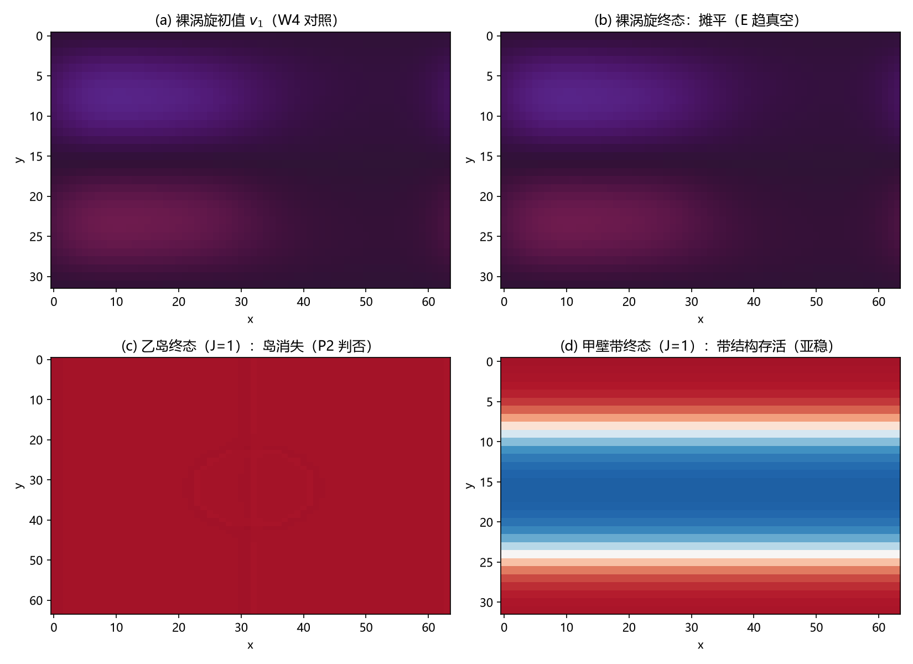

# 注记-二维芯结构模型立案轮：错配三相分配与 delta 可读性的档位面（第618号）

## 元数据

- **日期**：2026-10-12 03:53:12
- **脚本**：`验证脚本/dw_core_2d.py`
- **判据**：W1 至 W5（甲与对照）、P1 至 P3（乙）、J 档扫描读数档
- **可逆性等级**：判据敏感。读数绑定初值族（壁带与台阶同置）、档位组（$\kappa$ 四档、$J$ 四档）、弛豫协议（分场步长、$T=20000$）三者；换任一须重跑。W2 的近简并族结构与乙岛判否在 $T=60000$ 长步与弱 $J$ 档复检下复现。
- **类型**：最小验证注记，弹性本构主路线恢复入口的立案轮（对象存在性与可读性）；E 审计轮（第 598 条式供货窗口扫描）另立占位，不在本轮射程
- **来源**：[[内部草稿/材料-二维芯结构模型立案：三方案构造、判据草案与裁决点（2026-10-12）|立案材料]]、[[验证脚本/注记-复结构畴壁承载绕数（第486条）：联结类型决定 K 无关性、壁位零模终止无穷后退|第486条]]、[[验证脚本/注记-参数化扫描轮：交叉项强度的供货门槛与口径审定（第598条）|第598条]]、[[验证脚本/注记-维度外推审计：第598条藏身术在2D涡旋芯（第600条）|第600条]]
- **图**：见 §三 图 1、图 2

---

## 一、要判什么

第 600 条判定裸 $S^1$ 相位涡旋不局域存活，缺口形态"缺一整类模型"：体系位错芯的锚核/畴壁结构（第 486 条）从未有二维截面模型。立案轮判据只问两件事：其一，畴壁型错配结构在二维格点模型内是否作为可弛豫对象存在（存活）；其二，其 $\delta^{ab}$ 分布是否可读（非整数化的延展区是否打开）。供货窗口是否重开（第 598 条式扫描）归 E 审计轮，本轮不做任何交叉项供货判读。

**四项裁决已按立案材料推荐执行**（作者授权"根据你的判断执行"）：甲乙连跑、乙1 实 $\sigma$ 壁段回卷、定义性联结、立案轮与审计轮分开。

## 二、模型与协议

**能量泛函**（甲乙同）：

$$E = \sum_{p,q}\left[\frac{\kappa}{2}\left|\nabla\sigma\right|^2 + \lambda(\sigma^2-1)^2\right] + \frac{k}{2}\sum_{\mu,\alpha}(\Delta_\mu s^\alpha)^2 - J\sum_{\alpha<\beta}\cos 2\pi\!\left(v^\alpha - v^\beta\right)$$

其中 $v^\alpha = s^\alpha + Q_\alpha a$，$a=(1-\sigma)/2$（定义性联结，$\sigma$ 对 $v$ 单向），$Q=(1,0,0)$。环面 $64\times 32$（甲）、$64\times 64$（乙），$k=\lambda=J=1$ 起步，$\kappa\in\{1,4,16,64\}$。梯度流弛豫，分场步长 $\varepsilon_\sigma = 0.25/(8\kappa+48)$、$\varepsilon_s = 0.25/166$（Hessian 上界推导），主轮 $T=20000$。

**错配记账的关键构造事实**：份额 $Q=(1,0,0)$ 的合法性要求 $s_1$ 场自带奇数条整数台阶（$s_1$ 周期、$a$ 周期、$v_1$ 份额 1 三者联立）。初值 $s_1$ 为单位阶跃，与一条 $a$ 壁重合。错配的三相分配由此可读：$a$ 通道（$\sigma$ 壁的非整过渡）、$\delta$ 通道（$v_1-v_2$ 的非整区）、$s$ 通道（$s_1$ 的整数台阶），三者由 $\kappa$、$J$、$k$ 的档位竞争定分配。

**乙方案的实现层修正**（按立案材料诚实边界条款执行，材料文档已补登记）：环面上实 $\sigma$ 场的 $\pi_0$ 壁必闭合，割线有限壁段的端点芯拓扑不可达；开边界半无限壁冒烟显示端点被壁张力快速拉回边界（瞬态）。乙执行版取环面闭合壁环（错配岛：岛内 $a=1$）。

## 三、判据与结果

| 判据 | 内容 | 读数 | 判定 |
| --- | --- | --- | --- |
| W1 | 甲冒烟与收敛（$\kappa=16$，$T$ 对 $3T$） | 相对差 $2.82\times10^{-5}$（预算 $10^{-4}$，从末段单步相对降推） | PASS |
| W2 | 甲平移零模（壁带整体平移 4 格） | 相对差 $1.58\times10^{-3}$（壁宽 4.5 对 3.0 格），$T=60000$ 复现 | FAIL（近简并族，见 §四） |
| W3 | $J$ 档可读性（$J\le0.25$ 档 $\delta$ 占比 $>0.1$ 且 $X_\beta>10\times$ $J=1$ 档） | 占比 $0.125$，$X_\beta$ 比值 $107$（2.569 对 0.024） | PASS |
| W4 | 裸涡旋摊平对照（第 600 条复现齿） | $\max\vert\mathrm{wrap}\,\Delta s_1\vert=0.020$，能量趋真空 | PASS |
| W5 | 一维对照（第 598 条原版，无 $a$ 场） | $X_\beta=1.36$，占比 $0.363$，台阶键 10 | 基线读数档 |
| P1 | 乙冒烟与收敛 | 能量下降但单调破（构型剧变） | 观察项 |
| P2 | 乙岛存活（$J=1$ 与 $J=0.06$ 两档） | 岛面积 $241\to2037$（$J=1$）、$241\to0$（$J=0.06$） | FAIL |
| P3 | 乙环带罚集中 | 岛不存在，读数无判读意义 | 无效（按第 600 条纪律不读数） |

**$J$ 档扫描（$\kappa=16$，本轮核心读数）**：

| $J$ | $\delta$ 非整占比 | $X_\beta$ | $s_1$ 台阶键数 | 壁宽 |
| --- | --- | --- | --- | --- |
| 1.000 | 0.000 | 0.024 | 12.0 | 4.5 格 |
| 0.250 | 0.000 | 0.303 | 11.0 | 4.5 格 |
| 0.060 | 0.125 | 2.569 | 11.0 | 4.5 格 |
| 0.015 | 0.250 | 7.288 | 9.0 | 5.0 格 |

## 四、读数的意义

**发现一：$\delta$ 整数化（藏身术）的执行者是异类耦合的 $\cos$ 势阱，$J$ 是开关。** $J=1$ 档全档 $\delta$ 占比为零（错配分配走 $a$ 整数带与 $s_1$ 台阶，$\cos$ 势阱把 $\delta$ 锁在整数流形上）；$J$ 减小后延展非整区单调打开（占比至 0.250，$X_\beta$ 升两个数量级以上：$J=0.015$ 档 7.288 对 $J=1$ 档 0.024）。第 598 条的三重判否机制中"$\delta$ 整数化藏身"在二维锚核壁模型内原样重现，但其成立条件被精确定位为势阱强度 $J$ 的档位，而非维度或锚核结构的缺失。

**发现二：错配的三相分配由档位面 $(k, J, \kappa)$ 决定，热力学极小是锐台阶。** $J=1$、$\kappa=64$ 档：$\sigma$ 真空化、$s_1$ 收缩为单键锐台阶、总罚最低（$E-E_{\rm vac}=42.0$，低于 $\kappa=16$ 档壁带解的 1000.3）：错配收缩通道在纯弹性层内热力学开放。$\kappa$ 增大推错配离开 $a$ 通道，$J$ 减小拉错配回到 $a$ 壁通道（$s_1$ 台阶锐化至消失），两旋钮方向相反。

**发现三：甲存活为亚稳、乙判否，稳定性的缺课是拓扑保护层。** 甲壁带结构在扫描窗口内存活（错配重分配需重建半环带，动力学势垒大）；乙闭合壁环全档不存活（岛可局部逐格收缩，错配走 $s_1$ 无势垒；梯度修正后重跑全档岛面积归零、$a$ 通道归零，判否更干净）。两者合并的结论：纯弹性加异类耦合层不供给错配局域化的热力学稳定性，体系语义下这一稳定性的来源在绕数拓扑保护层（toric code 层 $[H,W]=0$），锚核/畴壁供给的是局域化结构而非绝对稳定。这与第 486 条约束版（$v$ 场不入能量、错配只能走 $a$）的壁稳定结论相容：约束版等价于隐含拓扑保护。

**W2 的 FAIL 按判负含义登记**：壁带平移 4 格后能量差 $1.58\times10^{-3}$（壁宽 4.5 对 3.0 格）在 60000 步长步下复现，属真破缺而非收敛伪影。$s_1$ 台阶与 $a$ 壁的耦合系统存在分立近简并族（台阶展宽程度与补偿方式的多重分配谷），平移后弛豫落入不同谷。按测量合法性纪律（第 506 条），落在近简并族的读数不硬给"零模成立"的结论，登记为近简并族结构。

## 五、过程记录

**实现层修正链（乙方案两改）**：立案材料原设计环面割线有限壁段，拓扑审查发现环面上实 $\sigma$ 的 $\pi_0$ 壁必闭合（端点芯不可达）；改开边界半无限壁后冒烟显示端点被壁张力 2000 步内拉回边界（瞬态对象）；终版取环面闭合壁环（错配岛），判否后保留为对照读数。修正链已补登记进立案材料。

**冒烟三轮抓出的构造级问题**：其一，初版 $s_1\equiv 0$ 违反份额合法性（$Q=(1,0,0)$ 要求 $s_1$ 带奇数条台阶），此时模型测的是纯畴壁而非位错，甲的能量与通道读数全错；修正后错配三相结构才显形。其二，开边界 pad 与 3D 场拉普拉斯的轴错位两处。其三，$X_\beta$ 键端权重初版单端取样，改键两端平均。

**s 场梯度轴位错误与重跑（2026-10-12 修正）**：第 621 号 E 审计轮的前置门核对发现，本脚本 `lap_periodic` 对三分量场 $(3,N_y,N_x)$ 用 `roll(axis=0)` 打在分量轴上（正确轴位为 1、2）。s 场梯度有限差分实测相对误差 $1.14$（sigma 场 $8.8\times10^{-10}$，故未被冒烟抓住）。

修复改为逐键 roll 形式（含 FK 绕数偏移，与能量逐键一致），双边界有限差分核验过（$10^{-9}$ 量级），全部读数重跑：定性结论保持（J 档开关单调打开），定量更新（本注记读数已同步），乙岛判否更干净（全档消失、a 通道归零）。教训：新脚本进判据循环前须对**每个场**做有限差分梯度核验，不能只核标量场（第 592 条"逐轴变化性"纪律的推广）。

**转义事故两处（heredoc 双层陷阱复发）**：绘图段经 heredoc 写入，`$X_\beta$` 的 `\b` 成退格、`\rangle` 的 `\r` 成回车进文件，语法层即炸；按规程改 Write 落修复脚本字节级替换。教训重申：含 LaTeX 的批量修改一律 Write 落脚本，heredoc 直贴是双层陷阱。

**J 档扫描的判据地位**：动笔前判据只设 $\kappa$ 档；冒烟显示 $\delta$ 通道全零后，按"判负后第一步查机制归属"纪律归因到 $\cos$ 势阱强度，$J$ 档作为机制判别齿补入（先立预期"弱 $J$ 打开延展区"再跑，实测四档单调符合预期）。

## 六、严格程度声明

**判据级（模型内）**：W3 的 $J$ 档单调性、W4 的摊平复现、P2 的乙岛判否、发现一的机制定位。**判据稳健部分**：W2 的近简并族（长步复现）、错配三相分配的定性结构（多档一致）。**条件性**：所有读数绑定 $k=\lambda=1$、格点 $64\times32$ 与 $64\times64$、初值族（台阶与壁同置）三个协议档；档位换组须重跑。**预算**：W1 容差 $10^{-4}$ 由末段单步相对能量降（约 $3\times10^{-9}$/步）乘剩余步数比加 10 倍安全因子推得。

## 七、边界声明

验证什么：畴壁型错配结构的二维存在性（甲亚稳存活）、$\delta$ 分布可读性的档位面（$\cos$ 势阱开关）、裸涡旋与一维两对照齿、乙闭合壁环的存活判否。不验证什么：交叉项供货窗口（$g_1$/$g_3$ 两支与失稳墙，归 E 审计轮）；绕数拓扑保护层的建模（toric code 层不在本模型射程）；三维形态；物理档位对接（$k=J=1$ 强离散档的档位债维持 P1-2 登记）。主路线出口状态由"挂起待模型"更新为"立案轮交付：甲立案成立（亚稳对象加可读性档位面），弱 $J$ 档延展 $\delta$ 区打开；乙判否；E 审计轮在弱 $J$ 档的立项合法性打开，是否开交作者裁决"。

## 修订记录

- **2026-10-12 梯度修正与读数重跑**（触发：第 621 号前置门核对抓出 s 场梯度轴位错误）
    - s 场梯度改逐键 roll 形式（含 FK 绕数偏移），双边界有限差分核验 $10^{-9}$ 量级；全部读数重跑
    - 定性结论保持（J 档开关单调打开、乙岛判否），定量更新：W1/W2/W4、J 档扫描表、发现节读数与 $X_\beta$ 比值（11.3 改 107）同步
- **2026-10-12 初版**（触发：作者授权按推荐裁决执行立案轮；README 占 618 号）
    - 甲乙同泛函立案模型与错配三相分配读数（份额合法性要求 $s_1$ 带奇数条台阶的构造事实）
    - 判据 W1 至 W5 加 P1 至 P3：W1/W3/W4 PASS、W2 FAIL（近简并族如实登记）、P2 乙岛判否、J 档扫描（核心读数：$\delta$ 占比 0 至 0.250 随 $J$ 单调打开）
    - 三项发现：藏身术执行者为 $\cos$ 势阱（$J$ 开关）、错配三相分配档位面、稳定性缺课在拓扑保护层（甲亚稳乙判否合并结论）
