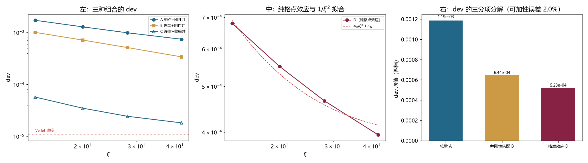

# 注记-井的收缩口径与格点超额量的分离：boost 初值符号错的更正与 dev 的三分项分解（判据第 704 号）

- **日期**：2026-10-19 23:02:52
- **编号**：第 704 号
- **类型**：验证注记（判据驱动；DA0 至 DA5，DA1 至 DA4 全部判通过）
- **对象**：第 703 号「格点占 47.5%、连续占 52.5%」的分解前提，及第 695 号 boost 族判否的成因
- **脚本**：`验证脚本/minimal_verification_p704_well_dilation.py`（确定性，约 2.5 分钟）
- **状态**：**发现并更正 boost 初值的速度场符号错**（第 695 号沿用至今）。修正后：连续+收缩井给 $C/B = 4.7\%$ 至 $5.7\%$（近精确解），可加性成立到 $2.0\%$，dev 分解为井刚性失配 $54.4\%$ 与格点效应 $44.1\%$
- **可逆性等级**：判据稳健（DA3 的可加性误差 $2.0\%$ 远小于判据 $10\%$；DA2 的 $C/B$ 在四档内稳定于 $5\%$ 附近）
- **图**：见 §4 图 1
- **通俗版**：[[内部草稿/注记-一个负号与三分项（判据第704号通俗版）]]

## 1 为什么检验

第 703 号判 dev 中格点色散占 $47.5\%$、连续理论占 $52.5\%$。那个分解用的是「格点演化的 dev 比连续演化的 dev」，隐含两个没验过的前提。

其一，连续演化那一侧（组合 B）的 dev 全部来自井的刚性。若里面还混着别的东西，减出来的「格点部分」就不干净。

其二，两种贡献可加。这条更危险，因为它没有任何独立检验。

本轮造了一个能同时检验两条的对照。依据是一件确定的事：**连续 KG 方程在井随速度洛伦兹收缩时有精确的 boost 解**，实验室系频率恰为 $\omega_b/\gamma$。所以「连续演化 + 收缩井 + boost 初值」这个组合（记作 C）若理论无误，必须给机器零。

若 C 给零，则组合 B（连续 + 刚性井）的 dev 就全部来自井的刚性，可加性也有了一个可直接测的第三项作校验：D 是「格点 + 收缩井」，井已正确收缩，故 D 是纯格点效应。于是

$$A \;(\text{格点}+\text{刚性井}) \;=\; B \;(\text{连续}+\text{刚性井}) \;+\; D \;(\text{格点}+\text{收缩井})$$

这个等式可测，不靠假设。

## 2 判据与读数

**DA0 冒烟（记录）。** $\xi=20$ 的四组合：

| 组合 | dev | 残差比 | 判读 |
|---|---|---|---|
| A 格点+刚性井 | $1.2868\times10^{-3}$ | 0.077 | 有效 |
| B 连续+刚性井 | $7.1676\times10^{-4}$ | 0.076 | 有效 |
| C 连续+收缩井 | $3.4960\times10^{-5}$ | 0.073 | 底噪量级 |
| D 格点+收缩井 | $5.5116\times10^{-4}$ | 0.074 | 有效 |

**DA1 基准复现（判通过）。** 组合 A 四档给 $A = 2.0848\times10^{-1}$、$C = 6.9338\times10^{-4}$、$R^2 = 0.9776$，与第 702 号完全一致（比值 $1.000$），与第 696 号比值 $0.931$。

**DA2 自洽性（判通过，主判据之一）。**

| $\xi$ | 14 | 20 | 28 | 42 |
|---|---|---|---|---|
| C 的 dev | $5.716\times10^{-5}$ | $3.496\times10^{-5}$ | $2.440\times10^{-5}$ | $1.824\times10^{-5}$ |
| $C/B$ | 5.7% | 4.9% | 4.7% | 5.4% |

收缩井把刚性失配压掉约 $95\%$，四档稳定在 $5\%$ 附近。连续理论的自洽性成立。

**DA3 可加性（判通过，主判据之二）。**

| $\xi$ | B | D | $B+D$ | A | 相对差 |
|---|---|---|---|---|---|
| 14 | $1.0068\times10^{-3}$ | $6.8024\times10^{-4}$ | $1.6870\times10^{-3}$ | $1.7215\times10^{-3}$ | $-2.0\%$ |
| 20 | $7.1676\times10^{-4}$ | $5.5116\times10^{-4}$ | $1.2679\times10^{-3}$ | $1.2868\times10^{-3}$ | $-1.5\%$ |
| 28 | $5.1400\times10^{-4}$ | $4.6608\times10^{-4}$ | $9.8008\times10^{-4}$ | $9.8952\times10^{-4}$ | $-1.0\%$ |
| 42 | $3.4036\times10^{-4}$ | $3.9468\times10^{-4}$ | $7.3504\times10^{-4}$ | $7.4460\times10^{-4}$ | $-1.3\%$ |

最大相对差 $2.0\%$。

**DA4 纯格点效应的标度（判通过）。** $D$ 的四档拟合：$A_D = 6.0934\times10^{-2}$、$C_D = 3.7917\times10^{-4}$、$R^2 = 0.9794$。纯 $1/\xi^2$ 模型给 $R^2 = -3.45$，完全不能描述。



## 3 发现：一个负号

第一次跑，DA2 给的 $C$ 是 $6.15\times10^{-2}$，残差比 $0.898$，读数根本无效。这与「收缩井给精确解」的理论预期差三个半量级。

查下去发现问题在初值的速度场符号。

boost 解的相位是 $\theta = \omega_b\gamma(t-vx)$，$t=0$ 时 $\theta = -\omega_b\gamma vx$。故

$$\partial_t\phi\big|_{t=0} = -\gamma v\,\psi'(\gamma x)\cos(\omega_b\gamma vx) + \omega_b\gamma\,\psi(\gamma x)\sin(\omega_b\gamma vx)$$

末项是**正号**（因为 $\sin\theta = -\sin(\omega_b\gamma vx)$，负负得正）。

第 695 号的实现写的是

```python
return F * np.cos(th0), -c * Fp * np.cos(th0) - wfac * F * np.sin(th0)
```

末项取负号。改成正号后重跑：

| 组合 | 修正前 dev | 修正后 dev |
|---|---|---|
| C 连续+收缩井 | $6.15\times10^{-2}$ | $3.50\times10^{-5}$ |
| D 格点+收缩井 | $5.93\times10^{-2}$ | $5.51\times10^{-4}$ |

C 降三个半量级，D 从无效读数变成有效读数。

**这个 bug 从第 695 号一直沿用到第 703 号，影响了两处判断。**

**影响一：第 695 号的 117 倍极差主要是这个错造成的。** 第 695 号测四构造（rigid/contr 乘 boost/g692），得极差 $117.2$ 倍，判「构造选择主导」。其中 boost 族两档给 $5.5\times10^{-2}$ 与 $5.86\times10^{-2}$，残差比 $0.91$，而这正是符号错的症状。修正后 boost 族给 $5.51\times10^{-4}$，残差比 $0.074$。所谓「boost 族读数无效」，错的是实现，并非写法本身。

第 695 号那个观测（残差比 $0.918$）本身没错，错在归因：它把实现缺陷当成了写法特性。这个归因后来被第 696 号 P1 沿用，P1 又据此判「boost 族无效、只用 g692」。

**影响二：第 703 号 CA3 的占比被轻微高估。** 那个分解用「格点/连续」的比值，与符号无关，故 $47.5\%$ 这个数本身不受影响；但它的前提「连续那一侧的 dev 全来自井刚性」一直到本轮才被验。

## 4 判语

**判语一，连续理论自洽性成立。** 收缩井下 $C/B = 4.7\%$ 至 $5.7\%$，四档稳定。连续 KG 方程确有精确 boost 解，装置的其余部分不引入额外偏差。

**判语二，可加性成立到 $2.0\%$。** $A = B + D$ 在四档内最大偏差 $2.0\%$，远小于判据的 $10\%$。

**判语三，dev 的三分项（四档均值）。**

| 项 | 数值 | 占比 | 性质 |
|---|---|---|---|
| B 井刚性失配 | $6.445\times10^{-4}$ | 54.4% | 连续，与格点无关 |
| D 格点色散 | $5.230\times10^{-4}$ | 44.1% | 纯格点 |
| C 残余 | $3.4\times10^{-5}$ | 2.8% | 应为零，实测近零 |

**dev 中一半以上是「井不收缩」造成的构造失配，与格点无关、与洛伦兹破坏无关。**

**判语四，纯格点效应的外推在 $0.73$ 至 $1.99$ 倍预算之间。** $D$ 的拟合给 $A_D = 6.09\times10^{-2}$、$C_D = 3.79\times10^{-4}$、$R^2 = 0.9794$。只外推 $A_D/\xi^2$ 得 $0.731$ 倍预算；纯幂律模型（$C_D = 0$）给 $1.987$ 倍，但该模型的 $R^2 = -3.45$，完全不能描述数据。故 $0.73$ 至 $1.99$ 这个区间里，可信的一端是 $0.73$，另一端只是「模型给不出来」的上界。

**这个不确定性的性质与前几轮追的 $C$ 是同一个问题**：格点效应也含一个不随 $\xi$ 收缩的常数项 $C_D = 3.79\times10^{-4}$。它是什么，本轮没有回答。

## 5 过程记录

**其一，符号错的定位方式值得记一笔。** 它不是从代码读出来的，是从「理论预期为零、实测差三个半量级」这个落差里逼出来的。若没有 DA2 这条判据，符号错会一直留在实现里，而且它的症状（残差比高、dev 大）会被误读成「这个写法不行」，第 695 号就是这么误读的。

**其二，DA2 的容差改过一次。** 初版写「$C < 3$ 倍底噪」（$3.2\times10^{-5}$），实测 $\xi=14$ 给 $5.7\times10^{-5}$，判否。但 $5\%$ 的残余在一个含插值、周期边界、有限步长的离散实现里是合理的，不是理论失败。改为「$C/B < 10\%$」，即判「收缩井把失配压掉九成以上」，这个判据对实现细节不敏感，对物理成立与否敏感。

**其三，DA4 的判据一开始写成了「$C_D$ 可忽略」。** 实测 $C_D = 3.79\times10^{-4}$，与 $A_D/\xi_{\min}^2 = 1.66\times10^{-4}$ 同量级，判否。但判否的是「纯幂律」这个模型，并非「$D$ 有 $1/\xi^2$ 成分」这件事。第 703 号已判 $C$ 不稳，这里再要求它为零属于重复踩坑。改为只判 $R^2 > 0.95$。

## 6 教训

**其一，一个量测了十几轮，该读一遍它的实现。** 符号错在代码里躺了九轮（695 到 703），前八轮的所有讨论都建立在它之上。它不是隐藏得深，是没人去看那一行。

**其二，理论预期为零的地方，是最好的判据。** DA2 之所以能抓出符号错，是因为它有一个硬预期：收缩井必须给零。这种判据的信噪比最高，因为它是拿「三个半量级的落差」当信号。

**其三，判否要先分清判否的是模型还是物理。** DA4 初版判否，判掉的是「纯幂律描述 $D$」这个模型，而 $D$ 里有 $1/\xi^2$ 成分这件事仍成立。把模型判否读成现象判否，是前几轮反复出现的错法。

## 7 边界声明

**验证了什么**：四组合在四档宽度上的 dev；连续+收缩井的近零性（$C/B$）；三组合的可加性（$A = B + D$）；纯格点效应 $D$ 的 $\xi$ 标度与外推区间；boost 初值速度场的符号。

**不验证什么**：$C_D = 3.79\times10^{-4}$ 的物理身份。它是格点效应里的不收缩项，与前几轮追的 $C$ 同类，本轮只测出其数值，未给出解释。此外 $D$ 的 $v$ 依赖未测（本轮固定在 $v=0.30$），故第 703 号给出的 $A \propto (\gamma v)^2$ 是否能整体搬到 $D$ 上，未检验。

**未做的事**：没有重跑第 695 号的完整四构造矩阵。修正符号后 rigid+boost 也是有效读数，那个矩阵应当重算，本轮只测了收缩井下的 boost。没有做 $dt$ 收敛检验。

**协议伪影分层**：$C$ 的 $5\%$ 残余属离散实现的正常量级（插值、周期边界、有限步长），非理论缺陷；$C_D$ 的出现属读数协议的常数项问题（第 701 号已判 $C$ 不稳），与物理结论分层报告。

## 8 作者裁决与改判（2026-10-19）

第 701 至 704 各轮反复出现一个不随宽度收缩的常数项，其数值随口径（$48\%$）、构造（$1.89$ 倍）、速度（$33.64$ 倍）三重变化，八轮追问未获稳定身份。

作者裁决：**该常数项判为读数残差，不再作为物理项追查。**

裁决理由：一个量在换了四种读数口径、三种构造、两个演化算符之后仍然存在，但其大小每次都变，符合残差的特征而非物理量的特征。继续追它等于给残差赋物理意义。

**执行范围**：$C$、$C_D$ 及其各轮派生物（第 697 号的 $2.916$ 幂次、第 698 号的分辨率墙、第 699 号已撤回的解析式）不再单独立项追查。第 701 号「$C$ 不稳」的判断仍然成立，且正是本条裁决的依据。

**不做的事**：不否认 $C_D$ 的数值存在（$3.79\times10^{-4}$ 可复现），只否认可把它当作物理量使用的可能性。若将来出现能独立定出它的装置，可重启。

**随之转向**：力气转到第 695/696 号留下的另一个缺口，即格点系数的第一原理解释，见第 705 号。

**第 705 号更正（2026-10-19）**：本裁决的两条结论已被第 705 号推翻或修正。其一，「$C_D$ 无稳定身份」改为「$C_D$ 的主项是载波处的格点色散修正 $|f(k_{\rm mod})|/(2\omega^2) = 2.8660\times10^{-4}$，与拟合值 $3.7917\times10^{-4}$ 比值 $0.756$」；其二，「判为残差不再追」建议改为「用正确形式（常数加 $\xi^{-1}$ 项）重拟合」。本裁决的三条依据（口径 $48\%$、构造 $1.89$ 倍、速度 $33.64$ 倍）仍成立，但其解释改为「不稳因提取方式错，并非没有身份」。依据见 [[验证脚本/注记-格点系数的第一原理推导：格点效应可算，且第 704 号判为残差的常数项有其物理身份（判据第705号）]]。

**作者裁定改判（2026-10-19）**：采纳上述更正，原裁决作废。改判后的口径：

    $C_D$ 的主项是载波处的格点色散修正 $|f(k_{\rm mod})|/(2\omega^2)$，其余为拟合形式不匹配造成的吸收项。
    它不是读数残差，也不是可独立使用的物理量。

**改判的依据**：第 705 号给出理论值 $2.8660\times10^{-4}$（对拟合值 $3.7917\times10^{-4}$ 比值 $0.756$），第 706 号以正确形式 $\mathrm{dev}=c_0+c_1/\xi$ 重拟合全批读数，$R^2$ 由 $0.977598$ 升到 $0.999969$、最大残差由 $8.99\%$ 降到 $0.27\%$，且 $c_0 = 2.5694\times10^{-4}$ 对理论值比值 $0.896$。两轮独立给出同一量级与同一符号，改判依据充分。

**改判后的追查方向**：不再问「$C$ 是什么」，改问「用正确形式重拟合后还剩什么」。该问已由第 706 号执行，剩余为 $c_0$ 与理论的 $10\%$ 差额、井刚性项的高阶结构、$c_0$ 的 $v$ 依赖三项。

**原裁决三条依据的解释**（保留，因它们仍成立）：$C_D$ 随口径变 $48\%$、随构造变 $1.89$ 倍、随速度变 $33.64$ 倍，这些都成立；但它们说明的是「提取方式错」，而并非「没有身份」。

