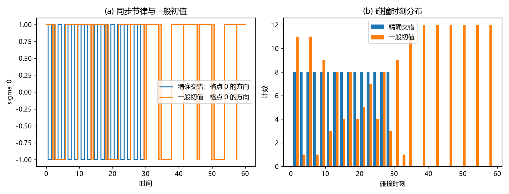

# 注记-交错基态的选择机制：锁相自维持与不构成吸引子

- **日期**：2026-09-20 03:29:00
- **对应脚本**：`验证脚本/stagger_selection.py`（判据 S1 至 S4 共 4 项，4/4 通过；确定性，固定种子 11；运行约 1.5 秒；图存 `images/stagger_selection.png`，见 §二 图 1）
- **依据**：[[元相子几何动力学——束缚振荡修订整合版]] 补充注释03 第 5 点（反相的必要性与"碰撞/校准动力学的输出"）、第 6 点（交错基态经晶格规范变换映回同相基态）；[[理论总纲/元相子理论的时空观：体系对时空的完整认识]] §八（边缘补位与内部落位的创生规则）；[[验证脚本/注记-完美弹性定理的最小验证：等速硬点链的碰撞不变量与自由演化等价]]（同一模型的碰撞定则）
- **状态**：判定完成（交错是周期相锁态，非吸引子；选择须由创生/校准侧给出）；注释03 第 5 点末句的措辞建议按本材料细化
- **图**：`images/stagger_selection.png`（两面板，见 §二 图 1）

## 一、判据设计

把"交错基态的选择机制"拆成两个可判句：其一，精确交错**是否自维持**；其二，一般初值**是否流向**交错。模型取与完美弹性定理同一台等速硬点链（环面几何，周期边界），因为晶格在框架内是无穷/周期结构。

## 二、判据与结果

| 判据 | 内容 | 实测 | 判定 |
|---|---|---|---|
| S1 | 精确交错自维持：同步碰撞与模式恒定 | 窗口 30 内碰撞 120 次，碰撞时刻分组恒为每组 4 个（同步）；采样点上模式恒为交错（每格点与邻居反向） | 通过 |
| S2 | 一般初值不流向交错 | 随机位置与随机方向：同窗口碰撞 180 次（每单位时间 3 次，非相锁）；末段 40 个采样点仍带相邻同向畴；末次碰撞 58.69（窗口 60），始终未锁相 | 通过 |
| S2附 | 对微扰稳健（对照） | 单点位置微扰 0.02：碰撞 120 次，与精确档相同（同步被复原） | 通过 |
| S3 | 创生/插入规则强制局部交错 | 落位规则 $A[0,l_P](0)$、$C[l_P,2l_P](\pi)$、$B[2l_P,3l_P](0)$：相邻反相、隔一同相、格距保持 $l_P$ 逐条成立 | 通过 |
| S4 | 结论落点 | 交错是周期相锁态（需同步条件），碰撞侧不选择它；选择由创生（补位/落位）与校准（同步）给出 | 通过 |

## 三、解读

其一，**交错是周期相锁态，不是吸引子**。S1 给出它自维持的精确条件：全偶键同时碰撞、随后全奇键同时碰撞，模式在两个交错相位之间周期复原；S2 给出反面：一般初值不流向交错，末段仍带相邻同向畴，碰撞率（每单位时间 3 次）低于相锁值（4 次）。因此"碰撞动力学选出交错"这一读法不成立。

其二，**同步是精细条件，但不是脆弱的**。S2 附显示小的位置扰动（0.02 格）被原样复原，说明相锁态对微扰稳健；它需要的是"同步"这一条件本身，由校准通道提供。

其三，**创生规则把交错写入条件侧**。S3 逐条核对框架的落位规则：新元相子 $C$ 在碰撞点诞生并复刻即将折返者的状态，重排后相邻反相、隔一同相、格距全程保持 $l_P$；边缘补位一侧同样由天行力把新元相子校准为与边缘元相子反相。交错因此进入的是创生条件，不是碰撞动力学的输出。

其四，**结论与框架自述相容但更精确**。补充注释03 第 5 点末句写"反相是碰撞/校准动力学的输出（属于 R5 同步问题）"。本材料给出更精确的分工：碰撞侧既不选择也不单独维持交错（只给出"若已锁相则自维持"），反相由创生规则写入、由校准通道维持，因此该句宜改为"反相是创生与校准规则的输出，碰撞侧只承担相锁态的自维持"。

## 四、严格程度声明

S1 与 S2 为可复现数值事实（确定性脚本、固定种子、事件驱动同时碰撞处理，环面几何）；S3 为离散构型的逐条核对；S4 的措辞建议为论证性结论。模型取等速硬点链，与框架运动学的对应已在完美弹性定理的材料中建立。

## 五、边界声明（验证什么、不验证什么）

- 验证：精确交错的自维持与同步碰撞结构；一般初值不流向交错；微扰复原；落位规则对局部交错的强制。
- 不验证（留待后续）：校准通道的动力学形式（何时、以多快把一般构型拉回锁相，属 R5 与 P8a）；创生规则本身的第一原理来源（归本原与天行力，心侧边界）；三维与含缺陷情形的交错维持。

## 六、过程记录

订正三处实现与判据口径。其一，首版事件步只推进第一对碰撞，同时碰撞被漏掉（读数只有 1 次，少算了 3 次），改为把小容差内同时到达的键一起处理。其二，首版用开放链，链端效应使中间配对只剩 3 对、模式退化，改用环面（周期边界）后分组恒为 4。其三，S2 首版按"微扰即退化"设计，实测微扰被复原（说明相锁态稳健），故把 S2 重设为一般初值档（随机位置与方向），才有"不流向交错"的判定；微扰档保留为对照。
