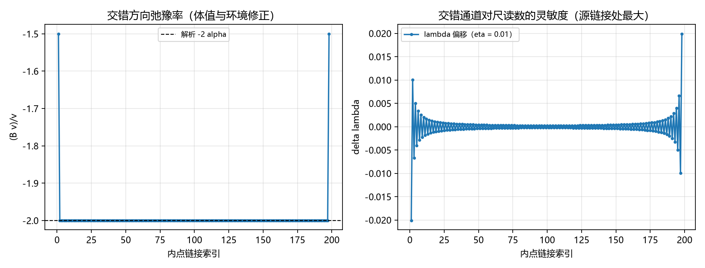

# 注记-交错通道的双重身份（第462条）：合成零模、正刚度与 lambda 的钉住依赖

- **日期**：2026-09-27 05:15:59
- **类型**：局域尺判定指南乙首轮（RD1 至 RD3；复刻阶段 2 一维链接模型）
- **脚本**：`验证脚本/staggered_channel.py`
- **图**：见 §3 图 1（`images/staggered_channel.png`）
- **依据**：[[注记-本体层重建阶段2：链接型写入的一维最小模型]]（模型与交错模读数）；[[注记-局域尺判定指南：一阶响应的来源、五条路径与首轮判据]]（乙首轮判据设计与二·五现状盘点）；[[注记-尺-记录耦合候选筛查：局部键能项给不出全值]]（局部路线判负）
- **状态**：判据 3/3 通过。核心读数：交错方向的体刚度读数 $-2\alpha$（稳定子作用值，偏差 $0$）、二次型正定；稳态算子满秩（零空间维数 $0$，解唯一）与合成映射核维数 $1$（交错通道）并存；源外 $\lambda$ 恒等（$2.2\times10^{-16}$）；同一站点记录的两个重构解的尺读数差 $2.0\times10^{-2}$（合成盲、尺可见）
- **可逆性等级**：判据稳健（RD1 为解析特征值，RD2 为线性代数事实，RD3 为恒等式与线性核对）

## 1 判据与设定

**任务**。局域尺判定指南乙首轮：判定交错通道（阶段 2 发现的"只有尺能读到的通道"）的身份，即它在合成层面与动力学层面各自是什么。

**模型（复刻阶段 2）**。一维链 $201$ 站点、$200$ 链接，两端 Dirichlet（$u_0 = u_{199} = 0$），内点 $1$ 至 $198$；稳态方程 $\alpha u_e - \frac{\alpha}{2}(u_{e-1}+u_{e+1}) = s_e$，源在 $e = 100$、$s = 0.5$、$\alpha = 1$；站点记录 $\theta_s = (u_{s-1}+u_s)/2$；链接中点配对 $\theta_{\rm mid}(e) = (u_{e-1} + 2u_e + u_{e+1})/4$，尺读数 $\lambda(e) = u_e/\theta_{\rm mid}(e)$。

**判据**。RD1：交错方向（$v_e = (-1)^e$）的体刚度读数（稳定子作用值）应等于 $-2\alpha$（解析）；交错扰动的能量二次型 $Q = \frac{\alpha}{2}\sum(\Delta u)^2$ 应为 $2\alpha\eta^2(N-1)$（正定、有限刚度）。RD2：稳态算子的零空间维数应为 $0$（解唯一）；合成映射（链接到站点记录）的核维数应为 $1$（交错）。RD3：源外 $\lambda$ 恒等；源链接偏离应等于 $s/(2\alpha)/\theta_{\rm mid}$（解析）；交错扰动对 $\lambda$ 的灵敏度线性；同一站点记录的两个重构解的 $\lambda$ 读数差应可见。

## 2 结果

**RD1（正刚度）**：体区间刚度读数 $= -2.000000000000000$（解析 $-2\alpha$，最大偏差 $0.000\times10^{0}$）；边界相邻两点读数 $-1.5$ 与 $-2.0$，修正定位在两端两格内。交错扰动的二次型 $Q = 3.980000\times10^{-2}$，解析 $2\alpha\eta^2(N-1) = 3.980000\times10^{-2}$，比值 $1.000000000000$。交错方向有能量代价，属有限刚度的稳定方向（无耗散口径见 §5）。

**RD2（两个维数的分离）**：稳态算子秩 $200/200$（零空间维数 $0$，解唯一；最小奇异值 $1.25\times10^{-4}$）；合成映射秩 $199$（$199$ 行），核维数 $= 200 - 199 = 1$，核向量与交错模重合度 $1.000000000000$。动力学唯一与合成不唯一并存，互不矛盾。

**RD3（通道效应与钉住）**：源外 $\max|\lambda - 1| = 2.220\times10^{-16}$（机器零）；源链接 $\lambda - 1 = 0.005050633$，解析 $s/(2\alpha)/\theta_{\rm mid} = 0.005050633$。交错灵敏度加倍比对最大偏差 $3.8\times10^{-12}$（线性）。同一站点记录下两个重构解：站点记录差 $3.553\times10^{-15}$（合成盲），$\lambda$ 读数差最大 $2.010\times10^{-2}$（可见）。

## 3 图

## 4 结论与移交

**结论**。交错通道的身份是双重的。合成层面，它是核维数一的零模：站点记录读不出它，只有尺读数能读到，其影响量级为 $\eta/\theta$（本轮读数 $2.0\times10^{-2}$）。能量层面，它是有限刚度的稳定方向：二次型正定（每点曲率 $2\alpha\eta^2$），受迫平衡方程满秩、解唯一，交错分量由源的交错投影与刚度之比唯一确定。这一钉住不涉及任何耗散过程：碰撞的完美弹性为公理级定理（无耗散通道），本轮的求稳态迭代收敛率属算法层（阶段 2 已如此定位），不读作物理弛豫。因此 $\lambda = 1$ 的源外恒等依赖两件事：解的分段线性与受迫平衡的唯一性（能量严格凸）。

**移交两条**。其一，绝对归一化：$\alpha$（链接传导强度）与钟率调制系数是否同一结构常数，属指南丙路径的对象。其二，交错通道的物理身份与其在三维的对应（核维数与正刚度的三维读数）属重建线阶段 3 的延伸。

## 5 严格程度与边界声明

严格程度：RD1 的体刚度读数与二次型为解析式，数值复核到机器精度；RD2 为线性代数事实（秩与核）；RD3 中源外恒等与源链接偏离为解析式核对，灵敏度线性为数值。可逆性等级：判据稳健。

边界（本脚本不做的事）：其一，一维模型，不含三维与矢量扇区；其二，不含钟率调制系数与 $\alpha$ 的同源性判定（移交其一）；其三，$\lambda$ 的绝对归一化（P1-5）不在本轮；其四，解的交错投影（$1.256\times10^{-3}$）为解的组成成分（由边界与分段线性决定），本轮不作零判据。其五，无耗散口径：本轮的稳定子作用值与二次型曲率为能量层读数；求稳态迭代的收敛率属算法层。

## 6 过程记录

其一，RD2 核维数算法教训：合成映射为 $199\times200$ 矩阵，核维数 $=$ 列数 $-$ 秩 $= 1$；首版按"奇异值中零的个数"计数，读到 $0$，判据误报失败。教训：矩形矩阵的核维数用列数减秩，不用零奇异值计数。

其二，RD3 预期修正：首版预期"稳态解的交错投影为机器零"，实测 $1.256\times10^{-3}$。定位为该投影来自解的分段线性形状与 Dirichlet 边界（源两侧斜率略不同），与 $\lambda$ 恒等不矛盾；判据改为"源外 $\lambda$ 恒等加同一站点记录下两重构解的尺读数差可见"，全部通过。

其三（2026-09-27 作者指出后补记），无耗散口径修正：初版把求稳态迭代的收敛率读作物理弛豫/动力学衰减，与完美弹性公理级定理（无耗散通道）冲突。修正为能量层表述：正定二次型给出有限刚度，受迫平衡方程给出唯一解；迭代收敛率仅为算法层读数。依据 [[注记-完美弹性的公理级形式化：恢复系数恒为一与不变量守恒（判据V1至V5）]] 与 [[注记-碰撞的完美弹性：无内部自由度与符号翻转实现的结构性论证]]。

其四，配对口径教训：首版用站点记录 $\theta_s$ 与 $u_e$ 直接配对，$\lambda$ 偏离读到 $1.0$（假失败）；改为链接中点二阶平均 $\theta_{\rm mid}(e) = (u_{e-1}+2u_e+u_{e+1})/4$（阶段 2 口径）后，源外恒等落到 $2.2\times10^{-16}$。同源同格林函数的配对必须用中点二阶平均，不能用单侧站点记录。
