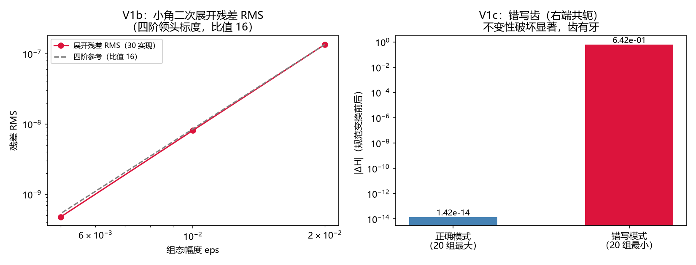

# 注记-介质物质项载体合法性判据轮（第608号）：U(1)链接与复物质场的联合规范不变性

| 项目 | 内容 |
| --- | --- |
| 日期 | 2026-10-12 01:09:14（取系统当前时刻） |
| 主题 | D3p 载体合法性判据轮（甲案分阶段第一步：V1a/V1b/V1c，3/3） |
| 可逆性等级 | 判据敏感：换跳变项形式、换展开式、换规范变换定义任一项即翻 |
| 图 | 图 1 见 §三 |
| 上游 | [[内部草稿/注记-D3p二维规范检验的载体方案：Kogut-Susskind介质物质项与plaquette框架的衔接（2026-10-12）|D3p 载体方案注记]]（甲案裁决 2026-10-12）、第 607 号判据轮 |

## 一、要判什么

载体方案注记裁决取甲案后，第一步是载体合法性：介质振子实现为 U(1) 链接格点上的复物质场 $z_p$（势 $\frac{\omega_0^2}{2}|z|^2$ 规范不变、跳变 $-\kappa\,\mathrm{Re}(z^*e^{i\theta}z')$ 与规范场线性耦合）与非阿贝尔推导的 plaquette 磁场项、KS 电场项的组合，其规范语义是否成立。本轮判三条：V1a 联合规范不变性（随机组态与随机规范下能面不变）、V1b 小角二次展开的残差标度（V2/V3 谱计算的合法前提）、V1c 错写齿（判据区分力）。边界声明：本判定的是载体组合的规范合法性，谱学长波回归（载体方案判据草案 D3p-3）与界面重拨检验（D3p-2）在后续轮。

## 二、模型设定与判据结果

二维周期盒 $N = 8$（两方向链接共 128），$\omega_0 = 1$，$\kappa = 0.6$，非线性能量面 $H = \sum\frac{1}{2}E^2 + \frac{1}{2}\sum_{plaq}(\mathrm{curl}\,\theta)^2 + \frac{\omega_0^2}{2}\sum|z|^2 - \kappa\sum\mathrm{Re}(z^*e^{i\theta}z')$，规范变换 $\theta_{p,a} \to \theta_{p,a} + \chi_p - \chi_{p+\hat a}$、$z_p \to e^{i\chi_p}z_p$，随机种子 20261012，脚本 `ks_matter_gauge.py`。

| 判据 | 内容 | 实测 | 判定 |
| --- | --- | --- | --- |
| V1a | 20 组随机组态与随机规范，$H$ 各分量与总和不变 | 正确模式 $|ΔH|$ 最大 $1.42\times10^{-14}$（容差 $10^{-10}$），磁场项不变（构造级）、物质项与跳变项不变（联合变换） | PASS |
| V1b | 小角二次展开残差 RMS 三档（每档 30 实现）| RMS $1.36\times10^{-7}/8.10\times10^{-9}/4.76\times10^{-10}$，比值 $16.81/17.01$ 对期望 $16\pm2$（四阶领头） | PASS |
| V1c | 错写齿：跳变右端共轭后不变性必破坏 | 错写模式 $|ΔH|$ 最小 $6.42\times10^{-1}$，与正确模式分离约 46 个数量级 | PASS |

## 三、图

## 四、严格程度声明与边界声明

验证什么：介质物质项（复场势加跳变）与链接规范场联合变换下的规范不变性（载体组合的合法性）、小角二次展开的阶数结构（谱计算合法前提）、判据区分力。

不验证什么：不验证谱学与长波回归（载体方案 D3p-3，独立轮）；不验证界面与重拨（D3p-2）；不验证第 581 条标量模型与复场载体的定量对应（回归轮内容）；plaquette 与跳变项的规范不变性主体是标准数学，体系贡献在物质项接入、介质调制与错写齿（判据范围与第 580 条纪律一致）。

协议伪影分层：V1a 为浮点代数重排（机器精度级）；V1b 残差为同号四阶系统项主导（RMS 统计量，30 实现估计波动约 13%）；无采样或截断伪影。

## 五、过程记录（三笔）

其一，V1b 期望式两改：首版判据写三阶标度（比值 8）且单实现读数，首跑 FAIL（比值 23.9/14.1 无规律）；第一改补统计量（随机符号三阶项求和是随机行走，改 30 实现 RMS）仍 FAIL（比值 16.8/17.0 两档一致）；第二改逐阶重推发现跳变展开中 $\theta^2$ 与 $\theta\,\mathrm{Im}(w)$ 交叉项被二次型完整吸收，三阶项不存在，残差领头为四阶（$\mathrm{Re}(w)\theta^4/24$ 与 $\mathrm{Im}(w)\theta^3/6$ 乘一阶场），期望订正为 16 后 PASS。教训：展开残差的阶数要逐项清点（交叉项吸收易漏），期望式与统计量形态两层都要先推导。

其二，heredoc 锚点事故两度（`\n` 折真换行致补丁断言失败、整文件改走 Write 工具重写），与第 607 号同型，纪律重申。

其三，错写齿的选择：右端共轭（$\mathrm{Re}(z^*e^{i\theta}z'^*)$）使规范变换残差带 $e^{-2i\chi'}$ 因子，破坏显著（0.64 量级），比改耦合符号的齿区分力更强（后者部分抵消）。

## 关联

[[内部草稿/注记-D3p二维规范检验的载体方案：Kogut-Susskind介质物质项与plaquette框架的衔接（2026-10-12）|D3p 载体方案注记]]、[[验证脚本/注记-重拨敏感性标度与平方锁定等价性（第607号）：介质模型规范固定地位的模型层定量|第 607 号注记]]、[[开放问题档案/开放问题-P1-50-光的发射率与介质折射的微观机制|P1-50 档案页]]
