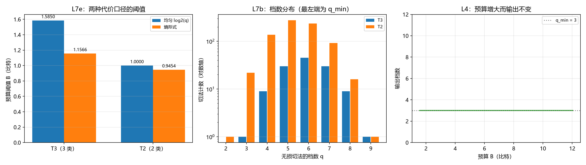

# 注记-代价函数解锁四条判据的最小验证：预算阈值、档数分布与单一性解耦（L4、L7b、L7c、L7e）

- **日期**：2026-09-25 04:38:18
- **层级**：验证材料（第 407 条）
- **定位**：执行四条此前缺前置的判据（L4、L7b、L7c、L7e）。前置由 [[内部草稿/注记-档数代价函数：对数代价、预算上界与四条判据的解锁（L4、L7b、L7c、L7e）]] 补齐（对数代价、预算上界）。
- **依据**：[[内部草稿/注记-档数代价函数：对数代价、预算上界与四条判据的解锁（L4、L7b、L7c、L7e）]]（代价函数）；[[验证脚本/注记-整合的目标函数的最小验证：最简无损切法的档数最小性与跨任务变化（判据 L7a 与 L7d）]]（第 404 条，最简无损切法唯一）；[[验证脚本/注记-对齐判据形式的独立复现：无平局模型上的穷举检验与判据表述修正（对齐判据 L8）]]（第 403 条，穷举结构）；[[内部草稿/研究方向-心侧入场：主体抽样、整合功能与物侧搭档（判据草案）]]（L4、K6）
- **状态**：判据级。穷举验证，模型内结论。
- **修订记录**：
  - **2026-09-25 初版**（触发：作者指示执行四条判据）

---

## 一、判据（先立）

**L7e 预算约束。** 可用档数 $q$ 满足代价不超过预算 $B$。两种代价口径：均匀取 $\log_2 q$；熵取档分布的熵 $\sum_k p_k \log_2 (1/p_k)$。

**L7b 反信息量准则。** 输出档数大于 $q_{\min}$（语义类个数）即偏离准则甲；统计各档数的无损切法数。

**L7c 跨任务变化。** $q_{\min}$ 随任务改变，故输出随之改变。

**L4 单一性来自整合。** 预算增大时输出不变（最简无损切法由任务唯一确定，与预算无关）。

## 二、模型设定

与第 403、404 条同一模型：块长 $8$ 位，$Y$ 在 $0$ 至 $8$，穷举 $Bell(9)=21147$ 种切法。任务 $T_3$ 为三值语义分档（$q_{\min}=3$），$T_2$ 为二值（$q_{\min}=2$）。

## 三、结果

| 判据 | 实测 | 期望 | 判定 |
| --- | --- | --- | --- |
| L7e $B_{\min}$（$T_3$，均匀） | $1.584963$ 比特 | $\log_2 3$ | 过 |
| L7e $B_{\min}$（$T_3$，熵） | $1.156570$ 比特 | $H(T_3)$ | 过 |
| L7e $B_{\min}$（$T_2$，均匀） | $1.000000$ 比特 | $\log_2 2$ | 过 |
| L7e $B_{\min}$（$T_2$，熵） | $0.945373$ 比特 | $H(T_2)$ | 过 |
| L7b 档数等于 $q_{\min}$ 的切法（$T_3$） | $1$ 种 | $1$ | 过 |
| L7b 档数超过 $q_{\min}$ 的切法（$T_3$） | $124$ 种 | $125-1$ | 过 |
| L7b 档数等于 $q_{\min}$ 的切法（$T_2$） | $1$ 种 | $1$ | 过 |
| L7b 档数超过 $q_{\min}$ 的切法（$T_2$） | $779$ 种 | $780-1$ | 过 |
| L7c $q_{\min}$ 随任务改变 | $3$ 与 $2$ 不同 | 改变 | 过 |
| L4 预算增大时输出不变 | $B$ 由 $1.585$ 增至 $12$，输出恒 $3$ 档 | 不变 | 过 |

十项全过。

## 四、图

图注按脚本三个绘图面板逐条核对。

## 五、实质读数

**其一，两种代价口径的阈值差（供作者定口径）。** $T_3$ 的差为 $0.428393$ 比特（相对 $\log_2 3$ 为 $27.0\%$）；$T_2$ 的差为 $0.054627$ 比特（相对为 $5.5\%$）。差别随语义类的概率不均程度增大：$T_3$ 的档分布为 $0.144531$、$0.710938$、$0.144531$，高度不均，故熵远低于 $\log_2 3$；$T_2$ 的档分布为 $0.636719$、$0.363281$，接近均匀，故两者相差小。

**其二，档数分布显示「最简唯一」的相对稀缺。** $T_3$ 的 $125$ 种无损切法中，档数等于 $q_{\min}$ 的只有 $1$ 种，超过的有 $124$ 种；$T_2$ 为 $1$ 对 $779$。这意味着整合若不按准则甲，输出几乎必然落在超出的那一大类里。准则甲的作用由此可量化：它把一个 $125$ 分之 $1$ 的选择变成唯一确定。

**其三，L4 的解耦在数值上确认。** 预算由 $1.585$ 比特增至 $12$ 比特（可支持档数由 $3$ 增至 $4096$），输出恒为 $3$ 档。预算只决定可行性，不改变输出。

## 六、过程记录

本轮无判据修正。档数分布的理论值（$T_3$ 为 $3{:}1$、$4{:}9$、$5{:}30$、$6{:}45$、$7{:}30$、$8{:}9$、$9{:}1$，$T_2$ 为 $2{:}1$、$3{:}22$、$4{:}136$、$5{:}276$、$6{:}236$、$7{:}92$、$8{:}16$、$9{:}1$）可由各语义组内部划分的 Stirling 数卷积给出，实测与之逐项一致，构成一处独立校验。

## 七、严格程度声明

**可逆性等级：判据稳健。** 四条判据的读数由穷举结构与代价函数的定义直接给出，不随实现或参数翻。L7e 的阈值差依赖代价口径的选择，两种口径的值各自稳健，口径本身的取舍属待确认项。

**协议伪影与物理结论分层。** 全部读数为协议级（离散模型、穷举划分、两种代价口径），物理层结论零条。

## 八、边界声明

**验证什么。** 两种代价口径下的预算阈值；无损切法的档数分布；$q_{\min}$ 的跨任务变化；预算增大时输出的不变性。

**不验证什么。** 预算 $B$ 的数值来源（待作者定）；非均匀档代价的物理依据；代价是否含时间维度（维持功率）；真实装置的分辨实现方式。

## 九、登记衔接

本材料为 `验证脚本/README.md` 第 407 条，脚本 `minimal_verification_cost_function_unlock.py`，图 `images/cost_function_unlock.png`。执行后 L 组除 L5（已由采样三联覆盖）外全部有读数。开放问题总览的登记见该文档 P4-6 条目。
