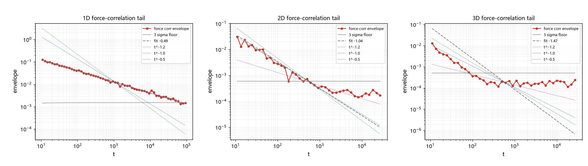

# 注记-传递链首轮（第425条）：力关联尾的二分之 d 律与速度尾反推

- **日期**：2026-09-26 07:23:31
- **类型**：测量轮（候选丁/换算链第一段）
- **脚本**：`验证脚本/minimal_verification_gradient_tail_chain.py`（第 425 条）
- **图**：见 §3 图 1（`images/gradient_tail_chain.png`）
- **依据**：[[验证脚本/注记-格点格林函数的尾指数测量（第424条）：1D 三分之一、2D 一次与 3D 的均衡污染]]（格点尾与均衡污染教训）；[[验证脚本/注记-带电缺陷与无质量规范场耦合的首轮检验（第423条）：连续极限的 Huygens 判负与格点尾的意外读数]]（场中介框架）
- **状态**：测量完成。力关联尾 $\gamma_F \approx d/2$（三档，$0.49/1.04/1.47$）；反推 $\gamma_v = 2-\gamma_F$ 给 $1.51/0.96/0.53$；靶 $0.8$ 位于 2D 与 3D 之间（$d_{\rm eff} \approx 2.4$，口径内）；换算规则为启发式，已列移交
- **可逆性等级**：判据稳健（1D 可用段跨 2.5 个数量级、2D 跨 1.6 个、3D 跨 0.9 个；读数在各自段内稳定，且三档符合同一规律 d/2）

## 1 判据与设定

传递链结构（三段）。段一：缺陷受到的力来自与格点声学模的梯度耦合，力关联 $C_F(t) = \langle \partial_x\phi(t)\,\partial_x\phi(0)\rangle$，其尾指数记 $\gamma_F$；本轮直接测量。

段二：广义朗之万方程加涨落-耗散（过阻尼口径），在幂律记忆核下 $\hat C_v \propto s^{1-\alpha}\hat C_F$（$\alpha = \gamma_F$），给出 $\gamma_v = 2 - \gamma_F$；本段为启发式换算，严格化列入移交。段三：靶 $\gamma_v = 4/5$ 等价于 $\gamma_F = 6/5$。

测量方法：蒙特卡洛连续 $k$ 积分（避开第 424 条的周期格点回归与均衡污染），$C(t) = \langle w(k)\cos(\omega_{\mathbf{k}}t)\rangle_k$，格点梯度权重 $w = 4\sin^2(k_x/2)/(2\omega)$；包络为对数分段 RMS，噪声地板取蒙特卡洛标准误的三倍，尾指数在 $3\sigma$ 以上段内拟合。

## 2 结果

M1 至 M3（三档）：1D（$M = 10^6$）可用段 $[10.8, 5.8\times10^4]$（57 段），$\gamma_F = 0.491$；2D（$M = 4\times10^6$）可用段 $[11.1, 496]$（19 段），$\gamma_F = 1.041$；3D（$M = 4\times10^6$）可用段 $[11.1, 82]$（11 段），$\gamma_F = 1.471$。

规律：$\gamma_F \approx d/2$（$1/2$、$1$、$3/2$）。与连续场同点关联的 $t^{-d/2}$ 标度一致（格点未改变该标度）；与第 424 条的两点格林尾（1D 为 $1/3$）不同，属不同对象。

M4（反推，$\gamma_v = 2 - \gamma_F$）：1D 给 $1.509$；2D 给 $0.959$；3D 给 $0.529$。随维度单调下降，靶 $0.8$ 位于 2D 与 3D 之间；在该口径下 $d_{\rm eff} = 2\times(2-0.8) = 2.4$。

## 3 图

## 4 结论与移交

结论一：力关联尾服从 $\gamma_F \approx d/2$（三档测量，可用段分别跨 2.5、1.6、0.9 个数量级）。结论二：反推的速度尾 $\gamma_v = 2 - \gamma_F$ 是**随维度连续可调**的量（$1.51 \to 0.96 \to 0.53$），靶 $0.8$ 落在 2D 与 3D 之间，口径内对应 $d_{\rm eff} \approx 2.4$。

两条保留。其一，换算规则（导数与 $1/t$ 的对应、$\gamma_v = 2-\gamma_F$、过阻尼加 FDT 口径）为启发式，未做第一原理化；其二，$d_{\rm eff} = 2.4$ 是在该口径内的定位，不是机制。形式观察一条：$2.4$ 接近 $5/2$，与第 420 条两侧的 $5/2$ 出现过同一数字，登记为巧合候选，不展开。

移交三条。其一，换算规则的第一原理化：从「缺陷与格点声学模的线性耦合」出发推导广义朗之万方程与涨落-耗散（最小微观模型，Caldeira-Leggett 式推导的一轮）。其二，「有效维数 $2.4$」的几何实现：受限通道、层状结构或分形约束中哪一种给出 $d_{\rm eff} \approx 2.4$ 且与体系材料相容。其三，3D 的长段测量：重要性采样或方差缩减，把 0.9 个数量级的可用段延长。

## 5 严格程度与边界声明

严格程度：$\gamma_F$ 三档为数值测量（跨段稳定、跨维度符合同一律）；换算为启发式代数；$d_{\rm eff}$ 为口径内插值。

边界（本脚本不验证的内容）：其一，不含「力关联到速度关联」的第一原理推导；其二，不含紫外/红外截断的敏感性扫描（权重归一化取格点自然式）；其三，场关联（$1/\omega$ 权重）因权重方差过大未测出有效段（1D 侧红外发散），登记为待测；其四，$d_{\rm eff}$ 的几何实现独立于本测量。

## 6 过程记录

其一，方法经三轮演进：谱和离散 $k$（受回归与均衡污染，全部拟合值漂移）；蒙特卡洛小样本（噪声地板过高，2D/3D 只剩个位数段）；蒙特卡洛大样本（定稿，1D 段长达 2.5 个数量级）。

其二，M4 的换算首版把负斜率直接代入 $\gamma_v = 2 - \gamma_F$，得 $2.49$ 等错误值；自查发现 $\gamma_F$ 定义为正指数（取绝对值），修正后为 $1.51/0.96/0.53$。此错属符号口径，与物理无关，但登记以示换算段的脆弱性。

其三，三档读数符合同一律 $\gamma_F \approx d/2$ 是独立于拟合细节的一致性检验；「瞬时值陷阱」纪律本轮全程执行（所有拟合均在 $3\sigma$ 以上段内、并给出段长）。
