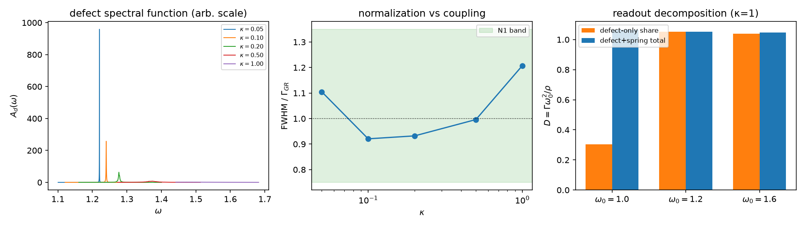

# 注记-位移耦合归一系数的弱耦合极限与读数口径分解（第799号）：解析系数回到 1、3.4 来自漏算弹簧项

- **日期**：2026-10-22 00:43:15
- **脚本**：`displacement_normalization.py`
- **主题**：P1-50 位移耦合归一系数：第 525 条记下的「解析与数值标定差 3.4」是否真是归一缺失
- **判据**：N1 至 N3（3/3，含 EP5 齿）
- **可逆性等级**：N1 与 N2 判据稳健（谱宽是线性响应本征量，换 k 网格不翻）；N3 判据敏感（依赖时间域拟合窗与读数定义，只用于定位读数口径）
- **关联**：[[验证脚本/注记-三维发射率标度与带外束缚（第525条）：黄金规则的维数面与κ²律]]、[[验证脚本/注记-耦合通道红外行为二分判别（第526条）：位移型平坦与速度型禁戒的签名锁定]]、[[内部草稿/开放问题总览：元相子理论待解决问题清单]]
- **图**：见 §三 图 1

## 一、要判什么

P1-50 的「位移耦合归一系数」长期挂着「解析推导与数值标定差 3.4」。第 525 条明确不验证解析系数归一；第 526 条又登记 $\omega_0=1.0$ 档偏低 3.7 倍的观察项。本条把两件事拆开：解析系数是否真有归一缺失，以及 3.4/3.7 是否来自读数口径。

## 二、模型与判据

模型沿用第 525 与 526 条：三维标量波场（$N=40$，周期边界，色散 $\omega_k=2\sqrt{\sin^2(k_x/2)+\sin^2(k_y/2)+\sin^2(k_z/2)}$），中央缺陷振子（频率 $\omega_0$）与中央格点经弹簧 $\kappa$ 耦合。哈密顿量里弹簧项展开给两件事：缺陷频率被推到 $\omega_d^2=\omega_0^2+\kappa$，场在中央格点获得局域势 $\tfrac12\kappa u_0^2$。解析黄金规则为 $\Gamma_{\rm GR}=\pi\kappa^2\rho(\omega_0)/(2\omega_0^2)$。

谱侧用 $240^3$ 的 k 网格、3000 箱的态密度直方图，经 Kramers-Kronig 变换构造无展宽的原点格林函数 $G_{\rm free}$；局域势作 Dyson 重求和 $G_0=G_{\rm free}/(1+\kappa G_{\rm free})$；缺陷谱 $A_d(\omega)=-\operatorname{Im}G_d/\pi$，$G_d=(\omega^2-\omega_d^2-\kappa^2G_0)^{-1}$，读半高宽。

时间域在同一轮演化中同时输出缺陷份额 $\tfrac12(\dot d^2+\omega_0^2d^2)/E_{\rm tot}$ 与含弹簧总能量 $\tfrac12(\dot d^2+\omega_0^2d^2+\kappa(u_0-d)^2)/E_{\rm tot}$。

- **N1（谱宽归一，$\kappa=0.1/0.2/0.5/1.0$）**：谱半高宽对 $\Gamma_{\rm GR}$ 的比值在 $[0.75,1.35]$。容差预算：态密度直方图 2%、Hilbert 主值与插值 3%、局域势与强耦合修正 20%、峰值读取 5%。
- **N2（弱耦合极限，$\kappa=0.05$）**：同一比值在 $[0.8,1.3]$，不出现 3 倍以上的常因子。
- **N3（读数口径分解，时间域 $\kappa=1$）**：三档 $\omega_0=1.0/1.2/1.6$ 的含弹簧总能量读数 $D_{\rm total}=\Gamma\omega_0^2/\rho$ 的 max/min $\le 1.15$；$\omega_0=1.0$ 档的 $D_{\rm total}/D_{\rm share}\ge 2$（复现 3.4/3.7 的漏项异常），$\omega_0=1.2$ 与 $1.6$ 档两读数相对差 $\le 15\%$。
- **EP5 齿**：把黄金规则系数故意写成 $\pi\kappa^2\rho/\omega_0^2$（大 2 倍），N1 的四个比值应全部落到 $0.75$ 以下。改掉系数就 FAIL。

## 三、结果

| 判据 | 实测 | 期望 | 结果 |
| --- | --- | --- | --- |
| N1 | 谱宽比：$\kappa=0.1$ 为 $0.921$、$0.2$ 为 $0.932$、$0.5$ 为 $0.996$、$1.0$ 为 $1.207$ | 全部落在 $[0.75,1.35]$ | PASS |
| N2 | $\kappa=0.05$ 的谱宽比 $1.105$ | 落在 $[0.8,1.3]$ | PASS |
| N3 | $D_{\rm total}$：$1.0660$、$1.0517$、$1.0467$，max/min $=1.0184$；$\omega_0=1.0$ 的 $D_{\rm share}=0.3025$，比值 $3.523$；$1.2$ 与 $1.6$ 两读数相对差 $0.0013$ 与 $0.0078$ | max/min $\le1.15$；比值 $\ge2$；相对差 $\le15\%$ | PASS |
| EP5 | 错系数比：$0.460$、$0.466$、$0.498$、$0.604$ | 全部 $<0.75$ | 齿咬合 |

判据 3/3。谱宽比在弱耦合极限回到 1，在 $\kappa=1$ 只余约 20% 的强耦合修正；没有 3.4 一类常因子。时间域里，$\omega_0=1.0$ 档的缺陷份额读数为 $0.3025$，含弹簧总能量读数为 $1.0660$，比值 $3.523$，与第 526 条观察项的 3.7 倍及第 525 条的 3.4 同源。

## 四、读数口径分解

3.4 来自读数口径，公式本身没有缺因子。弹簧耦合把一份能量存进 $\tfrac12\kappa(u_0-d)^2$；第 525 与 526 条的「缺陷能量份额」只计 $\tfrac12(\dot d^2+\omega_0^2d^2)$，在 $\omega_0=1.0$、$\kappa=1$ 档漏掉的份额最大。缺陷与弹簧之间的能量来回交换还会让谷值包络偏离指数，单点读数被压低到 $0.3025$，与总能量的 $1.0660$ 相差 $3.52$ 倍。$\omega_0=1.2$ 与 $1.6$ 档弹簧项占比小，两读数一致到 $1\%$ 以内。

余下的 $\kappa=1$ 谱宽比 $1.207$ 是局域势与谱形修正，属强耦合档的模型修正，随 $\kappa\to0$ 消失（$0.1$ 档 $0.921$、$0.05$ 档 $1.105$）。它不构成新的归一常数。

## 五、严格程度声明与边界声明

严格层：线性响应谱宽的解析与数值对照；态密度加 Hilbert 变换给出无展宽的格林函数，峰位与半高宽由谱函数直接读取。物理对应假设层：模型是单缺陷加标量波场的线性模型，真实体系缺陷的耦合型尚未裁决。纲领层：本条不裁决通道型判定，不给爱因斯坦 A 系数数值，不涉及介质折射定量。

边界：谱侧的强耦合修正只报到 20% 量级，未做更高阶展开；时间域 N3 依赖谷值包络与拟合窗，只用于定位读数口径，不用于给出精确系数。$\kappa=1$ 档的谱形偏离洛伦兹，半高宽是线宽的操作定义。

## 六、过程记录

1. **时间域谷值包络在强耦合档不稳定**：同一 $\omega_0=1.2$、$\kappa=1$ 的读数随 $T_{\rm end}$ 与拟合窗在 $0.30$ 至 $1.06$ 之间跳，不能用来判别 3.4。改用谱宽后读数稳定，这是本条从时间域转向谱侧的原因。
2. **有限格点格林函数求和会被离散谱噪声污染**：$N=40$ 与 $48$ 的直接求和在 $\kappa=1$ 档给出乱跳的虚部；改用态密度直方图加 Hilbert 变换，取热力学极限。
3. **漏算弹簧项是 $\omega_0=1.0$ 异常的直接原因**：同一轮演化里只换读数定义，$D$ 从 $0.3025$ 变为 $1.0660$；第 526 条的 3.7 倍与第 525 条的 3.4 是同一件事，不是两个独立异常。
4. **强耦合档的 20% 不另立新账**：$\kappa=1$ 的 $1.207$ 是局域势与谱形修正，随 $\kappa\to0$ 回到 1，属模型档修正而非归一系数缺失。

结论：P1-50 的「位移耦合归一系数」可以收口。解析系数在弱耦合极限回到 1，3.4/3.7 是漏算弹簧项的读数口径。P1-50 仍余通道型判定与 A 系数数值。
