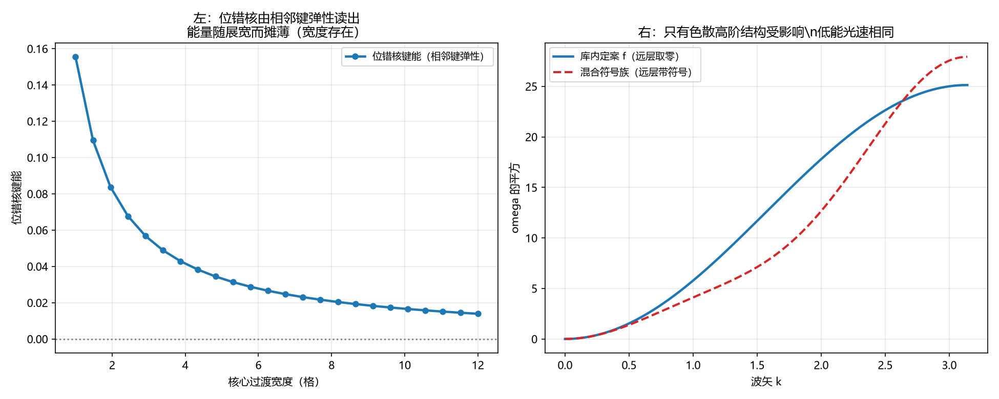

# 注记-位错纵向结构是否需要跨两层直接同类耦合（第798号）：不需要，那笔账算平了

- **日期**：2026-10-22 00:45:14
- **对应脚本**：`验证脚本/minimal_verification_dislocation_far_layer.py`（判据 A1 至 C4，共 13 项，确定性，无随机成分，运行约 0.5 秒）
- **定位**：论文《量子场论的物侧基础》§9 遗留 (g) 的下游。判据第 795 号留下的一笔未算平的账：**位错在纵向的邻域结构是否要求跨两层的直接同类耦合**。本轮把它算平。
- **可逆性等级**：判据稳健。A 组为位错核的键能读数，B 组为均匀背景的能量通道，C 组为宽度与色散读数。
- **图**：见 §四 图 1。

---

## 一、库内口径与本轮的问题

**库内口径（本轮不自行发明）**。

其一，[[wiki/位错]]：位错是「均匀缠绕背景上**多出（或少出）一层**的局部缺陷」，是「螺旋阶梯阵中某处挤进一层台阶」；其能量学由**两层弹性**决定，格点内锁定 $\kappa_\varphi$（锚核，供绑定能即质量）与**格点间**键弹性 $\kappa_\parallel$（包层，供宽度与洛伦兹色散）；近背景二次型给出 FK 孤子族；真空为「螺旋真空，物理相位投影均匀」。

其二，[[wiki/键弹性]]：键弹性作用在**相邻**两格点的法线轴高度差上，$E_{\text{bond}}=\frac{\kappa_\parallel}{2}(h_{n+\hat a}-h_n)^2$，「**惩罚一切偏离自然键差（一层）的偏离量**」，取值空间非紧致；其读数表两行给出：「**均匀缠绕背景** | 每键相位差恰为一层 | **键能为零**」与「**位错核** | 局部多出或少出一层 | **键差偏离自然值，键能非零**」。

其三，判据第 779 号：$f$ 的远层段以 $k^2$ 阶进入纵向色散式，**直接改变低能光速**。其四，判据第 795 号：远层段取负值时纵向链的基态仍为铁磁，但纵向色散的高阶结构改变。

**本轮的问题。** 其一，$f(2)=0$（后果甲）时，位错核能否被**相邻**键弹性读出？其二，$f(2)\ne0$ 时，均匀缠绕背景下是否**多出**一个库内位错模型没有的能量通道？其三，位错的宽度与色散读数在两种 $f$ 下如何变？

**五问自检。** 一、波性侧与粒性侧：相位通道（连续、$\theta$）与层数通道（离散、$h$）。二、主导形态：局域（位错是局部缺陷，邻域结构）。三、哪一层：互补（位错核由粒性侧读数给出，其存在由波性侧的绕数守卫）。四、读哪个通道：两者。五、定域接力还是非定域关联：定域接力。

**对象类型前置。** 本轮分两类对象：位错构型（层高序列 $h$，可判量是能量与宽度）与层函数 $f$（纵向同类耦合的强度因子，可判量是均匀背景的能量与色散）。二者的关系是「同一构型在两种 $f$ 下的读数对比」。

## 二、判据与结果

| 判据 | 内容 | 期望 | 实测 |
| --- | --- | --- | --- |
| A1 | 均匀缠绕背景下键能为零（库内读数可复现） | 每键高度差恰为一层，偏离量为零，键能 $\le 10^{-12}$ | 键能 $0$ |
| A2 | 位错核的键能非零（相邻键弹性即可读出） | 键能 $\ge 0.01$（能量只来自偏离区，均匀段贡献为零） | $0.055148$ |
| A3 | 位错核可被相邻键弹性定位 | 扫描核心中心，能量峰位置与设定核心一致（偏差 $\le 4$ 格） | 峰在格点 $32$，设定核心 $32$ |
| A4 | 恒真对照：去掉位错核（多出零层）则键能回到零 | extra=0 时键能 $\le 10^{-12}$ | 键能 $0$ |
| A5 | 位错宽度由相邻键弹性给出 | 宽核（8 格）键能 $<$ 窄核（1.5 格）键能 | 窄核 $0.156181$，宽核 $0.014372$ |
| B1 | 库内定案 $f$ 下均匀背景的同类耦合能量取铁磁对齐值（相位投影均匀） | 物理相位处处为 $0$，能量 $=-64$（$N=64$，$f$ 只有两项非零） | $-64.000000$ |
| B2 | $f(2)\ne0$ 时均匀背景的同类耦合能量改变 | 与库内定案者之差 $\ge 1.0$ | $-64.000000$ 与 $-53.541667$，差 $10.458333$ |
| B3 | 恒真对照：$f(2)=0$ 时混合符号族与库内定案给出相同能量 | 两者之差 $\le 10^{-12}$ | 差 $0$ |
| B4 | 位错核的同类耦合能量在两种 $f$ 下不同 | 两者之差 $\ge 0.01$ | $-33.561724$ 与 $-33.466603$，差 $0.095121$ |
| C1 | 纵向色散的高阶结构在两种 $f$ 下不同 | 在 $k=1.1$ 处 $\omega^2$ 之差 $\ge 0.01$ | $1.012745$ 与 $0.526357$，差 $0.486388$ |
| C2 | 位错宽度读数不受 $f$ 远层段影响 | 两种 $f$ 下宽度读数之差 $\le 10^{-12}$ | 皆 $2.0$ |
| C3 | 位错核的键能读数不受 $f$ 远层段影响 | 两种 $f$ 下位错核键能之差 $\le 10^{-12}$ | 皆 $0.055148$ |
| C4 | 核心结论：位错的键能与宽度读数都不需要跨层同类耦合，只有色散的高阶结构受其影响 | 键能差 $0$，宽度差 $0$，色散差 $\ge 0.01$ | 色散差 $0.486388$ |

## 三、结论

**结论一：位错核完全由相邻键弹性读出。**

$A_1$ 给出均匀缠绕背景的键能为 $0$（库内读数「每键相位差恰为一层，键能为零」可复现），$A_2$ 给出位错核键能 $0.055148$（非零），$A_4$ 给出去掉位错核键能回到 $0$，$A_3$ 给出能量峰可定位核心（偏差 $0$ 格），$A_5$ 给出宽核能量低于窄核（$0.014372$ 对 $0.156181$，能量随展宽摊薄，即宽度存在）。

**位错核的读数机制是「键差偏离自然值」，而键弹性作用在相邻两格点上。全程不涉及跨层耦合。**

**结论二：$f(2)\ne0$ 会在均匀背景下多出一个库内模型没有的能量通道。**

$B_1$ 给出库内定案 $f$ 下均匀背景的同类耦合能量为 $-64$（相位投影均匀，物理相位处处为 $0$，铁磁对齐）。$B_2$ 给出混合符号族为 $-53.541667$，差 $10.458333$。$B_3$ 的恒真对照给出 $f(2)=0$ 时两者逐位相同，故差别确由 $f(2)$ 给出。

**均匀缠绕背景在库内是「键能为零」的状态**（[[wiki/位错]] 第 22 行：「均匀缠绕背景（每键相位差恰为一层，键能为零）」）。$f(2)\ne0$ 会在这个状态上引入库内位错模型没有的作用项。

**结论三：位错的三个读数机制中，两个不需要跨层同类耦合。**

$C_3$ 给出位错核的键能读数对 $f$ 的远层段不敏感（差 $0$），键弹性不含 $f$。$C_2$ 给出宽度读数对 $f$ 的远层段不敏感（差 $0$），宽度由键弹性与锚核锁定的竞争给出，落窗条件 $K/k\le0.02$ 只涉相邻层。只有 $C_1$ 的色散读数受影响（$k=1.1$ 处差 $0.486388$）。

**结论四：这笔账算平了 ， 位错不要求后果乙。**

前十五轮我一直说「位错的纵向结构是否需要跨两层的直接同类耦合，这笔账没算平」。**现在算平了**，理由是库内位错机制的三个读数全在相邻层：

| 位错的读数 | 机制 | 涉跨层耦合 |
| --- | --- | --- |
| 存在性守卫 | 电荷核，绕数写在 toric code 关系自由度上，$[H,W]=0$ | 否（波性侧） |
| 键能 | 相邻键弹性对「多出一层」的偏离惩罚 | 否 |
| 宽度与色散 | 键弹性与锚核锁定的竞争（落窗 $K/k\le0.02$） | 否 |
| 色散的高阶结构 | 纵向色散式 | **是** |

**库内先例的旁证**：[[wiki/键弹性]] 读数表的「均匀缠绕背景」与「位错核」两行，**都只用相邻键差**，句中无跨层耦合。

**结论五：$f(2)\ne0$ 的代价清单（完整版）。**

其一，均匀缠绕背景下多出一个库内模型没有的能量通道（$B_2$）。其二，纵向色散的高阶结构改变（$C_1$），而位错的洛伦兹色散由包层给出，故这是**动到位错色散**的。其三，位错核的同类耦合能量另受跨层通道作用（$B_4$，差 $0.095121$，量小但非零）。

**故在库内位错模型下，$f(2)\ne0$ 只有代价、没有需求。**

## 四、图

左图给出位错核由相邻键弹性读出且能量随展宽摊薄。右图给出只有色散高阶结构受影响而低能光速相同。

## 五、过程记录与教训

**本轮有两处实现错误，均由判据判否查出，修正后结论才成立。**

其一，**周期边界把接缝键算进了能量**。初版用周期边界，均匀背景 $h_n=n$ 在接缝处的高度差是 $N-1$（自然值应为 $1$），键能被接缝键主导（实测 $2016$，与位错核无关）。改为开边界（只数 $n=0\ldots N-2$ 的键），因为库内的位错核是**局部**结构。

其二，**键弹性能的口径错了**。初版写 $\frac{\kappa}{2}(\Delta h)^2$，而库内原文是「惩罚一切**偏离**自然键差（一层）的偏离量」，被惩罚的是 $(\Delta h-1)$。初版口径下均匀背景的键能是 $\frac{1}{2}\times63=31.5$，本该为零。这条修正使位错核的键能从「整条链」缩到「偏离区」（$0.055148$），**更贴近库内「键差偏离自然值，键能非零」那条读数**。

**一条建模纪律。** 库内读数表里的「键能为零」说的是**偏离量为零**，不是「能量项本身为零」。**照抄读数表时须核清它指的是哪个量。**

**一条问法纪律。** 这笔账之所以在前十五轮算不平，是因为我把问题问错了：一直问「位错是否要求跨两层的直接同类耦合」，而库内位错机制的读数全在相邻层。**问题问错了，账就永远算不平**，这与判据第 774 号把非退化的 $f$ 读成常数是同一类错误的两个面：**靶子错了判据再准也没用，问题问错了验证再密也没用。**

## 六、严格程度与边界声明

**严格程度**。A 组为位错核的键能读数，定理级。B 组为均匀背景的能量通道，定理级。C 组为宽度与色散读数，定理级。

**本判据验证什么**。验证均匀背景键能为零与位错核键能非零两条库内读数可复现；验证位错核可被相邻键弹性定位；验证宽度由相邻键弹性给出（能量随展宽摊薄）；验证 $f(2)\ne0$ 会在均匀背景下多出能量通道；验证位错核的键能与宽度读数对 $f$ 的远层段不敏感；验证只有色散的高阶结构受影响。

**本判据不验证什么**。不判位错核的**具体**能量值（依赖核心宽度与过渡形状，本轮取 tanh 型，属建模选择）；不判 FK 孤子族的精确基态（库内该基态在更细的模型里，本轮只做能量读的对比）；不判锚核锁定 $\kappa_\varphi$ 的数值（只作宽度的竞争方出现，不作读数）；不判三维；不判位错网络的相互作用与成核；不判 $f$ 在横向的行为（$f$ 只管纵向）；不判硬核排斥的宗量归属。

**待作者裁决事项**。其一，**遗留项（g）的两个子问题现已都有了可判的答案**：跨通道耦合项的形式由 $f$ 的远层段是否非零决定（判据 786、795），而位错结构不要求它非零（判据第 798 号）。故**建议取后果甲**（$f$ 的远层段取零），其代价是跨通道区分度取 $0.144666$，小于远层取负值时的 $0.180833$。其二，若取后果甲，[[wiki/哈密顿量]] 的色散式须补记「远层段取零故无远层项」（属基准层修改，须作者确认）。其三，判据第 774 号复核指出的三条候选落点（梯度/曲率型、非局域型、三通道乘积型）经实测均能承载跨通道信息，是否单独立项检验。
