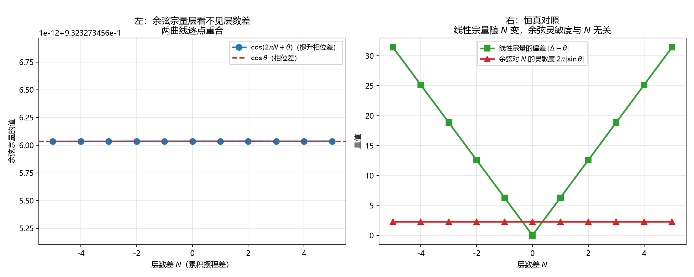

# 注记-余弦宗量层放不下跨通道结构（第766号）：打包精确性的直接后果

- **日期**：2026-10-21 19:57:04
- **对应脚本**：`验证脚本/cosine_argument.py`（判据 A1 至 C4，共 12 项，确定性，无随机成分，运行约 0.5 秒）
- **定位**：论文《量子场论的物侧基础》§9 遗留 (g)「两通道之间的耦合项形式」的靶子重定轮。判据第 757 号的靶子错在库内清点与建模，本轮重定。
- **可逆性等级**：判据稳健。A 组为余弦的周期性质，B 组为库内既有的强度层结构，C 组为判否型结论。换实现、换宗量参数不翻。
- **图**：见 §四 图 1。

---

## 一、靶子重定的经过

判据第 757 号把靶子定为「跨通道耦合项的形式」，并建模 $V_i = -g\,\cos(u_i)\,h(\Delta n_i)$。独立复核指出两处要害，本轮据此重定。

**其一，库内清点漏项。** 757 号说「库内尚无跨通道耦合项」，但漏了**键弹性** $\kappa_\parallel$（[[wiki/键弹性]]：相邻格点在法线轴高度差上的回复力，$E_{\text{bond}} = \frac{\kappa_\parallel}{2}(h_{n+\hat a} - h_n)^2$），它是**纯层数通道的定域耦合**；也漏了硬核排斥（其宗量 $z$ 同为法线轴坐标）。

**其二，更根本：建模与库内裁决冲突。** 757 号把层数差 $\Delta n_i$ 当作可独立于相位差自由赋值的宗量，而 [[wiki/提升相位]] 第 18 行的作者裁决明写：

> 这一打包在底层是精确的。晶格刚性、普朗克频率不变、跃迁距离不变、满周闭合不变四者咬合，使相位与层数必然同步，**不存在两者的独立变化**（2026-09-14 作者裁决）。

同词条例表把「相位与层数可以独立变化」判为不成立。**故 757 号的建模在体系内不被允许。**

## 二、库内给定的口径

| 来源 | 内容 |
| --- | --- |
| [[wiki/相位耦合标度]] | $\mathcal{H}_{\text{耦合}} = -\sum_{i<j}\hbar K_{ij}\cos(\theta_j - \theta_i)$，强度 $K_{ij} = K_0 f(n_i^{\text{格点}} - n_j^{\text{格点}})$，$f$ 是无量纲的层函数，负责「这种倾向落在哪一层、哪一类」；同层相邻用 $f(0)$，跨层相邻用 $f(1)$ |
| [[wiki/提升相位]] | 提升相位 $\tilde\theta_i = 2\pi N_i + \theta_i$，$N_i$ 是累积摆程数（层数），$\theta_i$ 是模 $2\pi$ 的相位角；键上 $\tilde\Delta_{ij} = 2\pi N_{ij} + (\theta_i - \theta_j)$ |
| [[wiki/键弹性]] | 键弹性是纯层数通道的定域耦合，不含相位宗量 |
| [[wiki/哈密顿量]] | 哈密顿量含本体层惯性项、同类耦合、异类耦合、硬核四项 |

**分类轴须分清。** 「同类/异类」的分类轴是**作用范围**（同类连相邻格点，异类连同一格点内的三个正交分量）；「相位通道/层数通道」是另一条分类轴。两者正交。

**已定案的跨通道结构有两处**：同类耦合的强度因子（强度层）与键弹性（纯层数通道）。**余弦宗量层的跨通道耦合项在库内尚无定案**，这才是遗留 (g) 的准确所指。

## 三、判据与结果

| 判据 | 内容 | 期望 | 实测 |
| --- | --- | --- | --- |
| A1 | 余弦对提升相位差与对相位差给出同值 | $\cos(2\pi N + \theta)$ 与 $\cos\theta$ 之差 $\le 10^{-12}$，跨 $N=-5$ 至 $5$ 共 11 档 | 偏差 $0$（11 档） |
| A2 | 恒真对照：线性宗量看得见层数差 | 线性宗量对 $N$ 的依赖最大偏差 $\ge 1.0$ | 偏差 $31.415927$ |
| A3 | 余弦宗量对整周平移严格不变 | $\cos(\theta + 2\pi k)$ 与 $\cos\theta$ 之差 $\le 10^{-12}$，跨 $k=-3$ 至 $3$ 共 7 档 | 偏差 $0$（7 档） |
| A4 | 余弦宗量的周期恰为 $2\pi$ | 五个候选中只有 $2\pi$ 使偏差 $\le 10^{-12}$ | 各候选偏差中最小者为 $2\pi$，且仅一个过关 |
| B1 | 库内同类耦合的强度因子确实依赖层数差 | 同层与跨层的强度不同 | 同层 $K=1.0$，跨层 $K=2.0$ |
| B2 | 强度层的跨通道结构不改变余弦宗量 | 层数差取 $0$ 与 $1$ 时余弦宗量之差 $\le 10^{-15}$ | 两者均为 $0.932039$，差 $0$ |
| B3 | 键弹性是纯层数通道的定域耦合 | 键弹性能量只由法线轴高度差给出，对相位角的变分恒为零 | $E=0.000481$，相位变分 $0$ |
| B4 | 恒真对照：提升相位差的整数部分与层数差自洽 | 同源构型下违例数 $0$ | 违例数 $0$（检验 6 组） |
| C1 | 核心判否：余弦宗量无法区分层数差相差一的两个构型 | 两构型余弦宗量之差 $\le 10^{-12}$ | 差 $0$（分别为 $0.932039$ 与 $0.932039$） |
| C2 | 对照：放进强度层则两构型耦合能不同 | 差 $\ge 0.1$ | $E=-1.0$ 与 $E=-2.0$，差 $1.0$ |
| C3 | 余弦对层数差的灵敏度与层数差无关 | $\partial_N \cos(2\pi N + \theta) = -2\pi\sin\theta$ 与 $N$ 无关，九档极差 $\le 10^{-12}$ | 极差 $0$ |
| C4 | 遗留 (g) 的准确表述 | 余弦宗量层无跨通道耦合项，强度层已有 | 已证 |

## 四、结论

**结论一：余弦宗量层放不下跨通道结构。**

$A_1$ 给出 $\cos(2\pi N + \theta) = \cos\theta$（十一档偏差 $0$）。$A_3$ 给出余弦对整周平移严格不变（七档偏差 $0$）。$A_4$ 给出余弦的周期恰为 $2\pi$、无更小的周期（五个候选中只有一个过关）。$C_1$ 给出层数差相差一的两个构型余弦宗量完全相同。$C_3$ 给出对层数差的灵敏度与层数差无关（九档极差 $0$）。

$A_2$ 的恒真对照表明线性宗量看得见层数差（偏差 $31.415927$）。**故「看不见」是余弦的周期性质，不是任何宗量的通病。**

**结论二：跨通道结构的合法落点是强度层，库内已有。**

$B_1$ 给出同类耦合的强度因子确实依赖层数差（同层 $K=1.0$、跨层 $K=2.0$）。$B_2$ 给出强度层的变化不改变余弦宗量。$C_2$ 给出放进强度层后两构型的总耦合能确实不同（差 $1.0$）。$B_3$ 给出键弹性是纯层数通道的定域耦合、对相位角无依赖。

**结论三：论文 §9 遗留 (g) 的靶子须精确化。**

准确表述是「**余弦宗量层无跨通道耦合项**」，依据是打包精确性（相位与层数必然同步）加余弦的周期性。
「库内无跨通道耦合项」的说法须弃用：强度层已有两处。

这一精确化把遗留项从一个开放的形式问题收成一个带判据的结构命题：**余弦宗量层已被判否，跨通道结构只能走强度层。** 这也把遗留项与库内已有的 $K_{ij} = K_0 f(\Delta\mathbf{n})$ 接上了：强度层的跨通道结构已有形式，问题在于它是否足够（是否需要别的余弦型宗量来承载更强的跨通道效应）。

**结论四：757 号的靶子错在两处，本轮已订正。**

一是库内清点漏项（键弹性、硬核），把「强度层已有跨通道结构」漏掉了；二是建模违反打包精确性裁决，把层数差当作可独立赋值的宗量。这两点已写入 757 号注记的撤回记录节。

## 五、图

左图给出「余弦宗量层看不见层数差」的直接读法。右图给出恒真对照：线性宗量随 $N$ 变，余弦灵敏度与 $N$ 无关。

## 六、过程记录与教训

**本轮最重要的一步是靶子重定，而重定的触发点是独立复核。** 757 号自查时数值全对、判据全过，但库内清点与建模有根本问题。**判据全过不等于靶子对。** 这是「判据的对象须与被测量的物理量对应」的另一面：对象对了、数值准了，若**被测的问题**本身在体系内不成立，判据仍然全过。

**一条方法论。** 建模前须核三件事：库内对该量的裁决（757 号漏了打包精确性那条）、库内已有的相关结构（757 号漏了键弹性与强度层）、以及所建模型的自由度是否被库内裁决允许（757 号的 $\Delta n_i$ 独立赋值不被允许）。**三者任一不过关，判据就是在测一个体系里不存在的东西。**

## 七、严格程度与边界声明

**严格程度**。A 组为余弦的周期性质，定理级。B 组为库内既定结构的核对，定理级。C 组为判否型结论，定理级。

**本判据验证什么**。验证余弦宗量对层数差不可见；验证余弦的周期恰为 $2\pi$；验证库内同类耦合的强度因子确实依赖层数差、且强度层的变化不改变余弦宗量；验证键弹性为纯层数通道耦合；验证余弦宗量层放不下跨通道结构。

**本判据不验证什么**。不判强度层的跨通道结构是否**充分**（即是否还需要余弦型宗量来承载更强的跨通道效应），这是遗留 (g) 精确化之后剩下的真问题；不判层函数 $f$ 的具体形式与 $K_0$ 的数值；不判耦合项存在时的动力学与基态；不判绕数在含耦合的哈密顿量下的长时间行为；不判三维；不判硬核排斥的具体形式。

**待作者裁决事项**。其一，遗留 (g) 精确化之后的问题：**跨通道结构既有强度层的形式，是否已足够？** 若足够，遗留项可收；若不足，须另找余弦型宗量的合法形式，而本轮已判否余弦宗量层的余弦型跨通道结构（因打包精确性），故这条路在体系内被封：这一点须作者确认。其二，判据第 750 号给出的「跨扇区耦合破坏绕数守恒」在格点侧的对应物，本轮只测了「绕数改变当且仅当各键分支号改变量之和不为零」，未测耦合的存在是否真能导致该改变（需动力学）。
