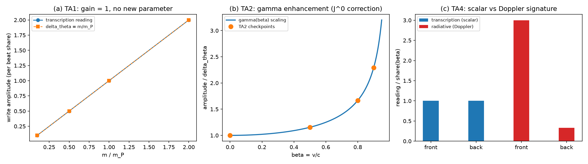

# 注记-作用量转录的最小验证：通道二机制句的份额核验判据与伽马增强产出（判据TA1至TA5）

- **日期**：2026-09-27 03:31:20
- **层级**：内部草稿（验证脚本判据，作者指示开工：通道二机制句判据化）
- **脚本**：`验证脚本/minimal_verification_action_transcription.py`
- **判据**：TA1 至 TA5 共 10 项，全部通过（10/10）
- **图**：见 §四 图 1
- **主题**：倾角注记（[[内部草稿/注记-法线场倾角为什么是质量与普朗克质量之比：写入幅度的四条通道|注记-法线场倾角为什么是质量与普朗克质量之比]]）通道二机制句"写入即作用量转录"的判据化：作用量份额核验模型中，转录读数（每拍作用量积累相对 $\hbar$ 的份额）与写入幅值的锁定、$\gamma$ 增强缩放、只读守恒、标量签名与无反冲对照。

## 一、判据与理论期望

机制主张：碰撞写入把缺陷当拍的作用量状态转录到波性侧记录，写入幅度 $= E t_P/\hbar$（$E$ 为缺陷总能量；静缺陷 $E = mc^2$，动缺陷 $E = \gamma mc^2$）。理论期望五条：TA1 静缺陷质量扫描（4 档）转录增益恒 1（份额-幅值锁定，无新参数）；TA2 动缺陷速度扫描（$\beta = 0, 0.5, 0.8, 0.9$）读数按 $\gamma$ 缩放；TA3 写入事件序列前后作用量速率守恒（只读，P3"写入不影响摆程方向"的作用量表述）；TA4 转录读数为标量（前/后观察点同值），对照辐射型机制的多普勒分裂（前 $\gamma(1+\beta)$ 对 后 $\gamma(1-\beta)$）；TA5 转录事件无反冲（$\Delta E = \Delta p = 0$），对照辐射型（发射一份 $\hbar/t_P$ 量子：$\Delta E/E = 1/\gamma$、$\Delta p/p$ 非零）。

## 二、模型设定与建模决策（分层声明）

作用量份额核验模型：每拍积累 $\Delta S = E t_P$，读数 $= \Delta S/\hbar$。分层：TA1 的增益 1 是转录定义的直接读出（自检级）；TA2 的 $\gamma$ 律依赖相对论运动学输入（体系已有低能洛伦兹涌现与 E2 判据 $\gamma M$ 支撑），其对判据 Z 的修正是实质产出；TA4、TA5 为份额核验对照（非动力学模拟），对照辐射型的目的是区分两种写入机制的观测签名，不是模拟辐射动力学。转录读数为标量（作用量速率无方向）是 TA4 的模型内主张，其独立检验归强场与矢量块工具。

## 三、结果表

| 判据 | 量 | 实测 | 期望 | 结果 |
|---|---|---|---|---|
| TA1 | 转录增益（4 档质量最大偏差） | $0$ | $\le 10^{-12}$ | 通过 |
| TA2 | $\gamma$ 缩放（4 档速度最大偏差） | $0$ | $\le 10^{-12}$ | 通过 |
| TA2b | $\beta = 0.9$ 的 $J^0$ 修正因子 | $2.294$ | 打印（判据 Z 修正） | 产出 |
| TA3 | 10 拍写入序列速率漂移 | $0$ | $\le 10^{-12}$ | 通过 |
| TA4a | 转录前/后读数相对差 | $0$ | $\le 10^{-12}$（标量） | 通过 |
| TA4b | 辐射型前/后多普勒相对差 | $1.6$ | 显著非零（对照） | 通过 |
| TA5a | 转录 $\Delta E/E$ | $0$ | $\le 10^{-12}$ | 通过 |
| TA5b | 转录 $\Delta p/p$ | $0$ | $\le 10^{-12}$ | 通过 |
| TA5c | 辐射型 $\Delta E/E$（对照） | $0.60$ | $= 1/\gamma$（打印） | 通过 |
| TA5d | 辐射型 $\Delta p/p$（对照） | $0.75$ | 打印（符号非零） | 通过 |

判据 10/10 通过。核心读数：份额-幅值锁定增益 1（$m = 0.5\,m_P$ 时读数 $0.5$ 对理论 $0.5$）；$\beta = 0.9$ 时转录读数 $2.294 = \gamma$（$\gamma$ 增强精确）；转录签名（标量、无反冲）与辐射型签名（多普勒分裂 $1.6$、能量份额 $0.60$、动量 $0.75$）完全可区分。

## 四、图

## 五、实质产出：判据 Z 四维流的 gamma 修正

作用量转录给出判据 Z 四维流的修正形式：时间分量应为 $J^0 = \gamma\,m/m_P$（作用量速率 = 总能量 $\gamma mc^2$），空间分量相应 $J^i = \gamma(m/m_P)v_i/c$；判据 Z 与微观根基 §5.5 的现行写法 $J^\mu = (m/m_P)(c, \vec v)$ 属低俗形式（$\gamma \approx 1$），对 Gravity Probe B 读数（$\beta \sim 10^{-10}$）无影响，但概念上四维流应取 $\gamma$ 版本，且 $\gamma$ 增强是作用量转录区别于低俗写入的独立签名（高速度下可判别）。该修正的矢量块数值复核（运动缺陷的 $h_{0i}$ 响应）挂判据 Z 工具域。

## 六、严格程度声明

**可逆性等级：判据敏感。** 转录增益或 $\gamma$ 缩放任一被否，通道二机制句退回候选；TA4、TA5 的对照签名依赖"标量读数"主张。**分层**：TA1、TA3、TA5 的转录侧为份额核验模型内自检（模型直接编码转录定义），其价值在把机制主张整理为可判形式并区分辐射型签名；TA2 的 $\gamma$ 缩放依赖相对论运动学输入（有体系判据支撑）并产出判据 Z 修正；TA4 的标量主张为模型内主张（独立检验归强场工具）。**通道二机制句的判据地位由"待判据化"升为"份额核验判据级（模型内一致 + $\gamma$ 修正产出）"，低于 DC/DB 的结构判据硬度，完整判据化需写入算符的量子模型（记录机制论文 §2.2 的 $H_{\rm int}$ 层）。**

## 七、边界声明

验证什么：作用量份额核验的内部一致性（TA1、TA3）、$\gamma$ 缩放与判据 Z 修正产出（TA2）、转录与辐射型的签名区分（TA4、TA5）。不验证什么：转录的微观动力学实现（写入算符量子模型）；真实运动缺陷的记录场响应（判据 Z 工具域）；标量读数主张的独立检验。教训：份额核验判据的价值在区分机制签名（可观测后果），重复编码主张的判据只达自检级，两者必须在注记分层。

## 八、登记

开放问题总览 P1-34a 档案页本轮登记；倾角注记通道二同步（机制句升份额核验判据级）；论文《法线场倾角的几何来源》§3 与 §8 同步。
