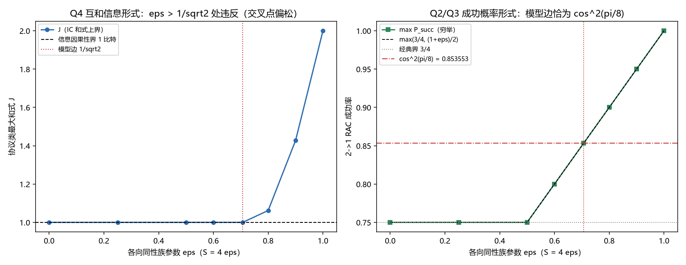

# 注记-信息因果性模型内定量判据的最小验证：协议类穷举、RAC 成功率与互信息和式

- **日期**：2026-09-23 14:05:10
- **脚本**：`验证脚本/minimal_verification_information_causality_model.py`（穷举决定性；种子 20260923 仅用于混合稳健性抽样）
- **图**：见 §五 图 1（`images/minimal_verification_information_causality_model.png`）
- **增补（2026-09-24）**：并入方向四首轮的 R3 与 R4 核对（容量侧的形式退化与非空转）；读数全部复用同一协议类，不新增协议。定性版见 [[注记-方向四首轮：三条候选容量的表达式化与 R1、R2、R6 检查]]
- **定位**：战线二（P1-29）方向三路线一（信息因果性）的落地。方向三推导稿把它登记为引用级并留一项开放（模型内定量判据），本轮在写死的合法协议类内穷举把它做成判据。两条读数：成功概率形式（2→1 RAC）在模型族的可达边上恰好取到信息因果性允许的上限 $\cos^2(\pi/8)$，给出 $\varepsilon \le 1/\sqrt2$ 即 $S \le 2\sqrt2$（与路线二的结构上界同数）；互信息和式的单副本版本不紧（交叉点在 $\varepsilon \approx 0.775$，$S^\ast \approx 3.10$），如实登记。
- **关联**：[[研究方向-方向三：为何止步 2√2（信息因果性路线）推导稿]]（路线一与开放项）、[[注记-齐雷尔森上界来源的最小验证：单位相量结构与奇异性缺口（为何止步 2√2）]]（路线二：结构上界 $2\sqrt{1+\vert z\vert^2}$）、[[注记-二-2 路径甲迁移轮的最小验证：由快照相位分布到 CHSH 的体系内计算]]（可见度 $V$ 与增强轮 $V$ 表）、[[贝尔违反的场侧闸门：纠缠锁定对、经典圈对照与可见度阈]]（v0 精确值与可见度阈）、[[开放问题总览：元相子理论待解决问题清单]]（P1-29）

---

## 一、判据（运行前写死）

| 序 | 判据 | 验收数值 |
|---|---|---|
| Q1 | 家族与模型边：各向同性族 $S = 4\varepsilon$；模型可达边 $\varepsilon_{\max} = 1/\sqrt2$ 给 $S = 2\sqrt2$ | 1e-12 |
| Q2 | RAC 穷举：$\max P_{\text{succ}}(\varepsilon) = \max(3/4,\ (1+\varepsilon)/2)$（8 档） | 1e-12 |
| Q3 | RAC 锚点：$\varepsilon = 0.5$ 给 $3/4$（经典界）；$\varepsilon = 1/\sqrt2$ 给 $\cos^2(\pi/8)$；$\varepsilon = 1$ 给 $1$（PR 箱） | 1e-12 |
| Q4 | 互信息和式穷举：$J(\varepsilon) = 1$ 对 $\varepsilon \le 1/\sqrt2$ 与 $0.75$ 档；$\varepsilon = 0.8$ 起 $J > 1$；交叉点由细扫定位 | 见结果 |
| Q5 | 混合稳健性：400 组随机两策略混合不提高 $J$ | 不超确定性穷举最优 |
| Q6 | 同数核对：$4\cdot(1/\sqrt2) = 2\sqrt2$；$P_{\text{succ}}(1/\sqrt2) = \cos^2(\pi/8) = (1+1/\sqrt2)/2$ | 1e-15 |
| R3 | 方向四增补·标准极限退化：无资源（$\varepsilon = 0$）时 $J$ = 记录预算 $m$；成功率 = $3/4$ | 1e-9；1e-15 |
| R4a | 方向四增补·非空转（双饱和）：模型边处 $J = 1$ 恰饱和且成功率 = $\cos^2(\pi/8)$ | 1e-9；1e-12 |
| R4b | 方向四增补·紧度对照（诚信项）：成功概率形式临界值 = 模型边（紧）；互信息和式首次越界在 $(0.77, 0.78)$（松） | 见结果 |

## 二、协议类与两个量

合法协议类（因果顺序写死）：爱丽丝拿到两个独立均匀比特 $a_1, a_2$，盒输入 $x = x(a_1, a_2)$ 在测量前决定（只许依赖输入），消息 $c = c(a_1, a_2, A)$ 在测量后发出（可用盒输出 $A$）；鲍勃知道目标位 $k$，盒设置 $y = y(k, c)$ 在收信后选定，判读 $G_k = G_k(c, B)$。单副本、2 比特输入、1 比特消息。穷举规模：$x$ 十六档、$c$ 二百五十六档（爱丽丝 4096 档），$y$ 四档、判读十六档（每 $k$ 六十四档）。

两个量。其一，2→1 随机存取码（RAC）成功率：目标位 $k$ 均匀，$\max P_{\text{succ}}$ 对爱丽丝与鲍勃的档位取最大。其二，信息因果性（IC）原则的单副本形式：$J = \max_{\text{爱丽丝}}\left[\max_{B_1} I(a_1 : G_1) + \max_{B_2} I(a_2 : G_2)\right]$，原则要求 $J \le 1$ 比特。

模型族对上各向同性族：路径甲的关联核 $E = \cos\alpha\cos\beta + V\sin\alpha\sin\beta$ 在标准选角 $(\alpha_0,\alpha_1) = (0, \pi/2)$、$(\beta_0,\beta_1) = (\pi/4, -\pi/4)$ 上给 $E = (V/\sqrt2)(+,+,+,-)$，即参数 $\varepsilon = V/\sqrt2$ 的各向同性族，CHSH 值 $S = 4\varepsilon$。结构路线（脚本 368）给模型可达边 $\varepsilon \le 1/\sqrt2$，对应 $V = 1$（完美锁）。

## 三、结果（实测 vs 期望）

| $\varepsilon$ | $J$（IC 和式） | RAC 成功率 | $\max(3/4,(1+\varepsilon)/2)$ |
|---|---|---|---|
| $0$ | $1.000000$ | $0.750000$ | $0.750000$ |
| $0.25$ | $1.000000$ | $0.750000$ | $0.750000$ |
| $0.50$ | $1.000000$ | $0.750000$ | $0.750000$ |
| $0.60$ | $1.000000$ | $0.800000$ | $0.800000$ |
| $1/\sqrt2 = 0.707107$ | $1.000000$ | $0.853553$ | $0.853553$ |
| $0.80$ | $1.062009$ | $0.900000$ | $0.900000$ |
| $0.90$ | $1.427206$ | $0.950000$ | $0.950000$ |
| $1.00$ | $2.000000$ | $1.000000$ | $1.000000$ |

汇总 $9/9$ 通过（含方向四增补三条）。三条读数的含义：

- RAC 成功率对公式最大偏差 $0$（8 档）：$\varepsilon \le 0.5$ 段停在经典 1 比特协议的 $3/4$（与各向同性族在 $\varepsilon \le 1/2$ 属经典区一致），$0.5$ 以上按 $(1+\varepsilon)/2$ 上升，$\varepsilon = 1/\sqrt2$ 处为 $0.853553391$，与 $\cos^2(\pi/8)$ 逐位相同（差 $0$）。
- IC 和式在 $\varepsilon \le 1/\sqrt2$ 与 $0.75$ 档都是 $1.000000$（不违反，且恰好饱和）；$\varepsilon = 0.8$ 起越界（$1.062009$），$0.9$ 给 $1.427206$，PR 箱给 $2.000000$。细扫（$0.76$、$0.77$、$0.78$、$0.79$ 给 $1.000000$、$1.000000$、$1.000168$、$1.030705$）把交叉点定在 $0.77$ 与 $0.78$ 之间，即 $S^\ast \approx 3.10$。
- 混合稳健性：400 组随机两策略混合的最好值是 $0.962868$（$\varepsilon = 0.75$）与 $0.927249$（$\varepsilon = 0.80$），都不超确定性穷举最优，说明本类内确定性穷举即最优（在抽样规模内）。

## 四、口径与过程记录

其一，协议类的因果顺序必须写死。第一版类让盒输入 $x$ 也依赖盒输出 $A$（测后改设置），$\varepsilon = 0.5$ 处就给出 $J = 1.1887 > 1$，与"经典资源不能突破 1 比特"直接冲突；修正为 $x$ 只依赖 $(a_1, a_2)$ 后同点回到 $1.000000$。教训：IC 类判据的第一杀手是协议类的因果顺序，先写死再穷举。

其二，RAC 的成功率公式要带经典地板。$\varepsilon < 0.5$ 段的最大值由经典 1 比特协议给到 $3/4$，公式取 $\max(3/4, (1+\varepsilon)/2)$；初版写成 $(1+\varepsilon)/2$ 在 $\varepsilon \le 0.25$ 档判负。

其三，两条形式的紧度不同（本轮主要发现）。成功概率形式（RAC）的临界值 $\cos^2(\pi/8)$ 与模型边 $\varepsilon = 1/\sqrt2$ 逐位重合，故给出紧的 $\varepsilon \le 1/\sqrt2$；互信息和式的单副本形式在 $\varepsilon \approx 0.775$ 才越界，给出的是 $S \le 4 \times 0.775 \approx 3.10$ 的松界。这与文献口径一致：互信息和式的紧版本需要多副本或渐近处理，登记为开放项。

其四，方向四增补（2026-09-24，容量侧的形式退化与非空转）。三条读数：R3 无资源（$\varepsilon = 0$）时 $J = 1.000000$，恰等于记录预算 $m = 1$（古典锚点饱和），成功率 $0.750000000$ 即经典 1 比特协议值。

R4a 模型边处记录预算与成功上限同点取满（$J = 1.000000$、成功率 $0.853553391$）；R4b 成功概率形式的临界值等于模型边（紧），互信息和式首次越界在 $(0.77, 0.78)$ 之间（松）。

这三条只做形式退化与非空转的核对，不构成容量原理的推导：容量的身份（消息等于记录）见 [[注记-方向四首轮：三条候选容量的表达式化与 R1、R2、R6 检查]]，R5 未做。

## 五、图

图 1 两联。左为 IC 和式 $J(\varepsilon)$：水平虚线是 1 比特的原则界，竖点线是模型边 $\varepsilon = 1/\sqrt2$；曲线在模型边处仍贴住 1 比特，$0.8$ 起越界。右为 RAC 成功率：绿色为穷举最大值，黑虚线为 $\max(3/4, (1+\varepsilon)/2)$，灰点线是经典界 $3/4$，红点划线是 $\cos^2(\pi/8) = 0.853553$；模型边处曲线与红点划线相交。

## 六、边界声明

**验证什么**：在写死的合法协议类内，（i）模型族（各向同性族代表）的 RAC 成功率对 $\varepsilon$ 的完整依赖；（ii）IC 和式的单副本交叉点；（iii）模型可达边与信息因果性允许的 RAC 上限的逐位重合。

**不验证什么**：不做公理级断言（信息因果性原则本身是引用级）；协议类为写死的单副本形式，其外（多副本、更长的消息、更多输入位）的最优性未扫；混合最优性只在 400 组随机两策略混合内核对；各向同性族作为模型 CHSH 族的代表引用标准选角，未做去极化归约的全族扫描。

## 七、结论

信息因果性的模型内定量判据成立，且以成功概率形式给出紧界：模型族（$\varepsilon = V/\sqrt2$）的 RAC 成功率恰为 $\max(3/4, (1+\varepsilon)/2)$，在模型可达边 $\varepsilon = 1/\sqrt2$（即完美锁 $V = 1$）处等于信息因果性允许的上限 $\cos^2(\pi/8)$，故 IC 在模型内给出 $\varepsilon \le 1/\sqrt2$ 与 $S \le 2\sqrt2$，与路线二的结构上界逐位同数。

互和信息式的单副本版本只给 $S^\ast \approx 3.10$，其紧版本需要多副本或渐近处理，与 IC 原则本身的地位一并留作开放项。
