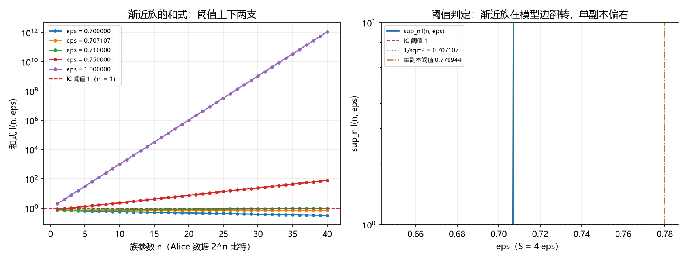

# 注记-信息因果性渐近族的最小验证：和式紧化、两方向阈值判定与单副本松弛

- **日期**：2026-09-24 05:01:33
- **类型**：验证注记（判据级；判据 A1 至 A6 全过）
- **定位**：值侧论文开放问题二的收口轮。369 已核到互信息和式的单副本形式不紧（模型内交叉点落在 S 属于 (3.08, 3.12)）；第三轮文献核对核到原文的紧形式是含参数 n 的渐近族。本脚本把该族搬到模型族（$E = \varepsilon$、$S = 4\varepsilon$）上，做阈值核对与两形式对照。
- **脚本**：`验证脚本/minimal_verification_information_causality_asymptotic.py`（确定性；$n$ 上限：判据 A3b 用 4000，教训项 A3c 用 60）
- **图**：见 §六 图 1
- **已有输入**：[[注记-文献 9 核对（第三轮）：预印本正文的取得、技术形式与 Tsirelson 推导的渐近结构]]；[[注记-信息因果性模型内定量判据的最小验证：协议类穷举、RAC 成功率与互信息和式]]

---

## 一、模型设定与判据

族的两个量按文献式 (22) 与 (23) 内核化：各向同性族处 $P_K = \frac{1}{2}(1 + \varepsilon^n)$，和式 $I(n, \varepsilon) = 2^n [1 - h(P_K)]$，二次下界 $I \ge (2\varepsilon^2)^n/(2\ln 2)$，判定为"存在 $n$ 使 $I(n) > 1$"。

判据 A1 至 A6 先行。A1 族公式内核化，对 369 的成功概率入口逐位一致；A2 二次下界在网格上成立；A3 两方向阈值（边之上给见证 $n$，边与边之下扫 $n \le 4000$ 无违反）；A4 三个锚点（经典 $\varepsilon = 0.5$、模型边 $\varepsilon = 1/\sqrt{2}$、PR $\varepsilon = 1$）；A5 单副本对照，解 $2[1 - h((1+\varepsilon)/2)] = 1$；A6 判定与口径登记。

## 二、结果

| 判据 | 读数 | 期望 |
| --- | --- | --- |
| A1 族公式 | $P(1, 1/\sqrt{2}) = 0.853553390593274$ | 与 $(1+\varepsilon)/2$ 逐位一致 |
| A1b 两支一致 | 切换点差 $0.0$；$y = 0.5$ 处对直算差 $2.8\times10^{-17}$ | 均在容差内 |
| A2 二次下界 | 相对余量最小值 $-3.6\times10^{-15}$ | $\ge 0$（浮点余量 $10^{-9}$） |
| A3a 边之上 | $\varepsilon = 1/\sqrt{2} + 10^{-3}$ 处 $n = 118$ 给 $I = 1.006908$ | 存在 $n$ 使 $I > 1$ |
| A3b 边与边之下 | $\sup_n I$ 为 $0.377444$（$0.5$）、$0.556144$（$0.6$）、$0.780319$（$0.7$）、$0.798248$（$1/\sqrt{2}$） | 全部 $\le 1$ |
| A4 锚点 | 经典 $0.377444$；模型边 $0.798248$；PR 处 $I(1) = 2.000000$ | 前两者不违反，PR 违反 |
| A5 单副本阈值 | $\varepsilon_1 = 0.779944271$，$S_1 = 3.119777084$ | 落在 369 实测交叉区间 $(3.08, 3.12)$ |

## 三、三条解读

其一，阈值恰在模型边。判定"存在 $n$ 使 $I > 1$"的临界值是 $\varepsilon = 1/\sqrt{2}$（即 $S = 2\sqrt{2}$），与结构路线的模型边逐位同数。边之上有显式见证 $n$，其大小随 $\ln(2\ln 2)/\ln(2\varepsilon^2)$ 发散（$\delta = 10^{-3}$ 处为 $118$）；边与边之下扫到 $n = 4000$ 无违反。故和式入口的紧版本就是渐近族。

其二，单副本松弛被定量解释。单副本判定 $2[1 - h((1+\varepsilon)/2)] \le 1$ 的阈值是 $\varepsilon_1 = 0.779944271$（$S_1 = 3.119777084$），与 369 协议类穷举的首次越界区间 $(0.77, 0.78)$ 相容；与模型边的差额 $S_1 - 2\sqrt{2} = 0.291350$。开放问题二的松弛由此定位：它由单副本入口自带，与模型读数无关。

其三，判据写法的一条教训。把 $\sup_n$ 截断到 $n = 60$ 时，表观阈值被推高到 $0.709034$（对 $1/\sqrt{2}$ 差 $1.9\times10^{-3}$）。判据必须写成"存在 $n$"，不得写成截断 $\sup$；A3c 项保留该读数作教训。

## 四、严格程度与边界

族公式与判定式为引用级（文献式 (22) 至 (24) 的内核化，出处见第三轮注记）；阈值读数、两形式对照与锚点为判据级。**不验证什么**：不重做 368 与 369 的读数；不改动 369 的 $J$ 口径（它以协议类最大化为入口，模型边 $J = 1.000000$，与本脚本的成功概率入口数值不同，分开登记）；不主张信息因果性的地位变化；不触碰 [[子理论索引]] 与任何基准文档。

## 五、过程记录（判据修正三次）

首轮 A2 报相对缺口 $-6.3\times10^{-10}$，根因是由 $P = \frac{1}{2}(1 + y)$ 反解 $y$ 时在 $y \sim 10^{-13}$ 处丢相对精度；改为直接吃 $y$（小 $|y|$ 走正值幂级数，系数 $1$、$1/6$、$1/15$、$1/28$、$1/45$；大 $|y|$ 走 log1p 闭式），并在切换点复检两支一致。

次轮 A3 暴露判据本身的写法问题：截断 $\sup$ 给出 $0.709034$。据此把判据从"截断 $\sup$ 的临界值"改为两方向判定（A3a 见证、A3b 扫描），截断偏移保留为 A3c 教训。

第三轮 A3b 在 $n$ 很大时同时遇到 $2^n$ 上溢与 $y$ 下溢，报 $\mathrm{nan}$；改对数域实现（$\ln I = n \ln 2 + \ln[1 - h((1+y)/2)]$，小 $y$ 走 $\ln$ 级数）。至此六条判据全过。

## 六、结论与登记

和式入口的紧形式是渐近族（存在 $n$），阈值 $S = 2\sqrt{2}$ 与结构路线逐位同数；单副本形式的松弛由 $S_1 = 3.119777$ 定量解释。值侧论文开放问题二据此收口，论文第 7 节与第 10 节按本轮同步。

图注按脚本绘图用的数组逐项核对（本机图片预览通道不可用，改用数值核对）：左图五档中，$\varepsilon = 0.65$、$0.70$、$1/\sqrt{2}$ 三档的 $\sup_n I$ 取在 $n = 1$（分别为 $0.661968$、$0.780319$、$0.798248$），曲线随 $n$ 下行；$\varepsilon = 0.75$ 一档在 $n = 2$ 与 $n = 3$ 之间越过阈值并上行；$\varepsilon = 1$ 一档随 $n$ 指数上行。

右图的 $\sup$ 曲线在网格步长 $0.001$ 下于 $0.708$ 处越过阈值（绿点线为真实阈值 $1/\sqrt{2} = 0.707107$），褐点划线为单副本阈值 $0.779944$，两线之间即单副本形式的松弛区。

