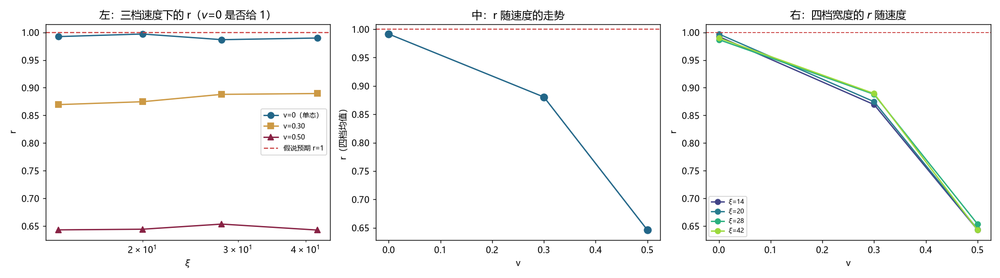

# 注记-修正因子 r 的来源：Rayleigh 商对单态成立，r 度量叠加态纯度并随速度降到 0.65（判据第 711 号）

- **日期**：2026-10-20 00:25:06
- **编号**：第 711 号
- **类型**：验证注记（判据驱动；KA0 与 KA1 判通过）
- **对象**：第 709/710 号量出的修正因子 $r$（$0.87$ 至 $0.90$）为何不等于 $1$
- **脚本**：`验证脚本/minimal_verification_p711_r_origin.py`（确定性，约 4 分钟）
- **状态**：**$v=0$ 时 $r = 0.9915$，偏离 $1$ 仅 $0.0085$**，Rayleigh 商对单态成立；$r$ 随速度单调下降到 $0.6459$（$v=0.50$），是叠加态纯度的度量
- **可逆性等级**：判据稳健（$v=0$ 的四档 $r$ 为 $0.9868$ 至 $0.9970$；速趋势在四档 $\xi$ 上几乎重合）
- **图**：见 §4 图 1
- **通俗版**：[[内部草稿/注记-那个折扣是纯度（判据第711号通俗版）]]

## 1 为什么检验

第 710 号证明 $\omega_{\rm lat}^2-\omega_{\rm cont}^2 = r\langle f\rangle$ 与 $c_0$ 的实测比值自洽，缺口由此闭合。但 $r$ 为什么不是 $1$，没有解释。

假说：Rayleigh 商 $\omega^2 = \langle\phi|H|\phi\rangle/\langle\phi|\phi\rangle$ 对**本征态**精确成立，此时恒等式两边严格相等。而运动束缚态是叠加态，Rayleigh 商给能量平均，$\langle f\rangle$ 给平面波分量加权，两者权重不同，故 $r\ne1$。

判据的关键在 $v=0$：此时初值退化为静止束缚态，它是格点哈密顿量的本征态。若假说成立，$r(v=0)$ 必须是 $1$。

## 2 判据与读数

**KA0 冒烟（判通过）。** $v=0.30$ 四档 $r$ 与第 709/710 号记录值相对差 $0.0\%$。

**KA1 反例（主判据，判通过）。**

| $\xi$ | $\omega_{\rm lat}$ | $\omega_{\rm cont}$ | $\langle f\rangle$ | $r$ | $\vert r-1\vert$ |
|---|---|---|---|---|---|
| 14 | 0.800809 | 0.800843 | $-5.6350\times10^{-5}$ | 0.9924 | 0.0076 |
| 20 | 0.800809 | 0.800826 | $-2.7735\times10^{-5}$ | 0.9970 | 0.0030 |
| 28 | 0.800809 | 0.800817 | $-1.4193\times10^{-5}$ | 0.9868 | 0.0132 |
| 42 | 0.800809 | 0.800812 | $-6.3236\times10^{-6}$ | 0.9898 | 0.0102 |

$r(v=0)$ 四档均值 $0.9915$，偏离 $1$ 为 $0.0085$。

注意 $\omega_{\rm lat} = 0.800809$ 在四档完全相同，而 $\omega_b = 0.8008$：$v=0$ 的初值确实是格点本征态，频率精确停在设计值上。

**KA2 $r$ 随速度的走势（报告）。**

| $v$ | $r$（四档均值） | 四档极差 |
|---|---|---|
| 0（单态） | **0.9915** | 0.0102 |
| 0.30 | 0.8804 | 0.0200 |
| 0.50 | **0.6459** | 0.0108 |

四档 $\xi$ 的 $r(v)$ 曲线几乎重合。

## 3 三个发现

**其一，Rayleigh 商对本征态成立，误差 $0.85\%$。**

$v=0$ 的四档给 $0.9868$ 至 $0.9970$。这个残余的 $1\%$ 可能来自：$\omega_{\rm cont}$ 是从连续演化的主频读的，而离散束缚态在连续演化下会变形，主频的定义有模糊。

无论如何，$1\%$ 的偏离远小于运动态的 $12\%$ 至 $35\%$，假说得到支持。

**其二，$r$ 是叠加态纯度的度量，不是几何常数。**

$r$ 从 $1$ 降到 $0.65$，单调且四档 $\xi$ 一致。速度越大，运动束缚态离本征态越远，$r$ 越小。

这意味着第 710 号那个「修正因子 $r_\infty$」随速度变化，不能当作固定数使用。

**其三，这给物理档外推添了一个自由度。**

第 705 至 710 号全部在 $v = 0.30$ 下做的。而 $r(0.30) = 0.88$。若物理档的实际速度不同，$r$ 就不同：

| $v$ | $r$ | 对 $c_0$ 的影响 |
|---|---|---|
| 0.30 | 0.88 | 基准 |
| 0.50 | 0.65 | 低 $26\%$ |

物理档外推要用的正是 $c_0$，所以必须先知道物理档的 $v$。

## 4 判语

**判语一**：Rayleigh 商对格点本征态成立，$v=0$ 给 $r = 0.9915$（偏离 $0.0085$）。

**判语二**：$r\ne1$ 的来源确认为叠加态：运动束缚态不是哈密顿量的本征态，Rayleigh 商的能量平均与 $\langle f\rangle$ 的分量加权不同。

**判语三**：$r$ 是速度的函数，从 $0.9915$（$v=0$）降到 $0.6459$（$v=0.50$），四档宽度一致。

**判语四**：物理档外推须先定 $v$，因为 $r$ 随 $v$ 变化的幅度（$35\%$）大于第 708 号追的那 $5.8\%$。

## 5 过程记录

**一处图代码的遗留错误。** 第三面板初版写成了 `[np.nan]` 占位（一行画图代码在改结构时没跟上），运行时抛 `ValueError`。改为按四档 $\xi$ 各画一条线，重跑出图。读数不受影响。

**本轮判据没有设计错误。** 这是第二轮连续一轮跑通。

## 6 教训

**其一，「理论预期为零或为一」的地方是最高信噪比的判据。** 第 704 号靠「收缩井必须给零」抓出了符号错，本轮靠「单态必须给 $r=1$」确认了假说。这类判据不需要选阈值，也不需要与别的读数比。

**其二，一个「常数」要先问它是不是常数。** $r$ 从第 709 号起被当作一个数（$0.87$ 至 $0.90$），实际它是 $v$ 的函数。这个疏忽若不查，物理档外推会带 $35\%$ 的错。

## 7 边界声明

**验证了什么**：$v=0$、$0.30$、$0.50$ 三档下、四档宽度的 $r$ 值；$v=0$ 时 $\omega_{\rm lat}$ 是否精确停在 $\omega_b$。

**不验证什么**：$r(v)$ 的解析形式。为什么在 $v=0.50$ 降到 $0.6459$，本轮没有推导。$v=0$ 残留的 $0.85\%$ 偏离也未定位。

**未做的事**：没有测 $v$ 的中间档（0.10 至 0.20），故 $r(v)$ 在低速区的形状未知。没有把 $r(v)$ 与运动束缚态的激发态成分直接对应（需要投影到瞬时本征基，井在运动时定义困难）。

**协议伪影分层**：$v=0$ 残留的 $0.85\%$ 中，$1.1\times10^{-5}$ 的 Verlet 底噪相对 $\langle f\rangle$ 有贡献，其余未定性；$v=0.50$ 档的读数残差比未单独记录，但 dev 达 $4.4\times10^{-3}$，远离底噪。
