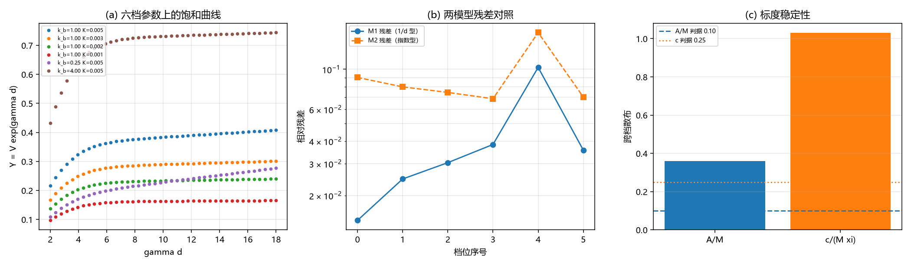

# 注记-修正项解析身份轮：两种候选形式均判负（判据 T1 至 T5）

- **日期**：2026-09-20 10:36:59
- **来源**：作者 2026-09-20 指令（接着做）；上一轮[[验证脚本/注记-次主导成分轮：交叉项积分工具与前置因子的相消（判据S0至S4）]]把修正项按窗口内经验形式登记为 $B/d$
- **脚本**：`验证脚本/correction_identity.py`
- **状态**：判据级读数；两种候选形式判负，振幅普适性判负，该线收口条件被推翻
- **图**：见 §二 图 1
- **依据**：[[验证脚本/注记-次主导成分轮：交叉项积分工具与前置因子的相消（判据S0至S4）]]

---

## 一、任务与方法

上一轮把修正项登记为 $B/d$，但它不是渐近展开的合法项，故需换参数核其标度：真项应有稳定的标度，拟合假象会随参数漂移。

方法：用交叉项积分算 $V(d)$，把 $Y = Ve^{\gamma d}$ 分别用两个两参模型拟合，其一为 $Y = A + k/d$（上一轮的经验形式），其二为 $Y = A + ke^{-\gamma d}$（渐近展开的合法形式）。窗口取 $d$ 从 $2\xi$ 到 $18\xi$。扫描六档：固定 $k_b = 1$ 变 $K$（$0.005$、$0.003$、$0.002$、$0.001$），固定 $K = 0.005$ 变 $k_b$（$0.25$、$4$）。

---

## 二、判据与读数

| 判据 | 内容 | 实测 | 期望 | 结果 |
| --- | --- | --- | --- | --- |
| T1 | $k_b = 1$ 上四档 $K$ 的 $1/d$ 型拟合残差 | $0.0146$、$0.0247$、$0.0304$、$0.0383$ | $\le 0.01$ | 判负 |
| T2 | 同四档上指数型与 $1/d$ 型的残差比 | $6.19$、$3.24$、$2.45$、$1.79$ | $\ge 3$ | 前两档通过、后两档判负 |
| T1 | $k_b = 0.25$ 与 $4$（$K = 0.005$）的 $1/d$ 型残差 | $0.1024$、$0.0357$ | $\le 0.01$ | 判负 |
| T2 | 同两档的残差比 | $1.56$、$1.97$ | $\ge 3$ | 判负 |
| T3 | $A/M$ 跨六档散布（均值） | $0.359$（$4.795$） | $\le 0.10$ | 判负 |
| T4 | $k/(M\xi)$ 跨六档散布（均值） | $1.030$（$-4.820$） | $\le 0.25$ | 判负 |
| T5 | 变 $K$ 子集上 $A/M$ 与 $k/(M\xi)$ 的散布 | $0.078$ / $0.248$ | $\le 0.10$ 与 $\le 0.25$ | 通过（边缘） |
| T5 | 变 $k_b$ 子集上两项的散布 | $0.333$ / $0.859$ | 同上 | 判负 |

---

## 三、读数与含义

**其一，$1/d$ 型不是真项。** 它的拟合残差随 $K$ 单调增大（$0.015$ 到 $0.038$），在 $k_b = 0.25$ 上达到 $0.10$；同时它相对指数型的优势随 $K$ 递减（$6.19$ 到 $1.79$）。真项的残差不应随参数系统性漂移，故上一轮的经验形式不成立。

**其二，指数型也不是。** 指数型的残差在所有档位上都更大（$0.069$ 至 $0.160$），即两参模型里它更差。所以修正项既不是简单的 $e^{-\gamma d}$，也不是简单的 $1/d$。

**其三，振幅的普适性判负。** $A/M$ 在固定 $k_b = 1$ 的四档 $K$ 上为 $4.76$、$4.58$、$4.49$、$4.40$（散布 $7.8\%$，边缘通过），但在 $k_b = 0.25$ 上跳到 $6.12$，在 $k_b = 4$ 上为 $4.42$。故「$A \approx 4.4M$」只在 $k_b$ 近 $1$ 的区间近似成立，不是普适常数。

**其四，修正系数的标度也不稳定。** $k/(M\xi)$ 在固定 $k_b = 1$ 的四档上为 $-4.71$、$-4.20$、$-3.94$、$-3.68$（散布 $24.8\%$，边缘通过），在 $k_b = 0.25$ 上为 $-8.65$。同一处的偏离与振幅的偏离同步，说明缺口来自模型本身，不是拟合噪声。

**其五，结论是一条负面结果，且它推翻了收口条件。** 两参结构（$A$ 加单项修正）不足以描述尾；无论修正取 $1/d$ 还是 $e^{-\gamma d}$，残差都超出判据，且振幅与修正系数的标度在 $k_b$ 方向不稳定。故「形状因子这条线收口」的条件本轮不成立，需要三项以上结构或换方法（例如直接把交叉项积分按 $e^{-n\gamma d}$ 逐阶展开后逐项定系数，而不是拟合两参模型）。

---

## 四、严格程度与边界声明

| 结论 | 严格程度 |
| --- | --- |
| $1/d$ 型修正判负 | 读数（残差随 $K$ 单调增大，劣势递减） |
| 指数型修正判负 | 读数（六档残差均更大） |
| $A/M$ 的普适性判负 | 读数（$k_b = 0.25$ 偏离至 $6.12$） |
| 修正系数的标度不稳定 | 读数（$k_b$ 方向散布 $0.859$） |
| 三项以上结构 | 未做（本轮已排除两种两参结构） |

**本注记验证**：两种候选修正形式的成立性、振幅与修正系数在两条参数方向上的标度稳定性。

**本注记不验证**：真正的修正结构（三项以上未做）；三维情形；$\xi$ 的体系取值。

---

## 五、过程记录

两处判据程序订正。其一，首版 `np.polyfit` 的返回顺序用错（`polyfit` 按降幂返回，degree-1 时第一个是斜率），把 $1/d$ 的系数当成了常数项，导致六档拟合残差都在 $3$ 至 $5$ 量级、常数为负，明显不合理才暴露；改正后残差降到 $0.015$ 至 $0.10$。其二，散布函数用了 $(\max-\min)/\mathrm{mean}$，当被统计量全为负时数值为负，会把「不稳定」误判为「通过」；改为取绝对值后 T4 由假通过变成判负。教训：判据函数必须对量纲与符号做检查，避免「负散布」这类假通过。

---

## 六、登记联动

- [[验证脚本/README.md]] 第 265 条。
- [[内部草稿/开放问题总览：元相子理论待解决问题清单]] P1 第 39 条补本轮读数；该条目的形状因子子项状态改为「两种候选形式判负，收口条件未满足」。
