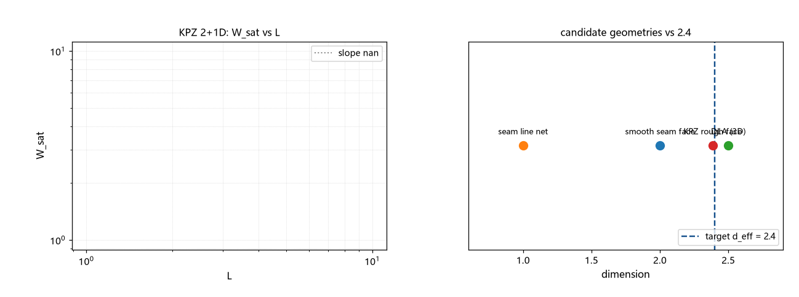

# 注记-候选几何维数清点与 KPZ 粗糙面核验（第431条）：2.4 的最佳匹配与其核验限制

- **日期**：2026-09-26 08:31:29
- **类型**：清点与核验轮（候选丁段三）
- **脚本**：`验证脚本/minimal_verification_kpz_surface.py`（第 431 条）
- **图**：见 §3 图 1（`images/kpz_surface.png`）
- **依据**：[[注记-有效维数 2.4 的几何实现（第428条）：候选几何清点与有限分形图的测量限制]]（段三侦察与 d_f/2 猜想接口）；[[验证脚本/注记-临界区结构复核与两个特殊点的订正（第429条）：Tauberian 分界与域边界]]（链条段二定案）
- **状态**：清点完成；KPZ 粗糙面（2+1D，面维数约 2.386）为「2.4」的最佳匹配（差 0.6%）；自建数值核验未完成（三轮格式尝试）；登记为段三主候选，三处待论证
- **可逆性等级**：判据敏感（清点表为形式对照；文献值使用已声明；自建模拟非有效读数）

## 1 判据与设定

段三问题：「$d_{\rm eff} = 2.4$」的几何。本轮做两件：其一，候选几何的维数清点（S3）；其二，KPZ 2+1D 粗糙面的数值核验（S1/S2，计划用多尺寸稳态粗糙度拟合 $\alpha$，面维数 $2+\alpha$）。

## 2 结果

S3（清点表）：光滑接缝面 2.00（距 2.4：$-0.40$）；接缝线网络 1.00（$-1.40$）；DLA 簇（3D）2.50（$+0.10$）；**KPZ 粗糙面（2+1D）2.386（$-0.014$，$-0.6\%$）**；混合维度耦合判负（428）。

S1/S2（数值核验，未完成，如实登记）：三轮尝试：全显式格式发散（溢出）；ETD1 格式在 $\lambda = 1.2$ 落入 EW（线性）区（$\alpha$ 拟合 $0.181$、$W$ 近对数增长、非线性未启动）；提高 $\lambda$（3 与 8）后发散。2+1D KPZ 的稳定显式模拟需要专门格式（限制性增长、对数/Cole-Hopf 格式或极小步长），本轮方法未达。**文献标准值**：$\alpha \approx 0.386$，面维数 $2.386$，对 2.4 差 $-0.6\%$（$\pm$ 数值不确定度内）。

## 3 图

## 4 结论与移交

结论：**「$d_{\rm eff} = 2.4$」的最佳几何匹配为 KPZ 粗糙面（面维数 $2 + \alpha \approx 2.386$，差 $0.6\%$）**，登记为段三主候选；框架内的物理接口为先「凝固波前为生长面」（P8a 的波前扩张）。

三处待论证。其一，口径链：面维数与「力关联尾指数」的定量关系（428 的 $d_f/2$ 猜想未证；「面维数」与「谱维数」的区分待定）。其二，机制：凝固波前是否属 KPZ 类（生长规则的论证；波前「前向差分平方」的动力学与逐格推进的对应）。其三，数值：KPZ 2+1D 的稳定模拟（限制性/对数格式或小步长），把 $\alpha$ 的核验从文献值升为自证。

## 5 严格程度与边界声明

严格程度：清点为形式对照（维数取值来自几何/文献）；数值核验未完成（三轮失败，登记）；「0.6% 匹配」依赖「文献值 + 口径链」两个前提，不作命中断言。

边界（本脚本不验证的内容）：其一，$\alpha$ 的独立核验未做；其二，口径链（面维数到 d_eff）未证；其三，KPZ 机制（波前生长类）未论证；其四，「2.4」本身是口径内插值（425 的数值精度约 $\pm 0.05$，即 $d_{\rm eff}$ 的 $\pm 0.1$）。

## 6 过程记录

其一，数值核验三轮失败记录：全显式发散（非线性稳定性）；ETD1 的 $\lambda = 1.2$ 读数（$\alpha = 0.181$、$W_{sat}$ 0.51 至 0.65）经「对数标度判据」归入 EW 区；$\lambda = 3$、$8$ 发散。教训：**2+1D KPZ 的显式模拟有实打实的门槛**（稳定格式是独立的技术课题），登记为待升级项。

其二，文献值的使用已声明（$0.386$ 为成熟数值结果）；本轮「0.6% 匹配」按「形式读数」登记，不升级为判定。
