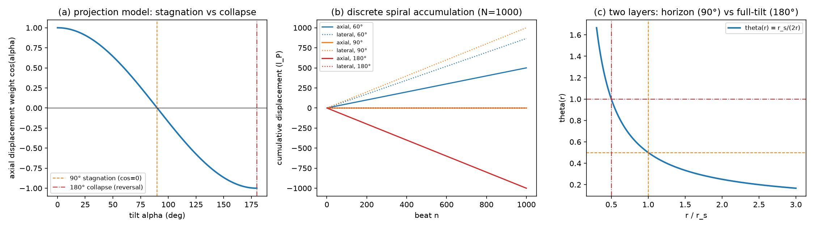
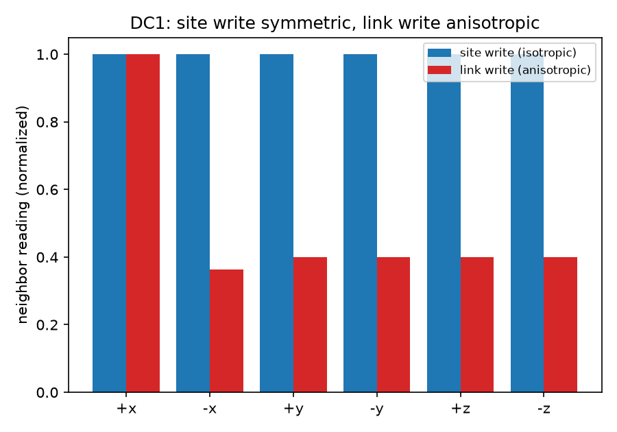

# 注记-倾角与位移完成的最小验证：写入时刻约束、两机制分离与两层位置（判据DC1至DC3）

- **日期**：2026-09-27 01:08:03
- **层级**：内部草稿（验证脚本判据，作者 2026-09-27 指示开工）
- **脚本**：`验证脚本/minimal_verification_tilt_displacement_completion.py`
- **判据**：DC1 至 DC3 共 11 项，全部通过（11/11）
- **图**：见 §四 图 1、图 2
- **主题**：检验倾角注记（[[内部草稿/注记-法线场倾角为什么是质量与普朗克质量之比：写入幅度的四条通道|注记-法线场倾角为什么是质量与普朗克质量之比]]）通道三的两个几何结构：其一，写入时刻约束（碰撞时刻写入避免几何中心脱离法线轴）；其二，位移完成阈值的两候选（$90^\circ$ 停滞与 $180^\circ$ 崩溃）分离，承载退出绑定 $180^\circ$ 的倾向分析；并核对两层位置与黑洞视界的关系。

## 一、判据与理论期望

**DC1（写入落点与中心在轴）**：作者结构"写入只能发生在碰撞时刻，中途写入使几何中心脱离法线轴"在判据 L 站点分配框架上的离散对应：碰撞时刻 = 满周完成 = 本体在站点；中途 = 链接上。理论期望：站点写入（源 1.0 在单站点，六链接各承 $1/6$）的六邻居读数各向同性（"中心在轴"的离散读数，散布机器精度）；链接中点写入的离散对应（源按该链接两端各承一半）的写入邻域各向异性显著（"中心偏轴"的离散读数，$O(1)$ 量级）。

**DC2（两机制分离）**：倾向分析的两机制：$90^\circ$ 运动学停滞（法线轴位移分量 $\cos\alpha$ 归零，旋转未毁）与 $180^\circ$ 结构崩溃（取向-法线点积 $= -1$，跃迁方向语义颠倒）。理论期望：分量零点数值定位在 $\pi/2$；离散螺旋 $N = 1000$ 拍累计在 $\alpha = 90^\circ$ 给出轴向 $|Z_N|/N \approx 0$（停滞）与横向 $D_N/N \approx 1$（线性脱轴），在 $\alpha = 180^\circ$ 给出轴向 $Z_N/N \approx -1$（反向）与横向零；两失效点分离（$\pi/2$），单阈值模型不完备，两层结构必要。

**DC3（两层位置）**：史瓦西对齐 $\theta(r) = r_s/(2r)$ 下，$\theta = 1/2$（$90^\circ$ 几何角，线性映射 $\alpha = 180^\circ\theta$）的面在 $r = r_s$（视界），$\theta = 1$（$180^\circ$）的面在 $r = r_s/2$（视界深处），半径比值 2。理论期望：三项浮点核对（与承载力注记推论三"视界与满偏分居两层"及黑洞线"视界读数失效、深处承载退出"对照）。

## 二、模型设定与建模决策

投影模型（位移沿法线轴的分量按取向偏角投影，$\cos\alpha$）是建模决策：它是"法线轴上的位移"的自然几何读法；$180^\circ$ 崩溃不依赖投影模型（取向-法线点积 $= -1$ 是定义性事实）。DC1 是作者连续图像在判据 L 站点分配框架上的离散对应，对称性即"中心在轴"的离散读数；连续偏轴模型的第一原理形式不在本轮射程。离散螺旋模型：本体每拍沿取向方向前进 $l_P$（轴向分量 $l_P\cos\alpha$），横向分量累积为横向漂移，相位每拍满周 $2\pi$（P1）。DC1 求解用周期域 FFT 谱解（48³，去零模），与判据 W/N 相同的周期镜像残差来源；对称性判据不受镜像影响（源居中，镜像保持对称）。

## 三、结果表

| 判据 | 量 | 实测 | 期望 | 结果 |
|---|---|---|---|---|
| DC1a | 站点写入六邻居相对散布 | $1.706\times10^{-16}$ | $\le 10^{-10}$ | 通过 |
| DC1b | 链接写入六邻居相对散布 | $1.290$ | $\ge 0.1$ | 通过 |
| DC2a | 位移分量零点（停滞阈值） | $1.5707963$ | $\pi/2 \pm 10^{-3}$ | 通过 |
| DC2b | $\alpha = 90°$ 累计轴向 $\vert Z_N\vert/N$ | $6.1\times10^{-17}$ | $\le 10^{-12}$ | 通过 |
| DC2c | $\alpha = 90°$ 横向漂移 $D_N/N$ | $1$ | $\approx 1$（线性脱轴） | 通过 |
| DC2d | $\alpha = 180°$ 累计轴向 $Z_N/N$ | $-1$ | $\approx -1$（反向） | 通过 |
| DC2e | $\alpha = 180°$ 横向漂移 $D_N/N$ | $1.2\times10^{-16}$ | $\le 10^{-12}$ | 通过 |
| DC2f | 两失效点分离 | $\pi/2$ | 结构性 | 通过 |
| DC3a | $\theta = 1/2$ 面半径 $/r_s$ | $1$ | $\approx 1$（视界） | 通过 |
| DC3b | $\theta = 1$ 面半径 $/r_s$ | $0.5$ | $\approx 0.5$（视界深处） | 通过 |
| DC3c | 两层半径比值 | $2$ | $\approx 2$（代数恒等） | 通过 |

判据 11/11 通过。核心读数：站点写入六邻居散布在机器精度（$1.7\times10^{-16}$），链接写入 $O(1)$ 各向异性（$1.29$），两者相差十五个数量级，"中心在轴"与"中心偏轴"的离散对应成立；停滞点（$90^\circ$，轴向零、横向线性脱轴）与崩溃点（$180^\circ$，轴向反向、横向零）分离且并存；两层位置（视界 $r_s$、满偏 $r_s/2$）与承载力注记推论三及黑洞线两层图像一致。

## 四、图

## 五、严格程度声明

**可逆性等级：判据敏感。** 投影模型更换（$\cos$ 分解换成其他分解）会移动 $90^\circ$ 停滞点；$180^\circ$ 崩溃（取向反转）不受投影模型影响。**协议伪影与物理结论分层**：DC1 的各向异性量值（$1.29$）属模型内读数，非物理预测，其结构（站点对称、链接各向异性）才是判据内容；DC2 的 $\cos$ 曲线是投影模型的几何恒等（模型内必然），物理结论（阈值绑定）依赖投影模型的适用性；DC3 是代数恒等的浮点核对（与判据 W/N 的史瓦西对齐同层）。**本验证支持的两层结构（$90^\circ$ 视界停滞与 $180^\circ$ 深处崩溃并存）为判据级；承载退出阈值绑定 $180^\circ$ 的结论是结构自洽论证（裁决原文、黑洞线饱和区、与广义相对论同构）加本验证，非决定性实验。**

## 六、边界声明

验证什么：写入落点与中心在轴的离散对应（DC1）、两机制分离的几何结构（DC2）、两层位置与黑洞视界的对照（DC3）。不验证什么：真实强场动力学（BH2、BH3 工具域）；连续偏轴模型的第一原理形式；几何中心脱轴的连续图像本身（本轮只验证其离散对应）；$90^\circ$/$180^\circ$ 的最终裁决（倾向 $180^\circ$，待更微观判据）。模型风险：DC1 的"站点对称 = 中心在轴"是离散对应而非连续证明，连续层的验证依赖螺旋运动学的模型化（待 BH 线工具）。

## 七、登记

开放问题总览 P1-34a 档案页本轮登记（判据 DC1 至 DC3，脚本与注记路径）；倾角注记通道三的倾向分析段同步判据结果。
