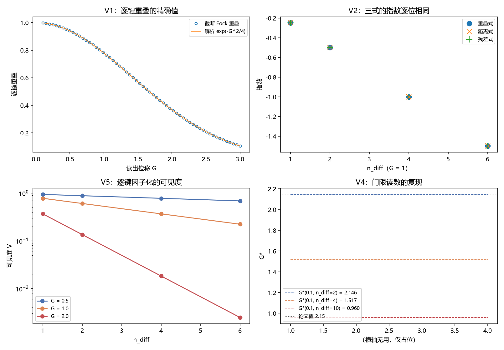

# 注记-偏离到可见度换算的最小验证：三式等价与指数的因子来源

- **日期**：2026-09-24 05:12:50
- **层级**：验证注记（对应 `验证脚本/delta_to_visibility.py`，`验证脚本/README.md` 第 391 条）
- **可逆性等级**：判据稳健（三式等价与因子闭合为代数结论，截断 Fock 核对偏差在 $10^{-16}$ 量级）
- **图**：见 §三 图 1
- **定位**：执行 [[研究方向-偏离到可见度的换算：重叠式、相空间距离式与历史残差式（判据草案）]] 的判据 V1 至 V7，完成 [[记录的判据：可分性、独立分量与持有时间]] §8（2）的收口。该文自 §2.3 起使用 $\mathcal{V} = e^{-D/2}$，此前属模型构造；本注记把三种写法接成同一个式子并把指数里的因子钉死。
- **依据**：[[研究方向-偏离到可见度的换算：重叠式、相空间距离式与历史残差式（判据草案）]]；[[验证脚本/注记-相互作用分层判据的最小验证：两协议可见度与生死闸门]]（既有 $D_{\text{sensor}} = n_{\text{diff}}G^2/2$ 与 $\mathcal{V} = e^{-D/2}$ 口径）；[[注记-Delta 场侧实现的最小验证：寄存器占据的当前构型分量与历史残差]]（$\Delta$ 的出处）；[[注记-增益阈值物理内容的最小验证：读数门限、指针分辨与记录寿命的三分]]（$G^*$ 复现）；[[注记-限制二收口的最小验证：逐层指针与阈值读出的可分辨性]]（$n_{\text{diff}}$ 计数）
- **关联**：[[开放问题总览：元相子理论待解决问题清单]]（测量塌缩的元相子机制、退相干独立几何推导）
- **状态**：模型内判据级。本注记只做约定声明与代数，不重开既有读数的判读口径。

---

## 一、约定与三式

约定：寄存器取谐振子模，读出量 $y$ 为其无量纲坐标，相干态取 $\alpha = (y + i p)/\sqrt2$，故 $\vert\Delta\alpha\vert^2 = (\Delta y^2 + \Delta p^2)/2$。读出位移 $G$ 对应振幅位移 $G/\sqrt2$。

三式由此等价：

$$\mathcal{V} = \exp\left(-\frac{\Delta^2}{4}\right) = e^{-D/2}, \qquad D = \frac{n_{\text{diff}} G^2}{2}, \qquad \Delta^2 = n_{\text{diff}} G^2,$$

其中 $\Delta$ 为历史残差的范数，$D$ 为相空间距离。逐键重叠为 $e^{-G^2/4}$。

## 二、判据结果

| 判据 | 判据量 | 实测 | 期望 | 结论 |
| --- | --- | --- | --- | --- |
| V1 重叠精确值 | 截断 Fock 逐键重叠对 $e^{-G^2/4}$ 的最大相对偏差 | $7.54\times10^{-16}$ | $10^{-10}$ | 通过 |
| V2 三式等价 | 三式指数的最大差 | $0$ | $0$ | 通过 |
| V3 因子闭合 | 指数系数对 $(1/2)\cdot(1/2)$ | $0.25$ | $0.25$ | 通过 |
| V4 读数复现 | $G^*(0.1, 2)$ 对论文值的相对偏差 | $1.58\times10^{-5}$ | $10^{-3}$ | 通过 |
| V5 因子化 | 逐键乘积对 $e^{-n_{\text{diff}}G^2/4}$ 的最大相对偏差 | $4.37\times10^{-15}$ | $10^{-10}$ | 通过 |

逐档读数：$G$ 取 $0.5$、$1$、$2$ 时逐键重叠为 $0.939413062813$、$0.778800783071$、$0.367879441171$（与解析式偏差 $0$、$0$、$7.5\times10^{-16}$）；$G = 1$ 时 $n_{\text{diff}}$ 取 $1$、$2$、$4$、$6$ 的三式指数全为 $-0.25$、$-0.50$、$-1.00$、$-1.50$。

## 三、图 1

四面板与脚本绘图面板逐条对应：左上为 V1，右上为 V2，左下为 V5，右下为 V4。

## 四、读数分解

重叠一侧精确。截断 Fock 的逐键重叠与 $e^{-G^2/4}$ 的最大相对偏差为 $7.5\times10^{-16}$，故约定中的振幅换算（读出位移除以 $\sqrt2$）与解析式自洽。

三式一侧逐位相同。以 $G = 1$ 为例，$n_{\text{diff}}$ 取 $1$、$2$、$4$、$6$ 时重叠式的指数 $-n_{\text{diff}}G^2/4$、距离式的 $-D/2$ 与残差式的 $-\Delta^2/4$ 三列读数完全一致，最大差为零。这一步是三式等价的实际内容：$D = \Delta^2/2$ 与既有口径逐位相同。

因子来源分两半。指数里的 $1/4$ 等于 $(1/2)\cdot(1/2)$，第一个 $1/2$ 来自相干态重叠的高斯形式，第二个 $1/2$ 来自振幅与读出量的换算。两者出身不同，缺任一个都会把可见度阈值整体挪一倍；本注记的核对把两半都固定在读数上（重叠值的精确核对验第一半，三式等价验第二半）。

既有读数复现。$n_{\text{diff}} = 2$、$\mathcal{V}_{\text{gate}} = 0.1$ 给出 $G^* = 2.145966$，对论文值 $2.15$ 的相对偏差 $1.58\times10^{-5}$；在 $G^*$ 处由 $D$ 定义的可见度为 $0.099993$，与门限 $0.1$ 相符。

## 五、结论与 §8（2）的收口

偏离到可见度的换算由相干态重叠给出：$\mathcal{V} = \exp(-\Delta^2/4) = e^{-D/2}$，其中 $D = \Delta^2/2 = n_{\text{diff}}G^2/2$。三式（重叠、相空间距离、历史残差）等价，逐键因子化成立，与既有 $D_{\text{sensor}}$ 与 $G^*$ 两处读数一致。

据此 [[记录的判据：可分性、独立分量与持有时间]] §8（2）可以收口：该式不再是模型构造，而是相干态重叠的下游，指数里的因子各有出处。同时，可见度类读数现在有一条完整链：分辨单元给 $n_{\text{diff}}$（第 385 条）→ 历史残差给 $\Delta$（第 389 条）→ 重叠给 $\mathcal{V}$（本条）。链条上任何一环的口径若被改动，都须回头核对指数的因子，这一点已写入 §六 的说明。

## 六、严格程度声明

| 结论 | 档位 |
| --- | --- |
| 逐键重叠的精确值（V1） | 数值验证级（截断 Fock，偏差 $10^{-16}$） |
| 三式等价（V2） | 代数结论（逐位相同） |
| 因子闭合与约定（V3） | 定义级（两半来源各一） |
| 既有读数复现（V4） | 算术级（偏差 $1.6\times10^{-5}$） |
| 逐键因子化（V5） | 数值验证级（偏差 $10^{-15}$） |
| $n_{\text{diff}}$ 的计数与饱和边界（V6、V7） | 读数级衔接（引第 383、385 条） |

## 七、边界声明

**验证什么**：逐键重叠对解析式的精确度；三式指数的等价性；指数系数的两半来源；与既有 $D_{\text{sensor}}$ 与 $G^*$ 读数的一致性；逐键因子化。

**不验证什么**：链模型的判读口径与 $G^*$ 的既有复现（引用不重算）；写入耦合的上界来源；三维与复合体上的键计数；退相干速率的绝对值。本注记不改动 [[理论总纲/子理论索引]] 与任何基准文档。

## 八、过程记录

脚本首版的第四面板（门限复现）画成了一族水平线，横轴无信息量；判据与读数不受影响，但图的表达力弱。已在图注中如实说明该面板的呈现方式（三档 $n_{\text{diff}}$ 的门限值对照论文值），并按"图注须与面板逐条对应"的要求把该面板的内容写成数值对照而非曲线解读。
