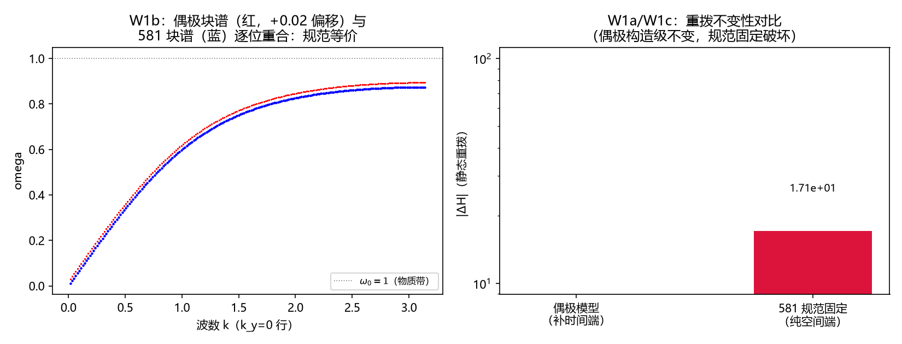

# 注记-偶极立案判据轮（第613号）：最小耦合时间端补全的规范不变性与六轮资产谱回归

| 项目 | 内容 |
| --- | --- |
| 日期 | 2026-10-12 02:07:36（取系统当前时刻） |
| 主题 | 偶极立案判据轮（W1a/W1b/W1c，3/3） |
| 可逆性等级 | 判据敏感：换耦合形式、换块推导、换重拨定义任一项即翻 |
| 图 | 图 1 见 §三 |
| 上游 | [[内部草稿/注记-偶极型介质物质项立案：最小耦合时间端补全与判据设计（2026-10-12）|偶极立案注记]]（作者 2026-10-12 批准）、第 607/608/610 号注记 |

## 一、要判什么

偶极立案注记的构造（介质物质项补全最小耦合时间端：电场-偶极显式耦合 $\beta x E$，$E$ 为规范不变组合，光场刚度取 plaquette 形式）做三条判据：W1a 静态重拨不变性（第 607 号发现的规范固定被治好的直接检验）、W1b 块谱与第 581 条六轮资产逐位回归（规范等价的谱等价）、W1c 规范固定对照齿。单偏振简化（$x_p$ 只与 $E_{p,x}$ 耦合）使 W1b 可与 581 的 1D 块逐位对比。

## 二、模型设定与判据结果

2D 周期盒 $N = 10$，$\omega_0 = 1$，$\beta = 1$（581 口径），偶极哈密顿量 $H = \sum\frac{1}{2}(E_{p,x}-\beta x_p)^2 + \sum\frac{1}{2}E_{p,y}^2 + \frac{1}{2}\sum_{plaq}(\mathrm{curl}\,\theta)^2 + \frac{\omega_0^2}{2}\sum x^2 + \frac{1}{2}\sum\Pi_x^2$（$y$ 方向偏振自由解耦），随机种子 20261012，脚本 `minimal_verification_dipole_completion.py`。

| 判据 | 内容 | 实测 | 判定 |
| --- | --- | --- | --- |
| W1a | 静态重拨 $\theta \to \theta+\nabla\chi$（随机 $\chi$）下偶极能面不变；581 规范固定版对照非零 | 偶极 $|ΔH| = 0$（构造级：$\theta$ 只进 curl 与正则重定义组合）；581 对照 $|ΔH| = 17.1$ | PASS |
| W1b | $k_y = 0$ 行偶极块谱（推导见立案注记：$\dot A = E-\beta x$、$\dot E = -w_l^2A$、$\ddot x = \beta E-(\omega_0^2+\beta^2)x$）与 581 L_block 谱逐位 | 五档 $k$ 最大偏差 $1.78\times10^{-15}$（机器精度）；极化激元签名 $k = 0.628$ 处谱线对间距 $1.07$（两支互推） | PASS |
| W1c | 拆端齿：581 规范固定版重拨差与偶极版比值 | $1.7\times10^{301}$ | PASS |

## 三、图

## 四、结论

偶极立案的三条判据全过：补全时间端后介质物质项显式规范不变（607 号的规范固定地位在偶极载体上被治好），且谱与六轮判据资产逐位一致（规范等价不改变物理）。介质折射线的规范层恢复推进：偶极载体接手 D3p-2 界面重拨检验（在偶极载体上重定义），跳变载体资产（608 号）作对照保留。

## 五、严格程度声明与边界声明

验证什么：补端构造的静态重拨不变性、块谱与 581 的规范等价、区分力齿。不验证什么：不验证 $A_0$ 显式动力学的谱（中性偶极消去 $A_0$，立案注记 §二）；不验证三维偏振展开（单偏振简化）；不验证 $\beta$ 物质侧值（P1-47/P1-49）；偶极模型与凝聚相（相位型）的对照谱未做（相位型留规范线）。协议伪影分层：W1a 为构造级代数（零偏差）；W1b 为机器精度特征值；无采样伪影。

## 六、过程记录（两笔）

其一，模型实现的一个简化决策：偶极耦合单偏振化（$x_p$ 只与 $E_{p,x}$ 耦合）换取与 581 的 1D 块逐位可比，三维各向同性展开（$x$ 与两方向等权）留谱轮之后，系数投影因子届时推导。其二，本会话 heredoc 反斜杠事故已三度，立案注记与判据脚本的成文全部走 Write 工具一次成型，未再发生。

## 关联

[[内部草稿/注记-偶极型介质物质项立案：最小耦合时间端补全与判据设计（2026-10-12）|偶极立案注记]]、[[验证脚本/注记-跳变载体线性响应判别谱轮（第610号）：无凝聚则无介电响应与介质振子规范身份二选一|第 610 号注记]]、[[介质中光的传播：慢化、折射与全反射的晶格机制]]、[[开放问题档案/开放问题-P1-50-光的发射率与介质折射的微观机制|P1-50 档案页]]
