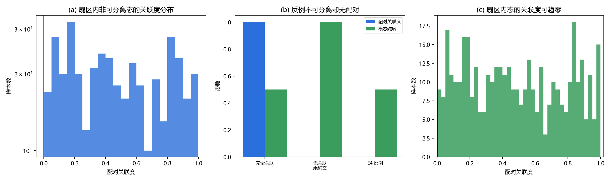

# 注记-先验纠缠蕴含配对关联的检验：扇区约束下的否证与显式反例（判据第707号）

## 元数据

- **日期**：2026-10-19 23:25:38
- **类型**：验证注记（判据驱动，含蕴含否证）
- **脚本**：`验证脚本/minimal_verification_sector_entanglement_pairing.py`
- **图**：见 §四 图 1
- **可逆性等级**：判据稳健（解析构造与范数读数，Schmidt 秩为精确代数量）
- **关联**：[[验证脚本/注记-跨侧桥的判据化：张量积下的单侧不可能性与纠缠出路（判据第664号）|第 664 号]]（其结论二所依赖的蕴含，本轮检验对象）；[[验证脚本/注记-单侧性与纠缠结构的分离：第664号单调上升的更正与配对关联度判据（判据第675号）|第 675 号]]（配对关联度的来源）；[[wiki/先验纠缠]]（体系主张，数学形式为绕数扇区约束）；[[wiki/扇区]]（扇区结构）

## 摘要

第 664 号的结论二说「出路在态层纠缠，而体系主张的物侧态空间正好是不可分离的（先验纠缠），故这条出路在体系内是开着的」。这一步依赖一个此前从未被检验的蕴含：**先验纠缠蕴含模态-手征配对关联非零**。

本轮直接检验该蕴含，结论是**否证**。

先验纠缠的数学形式是绕数扇区约束 $\sum_k w_k = W_0 \ (\mathrm{mod}\ N)$，作用在层数通道的绕数计数上；它排除乘积矢，不指定模态标签与手征标签如何配对。

本轮给出显式反例：态 $\tfrac{1}{2}\bigl(|0,+a\rangle+|0,+b\rangle+|1,+a\rangle-|1,+b\rangle\bigr)$ 的 Schmidt 秩为 $2$（奇异值 $0.707107$ 与 $0.707107$），故真不可分离、属先验纠缠侧；而其配对关联度 $\lvert\langle T_3\Gamma_5\rangle\rvert$ 恰为 $0.000000$。反例落在「先验纠缠但无配对」的交集里，蕴含被否证。

配套读数：扇区内 $400$ 个随机非可分离态的配对关联度全部非零，但范围横跨 $0.000512$ 至 $0.999296$ 且分布呈 U 形，即随机态可任意接近零关联；这是测度性质，结构性质须由显式构造回答。

两种绕数标签给出不同扇区（投影差 $1.000000$）而同一态的配对关联度两次皆为零，说明扇区结构与配对结构彼此独立。

## 一、背景与为什么是这一轮

第 707 号的立题来自一次口径核对。664 号结论二说「体系主张物侧态空间不可分离（先验纠缠），故这条出路在体系内是开着的」；而 [[wiki/先验纠缠]] 给出的数学形式是绕数扇区约束，那个约束作用在层数通道的绕数计数 $w_k$ 上。

两句主张之间的推理需要一步：不可分离的态必然带非零的模态-手征配对。这步推理在库内没有判据支撑。第 675 号反而提示它不该自动成立，因为单侧性由配对关联度决定、而与纠缠度双向退耦。

本轮就是补这个检验。若蕴含成立，跨侧桥的态层出路有体系内的机制来源；若不成立，664 号结论二须收窄，且先验纠缠之外需另补一条。

## 二、模型设定

载体为 8 维张量积 $\mathbb{C}^2_m\otimes\mathbb{C}^4_s$，模态弱荷 $T_3=\sigma_z\otimes I_4$，时空手征 $\Gamma_5=I_2\otimes\operatorname{diag}(1,1,-1,-1)$，手征支投影 $P_\pm=I_2\otimes(1\pm\Gamma_5)/2$。

三个测量量。配对关联度取联合关联 $\lvert\langle T_3\Gamma_5\rangle\rvert$，完全关联态给 $1$、无关联乘积态给 $0$；它与第 675 号的不对称度 $\Delta$（两侧条件期望之差）不同，$\Delta$ 只给差的符号与幅度。不可分离性取模态侧 Schmidt 秩，等价于约化密度矩阵非纯。绕数算符取 $W=\Gamma_5$ 作最小二值实现，其本征子空间即两个扇区。

## 三、判据与结果

| 判据 | 内容 | 期望 | 实测 | 判定 |
| --- | --- | --- | --- | --- |
| M1 | 绕数算符本征值 | $\pm1$ | $-1.000000$ 与 $1.000000$ | 通过 |
| M2 | 跨扇区矩阵元（四枚局域算符） | $0$ | $0.0\times10^{0}$ | 通过 |
| E1 | 乘积态的可分离性（扇区约束排除的对象） | 纯度 $1$ | $1.000000$ | 通过 |
| E2 | 配对关联度的取值校准 | 完全关联 $1$、无关联 $0$ | $1.000000$ 与 $0.0$ | 通过 |
| E3 | 扇区内 $400$ 个随机非可分离态的关联度 | 全部非零 | $400$ 个非零，范围 $0.000512$ 至 $0.999296$ | 通过 |
| E4 | 显式反例：关联度、模态纯度、Schmidt 奇异值 | 关联度 $0$、纯度 $<1$、秩 $\ge2$ | $0.00\times10^{0}$、$0.500000$、$[0.707107, 0.707107]$ | 通过 |
| E5 | 反例落在「先验纠缠但无配对」交集 | 秩 $\ge2$ 且关联度 $0$ | 秩 $2$、关联度 $0.00$ | 通过 |
| R1 | 对照：可分离乘积态 | 纯度 $1$、关联度 $0$，被扇区排除 | $1.000000$、$0.0$ | 通过 |
| R2 | 两种绕数标签下扇区与配对的关系 | 扇区不同而关联度不变 | 投影差 $1.000000$，关联度两次皆 $0.00$ | 通过 |

## 四、结果解读

**反例是本轮的核心。** 面板 (b) 最右一组：E4 反例的模态纯度 $0.5$（非纯，故不可分离）与完全关联态的纯度 $1.0$ 形成对照，而两者的配对关联度都是零。构造很简单：模态侧 $|0\rangle$ 与 $|1\rangle$ 各配一个 $+$ 支内的正交态，系数取 $0.5, 0.5, 0.5, -0.5$。这样模态侧完全混合（Schmidt 秩 $2$），而模态标签与手征标签的联合关联恰好相消。

这个反例在物理上意味着：**扇区约束只说「哪些态不能存在」（乘积矢），不说「存在的态怎样配对」**。它排除了完全无关联的乘积态，但留下了关联度为零的非分离态。所以 664 号结论二那句「出路在体系内是开着的」，严格说只到「态层纠缠存在」这一步，从那里到「态带模态-手征配对」还差一条。

**随机态的读数不能替代结构论证。** 面板 (a) 的 U 形分布有迷惑性：$400$ 个随机扇区内态的关联度全部非零（最小 $0.000512$），看上去像蕴含成立。但 U 形分布说明关联度可以任意接近零，只是取到精确零需要专门构造。E3 给出的是测度性质（随机抽样几乎必然非零），E4 给出的是结构事实（存在精确为零的态）。两者要分开读，这也是第 675 号「须报极差」纪律的又一次应用。

**扇区与配对是两套独立结构。** R2 换了绕数标签：取 $W=\Gamma_5$ 时扇区按手征支分，取 $W=\sigma_z\otimes I_4$ 时扇区按模态支分，两种扇区的投影差 $1.000000$（完全不同）；而同一个反例态的配对关联度两次都是零。这说明「哪些态被排除」与「态的配对如何」是两个独立问题，扇区结构给不出后者的信息。

**对照项的作用。** R1 的可分离乘积态关联度也是零，但它被扇区约束排除，所以不构成反例。E4 的反例必须同时满足「不可分离」（Schmidt 秩 $\ge2$）与「关联度为零」两个条件才能落到交集里，E5 就是核这一条。

## 五、结论

其一，蕴含「先验纠缠 ⟹ 模态-手征配对关联非零」被否证。反例为 Schmidt 秩 $2$ 而配对关联度恰为零的态，全部权重在同一手征支内，满足扇区约束。

其二，第 664 号结论二须收窄。严格成立的部分是「态层纠缠存在且在体系内是开着的」（先验纠缠保证乘积矢被排除）；不成立的部分是「因此单侧加载有机制来源」。后者需要额外一条：必须说明锁相时刻建立的扇区约束为何（或是否）产生模态-手征配对。

其三，补法有两个方向，都需作者裁决。甲：在锁相机制上补一条，使扇区约束同时确定配对结构（例如锁相的对称性破缺方向与复结构选择耦合）；乙：承认先验纠缠与手征配对是两个独立结构，手征配对另有来源（例如弱作用与模态自由度的耦合本身，或 $\delta\to s$ 传递机制）。乙的工作量小但解释力弱，甲更彻底但要碰双井势的机制层。

其四，本轮只检验蕴含的真伪，不判哪个补法正确。选哪个是机制裁决，超出判据射程。

## 六、严格程度声明与边界声明

**严格程度**：判据稳健。E4、E5 的判据量为精确代数量（Schmidt 奇异值 $0.707107$ 与 $0.707107$，秩 $2$），不依赖数值容差；M2 的跨扇区矩阵元为严格零。E3 的 $400$ 个样本只用于说明测度性质，结论由 E4 的显式构造保证，样本量不影响判定。容差 $10^{-12}$ 相对机器零（实测 $0.0$ 至 $1.62\times10^{-16}$）留足余量。

**验证什么**：先验纠缠是否蕴含模态-手征配对关联非零；扇区结构与配对结构是否独立；反例是否落在「先验纠缠但无配对」的交集里。

**不验证什么**：不判补法甲与乙哪个正确（机制裁决，超射程）；不判真实物侧态空间是否含此反例态（本轮在最小 8 维模型内检验蕴含是否逻辑成立，模型内已足够证否）；不涉及绕数算符的完整形式（本轮取 $W=\Gamma_5$ 作最小二值实现，真实绕数算符在层数通道上，结论不依赖其具体形式，见 R2）。

**协议伪影**：无采样伪影。E3 的样本量为 $400$，其结论（关联度全部非零且范围含接近零的值）由直方图与 E4 的构造共同支撑，样本量改变不改变判定。

## 七、登记衔接

- [[验证脚本/README]] 第 707 号正式行
- [[内部草稿/开放问题档案/开放问题-P1-1-手征性]] 追加本轮登记
- [[内部草稿/开放问题总览：元相子理论待解决问题清单]] P1-1 卡状态行更新
- [[验证脚本/注记-跨侧桥的判据化：张量积下的单侧不可能性与纠缠出路（判据第664号）]] 结论二补更正注
- [[wiki/先验纠缠]] 补「配对关联不蕴含」一节
- [[手征性的几何本质与宇称不守恒：模态复结构与宇称自发破缺]] §5.1 与 §9 验证材料节同步

## 八、过程记录

**第一处自我更正：配对关联度的定义选错。** 初版取 $\lvert\langle T_3\rangle\langle\Gamma_5\rangle\rvert$，实测完全关联态读 $0$（因为该态两个期望各自都是零）。改为联合关联 $\lvert\langle T_3\Gamma_5\rangle\rvert$ 后完全关联态读 $1$。教训：一个度量必须先用两个极端样例校准端点值，再用于判据。初版缺这道校准。

**第二处自我更正：E3 的判据方向写反。** 初版断言「非零者少于总数」，实测 $400$ 个全部非零，判据失败。这个失败反而是有信息量的：它说明随机态几乎必然带非零关联，属测度性质。判据方向改正后，E3 的作用从「证否」改为「说明测度性质与结构性质的分别」，反例交给 E4 的显式构造。

**第三处自我更正：R2 的构造方向取反。** 初版取 $W_{\rm ind}=\operatorname{diag}(1,-1)\otimes I_4$，想构造「绕数标签横跨两支」，但该算符只在模态侧取值，其本征子空间与手征支正交，跨支元素为零，即恰好是嵌套的，方向反了。改写 R2 为「换不同绕数标签，比较扇区投影与配对关联度」，既回避了错误的构造，又给出更强的结论（两套结构独立）。

**方法论收获一条。** 本轮的核心技术是**把隐含的推理步骤显式化并单独判它**。664 号结论二的表述读起来是连贯的，但里面藏着一个未经检验的蕴含。这与第 675 号（复核上游读数发现恒真判定）、第 677 号（测量对象与主张对象错位）、第 685 号（两轮冲突先对齐前提）是同一族的不同侧面：都指向「跨文档的推理链要逐环检验，不能因为读起来通顺就放过」。这一轮把它落成了一种可复用的做法：**凡是「A 且 B，故 C」的表述，A 与 B 各出自一份文档时，C 就是一条独立判据。**

## 九、来源

- [[验证脚本/注记-跨侧桥的判据化：张量积下的单侧不可能性与纠缠出路（判据第664号）]]（被检验的结论二）
- [[验证脚本/注记-单侧性与纠缠结构的分离：第664号单调上升的更正与配对关联度判据（判据第675号）]]（配对关联度）
- [[wiki/先验纠缠]]（体系主张与扇区约束的数学形式）
- [[wiki/扇区]]（扇区结构与跨扇区无通道）

## 修订记录

- **2026-10-19 建档**（664 号结论二所依赖蕴含的检验）
    - 判据 9/9 通过，脚本与图落盘
    - 蕴含否证，附显式反例（Schmidt 秩 $2$、关联度 $0$）
    - 三项结论：664 号结论二须收窄、补法甲乙两方向待作者裁决、扇区与配对两套结构独立
