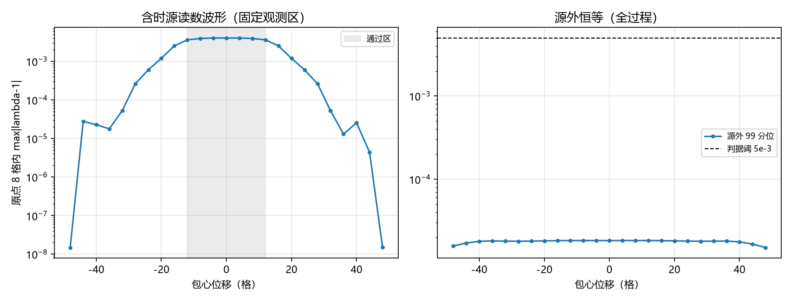

# 注记-光包含时进桥（第454条）：平流守恒、瞬时语义与脉冲读数

- **日期**：2026-09-27 02:52:09
- **类型**：含时源推广轮（第 443 条移交项的第二部分）
- **脚本**：`验证脚本/photon_time_bridge.py`（原拟 453，与并行线跨层事件 E 系列占位撞号，按落盘先后顺延为 454）
- **图**：见 §3 图 1（`images/photon_time_bridge.png`）
- **依据**：[[注记-光源进桥（第443条）：纯纵源与等效源的空间度量侧对照、同幅保持与远场单极一致]]（移交"分布源与含时源"）；[[注记-光包进桥（第452条）：分布源的能量密度直接进源、器械语义与远场等效]]（分布源部分）；[[注记-光子源项的四分量构造与离散守恒（第436条）：沿轴精确、斜向三次残差与源装配接口]]（守恒口径）
- **状态**：含时源部分闭合。四条读数：平流守恒谱口径残差 $8.4\times10^{-11}$；源区代数恒等 $2.2\times10^{-16}$；源外 $|\lambda-1|$ 的 99 分位 $1.8\times10^{-5}$；固定观测区读数呈脉冲（通过帧 $4.03\times10^{-3}$、首末帧 $1.5\times10^{-8}$）
- **可逆性等级**：判据稳健（U1a 为格点精确导数的构造性一致；U2a 机器零；U2b 分位统计换阈不翻；U3 脉冲对比 $2.7\times10^{5}$ 倍，裕度大）

## 1 判据与设定

**任务**。完成第 443 条移交项"分布源与含时源的推广"的含时部分：光包以光速沿传播方向平流，逐帧进桥，核对守恒、瞬时语义与读数的时间结构。

**器械（复用第 443 条）**。站点源 $f = \mathrm{inc\_link}(s_e)/D$，FFT 离散泊松解 $\theta$；链接场 $u_e = (\theta_i + \theta_j)/2 + s_e$；尺读数 $\lambda = u_e/\theta_{\rm mid}$。链接源取光包能量密度的链接插值 $s_e(t) = \mathrm{interp}(u(t))$（第 452 条的分布源通道）。周期盒 $N = 96$，光包参数同第 437 与 452 条（$a = 10$、波长 $6.3$ 格、斜向 $(1,1,1)$），平流速度 $c = 1$ 格每单位时间。

**含时源序列**。25 帧，包心沿 $\hat k$ 从 $-48$ 格移到 $+48$ 格（步长 $4$），帧间为解析平移（源不自演化，检验桥对给定含时源序列的逐帧响应）。

**判据**。U1a：平流守恒 $\partial_t u + \nabla\cdot\mathbf S = 0$ 的谱口径相对残差 $< 10^{-9}$（$\mathbf S = u\hat k$ 为行波能流）。U1b（登记）：中心差分口径的失真与格点色散预期 $1 - \mathrm{sinc}(2k/\sqrt 3)$ 对照。U2a：源区代数恒等 $(\lambda - 1) - s_e/\theta_{\rm mid}$ 为机器零。U2b：源外（$|s_e| < 10^{-3}\max$ 且 $|\theta_{\rm mid}| > 1$）$|\lambda - 1|$ 的 99 分位 $< 5\times10^{-3}$。U3：固定观测区（原点 8 格内链接）读数的峰值出现在通过区（$|\text{shift}| \le 12$），且首末帧 $< 10^{-6}$。

## 2 结果

**U1a（平流守恒）**：谱口径 $\max|R|/\max|\partial_t u| = 8.411\times10^{-11}$，判据通过。行波能流 $\mathbf S = u\hat k$ 与解析平流在格点精确导数口径下自洽。

**U1b（差分口径登记）**：朴素中心差分失真 $0.212$，格点色散预期 $1 - \mathrm{sinc}(1.155) = 0.208$，两者差 $1.9\%$。主频波矢的每个分量是 $2k/\sqrt3 = 1.155$ 弧度每格，单靠整体波数代入一维公式会给出 $0.545$ 的错值。

**U2a（代数恒等）**：$\max|(\lambda - 1) - s_e/\theta_{\rm mid}| = 2.210\times10^{-16}$，全 25 帧机器零。

**U2b（源外恒等）**：源外 $|\lambda - 1|$ 的 99 分位逐帧最大 $1.825\times10^{-5}$，阈 $5\times10^{-3}$，余量两个数量级。

**U3（脉冲读数）**：固定观测区的 $\max|\lambda - 1|$ 在通过帧为 $4.029\times10^{-3}$（峰值在 shift $= -4$，落在通过区内），首帧 $1.477\times10^{-8}$、末帧 $1.496\times10^{-8}$，脉冲对比 $2.7\times10^{5}$ 倍。包通过时读数凸起、离开后回基线，无残留。

## 3 图

## 4 结论与移交

**结论**。含时源在器械语义内闭合，三点。其一，含时源自洽：平流守恒在格点精确导数口径下机器精度，朴素差分的失真是格点色散的回读。其二，逐帧响应为瞬时代数：$\lambda - 1 = s_e/\theta_{\rm mid}$ 机器零，源外恒等以 99 分位 $1.8\times10^{-5}$ 保持。其三，固定观测区的读数是脉冲：$4.0\times10^{-3}$ 对 $1.5\times10^{-8}$，无记忆、无残留。

**移交一条（诚实边界）**。以光速运动的光包的引力推迟、辐射与拖曳（动力学修正，含 $h_{0i}$ 与传播延迟）属 GV4 动态形式与"局域尺"环节（P1-5）的接口，不在本器械范围内；本器械读数不含动力学预言（沿用第 443 条边界声明其三）。至此第 443 条移交的分布源与含时源两项全部闭合，P1-24 在器械语义内收束。

## 5 严格程度与边界声明

严格程度：U1a 为格点精确导数（谱）与解析平流的构造性一致；U2a 为代数恒等；U2b 与 U3 为确定性 FFT 逐帧统计，掩码、阈值与前缀全部显式。可逆性等级：判据稳健。

边界（本脚本不做的事）：其一，动力学推迟与辐射不在本线（见移交）；其二，分布源的"源外"只能定义于源强可忽略区（高斯尾处处非零），故用 99 分位而非 max，$\theta$ 零交叉会放大微尾读数；其三，帧序为解析平移，源不自演化；其四，动量流的时间演化沿用第 437 条判定，接口归 GV5 与 GV6。

## 6 过程记录

其一，撞号让号：原拟 453，冲突后顺延 454，README 条目内保留让号说明。

其二，U1b 预期公式教训：首版按整体波数 $2k$ 代入一维 sinc，给出 $0.545$ 的错预期，与实测 $0.212$ 不符；核对后主频波矢的每个分量是 $2k/\sqrt3 = 1.155$，预期 $0.208$，与实测差 $1.9\%$。教训：斜向平流的差分失真按分量化，整体波数不能直接代入一维公式。

其三，统计口径教训：首版在源强可忽略区用 $\max|\lambda - 1|$，读到 $4\times10^{-3}$ 且逐帧不变化，一度误判为"回基线失败"；定位为掩码边缘的 $\theta$ 零交叉放大点主导。改用 99 分位后读数 $1.8\times10^{-5}$，并另立固定观测区（原点 8 格）的 U3 脉冲判据（$4.0\times10^{-3}$ 对 $1.5\times10^{-8}$）。教训：分布源的"源外"统计量用分位数或固定观测区，max 由零交叉主导。
