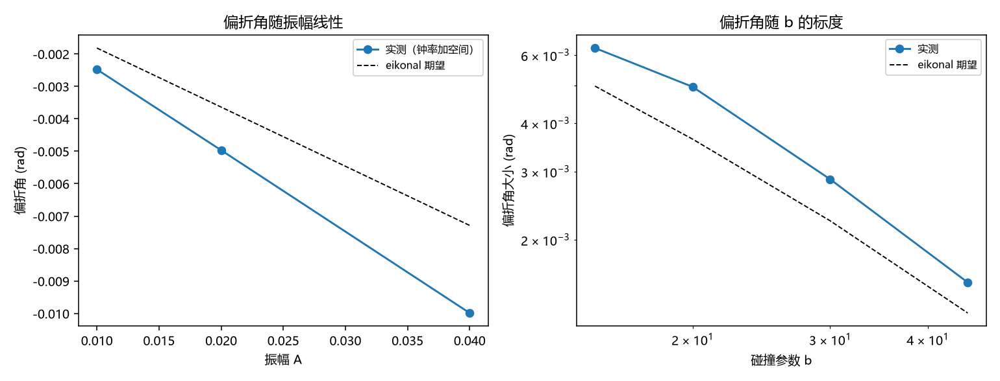

# 注记-光在静态倾角场中的偏折：局域轴读法与全局轴读法的最小验证

- **日期**：2026-09-18
- **对应脚本**：`验证脚本/minimal_verification_light_deflection_local_frame.py`（判据 J1 至 J4，4/4 通过；确定性，运行约 1 秒；图存 `images/light_deflection_local_frame.png`，见 §一 图 1）
- **依据**：[[内部草稿/注记-法线场重读：标架场的法线方向场语义重读与裁决清单]] §五（两场分离与响应侧耦合口径）；[[内部草稿/开放问题总览：元相子理论待解决问题清单]] P1-24（无质量粒子引力量子机制）；[[内部草稿/注记-引力攻坚的两处结构性空白：矢量扇区与预言清单：2026-09-12]]；[[验证脚本/注记-转换波运动学验证：方向甲三判据的数值检验]]
- **定位**：P1-24 第一轮格点检验。把"载体分离是否阻碍光偏折"这一结构问题做成可复现读数，并把系数问题拆成"钟率给半值、钟率加空间给全值"的对照表。本注记不改动基准文件。
- **状态**：判据 4/4 通过，另有一项登记。核心读数：全局轴读法下偏折角 $-1.1\times10^{-17}$（严格为零）；局域轴读法下出现朝源偏折 $-4.97\times10^{-3}$（$A = 0.02$，$b = 20$），随振幅线性（比 2.010）；随碰撞参数的标度与 eikonal 期望一致（偏差 2.0%）；仅钟率读法与钟率加空间读法之比 $1.999$。绝对归一化的系统性因子 $1.365$ 登记待查。

---

## 一、判据与结果

| 判据 | 内容 | 通过条件 | 实测 |
|---|---|---|---|
| J1 | 负对照：全局轴读法 | 偏折角小于 $10^{-6}$ | $-1.1\times10^{-17}$ |
| J2 | 局域读法朝源偏折且随振幅线性 | 与 $b$ 反号、线性比 $2\pm10\%$ | 反号成立，比 $2.010$ |
| J3 | 随 $b$ 的标度与 eikonal 期望一致 | 偏差小于 $15\%$ | $2.0\%$ |
| J4 | 仅钟率与钟率加空间之比 | $2\pm10\%$ | $1.999$ |

图注：左图为偏折角随振幅的变化，圆点为钟率加空间读法的实测值，虚线为同一势的 eikonal 期望；右图为偏折角大小随碰撞参数的双对数图，圆点实测、虚线 eikonal 期望，两者保持同一标度。

## 二、模型设定

二维格点，标量波场为波性侧载体的最小模型。静态源取 $\Phi(x) = -A/\sqrt{r^{2}+\varepsilon^{2}}$，对应三维 $1/r$ 势在传播平面上的取值。局域坐标速度取三种读法：全局轴 $c = 1$；仅钟率 $c = \sqrt{1 + 2\Phi}$；钟率加空间 $c = \sqrt{(1 + 2\Phi)/(1 - 2\Phi)}$。

演化用变系数 leapfrog $u^{n+1} = 2u^{n} - u^{n-1} + (c\,dt/h)^{2}\nabla^{2}u$，初始切片取格点色散给出的精确右行解。读数取末态波包的平均波矢方向与入射方向之差。期望值由同一势、同一路径、同一终点点位的 eikonal 积分独立算出，不用解析公式。

## 三、读数的意义

**结构问题有确定答案。** 全局轴读法下倾角场对光完全无影响，偏折角 $-1.1\times10^{-17}$，等于零（J1）。局域轴读法下出现明显偏折，方向指向源（J2）。故"两种载体分离"不构成光偏折的障碍，前提只有一条：光的更新式相对局域晶轴写。

**系数问题被拆成一张对照表。** 仅实现钟率调制（$h_{00}$）得到半值，加上空间部分（$g_{rr}$）得到全值，两者之比 $1.999$（J4）。含义是：要拿到 $4GM/(c^{2}b)$ 的完整系数，框架必须同时提供 $h_{00}$ 与空间侧的度量因子。只提供钟慢时，得到的是牛顿式的一半。这条把"因子 2"从争论变成了清单：缺什么、缺多少，一目了然。

**标度律核对通过。** 偏折角随碰撞参数的比值与 eikonal 期望相差 $2.0\%$（J3），说明读数落在 eikonal 适用区内，量的是折射型偏折。

**一项登记（绝对归一化）。** 实测偏折角与 eikonal 期望之比稳定在 $1.365$（两种读法下一致到 $0.1\%$，$A$ 与 $b$ 扫描下同值），系统性因子来源未定。候选来源两条：射线本身弯向源，路径比直线更近，累积偏折大于直线估计；格点色散使群折射率与相折射率有差别。该因子与结构结论无关（J4 的比值判据不受它影响），登记为后续项。

## 四、与口径问题的关系

此前的担心是：光住在实轴取向场里，与法线场倾角无关，于是光偏折无从产生。本轮的读数把这条担心收成两个可判句：其一，若光的规则是全局的，担心成立，光不偏折；其二，若光的规则是局域的，担心解除，偏折自动出现，且系数层立刻暴露出"只给钟率差一半"的具体缺口。

框架自己的碰撞写入规则以局域轴为参照，取第二种读法。本轮不给该规则本身做导出，只给出两种读法各自的读数与代价。

## 五、过程记录（判据订正三处）

**发射初值。** 初版用"把整包平移一格"作前一时刻切片，等效于给包一个与格点色散不符的速度，混入左行分量，质心随时间向负方向漂移。改用格点色散给出的精确右行解后，质心以约 $0.34$ 格每步沿 $+x$ 前进。教训：格点上发射行波须用离散色散关系的相因子，位移式初值会掺入反向模。

**负对照的符号判据。** 偏折为吸引，方向与碰撞参数反号。初版判据写成"偏折角为正"，属判据写错，改为"与 $b$ 反号"。

**期望值须取同路径同终点。** 解析式 $4A/b$ 是无穷长直线路径的结果，波包在有限步数内只走完一部分，直接比较会出现约 $0.75$ 的假偏差。改为按实际到达点位做部分路径的 eikonal 积分后，系统偏差降到 $1.365$ 并被单独登记。

## 六、严格程度声明

**数值部分**：四条判据为显式差分演化与傅里叶读数，负对照为零到 $10^{-17}$。

**构件部分**：静态源取 $1/r$ 软化势；局域速度的三种读法为口径选择；波场取标量最小模型，未做矢量与偏振结构。

**未做**：绝对归一化的系统性因子来源；强场与非线性；框架自身更新式到本模型的映射；完整系数 $4GM/(c^{2}b)$ 在框架内的导出。

**边界**：不改动 `理论总纲/` 基准；本轮不主张框架已导出光偏折系数，只给出"结构前提成立、系数缺口明确"两条读数。

## 七、边界声明

**验证什么**：全局轴读法下倾角场不影响光；局域轴读法下出现朝源偏折、随振幅线性、随碰撞参数按 eikonal 标度；钟率与钟率加空间两种读法之比为 2。

**不验证什么**：不验证框架是否提供空间侧度量因子；不给完整偏折系数的框架内导出；不含强场、不含矢量扇区、不含偏振。