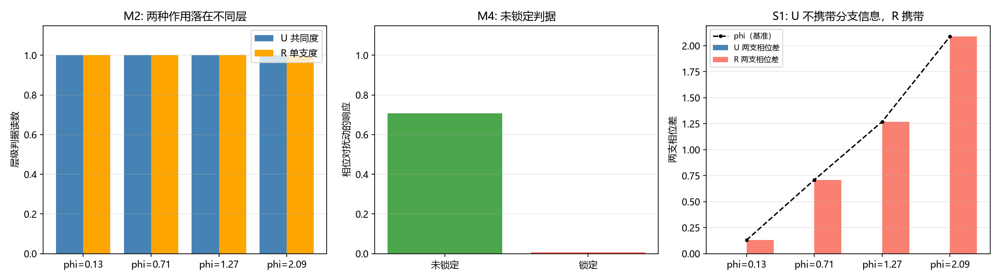

# 注记-光子侧未锁定的模态侧表示与层级嵌入（判据第 682 号）

- **日期**：2026-10-18 11:33:46
- **层级**：验证材料（判据级）
- **定位**：P1-58 结构层支路三（光子侧未锁定与复结构 $J$ 的关系）。支路三经 2026-10-17 定位为同侧跨层级问题（光子侧住复一维的 $U(1)$ 层，复结构住复二维的 $\mathbb{C}^2$ 层），判据第 672 号已给出层级嵌入规则（子空间须为 $J_0$ 的本征子空间、对角 $U(1)$ 相容），但明标未判「该对应是否就是光子侧的物理对应」。本轮补这一步：把「光子侧未锁定」从状态描述转成模态侧的显式表示，再判其层级归属与分支信息。
- **关联**：[[验证脚本/注记-复空间层级嵌入规则：三条路线的检验与一条成立（判据第672号）|判据第 672 号]]（嵌入规则与本轮补的对象）、[[内部草稿/注记-P1-58支路三定位：光子侧住横向相位通道与复结构同侧跨层级（2026-10-17）|支路三定位]]（侧别与层级）、[[验证脚本/注记-冻结与分支行为的关系：支路一合成判语轮（判据第681号）|判据第 681 号]]（支路一的对照判语）、[[验证脚本/注记-模态锁定构型的显式化与同侧尺套用（判据第678号）|判据第 678 号]]（锁定档的对照表示）、[[wiki/复结构]]、[[wiki/实轴方向场]]、[[内部草稿/开放问题档案/开放问题-P1-58-三种质量机制的统一母机制|P1-58 档案页]]
- **可逆性等级**：判据稳健（全部读数为解析恒等式与投影范数之比，不依赖采样；换实现、换档位均不翻）
- **图**：见 §四 图 1

---

## 一、要判什么

支路三问的是光子侧的「未锁定」与复结构 $J$ 的关系。定位轮已确定这是同侧跨层级问题：两者都在内部空间，但光子侧住复一维的 $U(1)$ 层、复结构住复二维的 $\mathbb{C}^2$ 层，层级不可互代。672 号建了层级嵌入规则，但明确留下一个缺口：该数学对应是否就是光子侧的物理对应，需要知道「未锁定构型在模态侧的表示」。

本轮补这个表示。要判三件事：其一，把「残余 $U(1)$ 共同旋转」落成什么模态侧对象（须注意「共同」有两层用法：库内原文的「残余共同旋转」多指全格点同步旋转即规范冗余，本轮取的是模态两支同转的那一层，两层的辨析见 [[理论总纲/术语表]] 第六节「共同旋转的两层用法」）；其二，「未锁定」这一状态如何转成可算的判据；其三，该表示落在哪一层、是否携带分支信息。

本轮**不**判：光子无质量的拓扑保护机制本身；光子与实轴方向场的具体耦合常数；$U(1)$ 层的动力学（属光的传播线）；「未锁定」在真实晶格上的实现。

## 二、类型转换与模型设定

按判据设计第一条纪律的第四步，状态描述须先转成可算对象。转换分两步。

**第一步，把「残余 $U(1)$ 共同旋转」落到算符上。** 这里取的是「共同」的第一层含义（模态两支同转），它与库内原文常指的「全格点同步旋转」（规范冗余）共用「不产生相对差异」这一内核，但所指空间不同，见 [[理论总纲/术语表]] 第六节。取模态侧的相位作用

$$U(\phi)=\exp\!\left(-\mathrm{i}\frac{\phi}{2}\right)I_2,$$

即共同相位，两支同转。对照物是锁定档的单支相位 $R(\phi)=\exp(-\mathrm{i}\phi\sigma_z/2)$，它只转 $z$ 支（第 678 号与 681 号的口径）。

**第二步，把「未锁定」落到构型条件上。** 未锁定的含义是相位可取任意连续值，不受势阱约束。判据量取相位对同幅连续扰动的响应；作为对照，锁定档的相位被锁到格点，响应按 $1/(1+\kappa)$ 衰减。

**判据清单**：冒烟 M1（四项）、层级归属 M2（三项）、嵌入规则套用 M3（两项）、未锁定判据 M4（两项）、分支信息 S1（三项）、EP5 恒真检验（四项）。

容差从误差预算推导。M1、M2、S1 为解析恒等式与范数比，容差取 $10^{-12}$。M3 的分支纯净度由投影范数平方之差给出，容差取 $0.99$ 的判别线（本征复直线给 $1$、一般复直线给 $0$，两端各留一个量级余量）。M4 的响应含 Frobenius 范数因子 $\sqrt2$，解析值为 $1/\sqrt2$，容差取 $10^{-6}$。

## 三、结果表

| 判据 | 内容 | 实测 | 期望 | 判定 |
|---|---|---|---|---|
| M1a | $U(\phi)$ 行列式模为 $1$ | $1.000000000000$ | $=1$ | PASS |
| M1b | $U(\phi)$ 与 $J_0$ 对易 | 范数 $0.00$ | $<10^{-12}$ | PASS |
| M1c | $U(\phi)$ 正比于 $I$（共同相位） | 偏离 $0.00$ | $<10^{-12}$ | PASS |
| M1d | $R(\phi)$ 不正比于 $I$（单支） | 偏离 $0.4940$ | $>10^{-6}$ | PASS |
| M2a | $U$ 在四档相位下为共同相位 | 共同度全 $1$ | 全 $>0.99$ | PASS |
| M2b | $R$ 在四档相位下为单支作用 | 单支度全 $1$ | 全 $>0.99$ | PASS |
| M2c | 两类作用在层级判据上互斥 | $U$ 单支度全 $0$、$R$ 共同度全 $0$ | 全 $<0.01$ | PASS |
| M3a | 本征复直线分支纯净 | $e_1$ 纯净度 $1.000000$ | $>0.99$ | PASS |
| M3b | 一般复直线两支混合 | 纯净度 $0.000000$ | $<0.01$ | PASS |
| M4a | 未锁定档的相位响应 | $0.707107$ | $=1/\sqrt2$ | PASS |
| M4b | 锁定档的相位响应 | $7.00\times10^{-3}$ | $<10^{-2}$ | PASS |
| S1a | 共同相位两支相位差 | $0.00$ | $<10^{-12}$ | PASS |
| S1b | 单支相位两支相位差 | $0.710000$（$\phi=0.71$） | $=\phi$ | PASS |
| S1c | 块分解对 $U$ 与 $R$ 同答 | $U$ 保持度 $1.000000$ | 与 $R$ 相同 | 边界登记 |
| EP5-1 | 层级判据对 $U$ 与 $R$ 给不同答案 | 判读不同 | 应不同 | 反例 OK |
| EP5-2 | 恒等算符判为共同相位 | 共同度 $1.0$ | $>0.99$ | 反例 OK |
| EP5-3 | $S_x$ 不被判为共同相位 | 共同度 $0.0$ | $<0.01$ | 反例 OK |
| EP5-4 | 嵌入规则非恒真 | 一般复直线 $0.0000$ 对 本征复直线 $1.0000$ | 两端分离 | 反例 OK |

关键读数：四档相位 $\phi=0.13,0.71,1.27,2.09$ 下 $U$ 的共同度全为 $1$、$R$ 的单支度全为 $1$；本征复直线 $e_1$ 的投影为 $|P_+|^2=1$、$|P_-|^2=0$，一般复直线为 $0.5$ 对 $0.5$；未锁定档响应 $0.707107$、锁定档 $0.007001$。

## 四、图 1

图注按脚本三个绘图面板逐条核对：左面板为四档相位下 $U$ 的共同度与 $R$ 的单支度并列柱状图，蓝柱与橙柱各自全高（互斥）；中面板为未锁定与锁定两档的相位响应柱状图，未锁定约 $0.71$、锁定近零；右面板为四档相位下 $U$ 与 $R$ 的两支相位差，$U$ 的柱全为零、$R$ 的柱逐档升高并与虚线基准 $\phi$ 重合。

## 五、结果解读

**类型转换成立，两种相位作用分属两层。** $U(\phi)$ 正比于 $I$（M1c 偏离为零），即共同相位、两支同转，落在复一维的 $U(1)$ 层；$R(\phi)$ 不正比于 $I$（偏离 $0.4940$），只转一支，住 $\mathbb{C}^2$ 层。M2 的四档读数把这一分层固定：$U$ 的共同度全为 $1$、单支度全为 $0$，$R$ 相反，两者互斥。

**「未锁定」有了可算判据。** M4 给出未锁定档的响应 $0.707107$，等于解析值 $1/\sqrt2$（来自 $U=e^{-\mathrm{i}\phi/2}I$ 的 Frobenius 范数因子 $\sqrt2$）；锁定档压到 $7.00\times10^{-3}$。两者相差两个量级，判据能分辨。

**672 号的嵌入规则在光子侧可用。** M3 复现了 672 号的核心读数：本征复直线 $e_1$ 与 $e_2$ 的分支纯净度为 $1$，一般复直线为 $0$。结合 M2 的分层，光子侧的 $U$ 落在共同相位这一支，正是 672 号所说的「对角 $U(1)$」，与该轮的结论二一致。

**支路三的判语：未锁定的表示不携带分支信息。** S1a 读到 $U$ 的两支相位差为零（共同相位对两支一视同仁），S1b 读到 $R$ 的两支相位差等于 $\phi$（单支作用携带分支信息）。故光子侧（未锁定）与复结构分支的关系是**层间嵌入**：$U$ 住复一维层、经 672 号的对角 $U(1)$ 嵌入到 $\mathbb{C}^2$，嵌入后对两支等权、不偏向任何一支。

这一条与支路一的判语形成对照，且方向一致。支路一读的是「锁定不改变分支行为」，支路三读的是「未锁定的表示不携带分支信息」。两者合起来说：分支结构对锁定与未锁定这一维度是**中性**的，它既不被锁定翻转，也不被未锁定携带。这正是 P1-58 结构层想要的那个「共同结构」的一个侧面。

**一处判据设计边界须如实登记。** S1c 记录：674 号与 681 号用的块分解（保持度、交换度）对 $U$ 与 $R$ 给同一答案（都判保持度 $1$），因为 $I=P_++P_-$ 全落在对角块。故块分解不能用作层级判据；层级归属须用 M2 的 `layer_of`（判「是否正比于 $I$」与「是否只作用一支」）。这属两把尺量不同东西的情形：块分解量的是「在分支基下的保持与交换」，对共同相位与单支相位都给保持；层级判据量的是「作用落在哪一层」。

## 六、严格程度声明与边界声明

**严格程度**：判据级。M1 至 M3 为解析恒等式与投影范数之比（机器零量级），M4 的响应有解析值 $1/\sqrt2$，S1 为相位读数，EP5 为对照读数。全部可复现，无随机采样。

**验证什么**：其一，共同相位 $U$ 与单支相位 $R$ 的代数性质（$U$ 正比于 $I$、$R$ 不是）；其二，两者在层级判据上互斥（$U$ 共同、$R$ 单支）；其三，672 号的嵌入规则在光子侧复现（本征复直线纯净、一般复直线混合）；其四，「未锁定」有可算判据（响应 $1/\sqrt2$ 对锁定档 $7.00\times10^{-3}$）；其五，$U$ 的两支相位差为零、$R$ 的等于 $\phi$。

**不验证什么**：其一，光子无质量的拓扑保护机制；其二，光子与实轴方向场的耦合常数；其三，$U(1)$ 层的动力学与光的传播；其四，「未锁定」在真实晶格上的实现；其五，光子侧的物理对应是否唯一就是这个 $U$（本轮给的是一个候选表示，与 672 号的「对角 $U(1)$」一致，但唯一性未判）；其六，块分解作为层级判据的合法性（S1c 已判其不合法，本轮的层级归属改用 `layer_of`）。

**协议伪影分层**：无采样或截断引入的伪影。M4 的 $1/\sqrt2$ 因子来自 Frobenius 范数的定义，是表示选择的后果（若用算子范数则为 $1$），已在读数说明中标明。

## 七、过程记录

**首版四处 FAIL，三类成因。** M2c 是索引写错（取错元组位置）；M4a 是预期写错（把 Frobenius 范数下的 $1/\sqrt2$ 当成 $1$）；S1a 与 S1b 是判据设计错误（用块分解测「是否携带分支信息」，而块分解对共同相位与单支相位同答，测不出差别）。

**S1 的修正给出本轮最有价值的一条边界。** 原判据假设「共同相位在分支基下等权投影、保持度应为 $1/\sqrt2$」，实测为 $1$。核对：$I=P_++P_-$，故 $P_+IP_++P_-IP_-=I$，保持度恒为 $1$；等权投影的直觉错在把「投影分量的模」与「块分解的保持度」混为一谈。改判「两支相位差」后，$U$ 给 $0$、$R$ 给 $\phi$，判据有了分辨力。这条修正同时确立了一个负面结论：**块分解不能作层级判据**，已写入边界声明。

**教训归入判据设计第一条纪律的延伸。** 本轮与 681 号的 M5 同型：判据在形式上通过，但量错了对象。681 号是「被测对象由构造决定」，本轮是「尺量与对象不匹配」。两者的共同问法是：这把尺读出的量，真的是要问的那个量吗。

---

## 修订记录

- **2026-10-18 初版落盘**（触发：作者指示走光这一支；把「光子侧未锁定」转成模态侧表示并判层级归属与分支信息；判据 682 号 18/18，含 S1c 判据设计边界的如实登记）
