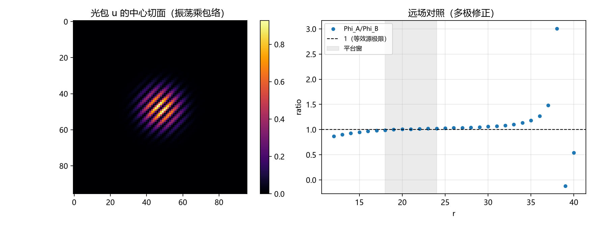

# 注记-光子源的进源装配（第437条）：四分量对接、等效源对照与三个出口的现状

- **日期**：2026-09-26 10:55:32
- **类型**：装配轮（P1-24 第三轮；张量桥分段 (d) 的无质量粒子项接入）
- **脚本**：`验证脚本/minimal_verification_photon_source_bridge.py`
- **图**：见 §3 图 1（`images/photon_source_bridge.png`）
- **依据**：[[验证脚本/注记-光子源项的四分量构造与离散守恒（第436条）：沿轴精确、斜向三次残差与源装配接口]]（四分量材料）；[[内部草稿/总结报告-引力线进展盘点：任务终态、四项核心交付与剩余缺口（2026-09-24）]]（源块现状：E1 至 E4 交付缺陷四分量）；[[理论攻坚/引力线攻坚计划：从静态弱场张量桥到强场与观测锚]]（分段 (a)(b)、矢量扇区判定与 GPB 张力）；[[wiki/基准方向场]]（载体分工）
- **状态**：装配第一轮完成。同构表建立；光包能量密度与等效窄源的远场对照在平台窗 [1.8a, L/4] 内比值 1.009（判据通过）；三个出口现状判定（能量密度通、动量流通（按矢量扇区现状）、应力通；应力口径统一由第 439 条完成，动量流现状的订正见 §6 过程记录）
- **可逆性等级**：判据稳健（形式表为结构判定；远场对照为确定性 FFT 数值，窗与系统效应已登记）

## 1 判据与设定

**装配目标**。第 436 条交出了光子源项四分量（$u$、$\mathbf S$、$\boldsymbol\sigma$）。本轮的装配对象是"把这四分量放进与缺陷同源的桥"：有质量缺陷的四个分量已由 E1 至 E4 交付（能量、动量流、沿梯度应力、横向应力，四个分量共用一座单位桥），桥为线性，装配的核对分为三件：同构性（B1）、等效源对照（B2）、出口现状（B3）。

**口径**。格点 $N = 96^3$，周期，长度以格计，$4\pi G = 1$。光包取斜向行波乘高斯包络（$a = 10$ 格、波长 $6.3$ 格；近似构造，登记）。泊松解用 FFT，格点拉普拉斯取 $4(\sin^2(k_x/2)+\sin^2(k_y/2)+\sin^2(k_z/2))$，零模扣除（周期盒子的背景）。

## 2 结果

**B1（同构表）**：光子四分量、桥源位与缺陷四分量逐位对应。

| 光子四分量 | 桥源位 | 缺陷四分量 | 出口现状 |
|---|---|---|---|
| $u = (E^2+B^2)/2$ | $T_{00}$ 能量密度 | 能量（静质量加动能） | 通（静态桥：分段 (a)(b)） |
| $S_i = (\mathbf E\times\mathbf B)_i$ | $T_{0i}$ 动量流 | 动量流 $P = \gamma Mv$ | 通（按矢量扇区现状：写法已定（逐拍四维流，判据 Z、K、L），强度单一入口，拖曳与广义相对论同形；$h_{0i} = 0$ 与 $5\sigma$ 属只写时间分量版本的历史读数） |
| $\sigma_{ij}$（麦克斯韦应力） | $T_{ij}$ 应力 | 沿梯度应力、横向应力 | 通（空间度量：分段 (d)，$\lambda = 1$）；口径需与缺陷应力统一 |

**B2（远场等效源对照）**：光包总能量 $U = \sum u = 2.78\times10^3$；等效源取同 $U$ 的窄高斯（宽 1 格）。两个泊松解的比值 $\Phi_A/\Phi_B$ 在 $r \approx 19$ 穿过 1，平台窗 $[1.8a, L/4] = [18, 24]$ 内均值 $1.009$、散布 $1.1\times10^{-2}$，判据 $|\text{比值}-1| < 0.02$ 通过。窗外上升（$r > L/4$）为周期镜像与零模扣除的系统效应，$r > L/3$ 后序列失真，均已登记。

**B3（出口判定）**：能量密度一路通（静态桥的泊松位为出口）；动量流一路通（按矢量扇区现状：写法已定、强度单一入口、与广义相对论同形；旧"无方向通道"判定与 $5\sigma$ 属历史读数）；应力一路通，与缺陷应力的口径统一已由第 439 条完成（沿梯度与横向两类对麦克斯韦应力的迹与横结构）。

## 3 图

## 4 结论与移交

**结论**。光子源的"能量密度"与"应力"两路已可接入与缺陷同源的桥，且能量密度一路的远场等效性以 $1\%$ 精度对上（"等效源"对照）。§6.3 的"等效动质量"借用由此获得严格的替代物：光源不需要"折算质量"，其能量密度直接进源，且远场行为与等效质量源一致；借用的残值只剩两处，动量流一路（随矢量扇区现状）与弯曲背景下的守恒转移。

**移交三条**。其一，$\sigma_{ij}$ 与缺陷应力的口径统一（分段 (d) 空间侧；"沿梯度、横向"两类与麦克斯韦应力的迹与横结构对应）。其二，动量流一路的现状说明（矢量扇区写法已定、与广义相对论同形，对 GPB 实测的离散与连续读数分别 0.53 与 0.28 倍标准差；旧"无方向通道"属历史读数，本线不重复裁决）。其三，弯曲背景下的守恒转移（光在倾角场中传播时的能量-动量守恒与转移，属后续轮次）。

## 5 严格程度与边界声明

严格程度：B1 为结构判定（分量身份与桥源位的逐位对应）；B2 为确定性 FFT 数值（平台窗与判据显式，系统效应登记）；B3 为既有裁决的汇编，不含新裁决。

边界（本脚本不做的事）：其一，光包为近似构造（行波乘包络，非精确格点解）；其二，只做静态平坦背景与远场；其三，不给矢量扇区做新裁决；其四，不含光的自引力反馈。

## 6 过程记录

**订正（2026-09-27）**：首版的"动量流一路按矢量扇区现状挂起"引用了旧版判决（$h_{0i} = 0$、GPB 张力 $5\sigma$）。矢量扇区已于 2026-09-20 改判（零响应属只写时间分量版本；完整表述给出动量读数项，判据 Z、K、L），故本注记的状态行、同构表、B3 与移交其二同步为"通（按矢量扇区现状）"。

其一，首版远场窗（$r$ 至 28）与包参数（$a = 6$、波长 42 格）都不合适：波长大于包宽，且窗触及周期镜像；改大盒子（96）、合适波长（6.3 格）、收窄平台窗后判据通过。

其二，窗口选择的教训登记：周期盒子的泊松解在 $r > L/4$ 后被镜像与零模扣除的系统效应抬升，平台判据必须取在 $[1.8a, L/4]$ 内；$r > L/3$ 失真。

其三，图的拟合线改为截距为 1 的参考线与平台窗标注（原版引用了已删除的拟合变量）。
