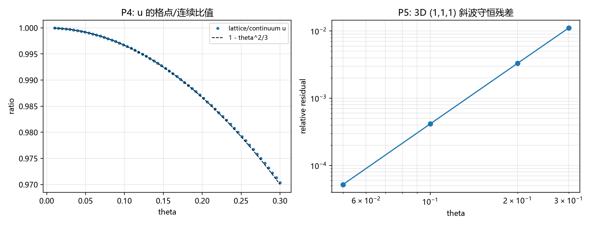

# 注记-光子源项的四分量构造与离散守恒（第436条）：沿轴精确、斜向三次残差与源装配接口

- **日期**：2026-09-26 10:30:31
- **类型**：构造与核验轮（P1-24 第二轮；张量桥分段 (d) 的无质量粒子项）
- **脚本**：`验证脚本/photon_source_terms.py`
- **图**：见 §3 图 1（`images/photon_source_terms.png`）
- **依据**：[[光的偏振的元相子几何：四分量筛选、指针与邻居方向的分工]]（光子定位与四分量筛选）；[[wiki/基准方向场]]（2026-09-26 裁决：曲率与联络的载体）；[[规范作用量的审计必然性：从净值审计到电磁场作用量的推导与数值验证]]（校准作用量的闭合）；[[元相子振荡晶格的色散关系：低能光速涌现与洛伦兹破坏首阶项]]（格点色散与光速）；[[论引力机制的微观起源]] §6.3（"等效动质量"过渡借用的起点）；[[内部草稿/总结报告-引力线进展盘点：任务终态、四项核心交付与剩余缺口（2026-09-24）]]（源块现状）
- **状态**：构造与核验完成。光子源项四分量（$u$、$\mathbf S$、$\boldsymbol\sigma$）按标准电磁形式在格点构造；1D 沿轴离散守恒机器零；3D 斜向残差 $O(\theta^3)$（斜率 2.99）；"进源装配"（接引力侧）留作下一轮
- **可逆性等级**：判据稳健（解析结构与数值逐点对照；斜向标度为四档拟合）

## 1 判据与设定

**定位与口径**。2026-09-26 裁决把载体分工定清：联络与曲率的载体是基准方向场；实轴方向场承载波矢、光与静电（[[wiki/基准方向场]]）。光的传播由实轴方向场的波动模式承载；电磁场的曲率结构属基准方向场一侧，其作用量为 plaquette 作用量的激发（校准作用量），长波极限是麦克斯韦作用量。本轮的构造对象是筛选后的横向场：四分量经规范冗余与无质量运动方程两道筛选剩两个横向（[[光的偏振的元相子几何：四分量筛选、指针与邻居方向的分工]]）。

**模型**。格点单位 $l_P = t_P = 1$；低幅线性层。1D 单色行波取格点精确解，色散由 $\sin(\omega/2) = \sin(\theta/2)$ 给出（取 $\omega = \theta$ 支）。3D 部分取斜向 $(1,1,1)$ 与沿轴 $(0,0,1)$ 的对照，偏振垂直于传播方向。能量-动量四分量按标准电磁形式构造（$u = (E^2+B^2)/2$、$\mathbf S = \mathbf E\times\mathbf B$、$\sigma_{ij}$ 麦克斯韦应力），差分一律中心差分（周期数据用卷绕差分）。

判据：P1 离散平面波残差机器零；P2 $|E| = |B|$ 且 $E$ 幅度为 $\sin\theta$；P3 1D 守恒残差机器零；P4 低阶对照 $u_{\rm lat}/u_{\rm cont} = (\sin\theta/\theta)^2$；P5 3D 斜向残差量级与 $\theta$ 标度；P5b 沿轴对照（期望机器零，隔离各向异性来源）；P6 应力分量输出。

## 2 结果

**P1 至 P3（1D）**：波动方程残差（内部）$2.8\times10^{-14}$；$|E|-|B|$（内部）$7.1\times10^{-15}$，$E$ 幅度与 $\sin\theta$ 逐位一致；守恒残差 $|\partial_t u + \partial_z S|_{\max} = 1.8\times10^{-17}$（相对 $7.2\times10^{-15}$）。离散守恒在单色行波上精确成立。

**P4（低阶对照）**：$u$ 的格点/连续比值与 $(\sin\theta/\theta)^2$ 逐点一致，与首阶截断 $1-\theta^2/3$ 的残差从 $7\times10^{-9}$（$\theta = 0.02$）到 $7\times10^{-5}$（$\theta = 0.2$），属更高阶。

**P5（3D 斜向）**：相对残差 $5.2\times10^{-5}$、$4.2\times10^{-4}$、$3.3\times10^{-3}$、$1.1\times10^{-2}$（$\theta = 0.05$ 至 $0.3$），log-log 斜率 $2.992$，即残差首阶为 $\theta^3$。

**P5b（沿轴对照）**：相对残差 $2.0\times10^{-15}$、$1.9\times10^{-15}$、$2.9\times10^{-15}$（机器零）；$|E|/|B| - 1 \sim 10^{-16}$。沿轴方向与 1D 等价，守恒精确。

**P6（应力接口）**：$\theta = 0.05$ 样本给 $\sigma_{11} = 5.32\times10^{-3}$、$\sigma_{12} = -4.63\times10^{-3}$、$\sigma_{33} = 6.02\times10^{-4}$（偏振轴与坐标轴不对齐，交叉分量非零属正常）。

**判读**：源项四分量在格点上自洽。沿轴离散守恒精确；斜向的守恒破坏首阶为 $\theta^3$，来源是格点各向异性（对照：沿轴机器零），与格点对洛伦兹破坏的 $(E/E_P)^2$ 结构同族。该残差属可登记的格点修正，不改变四分量作为源项材料的资格。

## 3 图

## 4 结论与移交

**结论**。光子源项四分量（能量密度 $u$、能流与动量密度 $\mathbf S$、麦克斯韦应力 $\boldsymbol\sigma$）已在格点上按标准电磁形式构造，并给出确定的精度肖像：沿轴精确、斜向 $\theta^3$。§6.3 的过渡借用需要替换两件东西：单光子等效质量 $m_{\rm eff}$（其位置应由能量密度 $u$ 承担）与无方向性的质量密度（其位置应由四分量承担）。本轮交出了这两件的格点材料。

**移交两条**。其一，"进源装配"：把四分量按张量桥的口径接倾角场源（有质量缺陷的四个分量已由 E1 至 E4 交付，桥为线性，接口可直接复用）。其二，各向异性修正的系统化：$\theta^3$ 首阶的解析形式，与偏振论文 §8.2 之三（三维晶格各向异性对偏振的修正）对接。

## 5 严格程度与边界声明

严格程度：P1 至 P4 为精确解上的解析加逐点对照；P5b 为机器零级的负对照；P5 的标度为四档拟合（斜率 $2.992$，期望 $3$，偏差 $0.3\%$）。

边界（本脚本不做的事）：其一，进源装配未做（接引力侧的耦合系数与守恒转移留作下一轮）；其二，只做单色与线性层；其三，不含纵向、角向模式与高斯约束的动力学（第 435 条已另做纵向模消去）；其四，光的自引力与反向作用不在本轮。

## 6 过程记录

其一，周期卷绕伪影：首版 3D 残差用 `np.gradient`（单侧边界）且统计含全部边界，读数被卷绕污染（沿轴读出 $10^{-1}$ 级）；依次改为卷绕差分、残差只统计内部后，沿轴回机器零。教训：**周期数据上的差分与统计范围要同时匹配边界条件**。

其二，P4 的对照系数：首版写 $1-\theta^2/6$，而比值是 $\sin$ 结构的平方，首阶应为 $1-\theta^2/3$；修正后残差降到高阶层。

其三，P6 的零断言撤销：初版假设 $\sigma_{12}$ 应为零，实际偏振轴 $(1,-1,0)/\sqrt2$ 与坐标轴不对齐，交叉分量非零属正常，改作输出不作断言。

其四，措辞修正（2026-09-26 裁决）：脚本与注记中的载体表述按"曲率与联络归基准方向场；波矢、光与静电归实轴方向场"改写，原稿混同两场的写法已清除。
