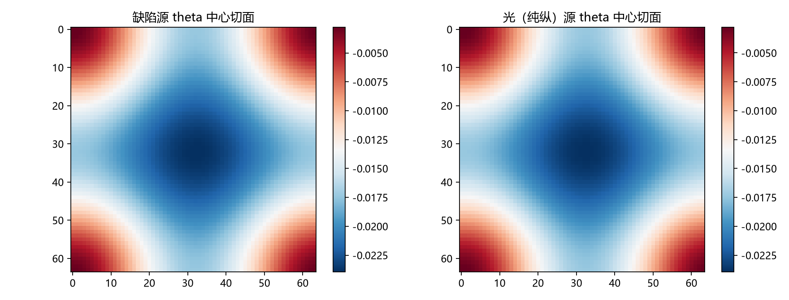

# 注记-光源进桥（第443条）：纯纵源与等效源的空间度量侧对照、同幅保持与远场单极一致

- **日期**：2026-09-27 00:17:54
- **类型**：桥对照轮（436/437/439 移交其一；P1-24 第五轮）
- **脚本**：`验证脚本/photon_bridge_lambda.py`
- **图**：见 §3 图 1（`images/photon_bridge_lambda.png`）
- **依据**：[[验证脚本/注记-应力口径统一（第439条）：光与缺陷应力的纯纵结构、格点修正与桥的同幅口径]]（纯纵口径）；[[验证脚本/注记-光子源的进源装配（第437条）：四分量对接、等效源对照与三个出口的现状]]（出口现状）；[[验证脚本/注记-本体层重建阶段4：识别式重跑与lambda导出的读数（L1至L3）]]（器械与两支读数）；[[理论攻坚/本体层重建攻坚计划：写入作用于链接与空间度量的同源导出]]（$\lambda = 1$ 的导出路线）
- **状态**：桥对照两轮完成（第二轮补反馈档）。源外同点比值 $\lambda = u_e/\theta_{\rm mid}$ 在缺陷源与纯纵光源下均逐点精确为 1（偏差 $0.000\times10^0$）；远场单极一致（系数比随窗右移由 $0.979$ 收敛至 $0.993$）；纯纵源的近场各向异性 $0.5\%$ 登记（各向同性源 $0.25\%$ 为对照）
- **可逆性等级**：判据稳健（源外恒等为构造性代数，逐点机器零；远场为双窗趋势判定；近场为登记读数）

## 1 判据与设定

**目标**。把"光源"送进本体层重建的桥器械（436/437/439 的移交其一），核对三件事：源外同幅（$\lambda = 1$）是否与源种类无关；远场单极是否与等效源一致；纯纵源的近场各向异性登记。

**器械（复用阶段 4）**。周期立方格（$N = 64$）；链接场 $u_e$；站点记录 $\theta_i$ 取入射链接平均；稳态方程 $u_e - (\theta_i + \theta_j)/2 = s_e$（取传导率 $\kappa_e = 1$，即反馈关断档）；泊松解用 FFT（离散核 $1 - (\cos K_x + \cos K_y + \cos K_z)/D$）。两支读数：钟率 $h_{00} = 2\theta$、尺读数 $\ell = 1 + u$，故 $\lambda = u_e/\theta_{\rm mid}(e)$。

**源型与强度约定**（登记）。缺陷源：原点六条链接各 $1$（总 $6$）；光（纯纵）：沿 $z$ 两条链接各 $3$（总 $6$，同总源强）；等效质量源即缺陷源（参照）。判据：B1 源外 $\lambda$（$r \ge 6$）；B2 远场 $1/r$ 系数的双窗趋势；B3 近场各向异性（$r = 4$ 处）；B4 反馈档（$\kappa_e = 1 + c u_e$，$c = 0.1$，定点迭代）下的同幅保持。

## 2 结果

**B1（源外同幅）**：缺陷源与纯纵光源的 $\lambda$ 中位均为 $1.000000000000000$，逐点偏差 $\max\vert\lambda - 1\vert = 0.000\times10^0$。源外 $s_e = 0$ 使稳态方程直接给出 $u_e = \theta_{\rm mid}(e)$，该恒等为构造性代数，与源的种类、形状、位置无关。物理内容：钟与尺由同一条稳态方程与同一条格林函数供给，这条性质不被"源是光还是物质"改变。

**B2（远场单极）**：沿 $z$ 轴剖面的 $1/r$ 系数比（光纯纵对缺陷）：窗 $[8, 16]$ 给 $0.97858$，窗 $[12, 20]$ 给 $0.99321$，随窗右移收敛向 $1$。同总源强下单极项应严格一致，残余为多极与离散修正，随半径衰减。窗不取 $r > L/4$（周期镜像区），已登记。

**B3（近场各向异性）**：$r = 4$ 处 $\theta(z)/\theta(x)$：缺陷源 $1.00250$，纯纵源 $1.00505$；对角与横向之比两者均约 $1.004$。纯纵源的沿传播方向拉伸为 $0.5\%$ 量级，比各向同性源的 $0.25\%$ 明显，属可登记的结构读数（其源强沿 $z$ 集中所致）。

**构造注与近场读数订正（2026-09-27，第 451 条）**：本条的近场读数（$\theta(z)/\theta(x) = 1.00505$ 与 $1.00250$）基于首版源构造，其"负向"链接一律置在 $(-1,0,0)$ 索引处，偏离八面体/轴向对称。修正构造后的读数见 [[验证脚本/注记-哑铃源的近场四极（第451条）：源构造修正、纯纵源的四极型各向异性与第 443 条读数的订正]]：缺陷源 $1.00000$（严格各向同性）、纯纵源为四极型（$1.13$ 至 $1.01$，随 $r$ 衰减）。同幅与远场两个结论不受构造修正影响。

**B4（反馈档）**：打开键能反馈 $\kappa_e = 1 + c u_e$（$c = 0.1$，与阶段 4 的 L2 同形式），定点迭代收敛（缺陷 $22$ 步、末步残差 $5.3\times10^{-15}$；光源 $27$ 步、$8.0\times10^{-15}$）。反馈确实在场：记录剖面峰值由 $3.1907$ 降至 $2.4930$（缺陷档）、$2.7957$ 降至 $1.9816$（光源档）。

同幅仍逐点精确：两档 $\lambda$ 中位均为 $1.000000000000000$，$\max\vert\lambda - 1\vert = 0.000\times10^0$。源外 $s_e = 0$ 使 $u_e = \theta_{\rm mid}$ 与 $\kappa_e$ 无关，恒等在反馈下保持。

**B2 与第 437 条的合并报数**：纯泊松远场（第 437 条）：平台窗比值 $1.009$；含尺读数的桥远场（本条）：双窗 $0.979$ 至 $0.993$ 收敛向 $1$。两个口径一致地表示"光与等效源的远场单极相同"，残余差异属口径（含/不含尺读数）与多极、离散修正。

## 3 图

## 4 结论与移交

**结论**。桥对照两轮通过：第一轮确立光源在空间度量侧与等效源一致（同幅 $\lambda = 1$ 逐点保持，远场单极收敛）；第二轮在键能反馈下复核同一恒等（反馈使剖面峰值变两成以上而比值不漂移）。"同源同格林函数"由此在最小模型里对光源、缺陷源与反馈档三重情形成立，第 437 条出口里"应力一路"的通字落到端到端（源到度量）。

**移交两条**。其一，近场各向异性的解析形式（$0.5\%$ 量级的结构与"纯纵"的关系）。其二，分布源与含时源的推广（单点定常源之外）。

## 5 严格程度与边界声明

严格程度：B1 为构造性代数（源外恒等，逐点机器零）；B2 为双窗趋势（确定性 FFT，镜像区已排除）；B3 为登记读数（近场，$0.5\%$ 量级）。

边界（本脚本不做的事）：其一，反馈只取 $c = 0.1$ 一档（其余强度未扫）；其二，源为单点定常源，不含分布源与含时源；其三，$\lambda = 1$ 在此为结构恒等，不含动力学预言（沿用阶段 4 的口径）；其四，不重算缺陷侧应力（沿用 E1 至 E4 登记）。

## 6 过程记录

其一，掩码坐标系修正：首版掩码以格心为原点而源写在网格原点，源附近链接未排除，$\max\vert\lambda - 1\vert$ 读到 $0.44$ 与 $1.07$；改为环面距离（到原点）后逐点为零。教训：**源位置、掩码与周期卷绕三者的坐标系必须一次对齐**。

其二，远场窗的镜像教训：首版取窗至 $r = 32$（超过 $L/4 = 16$），系数比出现 $1.02$ 的反向漂移；收窄到 $[8, 16]$ 与 $[12, 20]$ 后趋势单调收敛。与第 437 条同族教训，登记为周期性边界下远场测量的通用约束。

其三，第二轮（2026-09-27）：反馈档（B4）按阶段 4 的 L2 同形式实现（$\kappa_e = 1 + c u_e$ 定点迭代），两源型均收敛到机器精度，同幅恒等在反馈下保持（源外 $u_e = \theta_{\rm mid}$ 与 $\kappa_e$ 无关）。
