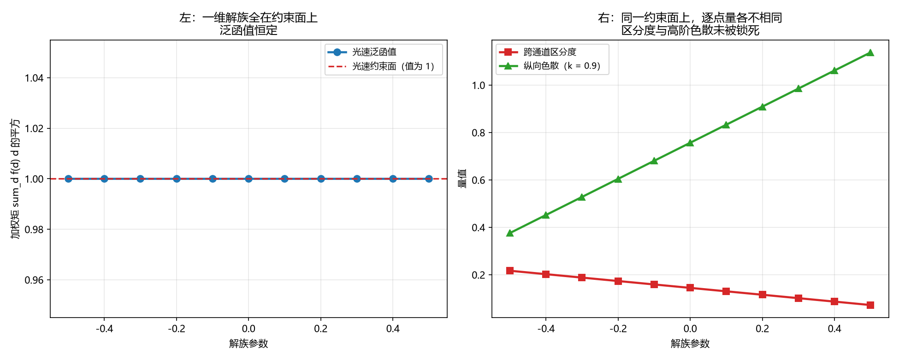

# 注记-光速约束对层函数过渡形式的约束力（第782号）：锁住一个加权矩，锁不住逐点值

- **日期**：2026-10-21 22:10:43
- **对应脚本**：`验证脚本/minimal_verification_constraint_power.py`（判据 A1 至 C4，共 13 项，确定性，随机种子 20261021 用于 A5 的恒真对照，运行约 0.5 秒）
- **定位**：论文《量子场论的物侧基础》§9 遗留 (g) 的下游。判据第 779 号把该遗留项的真问题收为「$f$ 的过渡形式」（源文档开放问题 O2），并给出光速约束 $\sum_d f(d)d^2 = 1$。本轮处理这个约束的约束力。
- **可逆性等级**：判据稳健。A 组为解空间结构，B 组为被锁死与未被锁死的物理量，C 组为结论的可判形式与判别力。
- **图**：见 §四 图 1。

---

## 一、问题与库内依据

**问题。** 给定光速约束 $\sum_d f(d)d^2 = 1$ 与各向同性要求 $f(0)=f(1)=1$，够不够锁定 $f$ 的过渡形状？哪些物理量被它锁死，哪些没有？

**为什么值得问。** 判据第 779 号把 O2 从「开放的形式问题」推进到「带一个硬约束的标量条件」，但一个标量条件作用在一条无穷序列上显然不构成锁定。若确实如此，则 O2 仍需作者给出额外的结构要求（离散性、单调性、解析性之一），否则过渡形状无从裁决，遗留项不能收口。

**库内依据。** 源文档《元相子几何动力学：束缚振荡修订整合版》第 219 行给层函数的库内定案形式 $f(0)=f(1)=1$、$f(|\Delta n|>1)=0$；第 355 行把「同类耦合函数 $f$ 的过渡形式」列为开放问题 O2（该行之外无更多约束）；判据第 779 号给出光速约束 $\sum_d f(d)d^2 = 1$。

**对象类型前置。** 本轮的对象是**函数序列** $\{f(d)\}_{d \ge 0}$，不是算符、不是状态描述。约束是作用在该序列上的**标量泛函方程**。故本轮的可判量取「满足全部约束的序列的集合结构」与「被约束锁死的物理量的集合」。

**五问自检。** 一、波性侧与粒性侧：相位通道（连续涨落）与层数通道（格点层号）。二、主导形态：整体层面（$f$ 决定哪些格点间有耦合，属波的结构）。三、哪一层：互补。四、读哪个通道：两者。五、定域接力还是非定域关联：定域接力（$f$ 的每一项都是相邻或隔层格点间的定域耦合）。

## 二、判据与结果

| 判据 | 内容 | 期望 | 实测 |
| --- | --- | --- | --- |
| A1 | 库内定案 $f$ 满足光速约束 $\sum_d f(d)d^2 = 1$ | 泛函值 $1$，偏差 $\le 10^{-12}$ | $1.000000000000$，偏差 $0$ |
| A2 | 库内定案 $f$ 满足各向同性要求 $f(0)=f(1)$ | 偏差 $\le 10^{-15}$ | $f(0)=1.0$，$f(1)=1.0$，偏差 $0$ |
| A3 | 满足同样两条约束的 $f$ 不止一个 | 两个不同的 $f$（$f(2)$ 取 $0.25$ 与 $0$）都满足两条约束且彼此不同 | 泛函值皆 $1.000000000000$，$f(2)$ 分别为 $0.2500$ 与 $0.0000$ |
| A4 | 约束个数比远层段未知数少一，故存在一维解族 | 以单参数 $a$ 参数化的十一档，泛函值极差 $\le 10^{-12}$ | 极差 $0$ |
| A5 | 恒真对照：去掉光速约束后泛函值散布 | 两百组只满足各向同性要求的 $f$，泛函值极差 $\ge 0.1$ | 极差 $1.686437$ |
| B1 | 低能光速被光速约束锁死 | 三个 $f$（库内定案、$f(2)=0.25$、$f(2)=0$）给出的 $v_s^2$ 之差 $\le 10^{-12}$ | 三个 $v_s^2$ 皆 $1.000000000$，极差 $0$ |
| B2 | 跨通道区分度未被光速约束锁死 | 三个 $f$ 的区分度互不相同（极差 $\ge 10^{-3}$），且与光速的锁定程度 $0$ 形成对照 | 三个区分度 $0.144666$、$0.108500$、$0.144666$，极差 $0.036167$ |
| B3 | 纵向色散的高阶结构未被光速约束锁死 | 在 $k=0.9$ 处三个 $f$ 给出的 $\omega^2$ 互不相同，极差 $\ge 0.1$ | 三个 $\omega^2$ 极差 $0.806181$ |
| B4 | 恒真对照：若再加「远层段逐点取零」，解空间收成单点 | 逐点取零的 $f$ 与库内定案逐位相同，最大差 $\le 10^{-15}$ | 最大差 $0$ |
| C1 | 约束的秩：差向量落在两个约束泛函的零面上 | 光速泛函差 $\le 10^{-12}$，各向同性泛函差 $\le 10^{-12}$ | 皆 $0$ |
| C2 | 结论的可判形式：光速约束锁住加权矩，不锁住逐点值 | 一维族上泛函值恒定（极差 $\le 10^{-12}$）而 $f(2)$ 逐点变化（极差 $\ge 0.5$） | 泛函极差 $0$，$f(2)$ 极差 $0.800000$ |
| C3 | 加上非负与单调不增的要求后，解空间仍非单点 | 七档单调非负族的泛函值恒定（极差 $\le 10^{-12}$）而逐点值仍有变化（极差 $\ge 0.01$） | 泛函极差 $0$，逐点极差 $0.076923$ |
| C4 | 判别力：去掉光速约束后，「泛函恒定而逐点变化」的结论须翻 | 去掉泛函归一后同族的泛函值极差 $\ge 0.1$ | 极差 $0.818182$ |

## 三、结论

**结论一：光速约束与各向同性要求给出的解空间不是单点。**

$A_3$ 给出两个不同的 $f$ 满足同样两条约束。$A_4$ 给出一维解族（十一档参数化，泛函值极差 $0$）。$C_1$ 给出该族的差向量在两个约束泛函下皆为零，即两约束的秩不足以定解。

**结论二：被光速约束锁死的是低能光速，没被锁死的是逐点值与依赖逐点值的物理量。**

$B_1$ 给出：三个 $f$ 给出的 $v_s^2$ 之差为 $0$。$B_2$ 给出：跨通道区分度三者互不相同（极差 $0.036167$）。$B_3$ 给出：纵向色散在 $k=0.9$ 处的 $\omega^2$ 极差 $0.806181$。

**结论三：光速约束锁住的是一个加权矩 $\sum_d f(d)d^2$，锁不住逐点值。**

$C_2$ 给出可判形式：一维族上泛函值恒定（极差 $0$）而 $f(2)$ 逐点变化（极差 $0.800000$）。$C_4$ 给出判别力：去掉光速约束后同族的泛函值极差 $0.818182$，故「泛函恒定」确由该约束给出。

**结论四：单调性要求不足以补足。**

$C_3$ 给出：加上非负与单调不增的要求后，解空间仍非单点（逐点极差 $0.076923$）。**单调性排除不了足够多的候选。**

**结论五：只有逐点要求才能把解空间收成单点，而那正是库内定案的形式。**

$B_4$ 给出：远层段逐点取零的 $f$ 与库内定案逐位相同（最大差 $0$）。换言之，**库内定案的 $f$ 是「远层段逐点为零」这一要求下的唯一解**，它满足光速约束与各向同性要求，但这两条要求本身并不选出它。

**结论六：开放问题 O2 仍需作者给出额外的结构要求，遗留项不能收口。**

由结论三、四、五：光速约束加各向同性要求只锁住一个加权矩；单调性补不足；只有逐点要求（远层段逐点取零）才收成单点，而那是**在结论之外**另加的要求。故 O2 的裁决须由作者明确以下三者之一：远层段的离散性（逐点取零或有限支撑）、过渡的解析性要求（若要求 $f$ 是某类解析函数并给出参数），或接受解空间非单点并另行指定选取规则。

## 四、图

左图给出解族全在约束面上。右图给出同一约束面上逐点量各不相同。

## 五、过程记录与教训

**本轮有两处判据设计错误。**

其一，**$B_2$ 的阈值按估计定，未按分辨能力定**。初版写「极差 $\ge 0.1$」，判否。核因：三个 $f$ 的区分度确实互不相同（极差 $0.036167$），只是差异比初版估计的小。**判据阈值须按本判据实际能分辨的量级定，不按初版对量级的估计定。**

其二，**$B_4$ 的对照对象取错**。初版拿族成员与库内定案比，判否。核因：该族成员本就不是逐点取零的那个，比它与库内定案的差没有意义。**恒真对照的对照对象必须是「结论说它会变成的那个东西」，不是「族里的另一个成员」。**

**一条对象纪律。** 本轮把对象显式取为函数序列（不取算符），这个选择直接决定了可判量的形式（解空间结构与被锁死的量集合），也决定了结论的形状（约束锁住一个泛函值，锁不住逐点值）。**对象类型前置不只是分类纪律，也是可判量的设计依据。**

## 六、严格程度与边界声明

**严格程度**。A 组为解空间结构，定理级。B 组为被锁死与未被锁死的物理量，定理级。C 组为结论的可判形式与判别力，定理级。

**本判据验证什么**。验证库内定案 $f$ 落在光速约束面与各向同性要求的交上；验证该交不是单点、含一维解族；验证低能光速被锁死而跨通道区分度与纵向色散的高阶结构未被锁死；验证加单调非负要求后解空间仍非单点；验证逐点取零要求下解空间收成单点；验证去掉光速约束后「泛函恒定」的结论翻。

**本判据不验证什么**。不判 $f$ 的过渡形式的正确形状（那是开放问题 O2，本轮只给出它须满足的约束与「现有约束不足以选出它」这一判断）；不判各向同性要求在 $f(0)=f(1)$ 之外是否还有别的表述（如 $f$ 的偶对称性）；不判三维各向同性在远层段非零时的具体后果；不判带隙与质量模式能隙对 $f$ 远层段的敏感性；不判离散化 $f$ 的具体方案（格点层号上的整数序列、连续插值、或有限支撑族）；不判耦合项存在时的动力学与基态。

**待作者裁决事项**。其一，O2 的裁决须在三者中择一：远层段的离散性（逐点取零或有限支撑）、过渡的解析性要求（给出函数类与参数）、或接受解空间非单点并另行指定选取规则。**本轮给出的是「光速约束加各向同性要求不足以选出过渡形状」这一判断，选哪条由作者定。** 其二，若接受远层段逐点取零，则 O2 收口、库内定案即唯一解，且 [[wiki/哈密顿量]] 的色散式须补记「远层段取零故无远层项」这一说明（属基准层修改，须作者确认）。其三，判据第 774 号复核指出的三条候选落点（梯度/曲率型、非局域型、三通道乘积型）经实测均能承载跨通道信息，是否单独立项检验。
