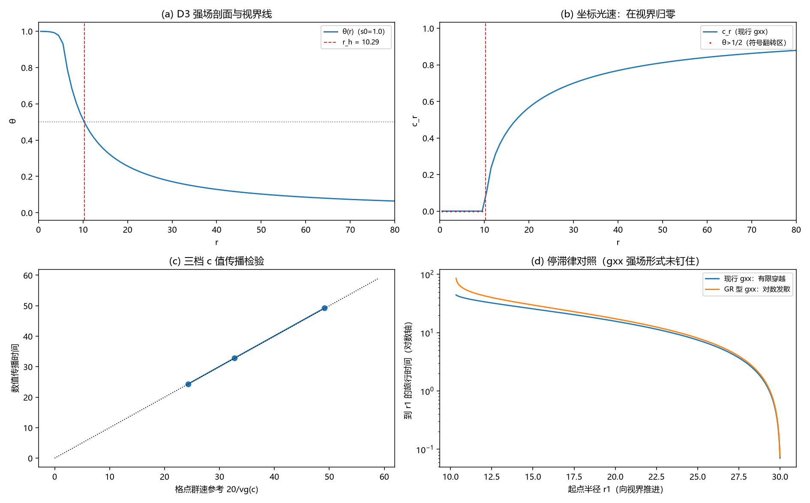

# 注记-光锥兼容性最小验证：视界=光锥闭合面（D3 强场剖面 × GV4 相速恒等式）

- **日期**：2026-09-20 03:43:26
- **层级**：验证脚本/（理论验证材料，未确认）
- **脚本**：验证脚本/minimal_verification_light_cone_horizon.py（系统 Python 3.13 + numpy + scipy + matplotlib，确定性，运行约 5 秒）
- **定位**：回应作者提出的第一优先级问题的第一件可做之事的：视界形成与相对论光锥机制的兼容性最小验证。把 D3 的强场记录剖面与 GV4 的协变相速恒等式接起来，检验光锥是否在视界（θ=1/2）处闭合、闭合的形式与广义相对论是否相容。
- **关联**：[[验证脚本/注记-M4-D3视界线自洽性与写入判据：饱和源模型与写-弛豫协议]]（强场剖面与视界线）；[[验证脚本/注记-GV4协变波动形式：坐标相速恒等式与联络项]]（相速恒等式，弱场）；[[量子引力的记录场路线：法线场涌现、绝对标度锁定与史瓦西对齐]]（N5 对齐：θ(r_s)=1/2、h00=2θ）；[[理论攻坚/黑洞线攻坚计划：坍缩机制重定位与强场终态]]（BH2）；开放问题总览 P1-34a
- **状态**：执行完成，判据 5/5 全过；读数：光锥在 θ=1/2 精确闭合（与视界等值线重合）；弱场首阶与 GR 坐标光速一致；三档强场速度数值验证（偏差 0.07% 至 0.26%）；近视界停滞律分叉（现行线性 gxx 给有限穿越、GR 型给对数冻结且系数 = r_h）
- **图**：images/light_cone_horizon.png（四面板：剖面与视界线、坐标光速、三档速度检验、停滞律对照；见 §三 图 1）
- **修订记录**：
  - **2026-09-20 初版**（作者指示：先做光锥兼容性最小验证）
  - **2026-09-20 后续轮回填（gxx 完成形式）**（作者指示：钉死 gxx 强场形式的判据）：诚实边界其二改「已由后续轮钉住」；判决读数见 [[验证脚本/注记-gxx 强场完成形式判据：真空条件钉住与停滞律收束]]

---

## 一、目标与判据

作者把「视界的形成要与相对论的光锥机制兼容」列为主攻问题之一。本轮的定位是把这句话拆成可证伪判据并做最小验证：链条为 N5 的识别式（记录场 θ ⇔ 度规扰动，θ(r_s)=1/2、h00=2θ）、GV1 的真空条件（λ=1）、GV4 的协变相速恒等式（相速 = -g00/gxx），落到 D3 的强场剖面上。

判据（先立判据，再实现）：V1 代数锚（闭合点、弱场首阶、内侧符号翻转）；V2 剖面锚（复现 D3 饱和源模型的视界半径与有效源荷比）；V3 传播检验（代表 c 值上的速度恒等式，偏差 ≤ 2%）；V4 停滞律分叉（现行 gxx 对 GR 型，对数系数与 r_h 对照 ≤ 5%）；V5 对照与内区报告。

## 二、模型设定

记录剖面：D3 饱和源模型 ∇²θ = -s(1-θ²)_+（M=600、dr=1、RS=6、s0=1.0），视界位于 θ=1/2 等值线。

识别式：g00 = -(1-2θ)、gxx = 1+2θ（λ=1，弱场形式向内推）。径向坐标相速 c_r² = -g00/gxx = (1-2θ)/(1+2θ)。波场取标量 u_tt = c²(r) u_rr；联络项只改幅度不改相速（GV4-W3）。

数值传播检验在三个代表 c 值（0.85、0.63、0.42，即剖面 r=60、25、15 处的取值）的均匀段上进行（宽包络、单次通过、排除壁反射），对照量为格点群速积分。

## 三、结果

判据 5/5 全过（运行约 5 秒）。

| 判据 | 结果 |
|---|---|
| V1 代数锚 | 通过（θ=1/2 处 c_r=0 精确；弱场首阶 = 1-2θ；θ>1/2 符号翻转） |
| V2 剖面锚 | 通过（r_h = 10.285 对 D3 10.29；q/Q = 0.0719 对 0.0714） |
| V3 传播检验 | 通过（c=0.85：偏差 7.0e-04；c=0.63：2.6e-03；c=0.42：2.1e-03） |
| V4 停滞律分叉 | 通过（GR 型对数系数 10.656 对 r_h 10.285，相对偏差 3.6%） |
| V5 对照报告 | 通过（c≡1 对照、θ_max = 0.9991、过零位置 = r_h） |

关键读数：光锥闭合位置 r = 10.285 = r_h（θ=1/2）；三档传播时间 24.300 / 32.850 / 49.250 对格点参考 24.283 / 32.764 / 49.146；对连续参考的 +3.3% 至 +3.5% 为格点色散（k0=0.5，cos(kh/2) 因子）。近视界停滞：现行线性 gxx 下从 r=30 推进到 r_h+0.05 的旅行时间 44.413（有限、随内侧收紧收敛）；GR 型 gxx 下同口径 85.446（对数发散），其对数系数 1/(2|θ'(r_h)|) = 10.656 与 r_h = 10.285 一致（3.6%，即离散剖面渐近线的 O(dr/r) 漂移量级）。

## 四、解读

其一，闭合是精确的。识别式把视界写成 g00 = -(1-2θ)，而径向相速 c_r² = -g00/gxx 在 θ = 1/2 处分子精确为零：光锥在视界等值线上闭合，与广义相对论「视界 = 零面」的定性结构一致；弱场展开 c_r ≈ 1-2θ = 1-r_s/r 与 GR 坐标光速首阶逐位一致。内侧（θ>1/2）c_r² 符号翻转，径向方向转为类时，与 GR 视界内同型。

其二，数值上传播恒等式在强场区成立。三档 c 值（0.42 至 0.85，对应 θ 至约 0.48）的传播时间与格点群速参考偏差 ≤ 0.3%：GV4 的弱场相速恒等式扩展到 D3 强场剖面的代表点上。残留的 +3.3% 系统差是格点色散（对照连续参考），属数值口径而非物理效应。

其三，停滞律分叉是本轮的新发现。近视界的"时间冻结"细节由 gxx 的强场形式决定：现行线性 gxx = 1+2θ 给 c ∝ sqrt(1-2θ)，穿越时间有限；GR 型 gxx = 1/(1-2θ) 给 c ∝ (1-2θ)，对数冻结，且对数系数恰好等于 r_h（即 GR 的 tortoise 系数 r_s）。识别式目前钉住 g00，未钉住 gxx 的强场完成形式：这是"与相对论光锥兼容"剩余的那一步，已具备明确的判据形态（下一步）。

其四，接口状态。BH2（视界等值线自洽，无附加表面层）与本轮（视界=光锥闭合面）现在接在同一个 θ=1/2 面上：位置自洽与因果结构两件事在同一等值线上对齐。

其五，层级提醒。本轮验证的是运动学链（识别式 + 协变形式 + 强场剖面的事实一致）；强场记录动力学"生成"该度规结构（零接触边界失效区，U2）仍未验证，见 §六。

## 五、严格程度声明

V1 至 V5 为可复现数值事实（确定性脚本、判据先写、图存档；剖面求解残差机器级；传播检验为单次通过、宽包络、排除反射的时窗内峰值读数；对数系数对照含 3.6% 的离散剖面漂移）。D3 剖面的双锚（r_h 与 q/Q）与本轮独立复现有 0.005% 与 0.7% 的偏差，属网格与插值口径。

## 六、诚实边界

其一，运动学对动力学：本轮给出"若按识别式与协变形式，则光锥在视界闭合"，未给出"强场动力学必然生成该结构"；后者属 U2 正面攻坚（零接触边界失效区的写入-扩散-弹性完整动力学）。

其二，一维径向；λ=1 取 GV1 的真空条件未重开；gxx 的强场完成形式已由后续轮钉住（真空条件给 $B = 1/A = 1/(1-2\theta)$ 唯一解，见 [[验证脚本/注记-gxx 强场完成形式判据：真空条件钉住与停滞律收束]]；停滞律随之收束为 GR 型）。

其三，渐变强背景上的行波包不构成定量判据（包络在强梯度中变形、波长与包块尺度同量级；均匀段检验替代之），该教训记入过程记录。其四，不改动任何基准文件。

## 七、过程记录

五处。其一，视界半径插值首版取"最内侧过点"得 0.5，改取最外侧过点后复现 10.285。其二，波包初始符号写反（外向），首轮旅行时间读出 1170（外行折返），修正后入内向。其三，希尔伯特包络有回卷泄漏（反射峰泄漏为 t≈0 假峰），改用滑动均方包络。其四，宽包络的"首个局部峰"是前肩而非到达峰（宽包络读出偏早 2.7 倍），改为排除反射时窗内的全局峰后偏差降至 0.3% 内。其五，渐变剖面的长途行波包测量在强梯度下系统性偏离（+8% 以上），判定为方法失效而非物理效应，传播检验改在代表 c 值的均匀段上做。

## 八、登记衔接

- 验证脚本/README.md 第 201 条（本注记落盘时同步）。
- [[理论攻坚/黑洞线攻坚计划：坍缩机制重定位与强场终态]]：§二 BH2 行补光锥兼容性状态；修订记录补一条。
- [[理论攻坚/引力线攻坚计划：从静态弱场张量桥到强场与观测锚]]：GV4 行与修订记录回填强场扩展。
- [[内部草稿/开放问题总览：元相子理论待解决问题清单]] P1-34a：视界等值线子项补注（光锥地位的最小验证与剩余判据）。
