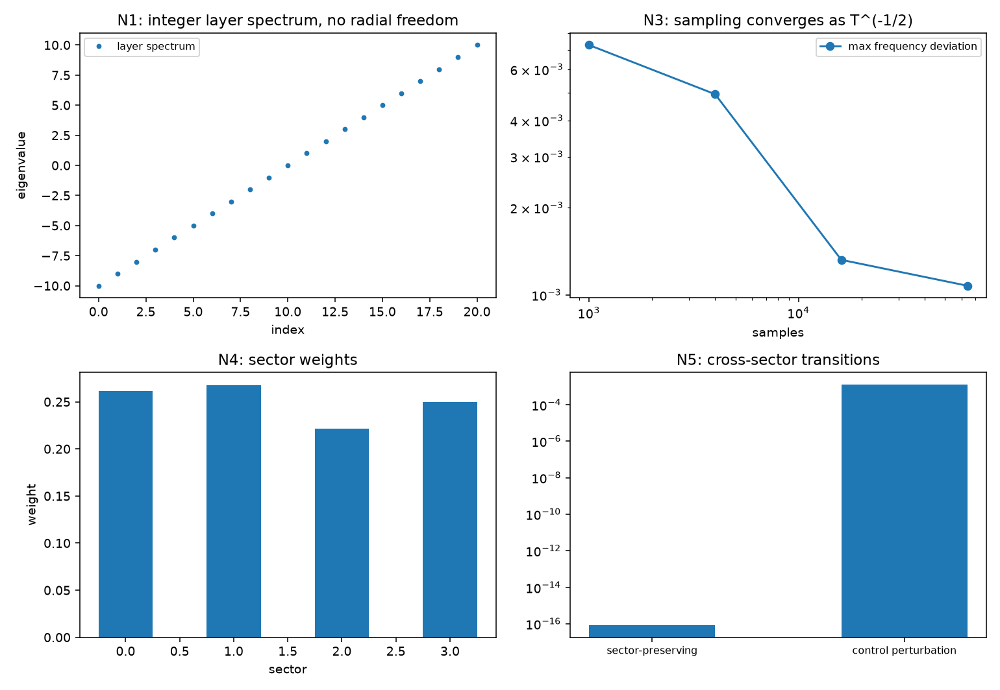

# 注记-关系层 Born 规则轮的最小验证：归一化、抽样收敛与扇区互斥

- **日期**：2026-09-19
- **对应脚本**：`验证脚本/relation_layer_born.py`（判据 N1 至 N6 共 6 项，6/6 通过；确定性，种子 20260919；运行约 0.0 秒；图存 `images/relation_layer_born.png`，见 §一 图 1）
- **依据**：[[内部草稿/研究方向-S¹ 到量子描述的显式约化：判据草案]]（R7 紧口径与 R1 轻量）；[[验证脚本/注记-关系层相位代数轮的最小验证：棱差为相位变量、扇区计数 Z^(L-1)、写入不移动扇区]]（第 148 条，关系层构造与扇区）；[[序参量份额定理：Born规则、归一化与幺正性的系综推导]] §7.1
- **状态**：判据 6/6 通过。核心读数：单体径向维数为 $0$、层数谱为整数（偏离 $0$）；幺正演化下归一化偏差 $0$；按份额抽样的最大频率偏差按 $T^{-1/2}$ 收敛（双对数斜率 $-0.5088$，四档 $0.0073$、$0.0049$、$0.0013$、$0.0011$）；扇区权重之和为 $1.000000$；扇区保持演化给出零跨扇区流（$8.3\times10^{-17}$），对照扰动给出 $0.0013$。

---

## 一、判据与结果

| 判据 | 内容 | 通过条件 | 实测 |
|---|---|---|---|
| N1 | 单体维度与裁决 R1 一致 | 径向 $0$、层数整数 | 偏离 $0$；构型数 $256$ |
| N2 | 归一化守恒 | 偏差 $< 10^{-12}$ | $0$ |
| N3 | 抽样按 $T^{-1/2}$ 收敛 | 斜率 $-0.50$ | $-0.5088$ |
| N4 | 扇区权重之和为 $1$ | 偏差 $< 10^{-12}$ | $1.000000$ |
| N5 | 扇区互斥（保持零流、对照非零） | 零流 $< 10^{-12}$ 且对照 $> 10^{-3}$ | $8.3\times10^{-17}$ 与 $0.0013$ |
| N6 | 口径登记 | 见 §三 | 登记 |

图注：左上为层数谱（整数阶梯，单体无径向自由度）；右上为抽样最大频率偏差随采样数的双对数收敛（斜率约 $-0.51$）；左下为四档扇区权重；右下为跨扇区流的两处对照（扇区保持演化与跨扇区扰动）。

## 二、模型设定

关系层构造取第 148 条的组合空间：$L = 4$ 条棱、每棱 $Z = 4$ 档取值，共 $256$ 条构型，按绕数（棱差之和取模）分四扇区，每扇区 $64$ 条。态矢量取该构型空间上的归一化复函数，份额取模方。抽样按份额做多项式抽样，四档采样数取 $1000$ 至 $64000$。扇区互斥用块对角幺正（各扇区内随机正交混合）与跨扇区扰动对照。

## 三、读数的意义

**R7 的三条在构造上复现。** 其一，归一化在幺正演化下守恒（偏差 $0$）。其二，Born 规则的系综读法成立：按份额抽样时经验频率的最大偏差按 $T^{-1/2}$ 收敛（斜率 $-0.5088$，四档数据单调下降）。其三，份额的扇区分解成立：总权重等于各扇区之和（$1.000000$），且演化下各扇区权重不变。

**超选择下的 Born 规则（本轮新读数）。** 扇区保持的演化给出零跨扇区流（$8.3\times10^{-17}$），而跨扇区扰动给出 $0.0013$。也就是说，概率只在扇区内分配；这条把第 140 条的对易子陈述与第 148 条的计数陈述接到了概率语义上，是 R7 紧口径下最实质的一条。

**与《序参量份额定理》§7.1 的对齐表。** 已对齐三条：归一化、Born 的系综读法、份额分解。待补两条：份额恒等式在关系层构造上的解析证明（本轮只做数值收敛），以及与该篇 §7.1 三条核心段的逐项对应（抽样按激发数计、形状归波性、碰撞与包络通量口径不可替代）。

**R1 轻量核验。** 单体的径向维数为 $0$、层数谱为整数，与 2026-09-13 裁决 R1 一致；关系层构型数的扇区分解见第 148 条（每扇区 $Z^{L-1}$）。

## 四、过程记录

判据订正一处。N5 首版用相位演化充当扇区保持，再以扇区外权重当作跨扇区流，量到的其实是初始权重（$0.47$），判据必然不通过；改为块对角幺正与跨扇区扰动对照后，保持流 $8.3\times10^{-17}$、对照 $0.0013$。教训：扇区流的判法要用权重变化量，不能用固定在某个子空间的权重。

效率记录：脚本约 $0.0$ 秒（有限维抽样与块对角正交化），无字体问题。
