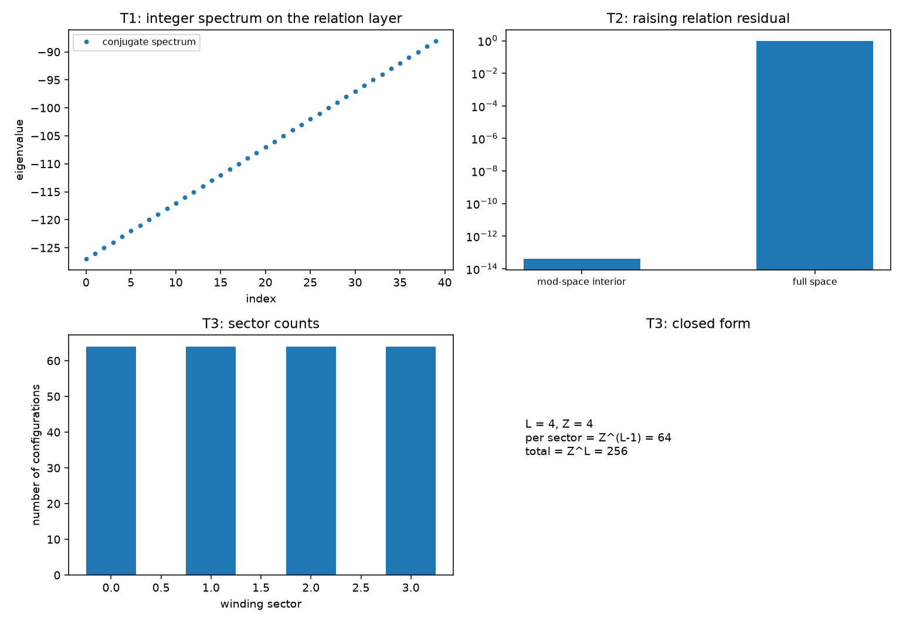

# 注记-关系层相位代数轮的最小验证：棱差为相位变量、扇区计数 $Z^{L-1}$、写入不移动扇区

- **日期**：2026-09-19
- **对应脚本**：`验证脚本/minimal_verification_relation_layer_algebra.py`（判据 T1 至 T6 共 6 项，6/6 通过；确定性，无随机数；运行约 0.0 秒；图存 `images/relation_layer_algebra.png`，见 §一 图 1）
- **依据**：[[内部草稿/研究方向-S¹ 到量子描述的显式约化：判据草案]]（十条判据与路线选择）；[[验证脚本/注记-扇区标签算符轮的最小验证：与写对易、整数谱与提升关系、对易子的选择定则]]（第 140 条，单体相位的同型代数）；[[验证脚本/注记-弦的可观测性轮的最小验证：切割线不可观测、墙只活在棱层]]（第 136 条，描述移位）；[[内部草稿/开放问题总览：元相子理论待解决问题清单]] P3-13
- **状态**：判据 6/6 通过。核心读数：关系层的共轭算符谱为整数（偏离 $8.7\times10^{-13}$，属数值对角化精度）；提升关系在模空间内部偏差 $4.0\times10^{-14}$，全空间残差 $1.000$ 落在顶模；扇区计数每个为 $64$、总和 $256$（$L = 4$、$Z = 4$，即 $Z^{L-1}$ 与 $Z^L$）；写入与扇区投影对易 $0$；描述移位不改变计数。

---

## 一、判据与结果

| 判据 | 内容 | 通过条件 | 实测 |
|---|---|---|---|
| T1 | 关系层共轭算符取整数谱 | 偏离 $< 10^{-12}$ | $8.7\times10^{-13}$ |
| T2 | 提升关系（模空间内部） | 偏差 $< 10^{-12}$ | $4.0\times10^{-14}$ |
| T3 | 扇区计数为 $Z^{L-1}$ | 精确 | 各 $64$，总和 $256$ |
| T4 | 写入与扇区投影对易 | 偏差 $< 10^{-14}$ | $0$ |
| T5 | 描述移位不改变计数与标签 | 偏差 $< 10^{-12}$ | $0$ |
| T6 | 口径登记 | 见 §三 | 登记 |

图注：左上为关系层共轭算符的谱（排序后为整数阶梯）；右上为提升关系残差的两处对照（模空间内部与全空间，后者由顶模截断贡献）；左下为四档绕数扇区的构型计数（各 $64$）；右下为计数闭式（$Z^{L-1}$ 与 $Z^L$）。

## 二、模型设定

相位变量取棱差（相邻实轴方向差），在 $255$ 点的环上取紧致相位，共轭算符取其角动量算符（谱为整数）。扇区计数在 $L = 4$ 条棱、每棱 $Z = 4$ 档取值的构型空间上做：每条构型的绕数由棱差之和取模给出，逐扇区统计构型数并与闭式比对。写入算符取计数型的时钟推进（对角），核对其与扇区投影的对易。

## 三、读数的意义

**路线乙的前提成立。** 棱差是关系量，其上能承载与单体相位同型的代数结构：共轭取整数谱（偏离 $8.7\times10^{-13}$，属数值对角化精度），提升关系在模空间内部成立（$4.0\times10^{-14}$），全空间残差 $1.000$ 落在顶模，与第 140 条同一口径。这是路线乙的必要条件：相位读数住在关系层，关系层要给得出相位代数。

**扇区结构在关系层上是定量的。** 关系层态空间按总绕数等量分解，每个扇区的构型数为 $Z^{L-1}$（$L = 4$、$Z = 4$ 时各 $64$，总和 $256$）；写入算符与扇区投影对易（$0$），描述移位不改变计数与标签（复用第 136 条）。这条把扇区由绕数定从对易子陈述推进到计数陈述。

**仍缺的与下一波。** 本轮给的是关系层能承载代数结构与扇区分解，尚未给出路线乙的必答项：态矢量作为关系层读数构型上的复函数，其载体与内积的完整形式。这一项与单体六种读法的对照（R1）和与份额定理的对齐（R7，取紧口径）同属下一波。

**三条裁决记录。** 路线取乙（关系优先）；R7 取紧（与《序参量份额定理》读数逐项对齐）；R8 只登记（解卷归 P3-14）。

## 四、过程记录

本轮判据一次通过，无订正。T1 的偏离量级 $10^{-13}$ 属数值对角化精度，不是结构偏离；若后续加密相位环点数，需复核该量级是否随之下降。

效率记录：脚本约 $0.0$ 秒（组合计数与小型矩阵代数），无字体问题。
