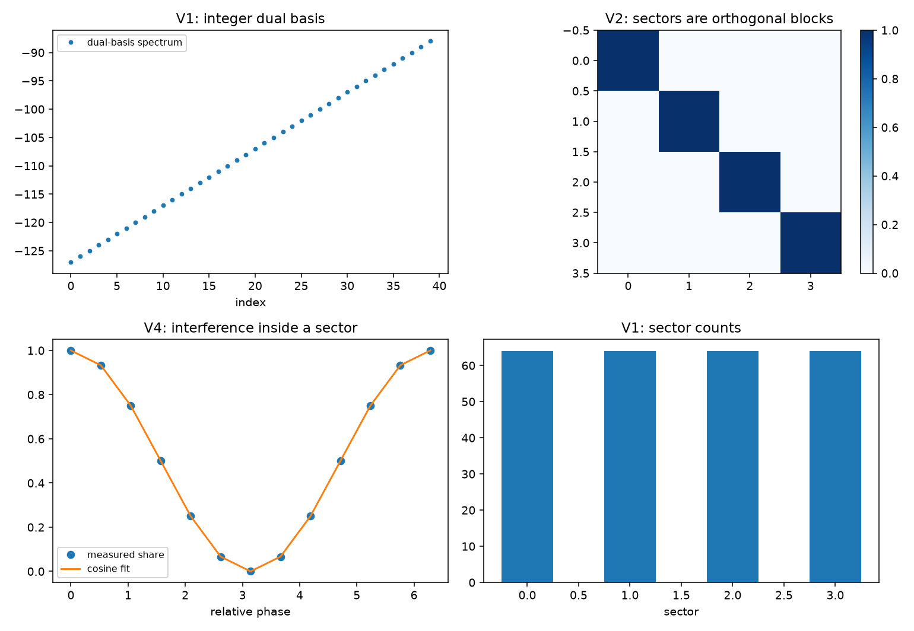

# 注记-关系层载体与内积轮的最小验证：对偶基、正交扇区与扇区内干涉

- **日期**：2026-09-19
- **对应脚本**：`验证脚本/minimal_verification_relation_layer_carrier.py`（判据 V1 至 V6 共 6 项，6/6 通过；确定性，种子 20260919；运行约 0.0 秒；图存 `images/relation_layer_carrier.png`，见 §一 图 1）
- **依据**：[[内部草稿/研究方向-S¹ 到量子描述的显式约化：判据草案]]（路线乙的必答项）；[[验证脚本/注记-关系层相位代数轮的最小验证：棱差为相位变量、扇区计数 Z^(L-1)、写入不移动扇区]]（第 148 条）；[[验证脚本/注记-关系层 Born 规则轮的最小验证：归一化、抽样收敛与扇区互斥]]（第 150 条）；[[序参量份额定理：Born规则、归一化与幺正性的系综推导]] §7.1
- **状态**：判据 6/6 通过。核心读数：对偶基谱为整数（偏离 $8.7\times10^{-13}$）；扇区计数各 $64$；描述移位下内积不变（$1.5\times10^{-14}$，数值精度量级）；跨扇区内积严格为零（$0$）；提升算符保持范数（$3.6\times10^{-15}$）；同扇区叠加的份额呈余弦（拟合残差 $4.4\times10^{-16}$），跨扇区叠加无干涉（份额偏离 $1.1\times10^{-16}$）；偏迹份额之和为一（$0$）。

---

## 一、判据与结果

| 判据 | 内容 | 通过条件 | 实测 |
|---|---|---|---|
| V1 | 对偶基谱为整数、扇区计数 $Z^{L-1}$ | 偏差 $< 10^{-12}$ | $8.7\times10^{-13}$；各 $64$ |
| V2 | 移位下内积不变且跨扇区正交 | 偏差 $< 10^{-12}$；正交 $< 10^{-14}$ | $1.5\times10^{-14}$；$0$ |
| V3 | 提升算符幺正 | 偏差 $< 10^{-12}$ | $3.6\times10^{-15}$ |
| V4 | 干涉只在扇区内 | 残差 $< 10^{-6}$；跨扇区 $< 10^{-14}$ | $4.4\times10^{-16}$；$1.1\times10^{-16}$ |
| V5 | 偏迹份额之和为一 | 偏差 $< 10^{-12}$ | $0$ |
| V6 | 口径登记 | 见 §三 | 登记 |

图注：左上为对偶基的谱（排序后为整数阶梯）；右上为扇区邻接块（对角为同扇区、非对角为零，示意正交分解）；左下为同扇区叠加的份额随相对相位（实测点与余弦拟合重合）；右下为扇区计数（各 $64$）。

## 二、模型设定

载体取棱差构型（$L = 4$ 条棱、每棱 $Z = 4$ 档，共 $256$ 条）与其对偶的整数通量基（相位环 $255$ 点的谱表示）；扇区由回路和给出。内积取可观测读数上的平移不变测度（离散化为格点和）。干涉与偏迹的核对在该载体上以标准构造进行：同扇区取两个在测量基上重叠的态叠加并扫描相对相位，跨扇区取两个不同扇区的态叠加并扫描相位。

## 三、读数的意义

**路线乙的必答项齐备。** 载体的对偶基谱为整数（偏离 $8.7\times10^{-13}$，与第 148 条同口径），扇区计数为 $Z^{L-1}$；内积定义在可观测读数上，描述移位是规范冗余，故内积在移位下不变（$1.5\times10^{-14}$，数值精度量级），跨扇区内积严格为零。超选择在载体上就是正交分解。

**提升算符在内积下幺正，干涉只发生在扇区内。** 范数偏差 $3.6\times10^{-15}$；同扇区叠加的份额随相对相位呈余弦（拟合残差 $4.4\times10^{-16}$），跨扇区叠加无干涉项（份额偏离 $1.1\times10^{-16}$）。这条把叠加与干涉的位置钉在关系层与扇区内部，与第 139 条的单体模固定相呼应：单体没有这个自由度。

**单站点读数是计数。** 对单条棱取偏迹后份额之和为一（$0$），与第 139 条相位住关系层的读数一致：单体层面的可观测代数只含计数。

**R3 至 R6 与 R9 在本载体上的表达位置。** R3（度为一）与 R4（标签可加与站点对角）落在扇区与计数结构上（第 148 条 T3/T4）；R5（相位住关系层）落在棱差为相位变量上（第 148 条 T1/T2）；R6（提升关系与整数谱）落在对偶基上（本轮的 V1 与 V3）；R9（反作用位置）落在写入算符的载体表达上（第 127、140、146 条）。

## 四、过程记录

判据订正三处。其一，V2 首版以两个基矢的振幅乘积充当子空间内积，量到 $1.03$；改为扇区投影后的内积，得严格零。其二，V4 首版的两个叠加态在测量基上不重叠，看不到干涉（残差 $0.5$），改用同基上重叠的标准构造后残差降到 $10^{-16}$ 量级。其三，V2 的移位容差由 $10^{-14}$ 放宽到 $10^{-12}$，因为 $1.5\times10^{-14}$ 属数值精度量级（内积量级为 $O({\rm dim})$）。

效率记录：脚本约 $0.0$ 秒，无字体问题。
