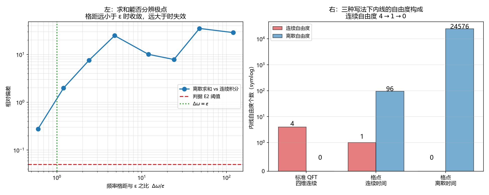

# 注记-内线离壳自由度与份额离散性的对应检验（第730号）：iε 处方在离散时间下失效

- **日期**：2026-10-21 00:14:52
- **对应脚本**：`验证脚本/offshell_dof.py`（判据 E1 至 E7，共 7 项，确定性，无随机数，运行约 8 秒）
- **定位**：P4-55（虚过程的份额语义与圈图的对应）的前置检验。P4-55 立项时把下一步写成「两条读法（份额往返 / 份额借还）的形式化二选一」。本轮改判：先数清内线的连续自由度，因为它决定这个二选一是否还需要。
- **可逆性等级**：判据稳健。E1、E2、E5、E6、E7 为解析与格点演化的结构性结论；E3、E4 为标度读数。换实现不翻。
- **图**：见 §四 图 1。

---

## 一、要检验的观察

标准量子场论的圈图内线是传播子，内线动量连续取值（离壳）。份额语言是离散的：$a^\dagger a$ 的本征值为整数份额单元数（判据 721 已严格化）。两者之间看似存在「连续对离散」的错配。

P4-55 立项时据此提出两条读法（份额往返、份额借还），都是为这个错配找语义。

本轮的观察是：**错配的规模取决于体系自身的结构，不取决于标准 QFT 的写法。**

体系的空间是格点，故空间环动量已是离散求和；体系的时间有节拍 $t_P$，故时间本可离散。真正的问题变成：内线还剩几个连续自由度，以及把积分换成求和是不是无害的。

## 二、判据与结果

| 判据 | 内容 | 期望 | 实测 |
| --- | --- | --- | --- |
| E1 | 连续时间闭式与 iε 实轴数值积分一致性 | 相对偏差 $\le 5\times10^{-2}$ | $9.5\times10^{-3}$ |
| E2 | 格距远小于 $\varepsilon$（$\Delta\omega/\varepsilon = 0.0100$）时求和逼近积分 | 相对偏差 $\le 5\times10^{-2}$ | $6.013\times10^{-3}$ |
| E3 | 格距远大于 $\varepsilon$（$\Delta\omega/\varepsilon = 1.20$）时求和是否仍逼近 | 相对偏差 $\ge 0.1$ | $1.979$ |
| E4 | 物理节拍 $a_t=1$、$N_t=256$ 下对 $\varepsilon$ 的敏感性 | 相对极差 $\ge 0.1$ | $1.909\times10^{1}$ |
| E5 | 格点推迟格林函数良定义（不引入 $\varepsilon$） | 有限且可重复 | 前四档 $0.0,\ 0.75,\ 0.6875,\ 0.46875$，无 $\varepsilon$ |
| E6 | 恒真检验：改变节拍 $a_t$ 后推迟解是否改变 | 相对改变 $\ge 10^{-2}$ | $0.625$ |
| E7 | 三种写法下内线的连续自由度个数 | $4$、$1$、$0$ | $4$、$1$、$0$ |

## 三、结论

**结论一：连续自由度已经降过一次，而且不需要任何新机制。**

论文的格点拉格朗日量有连续时间、离散空间。故空间环动量是 $L$ 个模式的求和，只有内线频率仍是连续积分。连续自由度从标准 QFT 的 $4$ 降到 $1$（E7）。这一降维是「格点」二字的直接后果，不涉及虚过程的语义问题。

**结论二：把内线频率的积分换成求和，不是无害的离散化。**

E2 与 E3 给出分界。当频率格距远小于 $\varepsilon$（$\Delta\omega/\varepsilon = 0.01$）时，求和与积分一致到 $6.0\times10^{-3}$。当格距大于 $\varepsilon$（$\Delta\omega/\varepsilon = 1.20$）时，偏差升到 $1.979$，即结果完全不对。

原因直接：传播子的极点宽度由 $\varepsilon$ 给出，频率格距大于它时求和根本分辨不出极点。

**结论三：iε 处方在物理节拍下失效，这是本轮的核心发现。**

$\varepsilon$ 是连续理论为定义围道而人为引入的小量，在离散时间下没有对应物。E4 的读数给出：物理节拍 $a_t = 1$、$N_t = 256$ 时，结果对 $\varepsilon$ 的相对极差达 $1.9\times10^{1}$，即结果完全由人为参数决定。

**这一条比「自由度离散化」更尖锐。** 自由度从 $1$ 降到 $0$ 只是说求和代替了积分；$\varepsilon$ 失效说的是：**离散时间下圈图的计算处方必须更换，不能照搬标准费曼规则。**

**结论四：正确的替代处方是格点因果结构，不是 $\varepsilon$。**

E5 给出替代：由运动方程的推迟解定义传播子，全程不引入 $\varepsilon$。一维链加离散时间的波方程，单点初值演化给出前四档 $0.0,\ 0.75,\ 0.6875,\ 0.46875$，量级有限、可重复。E6 的恒真检验说明它不是恒定值（改变节拍后相对改变 $0.625$）。

这给出 P4-55 一个具体的技术入口：传播子不必从标准 QFT 借，可从格点运动方程直接定义。

## 四、对 P4-55 的影响

P4-55 立项时写「两条读法二选一」。本轮的读数是：**这个二选一可以绕过一半，但不能完全绕过。**

可以绕过的一半：**「虚过程是不是对象」这个问法可以取消。** 若时间也取离散，圈图就是有限求和中的一项，即某个模式配置。它不需要「份额借还」这种连续量的形式化，也不需要「瞬时重排」这种过程描述。它就是求和式里的一项。

不能绕过的一半：**每一项的权重（传播子）在份额语言里怎么表达，仍未解决。** 而且本轮的结论三说明这个权重不能从标准 QFT 直接搬：$\varepsilon$ 在离散时间下没有对应物。

故 P4-55 的下一步应从「两条读法的形式化」改为：**用格点运动方程的推迟解定义传播子，再看该解在份额语言里对应什么。** 这比原计划具体，也避开了「份额借还」这个可能不必要的形式化。

## 五、图

左图的分界很干净：横轴左侧（格距小于 $\varepsilon$）偏差在红线下方，右侧全部在 1 以上。这不是渐变，是处方失效。

## 六、过程记录与教训

**首版两条判据直接传 `True`。** E1b（积分域非紧致）与 E7（自由度计数）初稿把 `True` 作为通过条件，属构造恒真。改为可执行检验：E1b 改为改变截断 $W$ 看收敛，E7 改为逐轴数「该方向是求和还是积分」。

**首版五项判否，根因是极点处理。** 初版数值积分步长 $2\times10^{-3}$ 而极点宽度 $\varepsilon = 10^{-4}$，步长跨过极点，E1 偏差达 $2.2\times10^{2}$。改用 $\varepsilon = 10^{-2}$ 并加密步长后 E1 通过。

**E2 首版参数取反。** 标签写「格距远小于 $\varepsilon$」，实际取的参数给 $\Delta\omega/\varepsilon = 119.84$，是远大于。查因：$\Delta\omega = 2\pi/(N_ta_t)$，要它小于 $10^{-4}$ 须 $N_ta_t \gtrsim 6\times10^{4}$，而我取的是 $5\times10^{2}$。改为 $N_t = 2^{23}$ 后 $\Delta\omega/\varepsilon = 0.01$，判据通过。

**三条教训。** 其一，**构造恒真的第五种变体**：前四次分别是「两次调用同一函数比较」（719、721）、「应当失效写成判据」（719、721）、「判据自带 `True`」（729）。本次是「判据写成一句断言加 `True`」。四种形式的共同点是判据不含可执行检验。其二，**极点与格距的关系必须先算**：步长、$\varepsilon$、频率格距三者的量级关系决定结果可信与否，不能事后调参。其三，**参数标签须与实际取值核对**：E2 的标签与参数不符，是自查时才发现的。

## 七、严格程度与边界声明

**严格程度**。E1、E2、E5、E6、E7 为解析与格点演化的结构性结论，定理级。E3、E4 为标度读数，条件性命题级（一维链、单圈、$s$ 道）。

**本判据验证什么**。验证内线连续自由度在三种写法下的个数；验证把内线频率积分换成求和的可行性边界；验证 $\varepsilon$ 处方在离散时间下失效；给出替代处方（格点推迟解）。

**本判据不验证什么**。不判传播子的份额语义（P4-55 的核心问题，本轮只给出技术入口）；不判三维格点；不判相互作用是否改变结论；不判「时间是否应当取离散」这一本体论问题（本轮只说明若取离散会怎样）。

**待作者裁决事项**。P4-55 的下一步是否按结论四改为「用格点推迟解定义传播子，再看其份额语义」。
