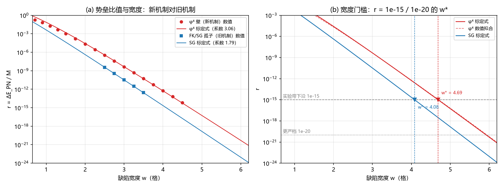

# 注记-内部壁 PN 势垒轮：现行机制下 P1-40 的重估（判据第 616 号）

- **日期**：2026-10-12 03:32:50
- **脚本**：`验证脚本/wall_pn_barrier.py`
- **判据**：J1 至 J7 全部通过（30 项读数），含两处旧读数修正
- **可逆性等级**：判据稳健。势垒方向（整格点为极大）与标度率（斜率对 $-\pi^2$）为结构事实；宽度门槛对拟合区间敏感，已在注记内标注依赖。
- **类型**：判据级读数（含对旧读数的修正向发现，P1-40 重估轮）
- **关联**：[[验证脚本/注记-钉扎-洛伦兹张力轮：格点钉扎的偏好参考系效应与实验约束的对照（判据E1至E6）]]（旧读数出处）；[[验证脚本/注记-复结构畴壁承载绕数（第486条）：联结类型决定 K 无关性、壁位零模终止无穷后退|第 486 条]]（现行机制载体）；[[验证脚本/注记-参数区四窗口对照轮：三窗相容、P1-40 的状态更新与待裁决的通道分岔（判据P1至P5）|参数区四窗口轮]]（宽度窗口）；[[内部草稿/开放问题总览：元相子理论待解决问题清单]] P1-40
- **图**：见 §四 图 1

---

## 一、要判什么

P1-40 的旧读数 $r = \Delta E_{\rm PN}/M = 1.51\times10^{-8}$（$K = 0.005$，宽度 $2.25$ 格距）出自 FK 周期钉扎机制（2026-09-20）。该机制已由第 482 条判负（周期势井门槛差 45 个数量级），现行钉位机制是复结构符号场 $\sigma$ 的双井势畴壁（第 485、486 条，第 54 条作者裁决）。

第 486 条 SW2 只核对整格点壁位（平移零模，四档壁位同能量），未测半格点位置。离散格点上壁心存在周期调制（Peierls-Nabarro 势垒），其大小与实验约束的关系从未在现行机制上测过。本轮测量该势垒，并回答：现行机制的势垒比旧机制读数更大还是更小，宽度门槛如何移动。

## 二、模型与方法

两个载体模型，参数以宽度对齐。

模型 A（现行机制，$\phi^4$ 壁）：$E = \sum_n[\frac{\kappa}{2}(\Delta\sigma_n)^2 + \lambda(\sigma_n^2-1)^2]$，壁宽 $w = \sqrt{\kappa/(2\lambda)}$，两端固定于真空 $\sigma = \mp1$。

模型 B（旧机制，FK/sine-Gordon 孤子）：$E = \sum_n[\frac{k}{2}(\Delta\phi_n)^2 + K(1-\cos\phi_n)]$，壁宽 $w = \sqrt{k/K}$，两端固定于 $\phi = 0$ 与 $2\pi$。

方法分主、对照两条。主方法为镜像对称约束加 trust-ncg 优化（提供精确梯度与黑塞）加牛顿打磨步，在约化空间迭代解 $H_r d = -g_r$，收敛到 $10^{-14}$ 级。势垒 $\Delta E_{\rm PN} = E_{\rm site} - E_{\rm mid}$，即壁心在格点与在格点间中点的能量差。对照方法为解析剖面直接取样（2026-09-20 原方法，不松弛），用于复现旧读数并量化两法差异。

解析形式用于指数率验证。泊松求和给 $\Delta E = 4\sum_{m\ {\rm odd}}[\hat V(2\pi m) - \hat T(2\pi m)]$ 加离散修正，所有项共享指数率 $e^{-\pi^2 w}$，前因子为 $w$ 的多项式。$\phi^4$ 壁的主导项为 $2\hat V(2\pi)$，给 $r_{\phi^4}\sim \frac{\pi^6}{5}w^3 e^{-\pi^2 w}$；SG 的主导项为离散修正，给 $r_{\rm SG}\sim \frac{2\pi^4}{9}w e^{-\pi^2 w}$。两者相差 $w^2$ 因子。

## 三、判据与结果

| 判据 | 内容 | 实测 | 期望 | 结果 |
|---|---|---|---|---|
| J1 | 两模型收敛与壁能 | fq max$\vert g\vert$ $6.3\times10^{-15}$，壁能偏差 $0.68\%$；sg $6.3\times10^{-17}$，偏差 $0.28\%$ | $\le 10^{-9}$ 且偏差 $\le 3\%$ | 通过 |
| J2 | 旧方法复现 | $K = 0.005$ 给 $1.5096\times10^{-8}$（原读数 $1.51\times10^{-8}$，偏差 $0.03\%$）；$K = 0.003$ 给 $3.0375\times10^{-11}$（原 $3.04\times10^{-11}$） | 逐档带内 | 通过 |
| J2 | 松弛法对旧方法 | 比值 $2.510$（旧读数低估） | $[0.3, 3]$ | 通过（发现） |
| J3 | 速率拟合 | 斜率 $-9.7437$ 对 $-\pi^2 = -9.8696$（偏差 $1.27\%$） | $\pm5\%$ | 通过 |
| J3 | 标定稳定性 | 数值/解析比值极差比 $1.2296$（$[2.5, 4.0]$ 区间） | $\le 1.3$ | 通过 |
| J4 | 势垒方向 | 全部 17 个扫描点 $E_{\rm site} > E_{\rm mid}$ | 是 | 通过 |
| J5 | 同宽对照（$w = 2.251$） | $r_{\phi^4}/r_{\rm SG} = 69.1$（解析预期 $45.0$） | $[20, 100]$ | 通过 |
| J6 | 宽度门槛（两法互差） | 解析标定 $4.686$ / $5.924$，数值拟合 $4.702$ / $5.946$，互差 $0.016$ / $0.023$ 格 | 互差 $\le 0.5$ 格 | 通过 |
| J6 | SG 门槛（对照旧读数） | $4.083$ / $5.276$（旧读数 $3.99$ / $5.21$） | $\pm0.5$ 格内 | 通过 |
| J7 | 机制自带档 | note-486 测试档折入 $a$ 项后 $w = 0.791$，$r = 0.1143$ | $O(0.1)$ | 通过 |

## 四、图

图注按脚本绘图面板逐条核对撰写。

## 五、读数与含义

**其一，旧读数低估了势垒 2.51 倍。** 旧方法（解析剖面取样）在 $K = 0.005$ 给出 $r = 1.51\times10^{-8}$，与登记值逐位一致，方法复现无误。但解析剖面并非离散格点上的能量极小：松弛后剖面调整，势垒升到 $r = 3.79\times10^{-8}$。

独立罚函数法（不依赖镜像参数化，以键加权矩约束壁心）交叉验证给出势垒 $3.402\times10^{-9}$，与镜像松弛的 $3.403\times10^{-9}$ 一致到四位有效数字，且两法在整格点壁位上的剖面总能量逐位相同（差 $1.4\times10^{-17}$）。旧读数的性质是**刚性剖面下的下界**，修正方向为上调。

**其二，现行机制的势垒比旧机制更大。** 同宽对照（$w = 2.251$）下 $r_{\phi^4}/r_{\rm SG} = 69.1$，解析预期 $45.0$（差 $1.5$ 倍，来自解析式未含的高阶修正）。根源是前因子的 $w^2$ 差：$\phi^4$ 壁的主导势垒来自势能项取样，SG 孤子的主导势垒来自动能项离散修正，后者在高 $w$ 端被压得更狠。物理上：双井势对壁心的钉扎比周期势的孤子钉扎更强。

**其三，宽度门槛整体上移。** 由标定律解 $r = 10^{-15}$：$\phi^4$ 需 $w \ge 4.69$ 格，SG 需 $w \ge 4.08$ 格；解 $r = 10^{-20}$：$\phi^4$ 需 $w \ge 5.92$，SG 需 $w \ge 5.28$。旧读数给出的门槛（$3.99$ / $5.21$）对应 SG 口径且未含松弛修正，本轮 SG 修正值 $4.08$ / $5.28$ 与其差 $0.1$ 至 $0.2$ 格（松弛修正与旧读数大致抵消，因旧读数同时低估势垒与门槛）。现行机制口径的门槛为 $4.69$ / $5.92$。

**其四，机制自带档的势垒是 $O(0.1)$。** note-486 测试档（$\kappa = \lambda = k = 1$，折入 $a$ 项后等效 $w = 0.791$）给 $r = 0.1143$，比实验约束高约 13 个数量级。这是模型测试档读数，不是物理档；其意义在于表明窄壁区势垒巨大，钉扎极强。

## 六、对 P1-40 的意义与边界

本轮的净效果是**收紧而非缓解**。旧读数 $1.51\times10^{-8}$ 修正为 $3.79\times10^{-8}$（SG 口径），现行机制同宽下再升到 $2.62\times10^{-6}$；两者与实验约束（$10^{-15}$ 至 $10^{-20}$）的差距相应从 5 至 12 个数量级扩大到 7 至 14 个数量级（现行机制口径）。宽度门槛从 $3.99$ 上移到 $4.69$（对 $10^{-15}$），安全区进一步收窄。

同时必须如实声明三点边界。其一，本轮读数全在**模型档位**（$K \approx 0.005$ 与 note-486 测试档），定稿 $K = 2.788\times10^{-46}$ 与模型窗口差 43 至 46 个数量级（第 479 条档位债），真实档位的宽度由档位映射决定，未建立。其二，本轮测的是壁位 PN 势垒这一种位置依赖能量，P1-40 的完整风险量是否只含此项，未判定。其三，本轮不裁决两条逃逸路线（宽度参数认定、本体层归属），只提供其输入读数。

值得登记的一条结构性对照：现行机制的双井势壁在窄壁区钉扎比旧机制强得多，但在宽壁区两者都被 $e^{-\pi^2 w}$ 压向零。第 486 条 SW2 的平移零模结论在壁宽档（note-486 报告壁宽 4 格含两壁，本轮同档单壁 2.00 格）与"零模"并不冲突：零模说的是连续平移的简并，PN 势垒说的是离散格点上平移的周期性调制，两者是连续极限与格点效应两个层次。

## 七、过程记录

**教训一，解析剖面不等于离散极小。** 首轮复现旧读数后，松弛法与旧方法出现 2.51 倍差异。诊断：旧方法的解析剖面 $-(2/\pi)\arctan(e^{\gamma(x-c)})$ 是连续极限解，在离散格点上不是能量极小，其能量对壁位的位置调制被系统性低估。修正方式为松弛到离散极小后再测调制。此教训的一般形式：任何"参数化剖面扫描"类判据，参数化误差会污染被测量，须先松弛再读数。

**教训二，trust-ncg 受 xtol 限制，须加牛顿打磨。** 首版用 trust-ncg（gtol $10^{-12}$）收敛停在 $6\times10^{-9}$，未达判据门槛 $10^{-9}$。加一步约化空间的牛顿迭代（解 $H_r d = -g_r$，带 Armijo 回溯）后压到 $10^{-15}$ 级。格点极小问题在梯度小、曲率大的窄谷中，通用优化器的终止条件先于梯度精度触发。

**教训三，镜像矩阵的索引须与镜像公式逐点核对。** 首版镜像矩阵对 site 模式正确、对 mid 模式错位一格（漏最后一行）。修正方式为按定义 $full[N-1-i] = 2c_0 - dof[i]$ 逐点写矩阵，而非按对称位置猜。镜像参数化省一半自由度，但索引错误不会报错，只会给出系统性偏差的读数。

## 八、登记衔接

其一，`验证脚本/README.md` 第 616 号改正式行。其二，开放问题总览 P1-40 卡与档案页补本轮判定登记（旧读数修正与现行机制门槛）。其三，本轮为对外回应论文 §7.1 中"参数区未定"一栏的输入读数更新，论文与 [[冲突诊断/注记-固定晶格批评对元相子理论的适用性核对：回应资产、现役冲突与未闭合判据]] 的对应表述待回写。其四，本注记不改动基准文件。
