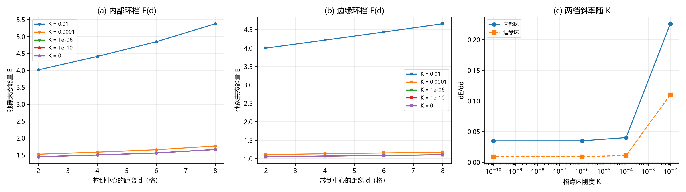

# 注记-内部结构承接钉扎角色的束缚（第 485 条）：内部冻结环可替代样品边缘

## 元数据

- **日期**：2026-09-29 07:37:36
- **脚本**：验证脚本/minimal_verification_inner_wall_confinement.py
- **判据**：IW1 至 IW3 通过，IW4 为严格程度与登记衔接
- **可逆性等级**：判据稳健。主结论（内部环档含非零 K 无关平台、K 标度与边缘档同族）由逐档读数给出，且 $K = 0$ 与 $K = 10^{-10}$ 两档读数相同；步数收敛性检查通过（$6000$ 对 $60000$ 步最大相对偏差 $1.679\times10^{-5}$）。
- **类型**：最小验证注记，执行「内部壁承接边界角色」候选的评估
- **关联**：[[验证脚本/注记-边界保护束缚的刚度不敏感性（第483条）：平台由键项承载、增益比停在38%、迁移判据设计失效|第483条]]（冻结边缘环的基线）；[[验证脚本/注记-环面芯-芯束缚（第484条）：吸引的收敛性更正、展宽模与静态无束缚态|第484条]]（无固定参照物时的判负与收敛性教训）；[[复合位错粒子的形态收束：宽度的波性侧承载、边界保护与锚核驻留判据]]（面壁与边界钉扎承担绕数的结论）；[[理论攻坚/电子场攻坚计划：复合位错算符的构造与螺旋序真空裁决]]（候选登记处）
- **图**：见第三节 图 1

---

## 一、要判什么

第 483 条测出冻结**边缘**环给出非零的 K 无关束缚平台，但适用范围段指出：闭合宇宙里没有样品边缘，物理上可用的固定结构只能是内部结构。第 484 条在周期环上测芯-芯，判负，因为那里没有固定参照物。

本条把冻结集由样品边缘换成**样品内部的冻结环**，测束缚是否仍然成立，并与边缘档并置对照。

判据：IW1 冒烟与保护核对（含步数收敛性检查）；IW2 两档的 $E(d)$ 与斜率；IW3 内部结构能否替代边缘；IW4 严格程度与登记衔接。

## 二、模型与协议

与第 483 条同口径。二维横截面 $N^2 = 31^2$ 格点，开边界（自由），场 $u = u_0 + \theta/(2\pi)$，$u_0 = I_X + I_Y$，$\theta = \operatorname{atan2}(y - y_c,\, x - x_c)$，能量

$$E = \sum_{\text{axes}}\frac{k}{2}(\Delta u - 1)^2 + K\sum_p\bigl[1 - \cos 2\pi u_p\bigr], \qquad k = 1 .$$

冻结集取两种。**内部环**：以样品中心为心、半径 $R = 9$ 的圆环上 $72$ 个格点。**边缘环**：样品四边共 $120$ 个格点。芯沿 $+x$ 方向离中心 $d$ 格，$d$ 取 $2$、$4$、$6$、$8$。梯度下降弛豫（$\eta = 0.02$，$6000$ 步），仅冻结集固定。$K$ 取 $10^{-2}$ 至 $0$ 五档。确定性，无随机与采样。

## 三、判据与结果

**判据 IW1（冒烟与保护核对）**。

| 量 | 初态 | 内部环冻结 | 边缘环冻结 | 不冻结对照 |
| --- | --- | --- | --- | --- |
| 环内键偏差能量 | $0.370710$ | $0.412898$ | $0.000056$ | $0.000000$ |
| 总能量 | $21.193298$ | $4.410540$ | $4.212924$ | $0.000000$ |

保护比（内部环冻结对不冻结）$\ge 8\times10^{23}$。步数收敛性（$K = 10^{-10}$，内部环）$6000$ 步对 $60000$ 步最大相对偏差 $1.679\times10^{-5}$。

**判据 IW2（两档 $E(d)$ 与斜率）**。

内部环档：

| $K$ | $d = 2$ | $d = 4$ | $d = 6$ | $d = 8$ | 斜率 |
| --- | --- | --- | --- | --- | --- |
| $10^{-2}$ | $4.015818$ | $4.410540$ | $4.845205$ | $5.377747$ | $2.260227\times10^{-1}$ |
| $10^{-4}$ | $1.521459$ | $1.582555$ | $1.652833$ | $1.765216$ | $4.007760\times10^{-2}$ |
| $10^{-6}$ | $1.447888$ | $1.499381$ | $1.559398$ | $1.660435$ | $3.488292\times10^{-2}$ |
| $10^{-10}$ | $1.447116$ | $1.498511$ | $1.558424$ | $1.659345$ | $3.483011\times10^{-2}$ |
| $0$ | $1.447115$ | $1.498511$ | $1.558423$ | $1.659345$ | $3.483010\times10^{-2}$ |

边缘环档：

| $K$ | $d = 2$ | $d = 4$ | $d = 6$ | $d = 8$ | 斜率 |
| --- | --- | --- | --- | --- | --- |
| $10^{-2}$ | $3.997329$ | $4.212924$ | $4.432004$ | $4.657729$ | $1.100140\times10^{-1}$ |
| $10^{-4}$ | $1.109117$ | $1.131146$ | $1.152969$ | $1.174983$ | $1.097106\times10^{-2}$ |
| $10^{-6}$ | $1.051060$ | $1.069024$ | $1.086710$ | $1.104466$ | $8.895221\times10^{-3}$ |
| $10^{-10}$ | $1.050462$ | $1.068384$ | $1.086028$ | $1.103740$ | $8.873956\times10^{-3}$ |
| $0$ | $1.050462$ | $1.068384$ | $1.086028$ | $1.103740$ | $8.873954\times10^{-3}$ |

**判据 IW3（替代性判定）**。两档斜率之比：$2.0545$（$K = 10^{-2}$）、$3.6530$（$10^{-4}$）、$3.9215$（$10^{-6}$）、$3.9250$（$10^{-10}$）、$3.9250$（$K = 0$）。内部环档的 $K$ 标度比（$K = 0$ 对 $K = 10^{-2}$）为 $0.1541$；边缘环档为 $0.0807$；第 483 条对照为 $0.1299$。判定为通过：内部结构可替代边缘，两档同族。

### 图 1

图注按脚本绘图面板逐条核对撰写。本注记作者未能对图像作目视复核（环境不支持显示），图注描述的是绘图段显式绘制的元素：面板 (a) 与 (b) 横轴均为芯到中心的距离 $d$（格），纵轴为弛豫末态能量 $E$，五条曲线按 $K$ 档以圆圈与方块标记；面板 (c) 横轴为 $K$，纵轴为 $dE/dd$，半对数坐标，内部环以圆圈实线、边缘环以方块虚线叠画。

## 四、解读

**其一，内部结构可以替代样品边缘。** 内部环档同样给出非零的 K 无关平台（$3.483010\times10^{-2}$），且其 K 依赖形状与边缘档同族。这是本条的主要结论：钉扎不要求样品边缘，一条**内部闭合的绕数承载结构**就够。物理上对应的正是「面壁（余维一，边界钉扎承担绕数）」那条已收束的读数。

**其二，保护与束缚是两件可分的事。** 环内键偏差能量在内部环冻结下保持（$0.412898$，较初态略增），不冻结则归零（$0.000000$）；而边缘环冻结档的环内反而几乎归零（$0.000056$），因为涡旋被冻结的边缘吸引、迁移出了环。这一组读数同时给出两件事：内部环能保护绕数，且束缚方向指向承载结构。

**其三，幅度不可直接比。** 内部环斜率约为边缘档的 $3.9$ 倍，但两者几何不同（环半径 $9$ 对样品半宽 $15$），故只有 K 标度可比。引用时须注明，不可把两个绝对斜率并列当作强弱结论。

**其四，与第 483 条的一致处与差别。** 差别在承载结构的位置（边缘对内部）。一致在 K 标度同族（$0.1541$ 对 $0.1299$，相差 $19\%$），且都表现为键项承载的非零平台。$19\%$ 的差异可能来自几何与冻结集厚度，不构成类型差别。

**其五，无穷后退问题在本模型中不可测。** 模型含平移不变性，环的位置是一个构造性的零模，「环由谁钉」在模型内无内容。物理版本取决于格点是否破坏连续平移：缺陷动力学线已登记「格点钉扎意味着偏好参考系，比值 $r = 1.5\times10^{-8}$ 与既有洛伦兹破坏约束不相容」。故该问题登记为未验证，见第七节。

## 五、过程记录

**保护判据首版失效并更换。** 首版用「沿环路径插值求绕数」作保护判据，读数恒为 $0.000000$。

诊断出两个问题：其一是插值索引转置（$u[j_0, i_0]$ 应为 $u[i_0, j_0]$，因网格第一轴为 $x$）；其二是更根本的，环路径穿过 $\theta$ 的分支切割，跨切割的插值会把 $\pm 1$ 的跳变卷进求和，该度量对「场是否含涡旋」不可靠。改为**环内键偏差能量**（直接可解释的正定量）并加**不冻结对照**后，读数立即恢复正常（$0.412898$ 对 $0.000000$）。教训：保护类判据应取被保护对象本身的可解释量，不要取需要沿路径积分的拓扑量，后者对采样路径与分支切割的选取敏感。

**步数收敛性检查已纳入冒烟。** 依第 484 条的教训，本轮把两个步数档的对照写进 IW1 并设为断言，通过。第 484 条因缺此步而误报一次，本条不再复用该错。

## 六、严格程度声明

**严格**：内部环冻结下环内键偏差能量的保持；步数收敛性（两档一致）。

**判据级**：两档斜率及其 K 标度；内部环与边缘环的 K 标度比（$0.1541$ 对 $0.0807$）。

**条件性**：内部环的稳定性在本模型中是**施加的**（冻结），未由对称破缺导出。本条验证的是「给定一个稳定的内部绕数承载结构，束缚是否成立」，不验证该结构本身的稳定性。

**纲领**：物理上面壁能否承担同一角色；环自身位置的钉扎。

## 七、边界声明

**验证什么**：内部冻结环能否替代样品边缘提供束缚；两档的 K 标度是否同族；保护是否成立。

**不验证什么**：其一，不判定内部结构的**稳定性来源**（本模型以冻结施加，未由 $\pi_0$ 型对称破缺导出，该步属后续）。其二，不判定环自身位置的钉扎，模型含平移不变性故零模为构造性质。其三，不判定三维形态，本条为二维横截面。其四，不判定肩并的电荷守恒层分工。其五，不改动 理论总纲 基准，不重开第 483、第 484 条已定的读数。

## 八、登记衔接

落点：电子场攻坚计划阶段 0 的「钉扎尺度替代来源」候选评估（本条评估内部壁承接一项，结论为**候选成立**）；[[内部草稿/开放问题总览：元相子理论待解决问题清单]] P1-11 挂一条关联。后续项登记一项：内部结构的稳定性须由对称破缺（复结构符号场的 $\pi_0$ 畴壁）导出，不得以冻结施加；该步即「面壁而非样品边缘」的物理落实。

## 修订记录

- **2026-09-29 首次执行**（判据 IW1 至 IW3 通过）
    - 内部环档给出非零 K 无关平台 $3.483010\times10^{-2}$，K 标度比 $0.1541$，与边缘档（$0.0807$）及第 483 条对照（$0.1299$）同族
    - 保护比 $\ge 8\times10^{23}$（环内键偏差能量 $0.412898$ 对不冻结档 $0.000000$）
    - 步数收敛性检查通过（$1.679\times10^{-5}$），依第 484 条教训纳入冒烟
    - 结论：内部结构可替代样品边缘，「内部壁承接」候选成立
    - 保护判据首版失效已更换（绕数沿路径积分对分支切割敏感，改用环内键偏差能量并加不冻结对照）
    - 未验证项登记：内部结构的稳定性须由对称破缺导出；环自身位置的钉扎
