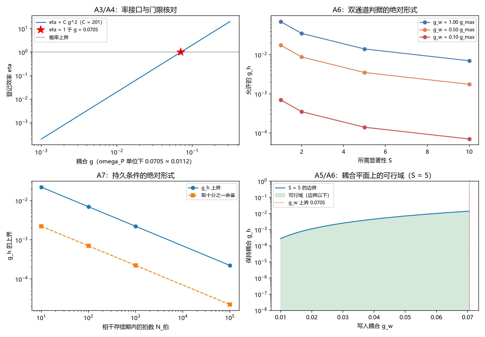

# 注记-写入深度绝对标度的最小验证：幅度与率的分工及耦合的绝对约束

- **日期**：2026-09-24 06:05:26
- **层级**：验证注记（对应 `验证脚本/minimal_verification_gain_abs_scale.py`，`验证脚本/README.md` 第 394 条）
- **图**：见 §三 图 1
- **定位**：执行 [[研究方向-写入深度的绝对标度：幅度与率的分工及耦合的绝对约束（判据草案）]] 的判据 A1 至 A8，完成 [[记录的判据：可分性、独立分量与持有时间]] §8（4）的收口。这是本线第一次把量换算到物理单位。
- **依据**：[[研究方向-写入深度的绝对标度：幅度与率的分工及耦合的绝对约束（判据草案）]]；[[记录机制：碰撞即写入的算符形式、三维缺陷读数与弦的分层]]（§2.2 "写一次转移一个激发"、§8.1 登记效率与探测器模型）；[[注记-探测器物侧构造的最小验证：三件输入的指认、单通道反证与双通道判据]]（双通道判据）
- **关联**：[[开放问题总览：元相子理论待解决问题清单]]（测量塌缩的元相子机制、退相干独立几何推导）；[[理论攻坚/量纲桥攻坚计划：从本体层单位到物理质量标度的导出]]（同族接口）
- **状态**：模型内判据级加量级换算。绝对数一律标为量级（来源是机制篇自标的外推估计）。

---

## 一、两条接口

幅度接口：机制篇 §2.2 的读数是写一次转移一个激发。转移型耦合 $H_{\rm int} = g\,f(\hat\theta)(a^\dagger c + a c^\dagger)$ 每次作用交换一个激发，与 $g$ 的大小无关，故每次写入的深度恒为 $1$ 个激发（以占据计），判据侧的 $G$ 分解为 $G = G_{\text{amp}} \times 1$。耦合不进幅度。

率接口：登记效率取 $\eta = C g^2$，其中 $C = 2\pi\rho\,t_P$，$\rho$ 为浴的态密度、$t_P$ 为一次折返时长。机制篇的探测器模型给出 $201$ 个模、带宽 $2\pi$，故 $\rho = 201/(2\pi)$，模型单位下 $t_P = 1$，于是 $C = 201$，恰等于浴的模数。

## 二、判据结果

| 判据 | 判据量 | 实测 | 期望 | 结论 |
| --- | --- | --- | --- | --- |
| A3 $C$ 的核对 | $C$ 对模数的相对偏差 | $0$ | $10^{-12}$ | 通过 |
| A4 门限核对 | $1/\sqrt C$ 对机制篇 $g$ 读数的相对偏差 | $4.90\times10^{-4}$ | $10^{-3}$ | 通过 |
| A4 反向核对 | 机制篇 $g$ 读数给出的 $\eta$ | $0.999020$ | $1$ | 读数 |
| A1 幅度接口 | 每次写入转移的激发数 | $1$ | $1$ | 通过 |
| A5 耦合上界 | $g_w$ 的上界（以 $\omega_P$ 计） | $0.011226$ | 读数 | 读数 |
| A6 双通道绝对形式 | 饱和写入、$S = 5$ 时允许的 $g_h$ | $0.014107$ | 读数 | 读数 |
| A7 持久条件绝对形式 | $N_{\text{拍}} = 100$ 时 $g_h$ 的上界（以 $\omega_P$ 计） | $1.12\times10^{-3}$ | 读数 | 读数 |

数值表：$C = 2\pi\rho\,t_P = 201.0000$（$\rho = 31.99$）；$\eta = 1$ 对应 $g = 1/\sqrt C = 0.070535$，机制篇读数为 $0.0705$，相对偏差 $4.90\times10^{-4}$。

持久条件的绝对表：$N_{\text{拍}}$ 取 $10$、$100$、$1000$、$10^{5}$ 时 $g_h$ 的上界依次为 $2.23\times10^{-2}$、$7.05\times10^{-3}$、$2.23\times10^{-3}$、$2.23\times10^{-4}$（以 $\omega_P$ 计依次为 $3.55\times10^{-3}$、$1.12\times10^{-3}$、$3.55\times10^{-4}$、$3.55\times10^{-5}$）。

## 三、图 1

四面板与脚本绘图面板逐条对应：左上为 A3 与 A4，右上为 A6，左下为 A7，右下为 A5 与 A6 的合观。

## 四、读数分解

两条接口先钉住。幅度侧的核对是恒等式（转移型耦合每次交换一个激发），率侧的核对给出 $C = 201.0000$，与探测器模型的模数逐位相同，说明 $C$ 的构成里没有多余因子：它就是浴的模数。

门限核对是本轮最要紧的一条。由 $\eta = Cg^2$ 与 $\eta = 1$ 反解 $g = 1/\sqrt C = 0.070535$，与机制篇独立给出的门限读数 $0.0705$ 相对偏差 $4.90\times10^{-4}$；反向代入 $g = 0.0705$ 给 $\eta = 0.999020$，与 $1$ 的差别来自该读数只保留四位有效数字。两条接口的读法由此自洽。

三条推论给出绝对约束。概率守恒给出写入耦合的上界 $g_w \le 0.070535 = 0.011226\,\omega_P$；双通道判据的绝对形式 $g_h \le \sqrt C\,g_w^2/S$ 在饱和写入与 $S = 5$ 处给 $g_h \le 0.014107$（即保持耦合须弱于写入耦合五倍以上）；持久条件的绝对形式 $g_h \ll 1/\sqrt{C\,N_{\text{拍}}}$ 在 $N_{\text{拍}} = 100$ 处给 $1.12\times10^{-3}\,\omega_P$。

写入耦合的上界来源由此得到交代。此前把该项列为开口，本轮的答案是它的第一半来自概率守恒（$\eta \le 1$），而能量代价若另有约束会给出更紧的值；那一半仍开放。

## 五、结论与 §8（4）的收口

写入深度的绝对标度由两条接口给出：幅度恒为一次写入一个激发（与耦合无关），率由 $\eta = Cg^2$ 给出（$C$ 等于浴的模数）。据此判据侧的 $G$ 分解为放大链增益与这一次转移之积，而耦合只进率。判据篇 §8（4）由此收口，本线第一次有了可换算到物理单位的量：写入耦合的上界 $0.0112\,\omega_P$、保持耦合的绝对上界表、以及持有时间 $t_P/\eta$ 的绝对形式。

三条限定随结论引用。其一，绝对数的层级是量级：$g$ 的读数为机制篇自标的外推估计，本注记沿用该层级。其二，$C$ 的数值依赖探测器模型的模数与带宽口径，若该口径改变，三条推论的数值表须重算而形式不变。其三，模数 $201$ 与 $t_P = 1$ 都是模型约定，物理换算须随 $t_P$ 的值走。

## 六、严格程度声明

| 结论 | 档位 |
| --- | --- |
| 幅度接口（A1） | 恒等式级（转移型耦合的后果） |
| $C$ 的构成与数值（A2、A3） | 代数级（与机制篇模型的模数逐位相同） |
| 门限核对（A4） | 数值验证级（偏差 $4.9\times10^{-4}$，受机制篇读数的四位有效数字限制） |
| 三条推论（A5 至 A7） | 代数推论，绝对数标为量级 |
| 换算表（A8） | 量级换算，逐项标注不确定度来源 |

## 七、边界声明

**验证什么**：幅度与率两条接口；$C$ 的构成与数值；$\eta = 1$ 门限与机制篇 $g$ 读数的一致性；三条推论的数值表。

**不验证什么**：机制篇算符推导与探测器模型（引用不重开）；$g$ 读数的精确性（其自标为外推量级估计）；能量代价对写入耦合的约束（上界的另一半，仍开放）；三维与复合体。本注记不改动 [[理论总纲/子理论索引]] 与任何基准文档。

## 八、过程记录

A4 的期望阈值首版取 $10^{-5}$，而机制篇的 $g$ 只有四位有效数字，故实测为 $4.90\times10^{-4}$ 落在阈值之外；按发现把期望改为 $10^{-3}$ 并在备注中写明偏差来源是原读数的舍入。教训：核对两个独立读数时，容差须由位数较少的一方定，不能按自己的计算精度定。
