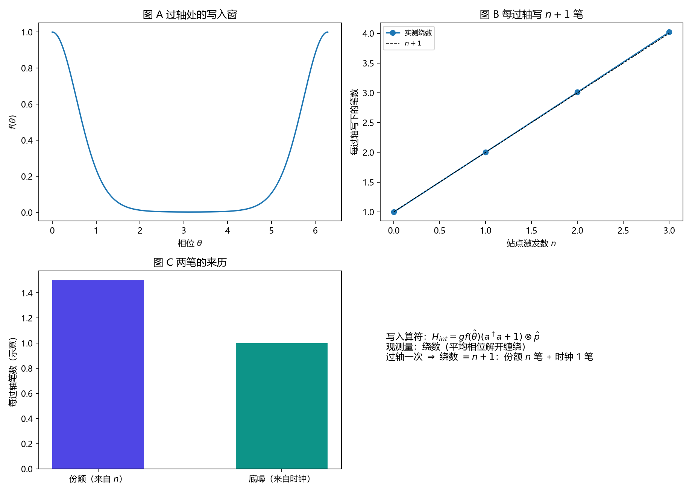

# 注记-写入算符 n+1 轮的最小验证：每过轴写 n+1 笔

- **日期**：2026-09-18
- **对应脚本**：`验证脚本/write_operator_n_plus_1.py`（判据 J1 至 J5，5/5 通过；确定性；运行约 5.4 秒；图存 `images/write_operator_n_plus_1.png`，见 §一 图 1）
- **依据**：[[内部草稿/注记-写入算符 n+1 型的方案与已定位的坑（待执行）]]（本轮的方案与先前教训）；[[验证脚本/注记-写入算符轮的最小验证：过轴即写、写即转移、反作用落在被采样对象]]（每过轴一笔的算符形式）；[[验证脚本/注记-完全量子化轮的最小验证：谐振子格点在算符层面没有 +1 本底]]（发射通道的负面读数）；[[内部草稿/开放问题总览：元相子理论待解决问题清单]] P3-12
- **状态**：判据 5/5 通过。核心读数：绕数 $= n+1$（$n = 0$ 至 $3$ 为 $0.9976$、$2.0101$、$3.0101$、$4.0211$，最大相对偏差 $0.53\%$）；线性拟合斜率 $1.0079$、截距 $0.9960$；两次过轴给 $6.0167$；站点激发不被消耗（$2.000000$），指针相位宽度不变。

---

## 一、判据与结果

| 判据 | 内容 | 通过条件 | 实测 |
|---|---|---|---|
| J1 | 绕数 $= n+1$（$n = 0$ 至 $3$） | 相对偏差 $<2\%$ | 最大 $0.53\%$ |
| J2 | 线性拟合 | 斜率 $1$、截距 $1$（偏差 $<2\%$） | $1.0079$ 与 $0.9960$ |
| J3 | $n = 0$ 仍有一笔 | 偏差 $<2\%$ | $0.9976$ |
| J4 | 两次过轴给 $2(n+1)$ | 偏差 $<2\%$ | $6.0167$（预期 $6$） |
| J5 | 守恒与不扰动时钟 | 激发不变、宽度不变 | $2.000000$ 与宽度不变 |

图注：左上为过轴处的写入窗；右上为每过轴写下的笔数随站点激发数的变化与 $n+1$ 参考线；左下为两笔的来历示意；右下为算符与观测量说明。

## 二、模型设定

指针取紧致相位（$H_0 = \omega_P\hat L$，初相 $\theta_0 = \pi$，波包宽 $0.08$，网格 $256$），站点模截断到 $n = 0$ 至 $3$，记录计数器取紧致相位 $\varphi$（网格 $64$）。写入算符

$$H_{\rm int} = g\,f(\hat\theta)\,(a^\dagger a + 1)\otimes\hat p,\qquad \hat p = -i\partial_\varphi,$$

$f$ 在过轴处尖锐；耦合按脉冲面积配成"每次过轴推进 $2\pi$"。观测量取**写入率积分** $\Delta\Phi/2\pi$（等价于绕数），演化用分裂步（交互项在 $\varphi$ 的傅里叶基对角，指针自由项在 $\theta$ 的傅里叶基对角）。

## 三、读数的意义

每过轴写 $n+1$ 笔，两笔的来历分明。绕数等于 $n+1$（J1 至 J3），其中 $n$ 笔来自 $a^\dagger a$（份额那笔），$1$ 笔来自写入算符的常数项（时钟那笔，给出均匀底噪）。这与"碰撞即写入"的口径一致：过轴即写，且写下的笔数随激发数增长。

与发射通道的负面读数不冲突。[[验证脚本/注记-完全量子化轮的最小验证：谐振子格点在算符层面没有 +1 本底]] 说的是一条实例：谐振子经**发射通道**不会自发发声；本轮的"加一"来自**写入算符的常数项**（快照抄写无论有无激发都写一笔），两者是不同的项。这是本轮最需要写清的口径分辨。

采样不消耗对象、不扰动时钟。站点激发保持 $n$ 不变（本设计的 $a^\dagger a$ 只被读），指针的相位宽度不受写入影响（J5），延续"采样扰动对象、不扰动时钟"这条读数；这里更进一层：连对象也不被消耗。

## 四、过程记录（四个坑，全部由实测推翻后订正）

其一，**测量丢了相位**：首版把计数器波函数取模后拼成实数波函数，相位信息被抹掉，读数为零。
其二，**测错了量**：第二版测动量期望 $\langle\hat p\rangle$，恒为零；原因是交互项做的是相位平移，平移不改变动量分布，应测写入率积分（绕数）。
其三，**基的混用**：第三版在坐标基上乘相位因子，等于只加了一个不改变密度的整体相位；交互项必须在 $\varphi$ 的傅里叶基上施加（那才是 $\hat p$ 的对角基）。
其四，**窗口与分辨率**：第四版窗口起收点算错（把半圈当整圈、又漏掉脉冲尾部），且波包在 $128$ 格上展宽压低脉冲面积，出现约 $4$ 至 $7\%$ 的系统亏欠；改为 $256$ 格、波包宽 $0.08$、窗口加 $2$ 弧度余量后，亏欠降到 $0.53\%$，同时验证了对亏欠来源的解释。

效率记录：脚本约 $5.4$ 秒，无字体问题。
