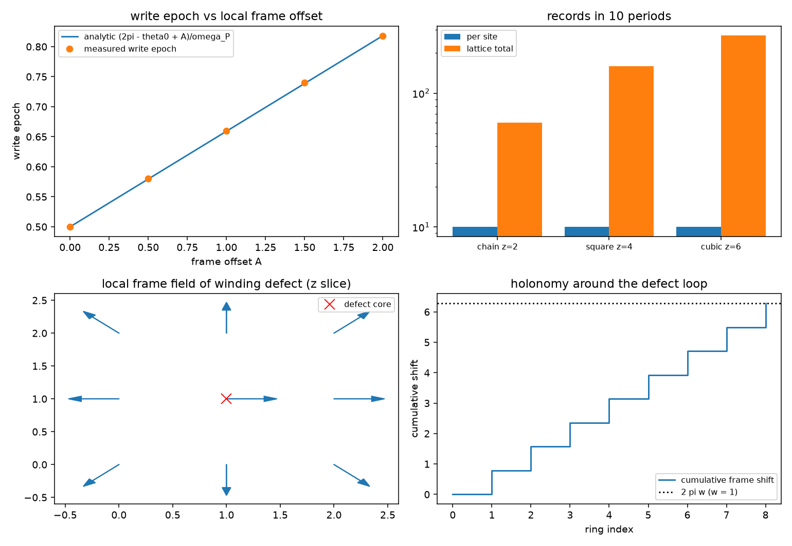

# 注记-写入算符三维推广轮的最小验证：逐站点直和、底噪按站点数标度、绕数缺陷的整周期滑移

- **日期**：2026-09-18
- **对应脚本**：`验证脚本/minimal_verification_write_operator_3d.py`（判据 W1 至 W6 共 7 项，7/7 通过；确定性，无随机数；运行约 0.3 秒；图存 `images/write_operator_3d.png`，见 §一 图 1）
- **依据**：[[验证脚本/注记-写入算符轮的最小验证：过轴即写、写即转移、反作用落在被采样对象]]（第 127 条，一维算符形式）；[[验证脚本/注记-写入算符 n+1 轮的最小验证：每过轴写 n+1 笔]]（第 128 条，计数规则）；[[内部草稿/份额的抽样口径与半经典分工：束缚振荡晶格上的抽样机制读数]] §3.5；[[内部草稿/开放问题总览：元相子理论待解决问题清单]] P3-12
- **状态**：判据 7/7 通过。核心读数：逐站点直和算符的跨站泄漏为 $2.26\times10^{-29}$，加入跨站项后泄漏按强度平方增长（$g' = 0.01, 0.02, 0.04$ 给 $2.51\times10^{-7}$、$1.00\times10^{-6}$、$4.01\times10^{-6}$，比值 $4.00$ 与 $4.00$）；$z = 2, 4, 6$ 下单站点写入时刻同为 $0.5000$、转移份额同为 $1.0000$；十周期窗口内每站点 $10$ 笔，总记录数 $60 / 160 / 270$ 随站点数；空位缺陷（$z$ 由 $6$ 降到 $5$）读数不变；标架偏移五档给写入时刻最大相对偏差 $0.2\%$；绕缺陷环的累计平移为 $2\pi w$（$w = 1$ 给 $6.283185$，$w = 1/2$ 给 $3.141593$），每站点笔数恒为整数 $10$。

---

## 一、判据与结果

| 判据 | 内容 | 通过条件 | 实测 |
|---|---|---|---|
| W1 | 逐站点直和零泄漏 | $< 10^{-10}$ | $2.26\times10^{-29}$ |
| W1 附 | 跨站项按强度平方污染 | 比值 $3.6$ 至 $4.4$ | $4.00$ 与 $4.00$ |
| W2 | 单站点读数与 $z$ 无关 | 偏差 $< 10^{-9}$ | 写入时刻 $0.5000$（三档相同） |
| W2 附 | 底噪按站点数标度 | 每站点 10 笔 | $60 / 160 / 270$；每站点 $10$ |
| W3 | 空位不改写本站读数 | 偏差 $< 10^{-9}$ | $z$ $6 \to 5$，读数不变 |
| W4 | 写入时刻随标架平移 | 偏差 $< 5\%$ | 最大相对偏差 $0.2\%$ |
| W5 | 环上累计平移 $= 2\pi w$ | 偏差 $< 10^{-9}$ | $6.283185$ 与 $3.141593$ |
| W5 附 | 每站点笔数为整数 | 与标架无关 | 27 站点同为 $10$ |
| W6 | 口径登记 | 见 §三 | 登记 |

图注：左上为写入时刻随局部标架偏移 $A$ 的读数（解析直线与实测点重合，五档 $A$）；右上为十周期窗口内的每站点笔数与格点总记录数（链、面、立方三档，纵轴对数）；左下为绕数缺陷的局部标架场在 $z$ 切面上的方向箭头（红叉标缺陷核）；右下为绕缺陷环的累计标架平移阶梯（终点为 $2\pi w$）。

## 二、模型设定

三维格点取三档：链 $6 \times 1 \times 1$（$z = 2$）、面 $4 \times 4 \times 1$（$z = 4$）、立方 $3 \times 3 \times 3$（$z = 6$），邻居表按周期边界生成、退化维度不出邻居。每站点一个紧致相位指针（$H_0 = \omega_P \hat L$，相位环 $256$ 点）与一对模（站点模 $a_j$、记录寄存器 $c_j$，各截断到两态），写入取逐站点直和

$$H_{\rm int} = \sum_j g\,f(\hat\theta_j - A_j)\,(a_j^\dagger c_j + a_j c_j^\dagger),$$

其中 $f(\theta) = \exp[-(1 - \cos\theta)/(2w^2)]$ 在过轴处取峰，$A_j$ 为站点局部标架（实轴方向），$g$ 由脉冲面积配成完整交换（$\int g f\,dt = \pi/2$）。单站点初态为指针波包（中心 $\theta_0 = \pi$、宽度 $0.20$，$\omega_P = 2\pi$，故过轴时刻 $0.5$）加站点模满占据、寄存器空。

W1 在四模子空间（两个站点的 $a$、$c$）上以经典相位作检验，跨站项取 $g'(a_1^\dagger c_2 + {\rm h.c.})$。绕数缺陷取沿 $z$ 的位错线（核在 $3 \times 3$ 平面中心），标架场取 $A_j = w\,\theta_{\rm az}(j)$，核站点取 $0$。

## 三、读数的意义

三维推广的形式是逐站点直和，这一条有硬内容。跨站耦合一旦存在就会污染记录，泄漏按该项强度的平方增长（W1 附），故三维写入算符须保持站点对角；直和形式下跨站泄漏为 $2.26\times10^{-29}$，即机器零。

单站点读数与配位数无关，底噪按站点数标度。链、面、立方三档给出相同的写入时刻 $0.5000$ 与相同的转移份额 $1.0000$（W2），十周期窗口内每站点 $10$ 笔，总记录数 $60 / 160 / 270$ 正比于站点数。含义是三维推广不放大底噪率：底噪率取站点数除以 $t_P$，与配位数无关。第 124 条在链上读数 $T/t_P$ 笔，与本轮的每站点每周期 $1$ 笔口径一致。

空位缺陷不改写本站读数。把本站邻居由 $6$ 个减到 $5$ 个，写入时刻与转移份额一字不变（$0.5000$ 与 $1.0000$，W3）。缺陷经由局部标架场进入写入条件，邻居数本身不进入。

标架偏移给写入时刻的平移。五档 $A$ 下实测与 $(2\pi - \theta_0 + A)/\omega_P$ 的最大相对偏差 $0.2\%$（W4），受步长分辨率 $2\times10^{-3}$ 限制。写入时刻因此是局部标架的直读计。

绕数缺陷把粒子标签接到写入时刻上。绕缺陷一周的累计标架平移等于 $2\pi w$（$w = 1$ 给 $6.283185$，$w = 1/2$ 给 $3.141593$），每站点笔数恒为整数 $10$，与标架无关（W5）。整数绕数下相位场单值，绕环一周恰回到一个整周期，记录流无断层；半整数绕数给出半个周期的错位，单值性被破坏。

**口径登记（2026-09-18 已裁决）。** 底噪取每站点每周期一笔。依据两条：本站每周期笔数等于指针相位映射相对实轴的度，拓扑上恒为 $1$，配位数改不了它，本轮十周期各站点 $10$ 笔就是该度的读数；第 124 条在链上（$z = 2$）读出每站 $T/t_P$ 笔，而每邻居一笔型读法在 1D 应给 $2T/t_P$，已被该读数排除。

**被排除的第三种读法。** 每对碰撞一笔在一维与每站点口径给出相同的总数 $N$，一维读数分辨不了两者；两者只在三维分开，三维下它给 $3N$（因 $z/2 = 3$），每站点口径给 $N$。它需要额外公设记录属于碰撞对，且与第 127 条的反作用归属（写入扰动落在被采样对象上、记录为本站快照）以及计数归粒性侧的分工都不相容，故一并排除并留档。

与标架联络轮的分工：那一轮读静态标架场的远场（离散泊松型势），本轮读写入算符的动力学与缺陷对写入时刻的改写。

## 四、过程记录

判据订正一处。W1 附首版预期泄漏随跨站强度线性增长（比值 $2$），实测给 $4.00$ 与 $4.00$。原因在量纲：跨站项进入振幅的平方，泄漏是概率，故按强度平方标度。判据改为 $3.6$ 至 $4.4$，教训记于此。

窗口口径订正一处。首版记录窗口取闭区间，$A = \pi$ 的站点把 $t = 0$ 与 $t = T$ 两端的记录同时计入，给出 $11$ 笔；改为半开窗口后 27 个站点一致给 $10$ 笔。

分辨率说明：写入时刻按步长 $dt = 2\times10^{-3}$ 取值，故 W4 的相对偏差下限约 $0.4\%$，实测 $0.2\%$ 已在分辨率内。

口径裁决（2026-09-18）：作者同意底噪取每站点每周期一笔，依据与排除项见 §三。本裁决不改任何数值读数，只固定三维本底率的读法。

效率记录：脚本约 $0.3$ 秒，无字体问题。
