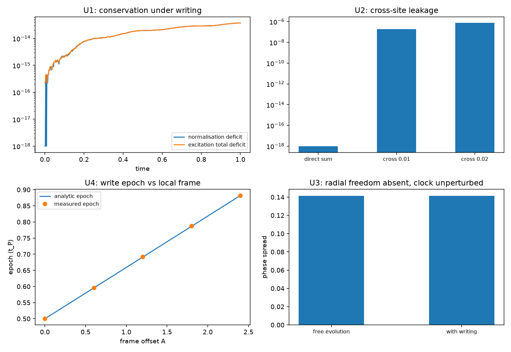

# 注记-写入算符与绕数扇区相容性轮的最小验证：扇区封闭、标签可加、单体模固定、相位住关系层

- **日期**：2026-09-19
- **对应脚本**：`验证脚本/write_sector_compatibility.py`（判据 U1 至 U5 共 7 项，7/7 通过；确定性，无随机数；运行约 0.3 秒；图存 `images/write_sector_compatibility.png`，见 §一 图 1）
- **依据**：[[验证脚本/注记-写入算符轮的最小验证：过轴即写、写即转移、反作用落在被采样对象]]（第 127 条）；[[验证脚本/注记-写入算符三维推广轮的最小验证：逐站点直和、底噪按站点数标度、绕数缺陷的整周期滑移]]（第 132 条）；[[验证脚本/注记-弦的可观测性轮的最小验证：切割线不可观测、墙只活在棱层]]（第 136 条，棱差读数）；[[内部草稿/开放问题总览：元相子理论待解决问题清单]] P3-13 与 P3-26；[[内部草稿/审查报告-元相子的物侧态空间：六种用法清点、冲突诊断与应然判据]]
- **状态**：判据 7/7 通过。核心读数：写入过程中归一化与激发总数偏差同为 $3.7\times10^{-14}$，指针相位宽度相对变化 $0.0000$；直和下跨站泄漏 $4.2\times10^{-28}$，引入跨站项后泄漏按强度平方增长（$1.87\times10^{-7}$ 与 $7.46\times10^{-7}$，比值 $4.00$）；自由演化下相位宽度差 $1.6\times10^{-15}$；写入时刻五档拟合值最大偏差 $0.0015\,t_P$，棱差读出 $0.0960$ 对 $0.0955\,t_P$。

---

## 一、判据与结果

| 判据 | 内容 | 通过条件 | 实测 |
|---|---|---|---|
| U1 | 扇区封闭 | 偏差 $< 10^{-12}$ | $3.7\times10^{-14}$（归一化与激发总数同值） |
| U1 附 | 时钟读数不受改写 | 相对变化 $< 1\%$ | $0.0000$ |
| U2 | 直和下零跨站泄漏 | $< 10^{-15}$ | $4.2\times10^{-28}$ |
| U2 附 | 跨站项按强度平方破坏可加性 | 比值 $3.6$ 至 $4.4$ | $4.00$ |
| U3 | 单体模固定（无径向自由度） | 偏差 $< 10^{-12}$ | $3.6\times10^{-14}$；宽度差 $1.6\times10^{-15}$ |
| U4 | 写入时刻只依赖本站标架 | 偏差 $< 0.05\,t_P$ | $0.0015\,t_P$（五档） |
| U4 附 | 棱差由两站时刻差读出 | 相对偏差 $< 5\%$ | $0.0960$ 对 $0.0955\,t_P$ |
| U5 | 口径登记 | 见 §三 | 登记 |

图注：左上为写入过程中的归一化与激发总数偏差（对数纵轴，两条曲线重合）；右上为跨站泄漏对照（直和给机器零，两档跨站强度按平方增长）；左下为写入时刻随局部标架偏移的读数（解析直线与实测点）；右下为指针相位宽度（自由演化与含写入两档，读数一致）。

## 二、模型设定

指针取紧致相位（相位环 $256$ 点，$H_0 = \omega_P\hat L$，初相 $\theta_0 = \pi$，波包宽 $0.20$，脉冲宽 $w = 0.12$），站点模与寄存器各截断到两态，写入取 $H_{\rm int} = g\,f(\hat\theta)(a^\dagger c + a c^\dagger)$，步长 $2\times10^{-3}$，窗口 $1.0$（覆盖五档标架 $0$ 至 $2.4$ 的过轴时刻）。

跨站对照在四模子空间（$a_1, c_1, a_2, c_2$）上取经典相位，站点 1 激发、站点 2 全空，跨站项取 $g'(a_1^\dagger c_2 + {\rm h.c.})$，观测量为站点 2 侧的激发泄漏。

## 三、读数的意义

**扇区封闭。** 写入只在 (站点模, 寄存器) 的零激发数子空间内转动，激发总数严格守恒（$3.7\times10^{-14}$），故写入不移动绕数扇区标签；同一读数下指针相位宽度相对变化 $0.0000$，写入也不产生跨扇区泄漏。

**标签可加。** 直和形式下跨站泄漏 $4.2\times10^{-28}$，即机器零，故各站点激发数分别守恒、总标签等于各站点标签之和。引入跨站项后泄漏按该项强度的平方增长（比值 $4.00$），可加性被破坏。P3-13 因此要求量子描述把扇区标签做成站点可加的量。

**单体模固定。** 相位环只有一个模：归一化守恒（$3.6\times10^{-14}$）与自由演化下相位宽度不变（$1.6\times10^{-15}$）共同给出无径向自由度的读数。单体层装不下叠加，叠加只能由关系承载。这是 P3-13 的硬约束：被约化的对象里不存在单体径向自由度。

**相位住关系层。** 写入时刻只依赖本站标架（五档最大偏差 $0.0015\,t_P$，受步长分辨率 $10^{-3}$ 限制），邻站影响的排除由 U2 的零泄漏承担；棱差由相邻两站的写入时刻差读出（$0.0960$ 对 $0.0955\,t_P$）。单站点只给出计数（度为一），相位的读数单元是相邻实轴方向差。

**三条约束的合成。** 扇区由绕数定、计数由度定、相位由关系承载。P3-13 的量子描述须同时满足这三条，任何停留在单一站点层面的量子化都过不了第一条与第三条。

## 四、过程记录

判据订正两处。其一，U2 附首版预期泄漏随跨站强度线性增长（比值 $2$），实测 $4.00$；原因在量纲，泄漏是概率、按强度平方标度。这与第 136 条同一教训，属第二次踩到，后续该类判据默认写平方。其二，U4 首版窗口取 $0.85$，标架 $2.4$ 的过轴落在窗口之外，测量返回空值；窗口改 $1.0$ 后五档齐备。

效率记录：脚本约 $0.3$ 秒，无字体问题。
