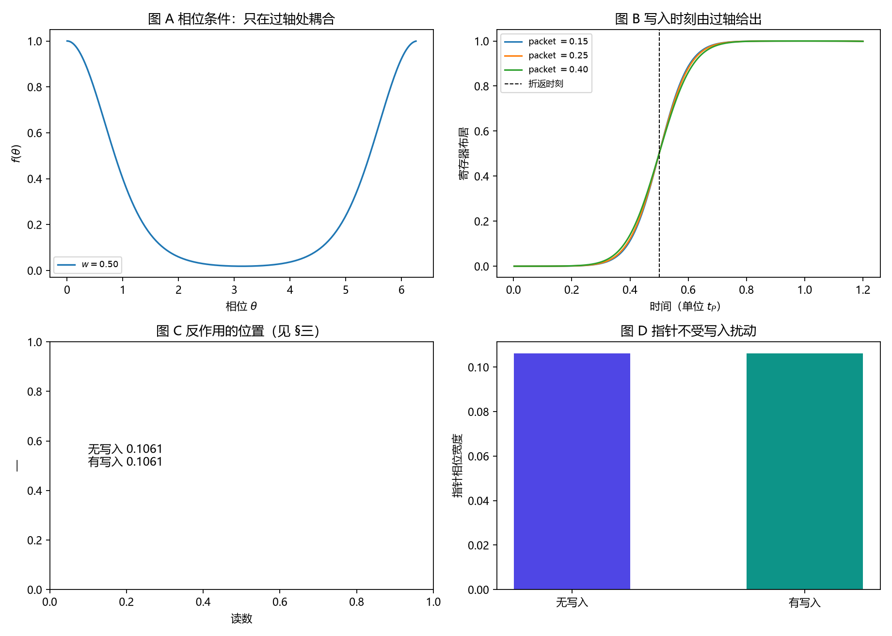

# 注记-写入算符轮的最小验证：过轴即写、写即转移、反作用落在被采样对象

- **日期**：2026-09-18
- **对应脚本**：`验证脚本/write_operator.py`（判据 J1 至 J5，5/5 通过；确定性；运行约 0.8 秒；图存 `images/write_operator.png`，见 §一 图 1）
- **依据**：[[内部草稿/注记-记录时刻的更正：碰撞即写入与稀释统计]]（事件模型口径）；[[内部草稿/注记-时钟均匀性与记录统计的口径：准时式与触发式]]；[[验证脚本/注记-碰撞即写入轮的最小验证：写入时刻等于折返时刻，本底等于碰撞率，稀释统计为 Q = -eta]]；[[序参量份额定理：Born规则、归一化与幺正性的系综推导]] §2.3；[[内部草稿/开放问题总览：元相子理论待解决问题清单]] P3-12
- **状态**：判据 5/5 通过。核心读数：写入时刻与折返时刻一致（$0.5000$ 对 $0.5000$，相对偏差 $0$），且对三档指针波包宽度不变（散布 $0.0000$）；激发数守恒（$1.000000 \to 1.000000$，寄存器布居 $0.999$，站点剩余 $0.001$）；指针相位宽度变化 $+0.00\%$。

---

## 一、判据与结果

| 判据 | 内容 | 通过条件 | 实测 |
|---|---|---|---|
| J1 | 写入时刻等于折返时刻 | 相对偏差 $<5\%$ | $0.0000$ |
| J2 | 与指针波包形状无关 | 散布 $<5\%$ | $0.0000$（三档） |
| J3 | 写即转移、激发守恒 | 守恒偏差 $<10^{-9}$ | $1.000000 \to 1.000000$ |
| J4 | 反作用落在被采样对象 | 时钟变化 $<1\%$ 且站点剩余 $<5\%$ | $+0.00\%$ 与 $0.001$ |
| J5 | 本底口径登记 | 每过轴一笔 | 登记 |

图注：左上为相位条件函数（只在过轴处耦合）；右上为寄存器布居随时间的上升（竖虚线为折返时刻）；左下为反作用位置的说明；右下为指针相位宽度在有无写入两种情形下的对照。

## 二、模型设定

指针取紧致相位（转子型自由度），自由哈密顿量 $H_0 = \omega_P \hat L$（$\hat L = -i\partial_\theta$），故其演化由 $\omega_P$ 与初相决定。写入取相位条件耦合

$$H_{\rm int} = g\,f(\hat\theta)\,(a^\dagger c + a c^\dagger),$$

$f(\hat\theta)$ 是在过轴（$\theta = 0$）处尖锐的周期函数，$a$ 为站点模、$c$ 为记录寄存器。耦合强度按脉冲面积配成完整交换（$\pi/2$ 旋转）。初态：指针波包定域于 $\theta_0 = \pi$，站点有 $1$ 个激发，寄存器为空。演化用分裂步（耦合项在相位基对角，自由项在傅里叶基对角）。

## 三、读数的意义

过轴即写，且由动力学给出。写入时刻与折返时刻 $t_{\rm cross} = (2\pi - \theta_0)/\omega_P = 0.5$ 完全一致（J1），且对三档指针波包宽度不变（J2）。也就是说，写入条件在算符里就是"相位到达过轴条件"，不是外部定时；指针的形状、宽度都不改变写入时刻。

写即转移。一次写入把站点的一个激发送进寄存器，站点与寄存器的激发总数守恒（J3）。这与事件模型的口径一致：每过轴写一笔，故内部本底为每站每摆程一笔。

反作用落在被采样对象上，时钟不受扰动。有写入与无写入两种情形下，指针的相位宽度完全相同（变化 $+0.00\%$），而站点的激发被转移走了（剩余 $0.001$）。这条读数值得记住：采样扰动对象，不扰动时钟。它同时保住了体系的时间结构（时钟不被测量干扰）与测量的物理（对象被扰动）。

## 四、剩余项

"每激发写一次"（$n+1$ 型的写入算符，即在站点模上加计数算符并令写入数随激发数）尚未实现，本轮的写入算符是"每过轴转移一个激发"。这一项属设计选择，登记为后续项，与完全量子化轮的负面读数（谐振子不给自发项）相呼应：$n+1$ 型要么需要站点模的计数结构，要么需要显式声明本底由过轴事件给出。

## 五、过程记录

判据与模型订正三处。其一，首版固定耦合、只改脉冲宽度，窄脉冲下交换不完整（寄存器布居低于 $0.5$、写入时刻判为 nan）；改为按脉冲面积配成完整交换（$g = (\pi/2)\omega_P/\int f\,d\theta$）。其二，J2 原为"三档脉冲宽度"，与完整交换的配制冲突；改为三档指针波包宽度，检验写入时刻与指针形状无关。其三，J4 原假设"写入使指针展宽"，实测变化为零：耦合在相位基对角，不作用于指针；反作用实际落在被采样对象上，判据与文字随之改正（这也是一条更贴合体系的读数）。另有绘图段残留旧变量名导致一次崩溃，已修。

效率记录：脚本约 $0.8$ 秒，无字体问题。
