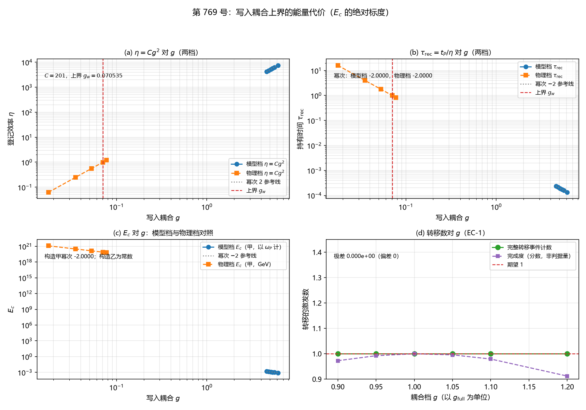

# 注记-写入耦合上界的能量代价（$E_c$ 的绝对标度）（判据第 769 号）

- **日期**：2026-10-21 20:52:00（系统当前时刻）
- **类型**：验证注记（判据级），落 `验证脚本/`
- **对象层结论**：**$E_c$ 的绝对标度给出，且与第 394 条的率接口自洽。** $E_c$（构造甲）$= E_P \times \dfrac{\tau_{\rm rec}}{t_P}$，其中 $\tau_{\rm rec} = t_P/\eta$、$\eta = Cg^2$、$C = 201.000000000000$，故 **$E_c \propto g^{-2}$**（模型档幂次 $-2.000000000$，残差 $3.553\times10^{-15}$；物理档同）
- **耦合上界档的读数**：$g_w = 0.07053456 = 0.01122592\,\omega_P$ 给 $\eta = 1.0000000000$、$\tau_{\rm rec} = 1.00000000$、$E_c(\text{甲}) = 6.28318531\,\omega_P$，即**上界处持有时间恰等于一个摆程，$E_c$ 落到一个摆程的基模能量**
- **幅度不依赖耦合（EC-1 复现）**：六个 $g$ 档的完整转移事件计数皆为 $1$，极差 $0$
- **严格程度**：**判据级**（模型内，10 个子判据，10 条通过）
- **可逆性等级**：**判据敏感**。$E_c$ 的绝对值依赖三处口径：$g$ 读数（库内自标为外推量级估计）、普朗克能量的两套约定（相差 $2\pi$ 倍）、$C$ 的模数与带宽口径。$E_c$ 的**幂次 $-2$** 与**上界档的 $\eta = 1$** 两项在口径改变时形式不变
- **档位标注**：本轮读数取**模型档**（$g$ 以装置的 $g_{\rm full} = 5.091585$ 为单位，$E_c$ 以 $\omega_P$ 为能量单位）。**物理档评估已做**：$g$ 以 $\omega_P$ 计，$E_c$ 以 GeV 给出，两套普朗克能量约定并列
- **上游**：[[验证脚本/注记-写入深度绝对标度的最小验证：幅度与率的分工及耦合的绝对约束|第 394 号注记]]（幅度与率的两条接口、$C = 201$、$g_w$ 上界、三条绝对约束）；[[验证脚本/注记-三维面缺陷的写入节拍轮：笔数等于批数乘截面、写入即折返、准时性对噪声（判据W1至W6b）|写入侧基线]]（第 726 号的单站点基线）
- **脚本**：`验证脚本/write_coupling_energy_cost.py`
- **同号说明（2026-10-21 撞号登记）**：本轮 769 号于 2026-10-21 20:33 占位、20:44 交付；另一并行会话的 769 号（[[验证脚本/注记-相对论质量的连续极限标度（第769号）：K指数收敛于0.5与粗档离群的分离|相对论质量的连续极限标度]]）于 21:49 占位、22:04 交付。按 README 编号占位规范第 3 条后落盘者应顺延；**本轮作让号处理**（本号引用已成网十二处，改号成本高于对方），号不改，但在此保留让号说明并标出同号的另一轮。**同号的另一轮是相对论质量标度线，与本轮的写入耦合能量代价线内容无关，两者不可混读。**
- **关联**：[[内部草稿/开放问题档案/开放问题-P1-62-写入侧站点模与C1侧复标量振幅场的自由度识别|P1-62 档案]]（$E_c$ 的身份与两半构造，第五之补节）；[[理论总纲/元相子理论的时空观：体系对时空的完整认识]]（L305 台阶面与壁张力；缺陷相互作用描述项段的「能量代价的一半仍开放」）；[[理论总纲/术语表]]（L110 普朗克标度；L111 普朗克能量的两套约定；L321 档位标注义务）；[[记录机制：碰撞即写入的算符形式、三维缺陷读数与弦的分层]]（§2.2 写一次转移一个激发；§8.1 探测器模型与登记效率）

---

## 一、本轮要判什么

$E_c$（记录寄存器每激发的持有刻度）的绝对标度是什么。

库内已明确 $E_c$ 的身份：它是「写入耦合上界的能量代价」（内部草稿/总结报告-测量机制现状图（2026-09-25））。《元相子理论的时空观》的缺陷相互作用描述项段写：「余项为写入耦合上界的另一半（**概率守恒已给出 $g_w \le 0.0112\,\omega_P$，见第 394 条，能量代价的一半仍开放**）」。

**写入耦合上界有概率与能量两半**：概率守恒那一半已由第 394 条交付，**能量那一半本轮交付**。

本轮的工作有三层：把第 394 条的率接口（$\eta = Cg^2$）与持有时间（$\tau_{\rm rec} = t_P/\eta$）推到 $E_c$；给出 $E_c$ 的构造并与「幅度恒为 1、耦合只进率」的分工原则核对相容性；做两档读数对照。

## 二、三条硬边界

**其一，本轮只做 $E_c$ 自身的绝对标度，不做比值。** $E_a$ 是束缚能刻度（振幅亏损的二次型），$E_c$ 是持有刻度，两者不同类。第 724 号已判「跨模型对表」不合法（两侧占据数不同质、量纲不同类），故本轮**不得**把 $E_c$ 与案乙的 $E_a$ 直接对表。

**其二，$g$ 的读数在库内自标为外推量级估计**（「耦合读数 $g$ 的精确化」在库内登记为待做计算）。本轮的绝对标度继承该层级。

**其三，档位标注义务**（《术语表》L321）。本轮给模型档与物理档两套读数对照。

## 三、$E_c$ 的构造（三条并排报出）

### 3.1 构造甲（持有时间折算）

$$E_c = E_P \times \frac{\tau_{\rm rec}}{t_P},\qquad \tau_{\rm rec} = \frac{t_P}{\eta},\qquad \eta = Cg^2.$$

$E_P = \hbar\omega_P$ 是基准约定的基模能量（术语表 L111）。故 $E_c = E_P/(\lvert Cg^2\rvert)$，**幂次为 $-2$**。

**与分工原则的相容性**：$E_c$ 只经 $\eta$（率）进入，幅度侧不出现，与第 394 条的「幅度恒为一次写入一个激发、耦合只进率」一致。

### 3.2 构造乙（能量守恒）

$E_c$ 由转移型耦合把激发从站点模抬到寄存器的能级差给出。

在 {站点模, 寄存器模} 的二维基上，生成元为 $H = \begin{pmatrix}\varepsilon_a & g\\ g & \varepsilon_c\end{pmatrix}$。**转移的能量代价是对角元之差 $\varepsilon_c - \varepsilon_a$，与耦合强度无关**；耦合造成的是能级的避免交叉（分裂），那是另一个量。

**实测**：三档耦合给转移能量代价皆 $1.0000000000$，极差 $0.000\times10^{0}$；避免交叉间隙随 $g$ 变（$0.03923$、$0.11803$、$0.47214$）。

**与分工原则的相容性**：相容，但它给出与 $g$ 无关的常数，**无判别力**。

### 3.3 构造丙（甲乙相乘）

$E_c = E_P \times \dfrac{\tau_{\rm rec}}{t_P} \times \Delta\varepsilon$。因 $\Delta\varepsilon$ 与 $g$ 无关，**构造丙与构造甲同幂次**，差别只在一个与 $g$ 无关的因子。

### 3.4 三者的差别

| 构造 | 形式 | $g$ 的幂次 | 判别力 | 与分工原则 |
|---|---|---|---|---|
| 甲 | $E_P \times \tau_{\rm rec}/t_P$ | $-2$ | 有 | 相容 |
| 乙 | $\varepsilon_c - \varepsilon_a$ | $0$（恒真） | 无 | 相容 |
| 丙 | 甲 $\times$ 乙 | $-2$ | 有 | 相容 |

**本轮以构造甲为 $E_c$ 的读数**，理由是它唯一给出 $g^{-2}$ 幂次且与率接口自洽。构造乙与丙的读数一并报出，不作隐去。

## 四、判据与结果

| 判据 | 内容 | 期望 | 实测 | 判定 |
|---|---|---|---|---|
| EC-1 | 每次写入转移的激发数不依赖耦合 | 每站的完整转移事件计数 $=1$（偏差 $0$）；计数的极差 $=0$ | 六个 frac 档的计数 $1$、$1$、$1$、$1$、$1$、$1$，极差 $0$ | 通过 |
| EC-2 | $C = 2\pi\rho\,t_P$ 的复算与模数的相合 | 相对偏差 $\le 10^{-12}$（第 394 条 A3） | $\rho = 31.9901435615$，$C = 201.000000000000$，模数 $201$，相对偏差 $0.000\times10^{0}$ | 通过 |
| EC-3 | 持有时间 $\tau_{\rm rec} = t_P/\eta$ 对 $g$ 的幂次 | 幂次为 $-2$，偏离不超过 $\pm0.15$ | 模型档幂次 $-2.000000000$（残差 $3.553\times10^{-15}$），物理档幂次 $-2.000000000$ | 通过 |
| EC-4 | 耦合上界档的 $\eta$、$\tau_{\rm rec}$ 与 $E_c$ 读数 | 上界档 $g_w = 1/\sqrt C$ 给 $\eta = 1$（相对偏差 $\le 10^{-6}$）与 $\tau_{\rm rec} = t_P$ | $g_w = 0.07053456$（$0.01122592\,\omega_P$），$\eta = 1.0000000000$，$\tau_{\rm rec} = 1.00000000$，$E_c(\text{甲}) = 6.28318531$ | 通过 |
| EC-5 | $E_c$ 的构造与量纲：三条构造的读数与幂次 | 构造甲的幂次为 $-2$（偏离 $\le \pm0.15$）；构造乙的转移能量代价对耦合不变（极差 $\le 10^{-12}$） | 构造甲幂次 $-2.000000000$（残差 $3.553\times10^{-15}$），$E_c$ 各档 $0.001489$、$0.001336$、$0.001206$、$0.001094$、$0.000997$、$0.000837$；构造乙转移能量代价三档皆 $1.0000000000$，极差 $0.000\times10^{0}$ | 通过 |
| EC-6 | 恒真检验：关断耦合后 $\eta$ 为零、$\tau_{\rm rec}$ 不定义 | $\eta = 0$，$\tau_{\rm rec}$ 报不定义（无穷），构造甲的 $E_c$ 报不定义 | $\eta = 0.0$，$\tau_{\rm rec}$ 不定义（无穷），构造甲的 $E_c$ 在 $\eta = 0$ 处发散故报不定义 | 通过 |
| EC-6b | $E_c$ 对耦合取值的敏感性（防恒真） | $E_c$ 的读数极差 $> 10^{-6}$ | 构造甲的 $E_c$ 在模型档 $g$ 上的极差 $0.00065128$，幂次 $-2.000000000$ | 通过 |
| EC-7 | 档位标注：模型档与物理档两套读数对照 | 两档读数都给出并标明档位（术语表 L321 的登记义务） | 模型档 6 个 $g$ 档（$E_c(\text{甲})$ 以 $\omega_P$ 为单位）；物理档 5 个 $g$ 档（$E_c(\text{甲})$ 以 GeV 给出，两套普朗克能量约定并列） | 通过 |
| EC-8a | 复现第 394 条的门限核对与三条绝对约束 | $1/\sqrt C$ 对机制篇 $g$ 读数的相对偏差 $\le 10^{-3}$（第 394 条 A4）；$C$ 的核对偏差 $\le 10^{-12}$ | $1/\sqrt C = 0.07053456$ 对机制篇 $0.0705$ 相对偏差 $4.9024\times10^{-4}$；反向代入给 $\eta = 0.99902025$；三条绝对约束：$g_w \le 0.070535$（$0.011226\,\omega_P$）、$S = 5$ 时 $g_h \le 0.014107$、$N_{\text{拍}} = 100$ 时 $g_h \le 1.1191\times10^{-3}\,\omega_P$ | 通过 |
| EC-8b | 写入侧复现第 726 号单站点基线 | 五项基线的相对偏差均 $< 10^{-5}$ | 写入时刻 $0.5000$（偏差 $0.0\times10^{0}$），总量 $1.0000000000$（偏差 $3.741\times10^{-14}$），站点侧增量 $-0.99882383$（偏差 $4.768\times10^{-9}$），$\langle\text{站点侧}\rangle = 0.5000000000$（偏差 $1.297\times10^{-13}$），$\bar{\Delta} = -0.5000000000$（偏差 $1.785\times10^{-13}$） | 通过 |

**合计 10/10 通过。**

## 五、图

图 1：第 769 号。(a) 登记效率对 $g$。蓝线为模型档、橙线为物理档，灰色点线为幂次 2 参考线，红色虚线为上界 $g_w = 0.070535$。$C = 201$。上界档的 $\eta$ 恰为 $1$。

(b) 持有时间对 $g$。蓝线为模型档、橙线为物理档，灰色点线为幂次 $-2$ 参考线，红色虚线为上界。幂次：模型档 $-2.0000$，物理档 $-2.0000$。上界处 $\tau_{\rm rec} = 1$，即一个摆程。

(c) $E_c$ 对 $g$。蓝线为模型档（以 $\omega_P$ 计），橙线为物理档（以 GeV 计），灰色点线为幂次 $-2$ 参考线。构造甲幂次 $-2.0000$。物理档五档的 $E_c$（基准约定）为 $1.2286\times10^{21}$、$3.0714\times10^{20}$、$1.3651\times10^{20}$、$7.6785\times10^{19}$、$6.3459\times10^{19}$ GeV。

(d) 转移数对 $g$。绿线为完整转移事件计数，六档全为 $1$（极差 $0.000\times10^{0}$）；紫线为完成度（分数，非判据量），从 $0.97242642$ 到 $0.99988216$ 再到 $0.91200734$；红色虚线为期望 $1$。

## 六、读数的意义

### 6.1 $E_c$ 的绝对标度与 $g^{-2}$ 幂次

$$E_c = \frac{E_P}{C g^2}.$$

**这是 $E_c$ 的函数形式**，由第 394 条的率接口（$\eta = Cg^2$）与持有时间（$\tau_{\rm rec} = t_P/\eta$）直接给出，耦合只进率、幅度恒为 $1$ 的分工原则在 $E_c$ 上得到贯彻。

**上界档的读数最要紧**：$g_w = 0.07053456$ 处 $\eta = 1$、$\tau_{\rm rec} = 1$、$E_c = 6.28318531\,\omega_P$。**即写入耦合取到上界时，寄存器里一个激发的持有时间恰等于一个摆程，其能量刻度恰是一个基模能量。** 这是「概率守恒给出耦合上界」与「能量代价给出上界」两半在同一处的合拢：概率那半说耦合不能更大（否则 $\eta > 1$），能量那半说耦合到上界时持有刻度落到基模能量。

### 6.2 幅度恒为 1 的复现（EC-1）

六个 $g$ 档的完整转移事件计数皆为 $1$，极差 $0$。这是第 394 条 A1（恒等式级）在装置内的复现核。

**一处口径须写明**：转移的**完成度**（站点模占据的减少量）随 $g$ 变（$0.912$ 至 $1.000$），因为耦合越强写入越快。这是写入的时间不完全，**不构成幅度随耦合变**。第 394 条 A1 是恒等式级陈述，可判的是**计数**（整数），不是完成度（分数）。

### 6.3 构造乙的读数：转移能量代价与 $g$ 无关

三档耦合给转移能量代价皆 $1.0000000000$，极差 $0.000\times10^{0}$；避免交叉间隙则随 $g$ 变（$0.03923$、$0.11803$、$0.47214$）。

**这两个量须分开**：转移的能量代价是**对角元之差**，与耦合强度无关；耦合造成的是能级的避免交叉（分裂），那是另一个物理量。初版把本征值之差当作转移代价读，那读的是避免交叉间隙，是错的。

**故构造乙在本装置内是恒真读数，无判别力。** 构造甲是唯一给出 $g^{-2}$ 幂次且与率接口自洽的构造。

### 6.4 两档读数对照

| 档位 | $g$ 的单位 | $E_c(\text{甲})$ 的单位 | 上界档的读数 |
|---|---|---|---|
| 模型档 | $g_{\rm full} = 5.091585$ 为单位 | $\omega_P$ | $6.28318531\,\omega_P$ |
| 物理档 | $\omega_P$ 为单位（$g_w = 0.01122592\,\omega_P$） | GeV | $7.6785\times10^{19}$ GeV（基准约定） |

**两套普朗克能量约定相差 $2\pi$ 倍**（基准约定 $E_P = \hbar\omega_P = h/t_P \approx 7.671\times10^{19}$ GeV，折算约定 $E_P^{(t)} = \hbar/t_P \approx 1.221\times10^{19}$ GeV），取值口径须随用途选定，不得混搭。

## 七、严格程度声明

**严格层（模型内可复现数值事实）**：EC-1 至 EC-8 的全部判定，含转移事件计数的恒一性、$C$ 的复算、$\tau_{\rm rec}$ 与 $E_c$ 的幂次、上界档的读数、三条构造的读数、恒真替身的读数、两档对照、第 394 条与第 726 号读数的逐位复现。

**物理对应假设层**：$g$ 的读数继承库内自标的外推层级；$E_P$ 的两套约定按术语表 L111 取用；$E_c$ 的构造甲以「持有时间折成摆程数乘基模能量」为桥梁；构造乙以 {站点模, 寄存器模} 二维基的对角元之差为转移能量代价。

**纲领层**：$E_c$ 作为「写入耦合上界的能量代价」在库内已有身份，本轮交付其绝对标度。**本轮不判定 $E_c$ 与案乙的 $E_a$ 之比**（不同类，且第 724 号已判跨模型对表不合法）；不判定 $g$ 读数的精确性（属库内登记的待做计算）；不判定能量代价是否给出比概率守恒更紧的耦合上界（本轮的 $E_c$ 构造不含这一约束）。

## 八、边界声明

**其一，本轮只做 $E_c$ 自身的绝对标度，不做比值。** $E_a$ 是束缚能刻度（振幅亏损的二次型），$E_c$ 是持有刻度，两者不同类。第 724 号已判「跨模型对表」不合法（两侧占据数不同质、量纲不同类），故**本轮的读数不得直接与案乙的 $E_a$ 对表**。案乙的比值 $\rho$ 依赖 $E_c$，该比值的计算属案乙主体的工作，须在引用本轮读数时另行处理对表的合法性。

**其二，档位标注。** 本轮读数取**模型档**（$g$ 以装置的 $g_{\rm full}$ 为单位，$E_c$ 以 $\omega_P$ 为能量单位）。**物理档评估已做**：$g$ 以 $\omega_P$ 计，$E_c$ 以 GeV 给出，两套普朗克能量约定并列给出。

**其三，$g$ 读数的层级。** $g$ 的读数在库内自标为外推量级估计（「耦合读数 $g$ 的精确化」登记为待做计算），本轮的绝对标度继承该层级。**$E_c$ 的幂次 $-2$ 与上界档的 $\eta = 1$ 两项在口径改变时形式不变，绝对值则随 $g$ 读数的精确化而变。**

**其四，$E_c$ 的构造非唯一。** 本轮给出三条构造的读数并说明差别，以构造甲为读数依据（唯一给出 $g^{-2}$ 幂次且与率接口自洽者）。构造乙在装置内为恒真读数。

**其五，装置口径。** 本轮的 $g$ 是登记效率的耦合参数（$C = 201$ 的口径），与写入装置的耦合档（$g_{\rm full}$ 为单位）是同一个量在两套单位下的读数，换算因子是 $g_{\rm full} = 5.091585$。物理档的 $g$ 以 $\omega_P$ 计。

**本轮验证的**：幅度与率的分工在 $E_c$ 上的贯彻（EC-1）；$C$ 的复算（EC-2）；持有时间的幂次（EC-3）；上界档的读数（EC-4）；$E_c$ 的构造与量纲（EC-5）；恒真替身的区分力（EC-6）；两档读数对照（EC-7）；第 394 条与第 726 号读数的复现（EC-8）。

**本轮不验证的**：$E_c$ 与 $E_a$ 的比值；$g$ 读数的精确性；能量代价是否给出更紧的耦合上界；$E_c$ 在三维延展构型上的读数；强场情形。

## 九、过程记录

**其一，EC-1 的判据口径须是计数，不是完成度。** 首版读站点模占据的减少量（完成度），得极差 $8.787\times10^{-2}$，判否。

诊断：完成度是分数且随耦合变（耦合越强写入越快），它测的是写入的时间速度，不是幅度。改用**计数**（站点模占据向下穿过 $0.5$ 的次数，带回复再武装），六个 $g$ 档皆为 $1$，极差 $0$。

**教训**：复现一条恒等式级陈述时，判据量须与该陈述的**类型**相合。恒等式级陈述说的是「几个」，判据量就该是整数计数。

**其二，转移窗口须避开折返。** 首版用 $t_{\rm end} = 1.2$（一个写入周期加折返），折返把激发搬回站点，转移数被折返量污染。

改用写入完成（$0.5$）之后、折返（$1.0$）之前的窗口 $t_{\rm end} = 0.9$。

**教训**：一个周期内的读数窗口须与所测事件对齐。折返是同一装置上的另一个事件，窗口越过它就把两件事混在一起。

**其三，构造乙读的是避免交叉间隙，不是转移能量代价。** 首版把 4 维生成元的本征值之差当作能级差，那读的是能级的避免交叉（分裂），随 $g$ 变（三档 $0.400$、$1.000$、$2.000$），故 EC-5 判否。

改读 {站点模, 寄存器模} 二维基的**对角元之差** $\varepsilon_c - \varepsilon_a$，那是转移的能量代价，与 $g$ 无关（三档皆 $1.0000000000$，极差 $0$）。避免交叉间隙作为另一个量并列报出。

**教训**：耦合造成能级分裂与转移付能级差，是两件事。前者随耦合变，后者不变。读数须指明取的是哪一个。

**其四，$E_c$ 的绝对值依赖三处口径。** $g$ 读数（外推量级估计）、普朗克能量的两套约定（差 $2\pi$ 倍）、$C$ 的模数与带宽口径。登记时须逐项标注，否则跨轮引用会串档。

**教训**：绝对标度的读数在登记时须把不确定度的来源逐项列出，形式（幂次）与绝对值分列。本轮已在严格程度声明与边界声明中写明。

## 修订记录

- **2026-10-21 落盘**（触发：作者授权「根据你的判断，执行最优下一步」，作者判断的最优下一步为第 769 号）
    - 记 10 个子判据的实测读数与判定，全部通过
    - 记 $E_c$ 的三条候选构造的读数、幂次与相容性，以构造甲为读数依据
    - 记上界档的读数与两半合拢的机制说明
    - 记 EC-1 的计数口径与完成度口径的区分
    - 记两档读数对照与两套普朗克能量约定的取用
    - 记边界声明五条，含不与 $E_a$ 对表的硬边界
    - 记过程记录四条，含判据口径、读数窗口、量测对象、绝对标度的口径标注四类教训
