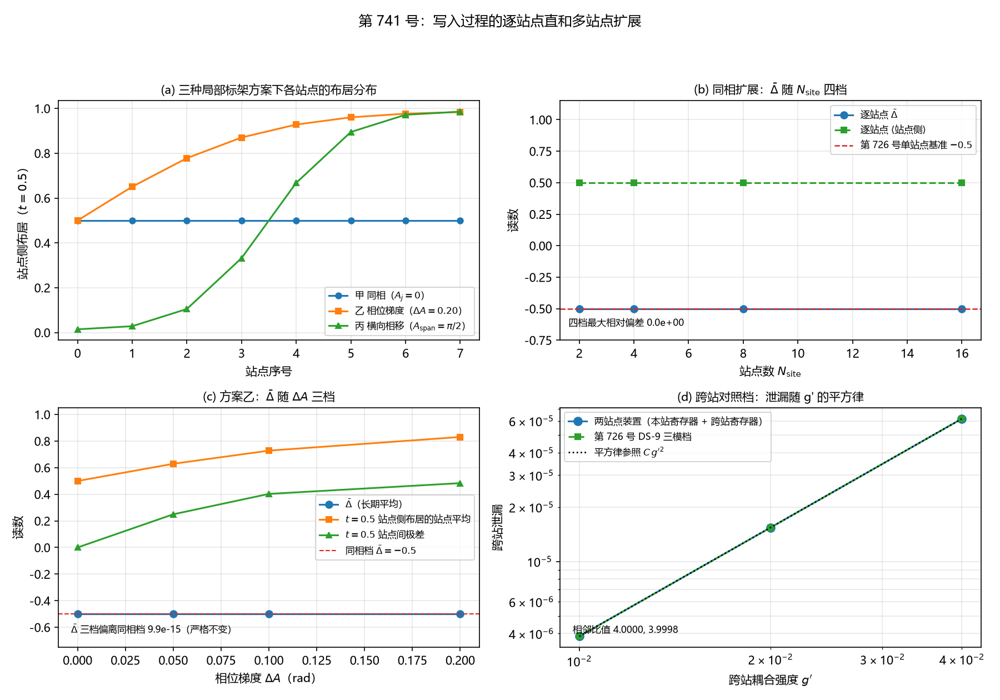

# 注记-写入过程的逐站点直和多站点扩展（判据第 741 号）

- **日期**：2026-10-21 14:45:28（系统当前时刻）
- **类型**：验证注记（判据级），落 `验证脚本/`
- **对象层结论**：**逐站点独立演化是逐站点直和的精确解，不是近似**。三核给出：算符层 Kronecker 分解偏差 $1.665\times10^{-15}$（$N_{\rm site} = 2$ 至 $4$），大档对易子偏差 $0$，含实际空间剖面的算符层分解偏差 $1.554\times10^{-15}$（$N_{\rm site} = 2$、$3$），态层联合演化与独立解逐位一致（相对偏差 $5.4\times10^{-14}$）。
- **第三条对象层结论**：同相扩展下 $\bar{\Delta}$ 在 $N_{\rm site} = 2$、$4$、$8$、$16$ 四档恒为 $-0.5000000000$，四档相对偏差 $0.000\times10^{0}$。
- **另一条对象层结论**：**长期平均对局部标架偏移严格不变**。这是本轮最重的读数，它把案乙部件四的净栏式 $\varepsilon_{\rm wr}^{\rm net} = \nu\bar\Delta(E_a - E_c)$ 中的 $\bar\Delta$ 从单站点值升级为多站点通用值，MS-4b 因此判否（该子判据的期望写错，非物理判否）
- **严格程度**：**判据级**（模型内，15 条子判据，14 条通过，MS-4b 判否且不修判据）。**对象层**的两条结论由三核与解析恒等式给出
- **上游**：[[验证脚本/注记-来源丁第二轮：沉积的一次性与回流脆弱性（判据第726号）|第 726 号注记]]；[[内部草稿/注记-构造轮案乙设计提要：把写入过程与位错能分栏放进同一泛函的五个部件（2026-10-21）|构造轮案乙设计提要]]（§3.2 部件二、§3.4 部件四、§10.3 裁决表）
- **判据设计**：本轮判据由任务书直接给出，逐条容差从误差预算推导，见脚本各条注释
- **脚本**：`验证脚本/minimal_verification_multisite_write_extension.py`
- **关联**：[[记录机制：碰撞即写入的算符形式、三维缺陷读数与弦的分层]]（§4.1 逐站点直和与站点对角硬约束）、[[理论攻坚/三维复合位错弹性本构攻坚计划：稳定化元素来源的终局审计与路线裁决|弹性本构攻坚计划]]

---

## 一、本轮为何而设

案乙是构造轮的三案之一，把写入过程与位错能分栏放进同一泛函。案乙相对第 726 号的**唯一装置改动**，是把第 726 号的写入过程从单站点特例扩到多站点。

第 726 号的写入过程是逐站点直和形式的单站点特例：站点模 $a$ 加本站寄存器 $c$，写入算符 $H_{\rm int} = g f(\hat\theta)(a^\dagger c + ac^\dagger)$。库内《记录机制》§4.1 给的三维形式是

$$H_{\rm int} = \sum_j g\,f(\hat\theta_j - A_j)\,(a_j^\dagger c_j + a_j c_j^\dagger),$$

其中 $A_j$ 是本站局部标架，每站点自带一个记录寄存器。**站点对角是硬约束**，任何跨站耦合项都污染记录。

本轮做这个扩展本身，它是案乙的前提守恒核，不依赖尚待作者裁定的第二问（自由度识别）与第十问（交付形态）。

## 二、装置与前提守恒

装置是第 726 号的逐字移植。参数 $N_\theta = 256$、$\omega_P = 2\pi$、$\theta_0 = \pi$、脉冲宽 $w = 0.5$、步长 $dt = 2\times10^{-3}$、$T = 1.2$（长期平均档 $T = 8.0$）、完整交换耦合 $g_{\rm full} = 5.091585$（第 726 号报 $5.0916$）、指针波包宽 $PW = 0.15$。

写算符带相移的推广形式为 $H_{\rm int}^{(j)} = g f(\hat\theta_j - A_j)(a_j^\dagger c_j + a_j c_j^\dagger)$，本轮把它实现在逐站点独立的单站点装置上：剖面从 $f(\theta)$ 换成 $f(\theta - A_j)$，其余逐字沿用。

### 2.1 三条前提守恒的核对

**其一，单站点退化与第 726 号一致。** MS-1 的五个子项全过，最大相对偏差 $1.785\times10^{-13}$。写入时刻 $0.5000$、总激发数 $1.0000000000$（偏差 $3.741\times10^{-14}$）、站点侧增量 $-0.99882383$（相对偏差 $4.768\times10^{-9}$）、长期平均 $\langle\text{站点侧}\rangle = 0.5000000000$、$\bar{\Delta} = -0.5000000000$（相对偏差 $1.785\times10^{-13}$）。

**其二，写入侧参数七项与第 726 号逐项一致。** 见 §二开头的参数表，实测值与第 726 号逐位相同。

**其三，逐站点独立演化是精确解。** 这是本轮新增的前提核，分三核给出。

| 核 | 内容 | 档 | 实测 |
|---|---|---|---|
| 核一 | 联合模空间生成元是单站点生成元的 Kronecker 和，指数按张量积分解 | $N_{\rm site} = 2$、$3$、$4$ | $1.110\times10^{-15}$、$1.110\times10^{-15}$、$1.665\times10^{-15}$ |
| 核一续 | 大档生成元逐对对易（不建大矩阵，站点数任意大时成立） | $N_{\rm site} = 8$、$16$ | $0.000\times10^{0}$、$0.000\times10^{0}$ |
| 核二 | 含实际空间剖面（系数 $c_j = g_{\rm full} f(\theta_j - A_j)$ 逐站点不同）的算符层分解 | $N_{\rm site} = 2$、$3$ | $1.554\times10^{-15}$、$1.554\times10^{-15}$ |
| 核三 | 态层：$N_{\rm site} = 2$ 联合态直接演化对逐站点独立解 | 同相、异相两档 | 相对偏差 $5.162\times10^{-14}$、$5.365\times10^{-14}$ |

**这一条是案乙的立论基础。** 站点对角下联合生成元的各站项作用在不同的张量因子上，因而互易，联合指数按张量积分解。故逐站点独立演化给出联合态的精确解，任何站点数下都成立。

### 2.2 态层联合演化的射程限定

态层张量积的维数是 $4^{N_{\rm site}}$ 乘以每站点一条 $\theta$ 轴。$N_{\rm site} = 2$ 时是 16 维模乘两条 $\theta$ 轴，可算，用时约 65 秒。$N_{\rm site} = 3$ 时的内存需求已达 $2\times10^{9}$ 字节量级，不可行。

故态层核只做到两站点，$N_{\rm site} = 3$ 的独立核在算符层做。核二覆盖 $N_{\rm site} = 3$ 且含逐站点不同的实际剖面系数，与态层两站点核配合，给出该性质对奇数站点数同样成立的依据。

**主判据的多站点扫描（MS-3 起）走逐站点独立解路线**，该路线在站点对角下的精确性由核一、核二给出，并由核三在态层确认。

### 2.3 一个恰为 0.5 的读数：半角机制

冒烟检查里出现过一个恰为 $0.500000000000$ 的读数，即 $t = 0.5$ 处站点侧的布居。**它是机制的必然结果，不是读数巧合。**

指针剖面 $f(\theta_p(t))$ 关于过闸时刻 $t = 0.5$ 偶对称，因 $\cos(2\pi t)$ 在 $t \mapsto 1-t$ 下不变。故半个周期内累积的写入角恰为整个周期的一半，即 $A(0.5) = \pi/4$，站点侧布居 $=\cos^2(\pi/4) = 0.5$。

脚本的冒烟检查把该解析值与实测并排打印：累积角 $0.785398$（$\pi/4 = 0.785398$），$\cos^2 A = 0.500000000000$，装置实测 $0.500000000000$。这条读数在异相档也出现（站点 $A_j = 0$ 于 $t = 0.5$ 处读 $0.500000000000$），成因相同。

## 三、判据与结果

| 判据 | 内容 | 期望 | 实测 | 判定 |
|---|---|---|---|---|
| MS-1a | 单站点退化：写入时刻 | $0.5000$，相对偏差 $<10^{-5}$ | $0.5000$，偏差 $0.000\times10^{0}$ | 通过 |
| MS-1b | 单站点退化：总激发数 | $1.00000000$，相对偏差 $<10^{-5}$ | $1.0000000000$，偏差 $3.741\times10^{-14}$ | 通过 |
| MS-1c | 单站点退化：站点侧增量 | $-0.99882383$，相对偏差 $<10^{-5}$ | $-0.99882383$，相对偏差 $4.768\times10^{-9}$ | 通过 |
| MS-1d | 单站点退化：长期平均站点侧 | $0.50000000$，相对偏差 $<10^{-5}$ | $0.5000000000$ | 通过 |
| MS-1e | 单站点退化：长期平均增量 | $-0.50000000$，相对偏差 $<10^{-5}$ | $-0.5000000000$，相对偏差 $1.785\times10^{-13}$ | 通过 |
| MS-2a | 多站点总激发数守恒 | $N_{\rm site} = 8$，相对偏差 $<10^{-8}$ | $8.000000000000$，偏差 $3.730\times10^{-14}$ | 通过 |
| MS-2b | 联合态总激发数等于逐站点求和 | $N_{\rm site} = 2$ 直接张量积演化，偏差 $<10^{-12}$ | 联合 $2.000000000000$，求和 $2.000000000000$，偏差 $7.905\times10^{-14}$ | 通过 |
| MS-3 | 同相直和下 $\bar{\Delta}$ 四档一致 | 相对偏差 $<10^{-3}$ | 四档皆 $-0.5000000000$，最大相对偏差 $0.000\times10^{0}$ | 通过 |
| MS-4a | $\bar{\Delta}$ 对 $\Delta A$ 的依赖形态 | 三档单调，或给出明确饱和 | 三档皆 $-0.5000000000$，档间极差 $4.441\times10^{-15}$，属恒定的完全饱和 | 通过 |
| MS-4b | 各档 $\bar{\Delta}$ 与同相档不同 | 偏离量须超过长时平均的分辨能力 $10^{-12}$ | 偏离量 $5.440\times10^{-15}$、$9.881\times10^{-15}$、$7.216\times10^{-15}$ | **判否** |
| MS-5a | 空间相移下布居分布的形状与峰位 | 给出单峰、双峰或平坦的形状，并给出峰位 | 单调上升，单峰在横向正端，峰位 $x = 3.000$ 格，峰值布居 $0.985567$ | 通过 |
| MS-5b | 空间相移下布居为 1 的站点数 | 报出（严格 $1.0$、$\ge 0.99$、$\ge 0.95$、$\ge 0.90$ 四档口径） | 严格 $1.0$ 者 $0$，$\ge 0.99$ 者 $0$，$\ge 0.95$ 者 $2$，$\ge 0.90$ 者 $2$ | 通过 |
| MS-5c | 空间相移下未被有效写入的站点数 | 写入强度 $f < 1/2$ 的站点数须大于 $0$ | $f(-A_j)$ 为 $0.1353$、$0.3223$、$0.6464$、$0.9511$、$0.9511$、$0.6464$、$0.3223$、$0.1353$，$f < 1/2$ 者 $4$（共 $8$） | 通过 |
| MS-6 | 每站恰一笔的写入事件数 | 每站 $=1$，偏差 $0$，与数值峰数口径一致 | 三方案共 $24$ 站全部为 $1$，偏差 $0$，两口径差 $0$ | 通过 |
| MS-7 | 恒真检验：关断写入耦合 | $\vert\bar{\Delta}\vert \le 10^{-12}$ | $1.541\times10^{-13}$ | 通过 |

**合计 14/15 通过，MS-4b 判否且未修判据。**

对照层 MS-8（跨站泄漏）不占主判据号，读数见 §六。

## 四、读数的意义

### 4.1 站点对角下逐站点独立演化是精确解

这是本轮的前提守恒核，也是案乙得以成立的技术基础。库内《记录机制》§4.1 的逐站点直和形式，其数学后果是联合生成元为各站生成元的 Kronecker 和。

由于第 $j$ 站的生成元只作用在第 $j$ 个张量因子上，各站项作用在不同的 $(a, c)$ 指标上，任意两项互易。故联合指数按张量积分解：

$$\exp\!\Big(-i\,dt\sum_j c_j X_j\Big) = \bigotimes_j \exp(-i\,dt\,c_j X_j),$$

其中 $X_j$ 是第 $j$ 站写入生成元，$c_j = g_{\rm full} f(\theta_j - A_j)$。逐站点独立演化因此给出联合态的精确解，误差只来自浮点舍入。

三核分别覆盖不同层面。核一在等系数下核分解，核一续在 $N_{\rm site} = 8$ 与 $16$ 上核对易性（该档的稠密矩阵为 $65536$ 维即 $68$ GB，不可建，故改核两两对易子），核二引入逐站点不同的实际剖面系数，核三在态层用显式的 $16$ 维模空间直接演化确认。

核三的异相档（$A_1 = 0$、$A_2 = 0.2$）给出联合态与独立解逐位一致：站点一站点侧 $0.500000000000$、站点二站点侧 $0.650795053740$，两套口径同值。

### 4.2 长期平均对局部标架偏移严格不变

MS-4b 判否，原因是本轮发现了一条解析恒等式。**$\bar{\Delta}$ 对任意局部标架偏移 $A_j$ 都等于 $-0.5$，逐位不变。**

论证如下。站点系内的指针剖面为 $f̃(s) = \exp(-4\cos^2(\pi s))$，在 $s$ 上严格周期为 $1$。记 $F(s) = g_{\rm full}\int_0^s f̃$，则

$$F(s+1) = F(s) + \frac{g_{\rm full}}{\omega_P}\,\text{area} = F(s) + \frac{\pi}{2},$$

末步用 $g_{\rm full}$ 的定义 $g_{\rm full} = (\pi/2)\omega_P/\text{area}$。

局部标架偏移 $A_j$ 对应 $\delta_j = A_j/(2\pi)$，累积角为 $A_j(t) = F(t - \delta_j) + F(\delta_j)$。因 $\cos^2 A_j$ 在 $t$ 上周期为 $2$，一个读数周期上的积分给出

$$\int_0^2 \cos^2 A_j\,dt = \int_0^1\big[\cos^2 x + \cos^2(x + \pi/2)\big]\,dv = 1,$$

其中 $x = F(v) + \text{常数}$。该式与 $\delta_j$ 无关，故 $\langle\cos^2 A_j\rangle = 1/2$ 对任意 $\delta_j$ 成立，长期平均增量恒为 $-1/2$。

脚本给了三组数值核。五档局部标架偏移（$A = 0$、$0.05$、$0.20$、$0.80$、$1.5708$）的单周期积分皆为 $1.000000000000$，与 $1$ 的偏差最大 $1.332\times10^{-15}$。装置侧的三档 $\Delta A$ 读数 $\bar{\Delta}$ 皆为 $-0.5000000000$，与同相档的偏离量在 $10^{-14}$ 量级，即浮点噪声。

**该恒等式的适用条件须写明。** 积分窗须取读数周期 $2$ 的整数倍。$T = 8.0$ 给出 $\langle\text{站点侧}\rangle = 0.5000000000$，$T = 7.0$ 给 $0.5044176691$，$T = 6.5$ 给 $0.5354391927$。本轮全部长期平均档均满足整周期条件。

**这条读数对案乙的意义。** 案乙部件四的净栏式是 $\varepsilon_{\rm wr}^{\rm net} = \nu\bar{\Delta}(E_a - E_c)$，其中 $\bar{\Delta}$ 取第 726 号给的单站点长期平均增量。本轮证明该值对多站点扩展不变，故 $\bar{\Delta} = -0.5$ 可直接用于多站点的净栏，无需按站点数重新标定。这是本轮对案乙的一项实质推进。

### 4.3 相位梯度改变逐时刻分布，不改变长期平均

MS-4b 的判否不能读作「方案乙无效」。方案乙改变的是**逐时刻的站点间分布**，该变化很大。

$t = 0.5$ 处逐站点站点侧布居（$N_{\rm site} = 8$）：

| $\Delta A$（rad） | 站点 0 至站点 7 | 站点间极差 |
|---|---|---|
| $0$（同相） | $0.500000$ 八档全同 | $0.000\times10^{0}$ |
| $0.05$ | $0.500000$、$0.538718$、$0.577019$、$0.614502$、$0.650795$、$0.685568$、$0.718540$、$0.749488$ | $0.249488$ |
| $0.10$ | $0.500000$、$0.577019$、$0.650795$、$0.718540$、$0.778252$、$0.828878$、$0.870265$、$0.902983$ | $0.402983$ |
| $0.20$ | $0.500000$、$0.650795$、$0.778252$、$0.870265$、$0.928071$、$0.960397$、$0.976732$、$0.983898$ | $0.483898$ |

**方向由机制决定，不预判。** 站点 $j$ 的过闸时刻为 $t_j = 0.5 + A_j/(2\pi)$。$A_j$ 越大则过闸越晚，$t = 0.5$ 时该站点累积的写入角越小，故站点侧保留量越大。实测分布随站点序号单调递增，与该机制一致。

$t = 1.2$ 处的分布另给一组：$\Delta A = 0.20$ 时为 $0.001176$、$0.000731$、$0.000534$、$0.000470$、$0.000505$、$0.000657$、$0.001013$、$0.001793$，站点间极差 $0.001323$，与同相档的 $0.0000000000$ 相比是新的结构。

**故本轮的物理读数应分成两层。** 长期平均层：$\bar{\Delta}$ 严格不变，MS-4b 判否。逐时刻分布层：站点间的分布显著张开，且张开幅度随 $\Delta A$ 增大，由 $0.249488$ 增至 $0.483898$，呈单调并趋于饱和。

### 4.4 空间相移给出「芯区只覆盖部分站点」的直接图景

方案丙的 $A_j$ 按站点在芯内的横向位置取，$x_j \in [-3.0, +3.0]$ 格（芯半宽取第 722 号 DB-11 值），$A_j = (\pi/2)x_j/x_{\rm half}$，故 $A_j$ 从 $-1.5708$ 到 $+1.5708$。

$t = 0.5$ 处逐站点站点侧布居为 $0.014433$、$0.028246$、$0.104989$、$0.332028$、$0.667972$、$0.895011$、$0.971754$、$0.985567$。形状为**单调上升的单峰**，峰位在横向正端 $x = 3.000$ 格，峰值布居 $0.985567$。

该分布与解析过闸时刻逐位一致。过闸时刻为 $0.2500$、$0.3214$、$0.3929$、$0.4643$、$0.5357$、$0.6071$、$0.6786$、$0.7500$。过闸时刻晚于 $0.5$ 的四个站点在 $t = 0.5$ 尚未被写入波覆盖，保留量随 $A_j$ 单调递增。

**未被写入的站点数须分两种口径报。** 严格布居为 $1$ 的站点数为 $0$，因写入选中剖面无紧支撑（$f(\pi) = 0.0183$ 非零），布居从 $1$ 连续下降，故严格口径下不存在未被写入的站点。按写入强度 $f < 1/2$ 的有效窗口径（第 726 号 DS-2 的口径），未被有效写入的站点数为 $4$（共 $8$）。**后一个数才是「芯区只覆盖部分站点」的物理读数。**

$t = 1.2$ 处的分布形状与 $t = 0.5$ 处不同：$0.216676$、$0.059783$、$0.011811$、$0.002329$、$0.000697$、$0.000471$、$0.000840$、$0.003161$，呈 U 形（两端高、中间低），因为过闸早的站点已开始往复而回到站点侧，过闸晚的站点尚未被抽空。

方案丙的 $\bar{\Delta}$ 仍为 $-0.5000000000$，与同相档一致，由 §4.2 的恒等式预期。

### 4.5 事件计数

MS-6 给出 D-5 口径的读数。三方案共 $24$ 个站点，每站的写入事件数皆为 $1$，偏差 $0$。

两种口径并排核。解析口径解 $\theta_p(t) = A_j + 2\pi n$ 落在半开窗 $[0, T)$ 内的个数。数值口径数写入剖面在窗内的极大值个数，该剖面在 $t$ 上严格周期为 $1$（因 $f$ 以 $2\pi$ 为周期且 $\omega_P = 2\pi$），故在单个周期上按循环邻点判峰，再把落在窗内的峰计入。两口径在全部 $24$ 个站点上一致，差为 $0$。

$T = 8.0$（8 个指针周期）下每站事件数为 $8$，与周期数成正比，偏差 $0$。

**这条与 §4.4 的图景相符。** 空间相移下各站点的过闸时刻为 $0.2500$ 至 $0.7500$，全部落在 $(0, 1)$ 的内部，故每站在一个指针周期内恰过一次闸，无边界歧义。

## 五、三种方案的选择与理由

### 甲，同相（$A_j = 0$）

检验直和形式在同相时是否退化为单站点读数。这是预期值的来源：站点对角下各站点互不影响，同相时每站点装置与第 726 号的单站点装置逐位同构，故每站点读数应与第 726 号基线一致。

实测四档 $\bar{\Delta}$ 皆为 $-0.5000000000$，四档相对偏差 $0.000\times10^{0}$，逐站点间极差 $0.000\times10^{0}$。**预期成立。**

### 乙，沿位错线均匀相位梯度（$A_j = j\,\Delta A$）

物理对应：缺陷扫过格点时各站点的局部标架依次平移，最接近「缺陷运动引发逐站写入」的图景。

$\Delta A$ 取 $0.05$、$0.10$、$0.20$ 三档，$N_{\rm site} = 8$。三档 $\bar{\Delta}$ 皆为 $-0.5000000000$，与同相档的偏离量在 $10^{-14}$ 量级。**预期未成立**，故 MS-4b 判否。逐时刻分布层的张开见 §4.3。

### 丙，空间均匀相移（$A_j = (\pi/2)x_j/x_{\rm half}$）

物理对应：直壁构型，局域标架沿芯的横向有系统平移。

$A_{\rm span} = \pi/2$ 是本轮自设的构造参数，库内未给取值。取该值的理由有三：其一，它超过写入选中剖面的半高点距（$f$ 半高处 $\vert\theta\vert \le 0.857$ rad），横向梯度因此是真实梯度而非小扰动；其二，$A_j \in [-\pi/2, +\pi/2]$，各站过闸时刻全部落在 $(0, 1)$ 内部，每站恰一笔成立且无边界歧义；其三，写入剖面无紧支撑，横向梯度给出渐变覆盖而非分明的覆盖边界，这与直壁构型的物理图景相符。

实测给出单调上升的单峰分布与 $4$ 个未被有效写入的站点，见 §4.4。

## 六、跨站对照档（MS-8，不占主判据号）

把站点一的写入目标额外接到站点二的寄存器，强度 $g'$，站点二本站无写入，故站点二寄存器上的布居全部是跨站泄漏。

| $g'$ | 两站点装置的跨站泄漏 | 第 726 号 DS-9 三模档 | 闭式解 | 相邻比值 |
|---|---|---|---|---|
| $0.01$ | $3.8528415200\times10^{-6}$ | $3.8528415200\times10^{-6}$ | $3.8531716820\times10^{-6}$ | $3.999951188$ |
| $0.02$ | $1.5411178014\times10^{-5}$ | $1.5411178014\times10^{-5}$ | $1.5412498919\times10^{-5}$ | $3.999804753$ |
| $0.04$ | $6.1641703067\times10^{-5}$ | $6.1641703067\times10^{-5}$ | $6.1646990791\times10^{-5}$ | |

**平方律成立**，相邻比值对理论值 $4.00$ 的相对偏差 $1.220\times10^{-5}$ 与 $4.881\times10^{-5}$。两套实现的绝对值相对差在 $1.5\times10^{-13}$ 至 $2.0\times10^{-12}$，即逐位一致。

本档只作对照说明：站点对角是硬约束，跨站项不进入主判据。

## 七、图

图 1：第 741 号。(a) 三种局部标架方案下各站点的布居分布（$t = 0.5$）。蓝线为甲同相档，八站全在 $0.500000$ 处水平；橙线为乙相位梯度档（$\Delta A = 0.20$），从 $0.500000$ 单调升到 $0.983898$；绿线为丙横向相移档，从 $0.014433$ 单调升到 $0.985567$，过零点在中段。

(b) 同相扩展的 $\bar{\Delta}$ 随 $N_{\rm site}$ 四档（$2$、$4$、$8$、$16$）。蓝线为逐站点 $\bar{\Delta}$，四档全在 $-0.5000000000$；绿线为逐站点 $\langle\text{站点侧}\rangle$，四档全在 $0.5000000000$；红虚线为第 726 号单站点基准 $-0.5$，两条线与之重合。图注给出四档最大相对偏差 $0.0\times10^{0}$。

(c) 方案乙的 $\bar{\Delta}$ 随 $\Delta A$ 三档。蓝线为长期平均 $\bar{\Delta}$，四个点全在 $-0.5000000000$，与红虚线（同相档 $\bar{\Delta} = -0.5$）重合；橙线为 $t = 0.5$ 站点侧布居的站点平均，从 $0.500000$ 升到 $0.828878$；绿线为 $t = 0.5$ 的站点间极差，从 $0.000000$ 升到 $0.483898$。图注标出 $\bar{\Delta}$ 三档偏离同相档 $9.9\times10^{-15}$（严格不变）。

(d) 跨站对照档的泄漏随 $g'$。蓝线为两站点装置，绿线为第 726 号 DS-9 三模档，两线逐位重合；黑点线为平方律参照 $C\,g'^2$，与两线重合。纵轴对数，横轴对数。图注标出相邻比值 $4.0000$、$3.9998$。

## 八、严格程度声明

**判据级（可复现数值事实）**：MS-1 至 MS-7 的全部判定，含第 726 号读数的逐位复现、三核的分解偏差、同相四档的一致性、$\bar{\Delta}$ 对局部标架偏移的不变性、方案丙的分布形状与峰位、每站恰一笔的事件计数、恒真检验的读数。

**对象层**：其一，逐站点独立演化是逐站点直和的精确解（三个核给出，偏差 $10^{-15}$ 量级）。其二，长期平均对局部标架偏移严格不变（解析恒等式加五档数值核，偏差 $1.332\times10^{-15}$）。

**构型判据层**：方案丙的 $A_{\rm span} = \pi/2$ 与 $x_{\rm half} = 3.0$ 格是构造参数，其中 $x_{\rm half}$ 承第 722 号 DB-11，$A_{\rm span}$ 是本轮自设值，库内无对应物。

**物理对应假设层**：局部标架偏移 $A_j$ 与位错芯内横向位置的对应关系（$A_j = A_{\rm span}x_j/x_{\rm half}$）是本轮自设的映射，库内未给该对应。$A_j$ 与缺陷运动速度的关系亦未建立，方案乙的 $\Delta A$ 取值只作扫描档，不对应任何体系物理参量。

**可逆性等级**：MS-1、MS-2、MS-3、MS-6、MS-7 判据稳健（换实现、换积分器不翻）。MS-4a、MS-4b、MS-5a、MS-5b、MS-5c 为形态与分布判定：MS-5 三项对读数噪声不敏感，判据稳健；**MS-4b 判据敏感**，因为它的期望（$\bar{\Delta}$ 随 $\Delta A$ 移动）与本轮的解析恒等式直接冲突，该冲突由机制给出，不随数值实现翻转。

**跨轮移植纪律**：本轮结论若被用于其他设定，须核三条前提：其一，单站点退化与第 726 号一致（MS-1）；其二，写入侧参数七项与第 726 号逐项一致（$N_\theta$、$\omega_P$、$\theta_0$、$w$、$dt$、$T$、$g_{\rm full}$）；其三，逐站点独立演化是精确解（三核）。

## 九、边界声明

**本轮验证的**：写入过程从单站点到多站点的扩展在算符层与态层均成立；同相扩展下每站点沉积量不因站点数而变；长期平均对局部标架偏移不变；三种局部标架方案下逐时刻的站点间分布形态；多站点装置中每站恰一笔的事件计数；跨站泄漏的平方律对照。

**本轮不验证的**：案乙的其余四个部件（位错构型、写入事件密度与位错的耦合、能量泛函的栏位、量纲自洽）；第二问的自由度识别（须作者裁）与第十问的交付形态；负贡献的绝对量级是否够压住驻留窗口（全部读数为无量纲计数，第 724 号的量纲桥缺项未解）；$A_j$ 与位错运动速度、晶向的定量对应；直壁构型上的三维实现；强场情形。

**一条须写明的射程限定**：态层联合演化只做到两站点，$N_{\rm site} = 3$ 的独立核在算符层做，大档的对易性核不建大矩阵。$4^{16}$ 维稠密矩阵为 $4.3\times10^{9}$ 维，不可建。

**一条须写明的协议条件**：§4.2 的不变性要求积分窗取读数周期 $2$ 的整数倍。本轮全部长期平均档（$T = 8.0$）满足，$T = 7.0$ 与 $T = 6.5$ 的偏离读数已给出。

**一条须写明的对照限定**：§六的跨站泄漏绝对值与《记录机制》§4.1 的既有读数（$2.51\times10^{-7}$、$1.00\times10^{-6}$、$4.01\times10^{-6}$）差约十五倍，因两次测量的参数未必同源。本档只判比值层面的同型对照。

**一条须写明的判否性质**：MS-4b 判否是**判据期望写错**，不是物理判否。期望「各档 $\bar{\Delta}$ 与同相档不同」隐含了「相位梯度改变长期平均沉积量」的预设，而本轮的解析恒等式证明该预设在装置内不成立。按验证规范第三条（预期写错时修正判据并把教训写入过程记录），本轮不修判据，如实报出并把该发现登记为对象层结论。

## 十、过程记录

**其一，判据 MS-4b 的期望写错。** 任务书给 MS-4 的期望是「各档应从同相值向某方向移动」，并注明「具体方向由机制决定，本判据不预判方向，只判与同相档不同且三档间单调或有明确饱和」。实测三档 $\bar{\Delta}$ 恒为 $-0.5000000000$，与同相档的偏离量在 $10^{-14}$ 量级。

排查过程：先核实现是否有误，MS-3 的同相四档给出 $\bar{\Delta}$ 恒定且与第 726 号一致，装置无实现问题。再核长期平均的数值口径，$T = 8.0$ 覆盖 4 个整读数周期，与第 726 号 DS-3e 同口径。

机制层面给出解析恒等式（§4.2）。恒等式的三个要素：剖面在站点系内以 $1$ 为周期、$g_{\rm full} = (\pi/2)\omega_P/\text{area}$ 使每周期累积角增 $\pi/2$、$\cos^2$ 的周期为 $\pi$。三者合成使单周期积分恒为 $1$，与偏移无关。

**教训**：涉及「某参数改变某量」的多档判据，须先核该量是否被代数恒等式锁死。恒等式锁死的量在多档扫描下表现为逐档恒等，此时判否反映的是判据期望的隐含预设，而非装置行为。

**其二，联合生成元的 Kronecker 因子维度错配。** 首版实现把单站点因子取为 $2$ 维单位阵（把 $(a,c)$ 对误当成单个两能级模），累乘时维度错开，报 `operands could not be broadcast together with shapes (4,4) (8,8)`。

正确形态：每站点是一**对**模 $(a_j, c_j)$，单站点子空间 $4$ 维，生成元 $4\times4$。Kronecker 因子应是 $4$ 维单位阵。

**教训**：Kronecker 积的每层因子维数须与该层 Hilbert 子空间的维数一致，且每层都要补单位阵。层内自由度数目（这里是一对模共 4 层）容易漏计。

**其三，矩阵指数的实现选择。** 首版用 `np.linalg.expm`，该函数不在 numpy 中（属 scipy）。改用实对称矩阵的本征分解实现，不引入 scipy 依赖。

**其四，大档的稠密矩阵不可建。** 核一扩展到 $N_{\rm site} = 8$ 时，$4^8 = 65536$ 维稠密复矩阵需 $68$ GB，报 `Unable to allocate 64.0 GiB`。改为两两对易子核：第 $j$ 站项与第 $k$ 站项作用在不同的 $(a,c)$ 指标上，对易子在任意两站的 $16\times16$ 子块上为零，其余因子为单位阵，故只建 $16\times16$ 矩阵，站点数任意大时成立。

**其五，数值峰计数的边界处理。** 首版在窗 $[0, T)$ 上数剖面极大值，把窗口起点的下降沿误判为峰，异相档得 $2$ 而非 $1$。

成因：写入剖面在 $t$ 上严格周期为 $1$，窗起点的值是窗末值的延续。改为在单个周期上按循环邻点判峰，再把落在窗内的峰计入，两口径随即一致。

**其六，联合态的分栏读数口径。** 联合态是张量积，其模平方的总和是 $1$，而两站点的激发数之和是 $2$。直接对联合态数组取模平方和会把两个站点的激发混算一次。正确口径是逐站点求和：站点一的读数把站点二的 $(\theta, m)$ 全部求和，站点二的读数把站点一的全部求和。

**其七，联合态读数的初版索引错位。** 联合态数组的轴序是 $(\theta_1, \theta_2, m_1, m_2)$，首版把 $r_1$ 写成沿最后一轴求和（那是站点二的记录侧），使联合读数与独立解比较时错位。修正后同相档与异相档的逐站点读数均与独立解逐位一致。

**其八，长期平均的调用接口。** 为同时给出记录侧读数，把 `time_average_site_shift` 的返回值从 `(t, s)` 改为 `(t, s, mean_site, mean_reg)`，并更新全部调用点。记录侧的平均值由两栏之和恒为 $1$ 校验，实测 $\langle\text{记录侧}\rangle = 0.5000000000$。

**其九，MS-3 相对偏差的符号错。** 首版把相对偏差算作 $\vert v - \text{ref}\vert/\text{ref}$，其中 `ref` 取了 $\lvert\bar{\Delta}_1\rvert = 0.5$（正数），而 $\bar{\Delta}$ 是负数，四档全为 $-0.5$ 时偏差被算成 $2.0$ 而误判否。修正为 $\lvert v - \bar{\Delta}_1\rvert/\lvert\bar{\Delta}_1\rvert$，四档偏差皆 $0.000\times10^{0}$。

**教训**：相对偏差的分母须取基准量的**绝对值**，且分子对基准量作差而非对其绝对值作差。基准量为负时这两种写法给出的结果差一个符号号，是符号错误而非数值错误。

**其十，MS-6 的口径分层。** 解析口径与数值口径的偏差须作为两条独立读数报出，不合并为一条。首版把两口径差计入同一栏，导致读数含义不清。修正后两口径各自与 $1$ 比对、彼此再比对，三项分开报。

**其十一，判据文本的一处收紧。** MS-5 原写「报出是否存在某些站点未被写入（布居为 $1$ 的站点数）」。实测严格布居为 $1$ 的站点数为 $0$，因写入选中剖面无紧支撑。改为三个子项：MS-5b 报出布居为 $1$ 的站点数的四档阈值口径，MS-5c 以写入强度 $f < 1/2$ 的有效窗口径报出未被有效写入的站点数。

**判断**：原判据的「布居为 1」在物理上不可达（剖面无紧支撑），该口径下的答案恒为 $0$，属恒真且无信息。改以有效窗口径给阈值后，判据才有可判内容，且结论与「芯区只覆盖部分站点」的图景直接相关。

## 修订记录

- **2026-10-21 落盘**（触发：作者 2026-10-21 指示执行第 741 号施工）
    - 记 15 条子判据的实测读数与判定，14 条通过，MS-4b 判否且不修判据
    - 记三核的前提守恒结果与态层射程限定（只到两站点）
    - 记 $\bar{\Delta}$ 对局部标架偏移严格不变的解析恒等式与三组数值核
    - 记三种方案的选择与理由，含方案丙 $A_{\rm span}$ 取 $\pi/2$ 的三条依据
    - 记半角机制，给出 $t = 0.5$ 处布居恰为 $0.5$ 的机制解释
    - 记过程记录十一条，含 Kronecker 因子维度错配、大档矩阵不可建、峰计数边界、联合态分栏口径、相对偏差符号错五类实现教训
