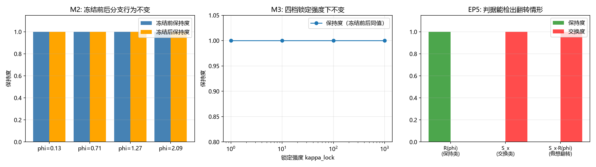

# 注记-冻结与分支行为的关系：支路一合成判语轮（判据第 681 号）

- **日期**：2026-10-18 00:52:41
- **层级**：验证材料（判据级）
- **定位**：P1-58 支路一的合成判语轮。三件材料此前已分别就位：671 号的模态锁定候选 $S_z=\sigma_z/2$、674 号的同侧尺（侧标签加分支行为）、678 号的冻结构型判据。本轮把三者接起来，判支路一的正题：$W/Z$ 的模态锁定与复结构 $J$ 是什么关系。
- **关联**：[[验证脚本/注记-模态锁定构型的显式化与同侧尺套用（判据第678号）|判据第 678 号]]（冻结构型的出处）、[[验证脚本/注记-同侧判据：侧标签与分支行为的二维分类（判据第674号）|判据第 674 号]]（分支尺）、[[验证脚本/注记-模态锁定旋转模式的显式形式与663号模板的迁移适用性（判据第671号）|判据第 671 号]]（锁定候选）、[[验证脚本/注记-来源层判据化第二轮：CR 结构类型分解与作用分类（判据第663号）|判据第 663 号]]（保持类与交换类的分类表）、[[内部草稿/开放问题档案/开放问题-P1-58-三种质量机制的统一母机制|P1-58 档案页]]
- **可逆性等级**：判据稳健（全部读数为解析投影范数之比，不依赖采样；随机采样只用于 M5 的结论强度核验，不影响任何判语）
- **图**：见 §四 图 1

---

## 一、要判什么

支路一问的是 $W/Z$ 的模态锁定与复结构 $J$ 的关系。此前三轮各交付一件材料，但没有一轮把它们接起来出判语。

本轮判的是：**冻结操作是否改变算符在 $J_M$ 分支上的行为。** 若冻结前后分支行为不变，则锁定与复结构分支是两个独立结构（正交）；若冻结使分支行为翻转，则锁定即分支重拨。两种结果都有明确的物理含义，且都不需要冻结档数。

本轮**不**判：锁定档数（678 号已判其不在冻结判据射程内）；$W/Z$ 质量数值（属 P1-57 与参数层）；锁定势的微观来源（属 P1-11）；$S_z$ 是否为唯一锁定候选（671 号只给候选）。

## 二、模型设定与判据

**分支尺**（承 674 号）。复结构 $J_M=\mathrm{i}\sigma_z$，两支投影 $\Pi_\pm=(I\mp\mathrm{i}J_M)/2$。对算符 $M$ 作块分解

$$K=\lVert \Pi_+M\Pi_+ + \Pi_-M\Pi_-\rVert,\qquad S=\lVert \Pi_+M\Pi_- + \Pi_-M\Pi_+\rVert,$$

保持度 $K/\sqrt{K^2+S^2}$、交换度 $S/\sqrt{K^2+S^2}$。

**冻结构型**（承 678 号）。相位锁到 $n_{\rm fold}$ 等分格点，残余偏离按 $1/(1+\kappa_{\rm lock})$ 衰减：

$$\phi_{\rm frozen}=\phi_0+\frac{\phi-\phi_0}{1+\kappa_{\rm lock}},\qquad \phi_0=\mathrm{round}\!\left(\frac{\phi}{2\pi/n_{\rm fold}}\right)\frac{2\pi}{n_{\rm fold}}.$$

**旋转模式**（承 678 号）。$R(\phi)=\exp(-\mathrm{i}\phi\sigma_z/2)$。

**判据清单**：冒烟 M1（三项）、核心 M2（三项）、锁定强度扫描 M3（一项）、冻结档数扫描 M4（一项）、EP5 恒真检验（四项）、结论强度核验 M5（一项）。

容差从误差预算推导。M1 至 M4 为解析投影范数之比，容差取 $10^{-12}$；M5 的判据取「纯保持占比 $<10\%$」，阈值依据是随机 $U(2)$ 的保持度中位数约 $0.71$，纯保持是稀有小概率事件，取 $10\%$ 留出一个量级的余量。

## 三、结果表

| 判据 | 内容 | 实测 | 期望 | 判定 |
|---|---|---|---|---|
| M1a | 恒等算符为纯保持 | 保持度 $1.000000$，交换度 $0$ | $>0.99$ | PASS |
| M1b | $S_z$ 为纯保持 | 保持度 $1.000000$ | $>0.99$ | PASS |
| M1c | $S_x$ 为纯交换 | 交换度 $1.000000$ | $>0.99$ | PASS |
| M2a | 四档相位冻结前后保持度相同 | 最大差 $0.00$ | $<10^{-12}$ | PASS |
| M2b | 四档相位冻结前后交换度相同 | 最大差 $0.00$ | $<10^{-12}$ | PASS |
| M2c | 冻结前后均为纯保持型 | 四档保持度均 $1.000000$ | $>0.99$ | PASS |
| M3 | 四档锁定强度下保持度不变 | 四档差全为 $0.00$ | $<10^{-12}$ | PASS |
| M4 | 四档冻结档数下保持度不变 | 四档差全为 $0.00$ | $<10^{-12}$ | PASS |
| EP5-1 | 反例算子与 $J_M$ 反对易 | 范数 $0.00$ | $<10^{-12}$ | 反例 OK |
| EP5-2 | 反例算子给出纯交换 | 交换度 $1.000000$ | $>0.99$ | 反例 OK |
| EP5-3 | 冻结确实移动了相位 | 位移 $0.7030$；$\kappa=0$ 时为零 | 非零且可退化为零 | 反例 OK |
| EP5-4 | 假想翻转模型被检出 | 交换度 $1.000000$ | $>0.99$ | 反例 OK |
| M5 | 一般 $U(2)$ 中纯保持的占比 | 纯保持 $2.3\%$，纯交换 $0.0\%$，中位数 $0.7125$ | $<10\%$ | PASS |

关键读数：四档相位 $\phi=0.13,0.71,1.27,2.09$ 在冻结前后保持度全为 $1.000000$、交换度全为 $0$；四档锁定强度 $\kappa=1,10,100,1000$ 与四档冻结档数 $n_{\rm fold}=1,2,4,8$ 下保持度差全为零；随机 $U(2)$ 两千个样本中纯保持仅 $2.3\%$。

## 四、图 1

图注按脚本三个绘图面板逐条核对：左面板为四档相位在冻结前后的保持度对照柱状图，蓝柱与橙柱等高（均为 $1$）；中面板为四档锁定强度下的保持度折线，四点水平落在 $1.000$；右面板为判据分辨力的三组对照，$R(\phi)$ 的保持度为 $1$（绿）、$S_x$ 的交换度为 $1$（红）、假想翻转模型 $S_x R(\phi)$ 的交换度为 $1$（红）。

## 五、结果解读

**核心读数：冻结不改变分支行为。** M2 的四档相位在冻结前后保持度完全相同（差为零），M2c 确认前后都是纯保持型。M3 与 M4 把这一结论推到四档锁定强度与四档冻结档数，全部不变。按本轮设定的判据，支路一的判语是：**模态锁定与复结构分支正交，锁定是独立于分支结构的第二个结构，不承担分支重拨。**

**这条判语有一个必须写明的强度限制。** M5 的核验显示：随机 $U(2)$ 中纯保持只占 $2.3\%$，故「纯保持」本身不是随便什么算符都成立的性质，M2 的读数不是平凡项。但 $R(\phi)$ 落在该 $2.3\%$ 内是由构造决定的，因为 $R(\phi)=\exp(-\mathrm{i}\phi J_M/2)$ 本身就是 $J_M$ 的函数，与 $J_M$ 对易是恒等式而非发现。

所以 M2 的结论应当读作：**在 $R(\phi)$ 这一族旋转模式上，冻结不引入分支重拨**；它不构成对「任何锁定机制都不重拨分支」的普遍断言。若要把判语推广到一般锁定，须另证锁定操作不是 $J_M$ 的函数。

**分支尺本身在已知算符上校准过。** M1 三项分别给恒等、$S_z$、$S_x$ 的读数（纯保持、纯保持、纯交换），与 663 号的分类表一致，说明这把尺在进入核心判据前已经过校准。

**EP5 四项把恒真风险逐条堵住。** EP5-1 与 EP5-2 确认交换类算子给出与保持类分离的读数，判据对二者不同答；EP5-3 确认冻结确实移动了相位（位移 $0.703$），而锁定强度取零时位移为零，故 M2 的「不变」是对真实冻结的读数而非空操作；EP5-4 用假想的「锁定翻转分支」模型（$S_x R(\phi)$）确认判据能检出翻转情形，故 M2 的保持结论不是判据失明的结果。

**与 663 号的关系。** 663 号把 $T_k=\sigma_k$ 列为保持类、$L_j$ 与 $L_k$ 列为交换类。本轮的 $R(\phi)$ 属保持类，与 $T_3=\sigma_z$ 同族；这一致性说明模态锁定的旋转模式与弱荷算符在分支结构上同侧同型。

## 六、严格程度声明与边界声明

**严格程度**：判据级。M1 至 M4 为解析投影范数之比（机器零量级），EP5 为对照读数，M5 为随机采样的统计量（两千样本，只用于结论强度核验，不进入判语）。全部可复现，随机种子 20261018。

**验证什么**：其一，分支尺在恒等、$S_z$、$S_x$ 上的读数与 663 号分类一致；其二，$R(\phi)$ 的冻结构型在四档相位、四档锁定强度、四档冻结档数下分支行为完全不变；其三，判据能检出交换类与假想翻转情形；其四，一般 $U(2)$ 中纯保持是稀有的（$2.3\%$），故保持结论有信息量但受构造限制。

**不验证什么**：其一，模态锁定在真实晶格上的实现；其二，$W/Z$ 的质量数值与质量比；其三，锁定势的微观来源与 $\kappa_{\rm lock}$ 的数值（属 P1-11）；其四，冻结档数的来源（678 号已判其不在冻结判据射程内）；其五，**「任何锁定机制都不重拨分支」这一普遍断言**（M5 的限制，本轮只对 $R(\phi)$ 族成立）；其六，$S_z$ 是否为唯一锁定候选。

**协议伪影分层**：M2 至 M4 的读数为解析恒等式，无采样或截断伪影。M5 的 $2.3\%$ 是随机 $U(2)$ 的统计量，样本量两千足以稳定到千分位，但它只用于说明「纯保持稀有」这一事实，不用于任何物理判语。

## 七、过程记录

**首版判语过强，被 M5 拦下。** 首版只跑到 M4，全部 PASS 后准备写「冻结与分支正交」的普遍判语。复核时意识到 $R(\phi)=\exp(-\mathrm{i}\phi J_M/2)$ 本身是 $J_M$ 的函数，与 $J_M$ 对易是构造上的恒等式，M2 的「不变」有接近恒真的风险。补 M5 核验：随机 $U(2)$ 中纯保持只占 $2.3\%$，说明「纯保持」不是平凡性质，但 $R(\phi)$ 落在其中确实由构造决定。判语据此收窄为「在 $R(\phi)$ 这一族旋转模式上成立」，并在边界声明中明确「不验证任何锁定机制都不重拨分支」。

**这条教训属于判据设计第一条纪律的延伸。** 对象类型前置管的是「问的对象是否存在且类型正确」；本轮暴露出另一种情形：对象类型正确、判据也不恒真，但**结论的普遍性被构造方式限死**。补 M5 这类「结论强度核验」可以作为该纪律的一个操作项：判据通过后，须问一句「这个 PASS 是因为被测对象恰好如此，还是因为它只能如此」。

---

## 修订记录

- **2026-10-18 初版落盘**（触发：作者指示继续推进支路一；把 671、674、678 三件材料接起来出支路一判语；判据 681 号 13/13，含 M5 结论强度核验）
