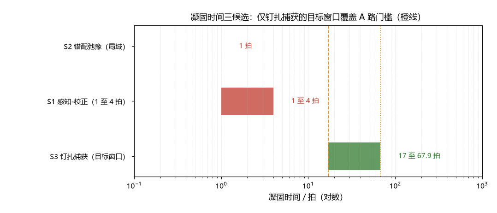

# 注记-凝固时间的最小动力学（第384条）：三候选时标估算与 A 路的单参数压缩

- **日期**：2026-09-24 04:05:14
- **类型**：判定轮（A 路的单参数压缩）
- **脚本**：`验证脚本/minimal_verification_solidification_time.py`（第 384 条）
- **图**：见 §3 图 1（`images/solidification_time.png`）
- **依据**：[[验证脚本/注记-LZ 的 t_sweep 物理身份判定（第382条）：缺口硬约束、快过程排除与缺口归约]]（门槛 17 至 68 拍与慢过程族）；[[束缚振荡动力学的物侧闭合：完美弹性定理、交错基态与校准通道]]（$\kappa = 1/t_P$ 定标；感知-校正链延迟未建模）；[[粒子与时空的同生：凝固波前的缺陷形成机制]] §3.4（绕数缺陷被位错钉扎而凝固；吸附动力学未建模）；[[内部草稿/判别材料-程长-宽度接口轮：宽度档捕获截面、配对时标与「宽度-间距-稀释」三重互锁]]（缺陷宽度与捕获截面档）
- **状态**：判定完成。S1、S2 判负（快过程）；A 路压缩为单参数（钉扎捕获率 0.0147 至 0.0589 每拍），该参数未建模

## 1 判据与设定

第 382 条把 A 路归约到凝固的时间实现，门槛为 $t_{\rm sweep} \ge 17$ 至 $68$ 拍；第 381 条给出畴尺度候选（KZ 幂律、追赶、视界）并注明其共同前提是凝固时间显著大于校准固有时间，本轮补判该前提。三个候选：S1 背景对照（感知-校正循环的延迟）；S2 缺陷形成（相位错配的弛豫，局域版与大尺度版）；S3 缺陷完成（钉扎捕获率，同生论文的「钉扎而凝固」环节）。判据 S1 至 S4 为确定性算术加材料清点。

## 2 结果

S1（背景对照）：感知-校正链（局部偏转 → 邻居感知 → 自主校正 → 逐格传播）各环节下限 1 拍，单轮循环 1 至 4 拍。换算缺口：1 拍需 $4.121\,E_P$（超截断 $312\%$）、4 拍需 $2.061\,E_P$（超 $106\%$）。背景凝固为快过程，不能承载 A 路。

S2（缺陷形成的局域弛豫）：局域版 $t = 1/\kappa = 1$ 拍，需缺口 $4.121\,E_P$。大尺度表面活口：$t = w^2/\kappa$ 取 $w = 2\pi$ 给 $39.5$ 拍，表面过门槛；自洽性排除：冻结尺度由 $\tau(\xi) = \xi/v$ 定，$\tau = \xi^2/\kappa$、$v = 1$ 唯一给出 $\xi = \kappa$（稳态解），与 $w = 2\pi$ 不自洽。表面活口不成立。

S3（钉扎捕获率）：捕获（同生论文口径：绕数缺陷被位错钉扎而凝固）给出 $t = 1/(n_{\rm pin}\sigma v_{\rm def})$，$\sigma = \pi w_{\rm def}^2 = 4.5365\times10^{43}\,l_P^2$。A 路要求 $\Gamma = n_{\rm pin}\sigma v_{\rm def} = 0.0147$ 至 $0.0589$ 每拍，即 $n_{\rm pin}v_{\rm def} = 3.245\times10^{-46}$ 至 $1.298\times10^{-45}$。取 $v_{\rm def} = 1$ 格每拍（光速档）给 $n_{\rm pin} = 3.2\times10^{-46}$ 至 $1.3\times10^{-45}$ 每格，对应平均位错间距 $9.2\times10^{14}$ 至 $1.5\times10^{15}\,l_P$（约 $1.5\times10^{-20}$ 至 $2.4\times10^{-20}$ 米）。该密度比自然档（每格一位错）稀约 $45$ 个数量级；其两个参数（位错密度、缺陷迁移速度）未建模。

S4（单参数压缩）：S1、S2 判负后，A 路的全部内容压缩为单参数：**钉扎捕获率 $\Gamma = 0.0147$ 至 $0.0589$ 每拍**。该窗口与第 380 条的弛豫率目标同值（同一自洽结构的第三次出现：宽度窗口、弛豫率、捕获率），并与入口份额 $f$ 的缺陷产额同族。

## 3 图

## 4 结论与后果

三条候选的判定：背景凝固与缺陷形成的局域过程都是快过程（1 至 4 拍），明确低于门槛；缺陷完成的钉扎捕获是唯一开口，A 路存活等价于「捕获率恰为 0.0147 至 0.0589 每拍」。第 382 条的畴尺度候选（KZ 幂律 19.5、追赶 60.8 拍）若要进入 A 路，需要「凝固由畴级协调控制」的机制，该机制在体系里无独立依据；本轮的钉扎捕获是与之独立的第二个开口，其参数同样未建模。

后果与判句：A 路从「需要 17 至 68 拍的凝固过程」进一步压缩为「需要捕获率落在 0.0147 至 0.0589 每拍」。下一步有两条等价路径：其一，从相变动力学估计位错密度与迁移速度（吸附动力学，同生论文 §5.3 第一项）；其二，从入口份额 $f$ 的观测值反推缺陷密度，再与捕获率窗口交叉。两条路径在「缺陷形成率」这个量上汇合，S 线与 $f$ 线由此共享同一个待定量。

## 5 严格程度与边界声明

严格程度：S1 至 S3 为最小估算（各环节 1 拍与线性捕获律属量级口径，判据级）；S2 的自洽性排除为算术；S4 的压缩为等价改写（算术级）。

边界：不建立凝固动力学模型；不重算第 380 至 382 条；捕获时间取截面档口径，未计入位错分布的形状因子与缺陷的量子扩散；「感知-校正链」的环节数取会话口径，其形式化仍属正稿 §八其一未建模项；不涉及 B、C 路的重算。

## 6 过程记录

触发：第 382 条把 A 路归约到凝固时间后开工。首版脚本把钉扎捕获误判为「瞬时快过程」（只取自然档位错密度），重算发现捕获率是未建模参数、A 路应压缩为单参数，这是本轮的方法论教训：参数未建模的候选不能按单一档位判死。两个表面活口的排除（S2 大尺度版、S3 的自然档读法）与单参数压缩是本轮的实质产出。
