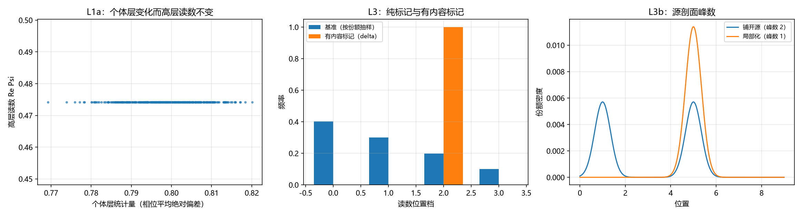

# 注记-分层读数可靠性的最小验证：充分性、中层最小性与附内容边界（判据 L1 与 L3）

- **日期**：2026-09-25 03:06:36
- **层级**：验证材料（第 400 条）
- **定位**：把 [[内部草稿/注记-认知错视与分层粗粒化：主体采样读数的可靠性、错觉边界与认知进化]] 所立判据 L1（分层压缩的充分性）与 L3（错觉的可检验边界）落成可执行的数值判据，在最小分层模型上给出实测读数。
- **依据**：[[内部草稿/注记-认知错视与分层粗粒化：主体采样读数的可靠性、错觉边界与认知进化]]（L1、L3）；[[验证脚本/注记-个体层充分统计量的最小验证：份额、块内相干与块间相位的分工（沉默的可判定化）]]（第 371 条，另一套设置下的个体充分统计量）；[[验证脚本/注记-空支能量的引力地位的最小验证：两瓣叠加模型内的判据 K1 至 K6]]（第 399 条，源剖面峰数口径）
- **状态**：判据级。模型内自洽性验证，非经验结论。
- **修订记录**：
  - **2026-09-25 初版**（触发：作者批准开工第 400 条，执行 L1 与 L3）

---

## 一、判据（先立）

**L1a 高层读数对个体细节的不敏感性。** 固定中层统计量 $(W_k,\eta_k,\Phi_k)$，遍历个体相位构型：个体层统计量须明显变化（极差大于 $10^{-3}$），而高层读数 $\Psi$ 的散布为零（小于 $10^{-14}$）。

**L1b 中层三分量的最小性。** 放开 $W$、$\eta$、$\Phi$ 中任一分量，$\Psi$ 的变动须显著（大于 $10^{-3}$）。三分量缺一不可，方能称中层为高层的最小承载。

**L1c 条件独立性。** 给定中层，高层读数无残余散布。与 L1a 同一实测。

**L3a 纯标记不可观测。** 只标记「整体在某处」而不改变份额剖面：读数分布与基准解析相同（逐分量差为零），样本层卡方检验不能拒绝同分布。

**L3b 有内容的标记可观测（对照）。** 把分布替换为集中于标记点的 delta：读数分布显著改变（直方图 L1 差大于 $1.0$，卡方远大于临界值），且源剖面峰数由 $2$ 变 $1$。

## 二、模型设定

取 $K=4$ 块，每块 $N_k=25$ 个元相子，构型为一个中心相位加 $12$ 对相对中心对称的相位。中层量取份额 $W_k$、块内相干 $\eta_k$、块中心相位 $\Phi_k$。高层量取

$$\Psi = \sum_k \sqrt{W_k}\,\eta_k\,e^{i\Phi_k}$$

构造法把每块的相位和严格钉在 $N_k\eta_k e^{i\Phi_k}$ 上，故 $\eta_k$ 与 $\Phi_k$ 在构造层固定，而表示个体细节的对称配对参数 $\{c_j\}$ 仍留有 $24$ 个自由度（用保持和不变的成对微扰遍历）。个体层统计量取个体相位相对块中心的平均绝对偏差。

## 三、结果

| 判据 | 实测 | 期望 | 判定 |
| --- | --- | --- | --- |
| L1a 个体层统计量极差 | $5.086681\times10^{-2}$ | $>10^{-3}$ | 过 |
| L1a 中层量重构偏差 $\max\vert\hat\eta_k-\eta_k\vert$ | $3.330669\times10^{-16}$ | $<10^{-14}$ | 过 |
| L1a / L1c 高层读数散布 | $3.330669\times10^{-16}$ | $<10^{-14}$ | 过 |
| L1b 放开 $\eta_1$（乘 $1.10$） | $5.375872\times10^{-2}$ | $>10^{-3}$ | 过 |
| L1b 放开 $\Phi_1$（加 $0.10$ 弧度） | $5.373632\times10^{-2}$ | $>10^{-3}$ | 过 |
| L1b 放开 $W$（改份额） | $4.046968\times10^{-2}$ | $>10^{-3}$ | 过 |
| L3a 解析分布逐分量差 | $0$ | $=0$ | 过 |
| L3a 样本卡方（自由度 $3$，临界 $7.815$） | $2.7834$ | $<7.815$ | 过（不能拒绝） |
| L3b 直方图 L1 差 | $1.6021$ | $>1.0$ | 过 |
| L3b 样本卡方 | $5.3450\times10^{4}$ | $\gg 7.815$ | 过 |
| L3b 源剖面峰数 | $2 \to 1$ | $2 \to 1$ | 过 |

十项全过。样本量 $40000$，随机种子 $20260925$。

## 四、图

图注按脚本三个绘图面板逐条核对。左面板的横轴铺开与纵轴水平带合起来正是 L1a 的内容：个体细节在变，高层读数不动。

## 五、过程记录（一处判据选错的修正）

初版把个体层统计量取为圆方差 $1-\vert\overline{e^{i\theta}}\vert$，首轮实测 $1.110223\times10^{-16}$，判据未过。核对后确认原因：中层量固定时，每块相位和固定，整体一阶矩随之固定，故圆方差属中层量的函数，不属个体细节，实测为常数属必然。改为相位相对块中心的平均绝对偏差后实测 $5.086681\times10^{-2}$。

**教训。** 分层验证的第一步是核对两层的量集合不交叠。所选个体层统计量若可由中层量导出，检验就退化为恒等式（本稿初版即为实例）。本条写入本目录的过程记录，供后续分层类判据复用。

## 六、严格程度声明

**可逆性等级：判据敏感。** 换构造（不保持中层量的随机个体构型）或换可观测集合，L1 与 L3a 的读数会翻。

**一处须说明的限度。** L1 部分在本模型内近乎定义层的恒等式：$\Psi$ 本就定义为中层量的函数，故 L1a 与 L1c 的通过不构成独立经验证据，其价值是把分层充分性的形式内容显式化。独立证据见第 371 条，那里在另一套设置下个体相位自由而高层统计量不变（$\Psi$ 偏差 $2.2\times10^{-16}$）。L3b 的对照为判据稳健：分布改变必可观测。

**协议伪影与物理结论分层。** 本轮全部读数为协议级（构造、抽样、卡方临界值），物理层结论为零条。卡方检验只能说不能拒绝，不能证明相同，L3a 的形式结论由其解析部分承担（逐分量差为零）。

## 七、边界声明

**验证什么。** 模型内分层充分性的形式内容；中层三分量的必要性；纯标记与有内容标记在给定可观测集合下的可分辨性；源剖面峰数在两种源口径下的差别。

**不验证什么。** 真实量子系统的分层结构；神经元式分层的具体层数；「整体在某处」这一多余内容在真实实验中的可观测性（取决于实验可观测集合）；个体层统计量的物理唯一性。

## 八、登记衔接

本材料为 `验证脚本/README.md` 第 400 条，脚本 `minimal_verification_layered_reading_reliability.py`，图 `images/layered_reading_reliability.png`。承接 [[内部草稿/注记-认知错视与分层粗粒化：主体采样读数的可靠性、错觉边界与认知进化]] 的 L1 与 L3；L3b 的源剖面峰数口径与第 399 条一致。开放问题总览的登记见该文档对应条目。
