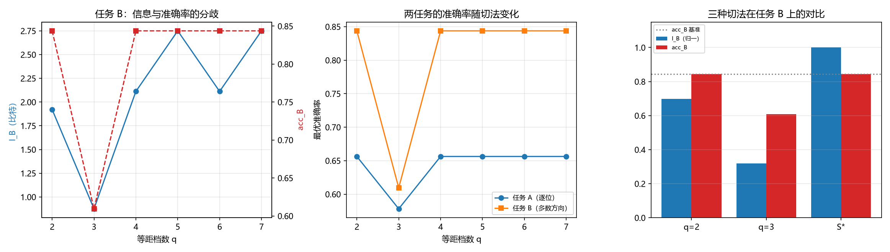

# 注记-切法与任务对齐的最小验证：装置响应类型、互信息与准确率的分歧（判据 L4）

- **日期**：2026-09-25 03:50:43
- **层级**：验证材料（第 402 条）
- **定位**：执行判据 L4（切法与任务对齐），把第 401 条记下的「切法与任务是否对齐比保留多少信息更重要」放到 M6 与裁决点 4 的口径上（装置响应类型即切法），并给出一处可算的判据形式。
- **依据**：[[内部草稿/注记-认知错视与分层粗粒化：主体采样读数的可靠性、错觉边界与认知进化]]（L4）；[[验证脚本/注记-压缩不可逆方向的最小验证：信息沿压缩方向不增、丢失不可追回与任务性能的非单调性（判据 L2）]]（第 401 条，L2d）；M6 与裁决点 4（装置响应类型决定测量基）
- **状态**：判据级。模型内验证，非经验结论。
- **修订记录**：
  - **2026-09-25 初版**（触发：作者批准把 L2d 的读数接到裁决点 4 上）

---

## 一、判据（先立）

**L4a 对齐无损（准确率口径）。** 等距两档切法对任务 A 与任务 B 的准确率都等于用 $Y$ 的准确率。

**L4b 错位有损（准确率口径）。** 等距三档切法对两个任务的准确率都低于用 $Y$ 的准确率。

**L4c 指标依赖。** 对任务 B，等距两档的互信息低于用 $Y$，而准确率与用 $Y$ 相同；同一装置在两个指标下给出相反结论。

**L4d 对齐切法。** 把 $Y=3$ 单独成档的切法 $S^*$，对任务 B 的互信息与准确率都无损。

## 二、模型设定

$X$ 为 $24$ 个独立均匀比特，分 $4$ 块每块 $6$ 位；$Y_k$ 取块内和；$Z$ 取 $Y$ 的分档读数。装置响应类型即分档的切法。

任务 A 为逐位恢复 $X$；任务 B 为恢复块内多数方向，即 $Y$ 与 $3$ 的比较，平局时按 $0.5$ 计。指标取最优准确率与互信息 $I(Z;T)$ 两样，以检验指标选择是否影响结论。

## 三、结果

等距切法扫描（$q$ 为档数）：

| $q$ | acc_A | $I_A$（比特） | acc_B | $I_B$（比特） |
| --- | --- | --- | --- | --- |
| $2$ | $0.656250$ | $3.713448$ | $0.843750$ | $1.921372$ |
| $3$ | $0.578125$ | $3.906514$ | $0.609375$ | $0.875000$ |
| $4$ | $0.656250$ | $6.660548$ | $0.843750$ | $2.111924$ |
| $5$ | $0.656250$ | $7.067757$ | $0.843750$ | $2.750000$ |
| $6$ | $0.656250$ | $7.178262$ | $0.843750$ | $2.111924$ |
| $7$ | $0.656250$ | $9.333448$ | $0.843750$ | $2.750000$ |

基准（读全 $Y$）：acc_A $=0.656250$，acc_B $=0.843750$，$I_A=9.333448$，$I_B=2.750000$。

| 判据 | 实测 | 期望 | 判定 |
| --- | --- | --- | --- |
| L4a acc_A（$q=2$） | $0.656250$ | 等于基准 | 过 |
| L4a acc_B（$q=2$） | $0.843750$ | 等于基准 | 过 |
| L4b acc_A（$q=3$） | $0.578125$ | 低于基准 $0.078125$ | 过 |
| L4b acc_B（$q=3$） | $0.609375$ | 低于基准 $0.234375$ | 过 |
| L4c $I_B$（$q=2$） | $1.921372$ | 低于基准 $2.750000$ | 过 |
| L4c acc_B（$q=2$） | $0.843750$ | 等于基准 | 过 |
| L4c 两指标结论相反 | 成立 | 成立 | 过 |
| L4d acc_B（$S^*$） | $0.843750$ | 等于基准 | 过 |
| L4d $I_B$（$S^*$） | $2.750000$ | 等于基准 | 过 |

九项全过。蒙特卡洛交叉验证（$M=400000$，种子 $20260925$）：acc_B 用 $Y$ 采样 $0.843580$ 对解析 $0.843750$，用 $Z_{q=2}$ 采样 $0.843580$ 对解析 $0.843750$，用 $Z_{q=3}$ 采样 $0.608424$ 对解析 $0.609375$，两端在统计误差内一致。

## 四、图

图注按脚本三个绘图面板逐条核对。左面板两条线在 $q=2$ 处的分歧是本条核心。

## 五、三处实质读数

**其一，指标依赖。** 任务 B 在 $q=2$ 处，互信息 $1.921372$ 比特低于基准 $2.750000$，而准确率 $0.843750$ 与基准相同。同一装置在两个指标下一个判有损、一个判无损。原因是准确率只看后验的多数侧，互信息还看后验的陡峭程度：较粗的读数可以保住猜对率而丢掉确定性。**口径选择决定结论，写判据时须先指定指标。**

**其二，信息随档数非单调。** $I_B$ 在扫描中为 $1.921372$、$0.875000$、$2.111924$、$2.750000$、$2.111924$、$2.750000$，中途两次回升。原因是等距分档族不嵌套（$q$ 增加时档边界移动），数据处理不等式的单调性不适用。第 401 条的档数扫描给出单调升，是因为那里的细化是嵌套的。**分档更细不等于信息更多。**

**其三，对齐的判据形式（本轮实质结论）。** 逐档检查是否把 $Y=3$ 单独成档：$q=2$ 的档 ${0,1,2,3}$ 没有，$q=3$ 的 ${2,3,4}$ 没有（有损最重），$q=4$ 的 ${2,3}$ 没有，$q=5$ 的 ${3}$ 有，$q=6$ 的 ${2,3}$ 没有，$q=7$ 每档单值有，$S^*$ 的 ${3}$ 有。与读数对照：凡单独分出 $Y=3$ 的切法都无损，凡没有的都无损不了。

**由此得一条判据级命题**：对任务 B，装置无损当且仅当档边界包含任务的判别边界。无损与分档粗细无关，$q=5$ 与 $q=7$ 在这条任务上等价。$S^*$ 的证据更强：它对任务 A 的互信息只有 $6.334153$ 比特（远低于 $q=4$ 的 $6.660548$），却对任务 B 完全无损。

**2026-09-25 表述修正（第 403 条）**：本条的判据形式「档边界包含判别边界」对二值任务正确。第 403 条改换三值语义任务并以穷举代替扫描后，发现该表述过宽，一般形式为「不同语义类不共档」；二值情形下两者等价。归属见 [[验证脚本/注记-对齐判据形式的独立复现：无平局模型上的穷举检验与判据表述修正（判据 L4）]]。

## 六、与裁决点 4 的接口

M6 与裁决点 4 把测量基的确定交给装置响应类型（条件性命题的 C1）。本条给该口径一处可算形式：装置响应类型即粗粒化的切法，装置的档边界是否包含目标量的判别边界，决定读数对该目标量是否无损。这为 C1 提供定量支撑，同时把它的适用范围说清：无损是对指定任务而言的，换任务则同一装置的成色改变。

## 七、过程记录

初版手算 $I_B(q=2)$ 的期望为 $1.920344$，实测 $1.921372$，差 $1.0\times10^{-3}$。原因是 $\log_2(16/21)$ 手算截断。修正为 $1.921372$ 后与实测一致。教训同第 401 条：期望值应由脚本内的解析式给出，手算中间量截断会超出判据容差。

## 八、严格程度声明

**可逆性等级。** L4a、L4b、L4d 判据稳健（结构性的无损或有损，不随实现翻）。L4c 判据敏感（结论取决于指标选择与切法族；换成嵌套细化族即消失）。

**协议伪影与物理结论分层。** 全部读数为协议级（离散模型、等距分档、逐位与多数方向两类任务），物理层结论零条。

## 九、边界声明

**验证什么。** 切法与任务对齐对读数质量的作用；两个指标在同一装置上的分歧；非嵌套分档族的信息非单调；「判别边界单独成档」这一对齐形式的充分性。

**不验证什么。** 真实装置的响应类型；任务的最优选择；M6 的 C1 条件本身；体系分层与信息论分层的对应关系。

## 十、登记衔接

本材料为 `验证脚本/README.md` 第 402 条，脚本 `minimal_verification_coarse_graining_alignment.py`，图 `images/coarse_graining_alignment.png`。与第 401 条相接（该条记切法重要，本条给出对齐的判据形式），并把读数接到 M6 与裁决点 4 的口径。开放问题总览的登记见该文档 P4-6 条目。
