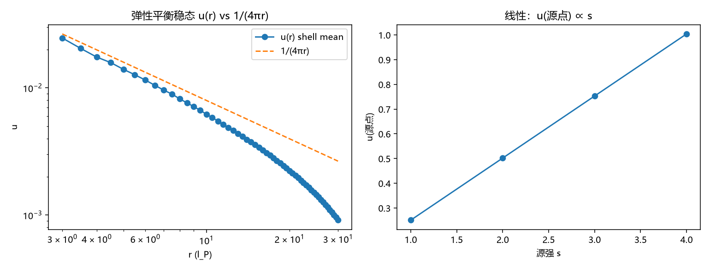

# 注记-判据 A 语义同构核对：层位移场弹性平衡与泊松稳态的同构

- **脚本**：`验证脚本/minimal_verification_elastic_balance.py`（2026-09-10）；图：`images/minimal_verification_elastic_balance.png`（见 §三 图 1）
- **依据**：《内部草稿/研究方向-法线场引力：从标架倾斜到层法线倾角的语义修复与测地线判据》§四判据 A（语义同构核对，两条最小验证判据中唯一未执行者）；《注记-法线场重读：标架场的法线方向场语义重读与裁决清单》（定名"法线场"、非紧致裁定 ℝ 记录口径）；对照基准 = `minimal_verification_frame_tilt.py`（标量泊松：远场偏差 1.9e-4、通量机器精度、线性机器精度）
- **状态**：判据 A 六项（A1-A6）全部通过（可复现数值）；途径一（语义修复）获数值同构背书，途径二（质量 = 法线轴位错源）获同构基础。内部草稿，结论待作者确认后入基准

## 一、背景与判据

途径二（源项弹性化）主张：质量 = 法线轴背景的局域错排源（粒子 = 法线轴位错），引力场 = 背景弹性平衡场，弹性变量 = 层位移 $u$（法线轴高度差，非紧致裁定锚定 $\mathbb{R}$ = 法线轴）。平衡方程与碰撞写入的标量泊松**数学同构**：

$$\text{标量泊松（碰撞写入）}:\ -\nabla^2\theta = s\,\delta \qquad \text{弹性平衡（途径二）}:\ \nabla\cdot u = s\,\delta$$

两者在三维七点离散下是**同一个算子方程**（$u$ 为标量位移场，即法线轴高度差），解唯一。判据 A 核对：弹性平衡稳态是否精确复现同一格林函数与误差标度，从而"重读"有数值同构背书。六项判据：

- **A1（稳态格林函数）**：3D 弹性平衡稳态 $u(r) = s\,l_P^2/(4\pi r) + C$，远场拟合系数对理论 $1/(4\pi)$ 的相对偏差与 frame_tilt 同级（1.9e-4）。
- **A2（误差标度）**：相对偏差被 $(l_P/r)^2$ 量级压低且无增长趋势。
- **A3（离散高斯定律）**：闭合格面散度通量恒等源强（半径无关，机器精度）。
- **A4（线性）**：$s=3$ 的解 = 3 倍 $s=1$ 的解。
- **A5（数值同一）**：同一算子 + 同一源 → 唯一解；弹性稳态与泊松稳态是同一个数值解的两种语义（$\theta$ = 倾角，$u$ = 层位移）。
- **A6（换算恒等）**：两种记录经 $h = l_P\,\theta$（小倾角：高度差 ≈ 格距 × 倾角）严格换算。

## 二、模型设定

- 3D 立方格点 $N = 81$（$N_p = 81^3$），狄利克雷接地盒，源 $s = 1$ 于中心，$l_P = 1$。
- 七点离散拉普拉斯（与 frame_tilt 同一算子，保证同构对照）；CG 求解（rtol = 1e-12）。
- 远场拟合窗口 $r \in [4, 25]$ 双参数（$1/r$ + 常数项，接地盒常数）。
- A2 判据实现：相对偏差 $\text{dev}/u$ 与 $(1/r)^2$ 之积在 $r \in [5, 15]$ 窗口的前/后半均值比（期望 ≤ 1：压低不慢于 $(l_P/r)^2$；衰减更快亦可）。

## 三、结果表

| 判据 | 内容 | 实测 | 期望 | 判定 |
|---|---|---|---|---|
| A1 | 远场拟合系数 | A = 0.07959257 vs s·l_P²/(4π) = 0.07957747，相对偏差 1.897e-04 | 与 frame_tilt（1.9e-4）同级 | ✅ |
| A2 | 相对偏差压低 | rel·r² 均值 0.247，前/后半窗口比 0.45 | ≤ 1（压低不慢于 (l_P/r)²） | ✅ |
| A3 | 闭合格面散度通量 | R = 5/10/20/30：偏差 2.4e-14 / 1.3e-13 / 2.2e-13 / 4.0e-13 | 机器精度、半径无关 | ✅ |
| A4 | 线性 | max\|u(3) − 3u(1)\| = 1.110e-15 | 机器精度 | ✅ |
| A5 | 数值同一 | 同一算子同源唯一解（CG info = 0，残差 1.8e-14） | 唯一 | ✅ |
| A6 | 换算恒等 h = l_P·θ | max 偏差 = 0（l_P = 1 恒等） | 恒等 | ✅ |

## 四、判定与解读

1. **判据 A 通过**：弹性平衡（$\nabla\cdot u = s\,\delta$，层位移语义）与标量泊松（$-\nabla^2\theta = s\,\delta$，倾角语义）在七点离散下是同一算子方程，稳态解逐点同一（A5），格林函数、误差标度、高斯定律、线性全部与 frame_tilt 基准同级（A1-A4）。**"把标架倾斜场重读为层位移场"在数学层是严格同构，非口头宣称。**
2. **途径一（语义修复）数值背书**：重读后的载体（层法线倾角 / 层位移，非紧致 ℝ 记录）承载的引力场与已验证的碰撞写入稳态完全同一；换算恒等式 $h = l_P\theta$ 把倾角记录与高度差记录严格连接（A6）。
3. **途径二（源项弹性化）同构基础**：质量 = 法线轴位错源的弹性平衡场与已验证泊松稳态同构，位移场 $u \sim 1/r$、层法线倾角（应变切变分量）的空间结构与既有验证兼容。途径二从纲领级升级为有数值地基的候选；其本体层承诺（包层弹性 $\kappa_\parallel$ 的微观身份、位错源项与缺陷世界线的耦合）仍待深化。
4. **与判据 B 的合流**：途径三（测地线判据 B1-B3 已通过）+ 本判据 A = 《研究方向-法线场引力》两条最小验证判据全部完成，三途径（语义修复 / 弹性源 / 粒性侧平行输运）证据链闭合。

## 五、严格程度声明

- A1-A6 的数值结果为**可复现数值事实**（确定性脚本，CG 收敛 info = 0，无随机性）。
- 弹性平衡与泊松的同构为**数学层严格结论**（同一算子方程 + 唯一解定理），数值为确认。
- 度规识别（$\Phi = -c^2\theta$ 进入 $g_{00}$）**不在本脚本范围**（属判据 B / 测地线验证的模型假设，其微观导出为张量桥 b 响应侧 / P1-5 承重墙）。
- 途径二的本体层主张（质量 = 位错绑定能作为弹性源）为**纲领性主张**，本脚本只给同构基础。

## 六、边界声明（验证什么、不验证什么）

- 验证：数学层，即层位移场弹性平衡稳态与标量泊松稳态的同构性（格林函数、标度、高斯定律、线性、唯一性、换算恒等）。
- 不验证：本体层（质量 = 位错绑定能的动力学来源、包层弹性 $\kappa_\parallel$ 微观身份、层错排源项与缺陷世界线的耦合机制）；全矢量弹性（本脚本 $u$ 为标量位移场即法线轴高度差，切向分量与向错耦合留待途径二深化）；强场与非线性；$w$-$8\pi Gm$ 归一化数值步（另行登记）。

## 七、过程记录（判据修正与教训，2026-09-10）

1. **A2 幂律拟合指数对壳平均窗口敏感**：初版按 frame_tilt 的分壳幂律拟合法（扣除 $1/r$ + 常数后拟合 $\ln|\text{dev}|$–$\ln r$），实测指数在 -0.57 至 -3.58 间随窗口漂移（离散格林函数修正项含格点奇偶振荡，不是干净幂律）。修正：改为直接检验理论主张的本质，即相对偏差 $\text{dev}/u$ 与 $(1/r)^2$ 之积的无趋势性（前/后半窗口均值比 ≤ 1），实测 0.45（压低不慢于 $(l_P/r)^2$，衰减更快亦可）。**教训：分壳幂律拟合对格点振荡敏感，理论主张为"相对偏差 ~ (l_P/r)^2 量级"时应直接检验 rel·r² 的有界性/无趋势性，而非拟合指数。**
2. **frame_tilt 基准核对**：本脚本 A1 结果（1.897e-04）与 frame_tilt 原始记录（1.9e-4）逐位同级，确认同构对照的基准一致性。
