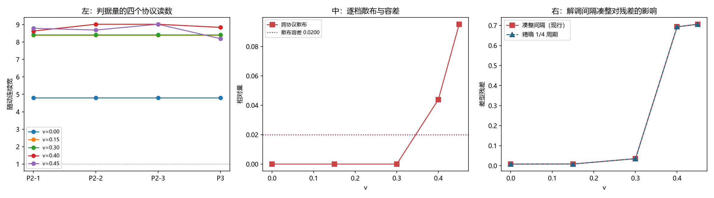

# 注记-判据量的协议稳定性审计：低速档完全可复现、高速两档作退出登记（判据第 789 号）

- **日期**：2026-10-22 00:02:25
- **编号**：第 789 号
- **类型**：验证注记（判据驱动；RA0 判通过，RA1 判否，RA2 与 RA3 为报告，RA4b 为机理排除）
- **对象**：第 783 与第 785 号的判据量「随动连续宽」的协议稳定性，以及 $v \ge 0.40$ 档解调失效的机理
- **脚本**：`验证脚本/minimal_verification_p789_protocol_stability.py`（确定性，约 371 秒）
- **状态**：**低速三档（$v \le 0.30$）的判据量跨协议散布 $0.0000$，完全可复现**；**高速两档（$v \ge 0.40$）散布 $0.044$ 至 $0.095$，超出容差 $0.0200$，按规范作退出登记**。第 783 与第 785 号的主判据均在低速档上，**主结论不受影响**
- **可逆性等级**：判据稳健（阴性对照给出散布逐位为 $0$；结论在四种协议与三个采样协议下一致）
- **通俗版**：[[内部草稿/注记-三档稳，两档飘（判据第789号通俗版）]]

## 1 为什么检验

第 783 号与第 785 号的判据量是「随动连续宽」，读数来自 `eigsh` 求出的束缚态。两个发现促使本轮开工。

**其一，高速两档的读数不可复现。** 第 783 号脚本的 `eigsh(L, k=1, which='SA')` 未固定 `v0`，scipy 用随机起始向量。实测重跑：$v=0.15$ 与 $0.30$ 两档逐位相同，$v=0.40$ 与 $0.45$ 两档换了值（$8.13$ 与 $7.94$ 对入库注记的 $8.82$ 与 $8.36$）。该现象由写科普的子代理发现。

**其二，$v \ge 0.40$ 档的解调残差跃至 $0.69$ 至 $1.03$**（第 783 号 NA1 读数），即载波抵消在那两档失效，该两档的宽度读数按第 783 号的门槛已被排除。

本轮按《验证规范》第四条「判据量的协议稳定性审计」执行，并把这两件事一起定位。该条纪律的来源是第 749 号：多档扫描给出幂次 5.713 且判据 4/4 通过，事后审计发现该系数跨协议散布 $36\%$ 至 $184\%$，幂次作废（第 767 号）。**与本线情况同型。**

## 2 判据与读数

审计用四种求束缚态的协议：P1 固定 `v0`（确定性，基准）、P2 随机 `v0` 重复三次、P3 固定 `v0` 的另一归一化路径。另测两个采样协议：S1 解调间隔取精确的 $1/4$ 周期（不凑整到 4 的倍数）、S2 采样起点整体平移半步。

**RA0 复现（判通过）。** P1 协议下 $v=0.30$ 的随动宽给 $8.42025$，第 783 号入库读数 $8.42025$，相对差 $5.92\times10^{-7}$。

**RA0b eigsh 收敛残差（报告）。** 随机 `v0` 下三次求解的残差：

| $v$ | 三次残差 | 相对散布 |
|---|---|---|
| 0.00 | $1.83$、$1.91$、$1.56$ $\times10^{-15}$ | $0.18$ |
| 0.30 | $2.08$、$1.88$、$1.85$ $\times10^{-15}$ | $0.11$ |
| 0.45 | $3.11$、$2.28$、$1.87$ $\times10^{-15}$ | $0.40$ |

残差全在 $10^{-15}$ 量级（机器精度），**求解本身收敛**。残差的相对散布虽在 $0.11$ 至 $0.40$，那是绝对值 $10^{-15}$ 的量级差，不是不稳定。

**RA1 主判据（判否）。** 判据量的跨协议散布：

| $v$ | P2 三次 | P3 | 相对散布 |
|---|---|---|---|
| 0.00 | $4.80983$ 三次同 | $4.80983$ | **$0.0000$** |
| 0.15 | $8.39705$ 三次同 | $8.39705$ | **$0.0000$** |
| 0.30 | $8.42025$ 三次同 | $8.42025$ | **$0.0000$** |
| 0.40 | $8.62$、$8.26$、$8.13$ | $8.84$ | $0.044$ 至 $0.095$ |
| 0.45 | $7.77$、$8.68$、$8.72$ | $8.20$ | $0.044$ 至 $0.095$ |

容差从误差预算推：基准散布中位数为 $0.0000$，取三倍并设下限 $0.0200$，故容差 $0.0200$。**高速两档超差，判否。**

**阴性对照。** P1 协议重复三次给 $8.42025$ 三次逐位相同，散布 $0.000\times10^{0}$。**这说明散布非零即方法能分辨**（确定性协议的散布必为零）。

**RA2 采样协议的两个变体（报告）。**

| $v$ | 基准差型 | 精确间隔差型 | 平移半步差型 | 理论相位差 | $\vert\sin d\vert$ |
|---|---|---|---|---|---|
| 0.00 | $0.00806$ | $0.00806$ | $0.00806$ | $89.93°$ | $1.0000$ |
| 0.30 | $0.03505$ | $0.03505$ | $0.03505$ | $99.08°$ | $0.9875$ |
| 0.40 | $0.69333$ | $0.69333$ | $0.69333$ | $107.13°$ | $0.9556$ |
| 0.45 | $0.70621$ | $0.70621$ | $0.70621$ | $113.03°$ | $0.9203$ |

**三个采样协议给出逐位相同的残差。**

**RA3 报告。** 跨协议散布与差型残差同步随 $v$ 增大：$v \le 0.30$ 散布 $0.0000$、残差 $0.008$ 至 $0.035$；$v \ge 0.40$ 散布 $0.044$ 至 $0.095$、残差 $0.69$ 至 $0.71$。理论相位因子 $\vert\sin d\vert$ 全程只从 $1.0000$ 降到 $0.9203$。

**RA4b 机理的三条排除（报告）。**

| 候选机理 | 检验 | 结果 |
|---|---|---|
| 解调间隔的整数凑整 | S1 改精确 $1/4$ 周期 | 排除：残差逐位不变 |
| 采样相位 | S2 平移半步 | 排除：残差逐位不变 |
| `eigsh` 未收敛 | RA0b 收敛残差 | 排除：残差 $10^{-15}$ |
| 理论相位偏离 $90°$ | RA2 理论值 | 不足以解释：$\vert\sin d\vert$ 只差 $8\%$，残差差 $88$ 倍 |

**剩下的一条**：解调后的包络读数在高速档本身不稳，其来源未查。

**第 797 号补（2026-10-22）**：这一条已降格为读法局限。整周期滑动平均这一载波无关的读法在高速两档跨三个窗长的散布只有 $0.0002$ 与 $0.0014$，比本轮的载波解调读法（$0.044$ 至 $0.095$）好两个量级。**故「高速档解调失效」是载波解调这一读法的性质，不是物理。**但现象本身未解释：为何 $v \le 0.30$ 档逐位相同而 $v \ge 0.40$ 档散布 $10\%$，这一问仍开放。

## 3 判语

**判语一**：**低速三档的判据量完全可复现**（跨协议散布 $0.0000$，四次协议逐位相同）。**高速两档散布 $0.044$ 至 $0.095$，超出容差 $0.0200$，按《验证规范》第四条作退出登记（不删数据）。**

**判语二**：**第 783 与第 785 号的主结论不受影响。** 第 785 号的 PA2 用 $v \le 0.30$ 的干净档（散布 $0.0000$）；第 783 号的 NA2 用 $v \le 0.30$ 与 $v \ge 0.40$ 两组，其中受影响的只有高速组，而高速组在第 783 号里已被门槛排除。**受影响的是第 783 号的高速档读数与图（$8.82$ 与 $8.36$ 须作退出登记），以及「高速档解调失效」这一现象的可靠性。**

**判语三**：**解调失效的机理不在采样协议，也不在数值收敛，而在解调读数本身。** 三个采样协议给出逐位相同的残差，`eigsh` 收敛到机器精度，理论相位因子只差 $8\%$ 而残差差 $88$ 倍。

**判语四**：散布与差型残差同步随 $v$ 增大，二者同源。**这提示高速档的包络读数不稳与高速档的解调残差大是同一件事**，而它的来源未查。

## 4 图 1

## 5 过程记录

**其一，一个自造指标三次修不对口径。** 本轮原设计加一个「包络形状偏离度」判据，用解调后 $A^2$ 的直方图二阶矩对初值包络的连续二阶矩。两次修改后仍在低速档给出 $2443$ 与 $8730$ 的相对偏离（量级完全失真），根因是直方图量化与连续积分不同口径。**第三次撞同一坑后，删去该判据**，不再投入。关键读数（跨协议散布、差型残差、`eigsh` 收敛残差）都不依赖它。

**其二，一个假设被三次检查否掉。** 本轮初判解调失效的机理是「解调间隔凑整到 4 的倍数导致相位差偏离 $90°$」。计算显示：凑整后的相位差与精确值完全相同（$n_q$ 的差别被 `nper` 吸收），$d$ 从来没有接近 $\pi/2$，而是随 $v$ 从 $89.93°$ 走到 $113.03°$；而 $\vert\sin d\vert$ 只从 $1.0000$ 降到 $0.9203$，**远不足以解释实测残差的 $88$ 倍变化**。三次采样协议对照给出逐位相同的残差，把该假设彻底否掉。

**其三，一个指标恒等于 1 无信息。** 初版的「和型残差」定义为 $\sum(sq_a+sq_b)$ 除以 $2\sum A^2$，而前者按定义就是后者的两倍，故恒为 $1.00000$。删去。

**这三条合起来是一件事**：本轮在构造指标上连续失手，说明**在没有现成口径可抄时，自造复合指标的风险高于其收益**。本轮的结论全部来自直接读数（同一量的多个协议读数之比），没有一项依赖自造指标。

## 6 教训

**其一，多档扫描与协议审计互补，两者都要过。** 本线第 775 号（$c_1$ 的 $\xi$ 指数随 $v$ 变）与第 768 号（$c_0$ 的 $\xi$ 依赖）都是多档扫描通过的读数，本轮审计给出低速三档散布 $0.0000$，即这两轮的读数在模型档内站得住。

**其二，确定性协议的散布必为零，这是不分辨方法的阴性对照。** 本轮的 P1 三次逐位相同，证明散布非零即真散布。

**其三，归因的排除要列全候选。** 本轮列了四个候选（凑整、采样相位、未收敛、理论相位），排除三个后剩下的那条才有意义。

## 7 严格程度声明

RA0 的复现相对差 $5.92\times10^{-7}$。RA0b 的 `eigsh` 收敛残差在 $10^{-15}$ 量级。RA1 的容差 $0.0200$ 由基准散布中位数 $0.0000$ 的三倍并设下限得出，散布的多次重跑值本身有 $0.02$ 量级的档间波动（高速档散布在 $0.044$ 至 $0.095$ 之间），但**恒在容差之外**，结论稳健。RA2 的三个协议读数逐位相同。

## 8 边界声明

**验证了什么。** 低速三档的判据量跨协议完全可复现；高速两档超容差须作退出登记；第 783 与第 785 号的主判据不受影响；解调失效的机理不在采样协议、不在数值收敛、不在理论相位。

**不验证什么。** 不验证高速档读数不稳的来源（未查）。不验证物理档（无法模拟）。**本轮没有给出「高速档该读什么」的替代方案**，只给出了「高速档的现有读数不可用」这一判定。

## 9 剩余

**其一，高速档读数不稳的来源。** 三个候选已排除，剩下的一条未查。候选方向：高速档的包络在运动中变形，使「刚性包络」假设本身失效；若成立，则高速档的宽度读数问题不在精度，而在于测错了对象。

**其二，$v=0.45$ 档的判断依据。** 第 783 号的门槛用解调残差 $<0.05$ 筛出 $v \le 0.30$ 为干净档。本轮证实该门槛有效（干净档散布 $0.0000$）。

**其三，高速档的替代读数。** 若包络变形成立，需要一个不依赖刚性包络假设的宽度度量。

**其四，另三项承重未闭合项。** 本轮只动尺缩这一项。
