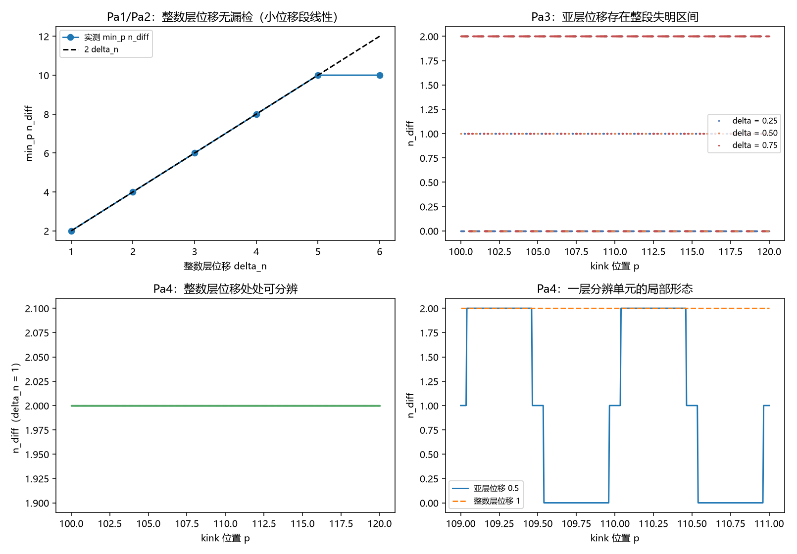

# 注记-前提 P1 独立性审查的最小验证：被记录量的分辨单元恰为一层

- **日期**：2026-09-24 04:23:12
- **层级**：验证注记（对应 `验证脚本/record_resolution_unit.py`，`验证脚本/README.md` 第 385 条）
- **图**：见 §三 图 1
- **定位**：执行 [[研究方向-前提 P1 的独立性审查：被记录量的分辨单元由位置离散结构定（判据草案）]] 的判据 Pa1 至 Pa7。把 [[记录的判据：可分性、独立分量与持有时间]] §3.4 的外挂前提 P1 化为两条既有结论的合取，使限制二的收口不再带前提字样。
- **依据**：[[研究方向-前提 P1 的独立性审查：被记录量的分辨单元由位置离散结构定（判据草案）]]；[[注记-限制二收口的最小验证：逐层指针与阈值读出的可分辨性]]（剖面与读数框架）；[[测量的三层判据：从相互作用分层到单次测量机器]]（§4.3 距离归粒与位置读数的可数性）；[[注记-层位份额语义：从人数份额到相干份额的物侧定义]]（逐层承载位置概率）
- **关联**：[[开放问题总览：元相子理论待解决问题清单]]（测量塌缩的元相子机制）；[[理论攻坚/测量问题攻坚纲领：三条承重墙的闭合]]（裁决点 2 限制二）
- **状态**：模型内判据级。审查只做来源核对与判据化，不重开距离归粒与层位份额语义。

---

## 一、模型与两侧事件集

模型沿用限制二轮：键滑剖面 $w_j(p) = (\pi\ell)^{-1}\operatorname{sech}((j+0.5-p)/\ell)$（$\ell = 2.2508$ 格距、峰值 $0.1414$、阈值取 $0.5\,w_{\max}$），读数图样 $P_j = \Theta(w_j - \theta)$，差异数取两支图样的对称差大小。位置扫描取 $p \in [100, 120]$、步长 $0.0125$（1601 个采样点）。

本轮把位移分成两侧。整数层位移一侧是来源甲允许的事件集：位置读数取整数层，$\delta n = 1$ 至 $6$。亚层位移一侧是连续位置假设下才成为事件的位移：$\delta = 0.25$、$0.5$、$0.75$。

## 二、判据结果

| 判据 | 判据量 | 实测 | 期望 | 结论 |
| --- | --- | --- | --- | --- |
| Pa5 峰值校验 | 解析峰值对既有实测的相对偏差 | $1.09\%$ | $< 2\%$ | 通过 |
| Pa1 整数层无漏检 | $d = 1$ 档 $\delta n = 1$ 至 $6$ 的漏检集大小 | $0$ | $0$ | 通过 |
| Pa2 位移律 | 小位移段 $n_{\text{diff}}$ 对 $2\,\delta n$ 的最大偏差 | $0$ | $0$ | 通过 |
| Pa3 亚层失明 | $\delta = 0.25$ 与 $0.5$ 与 $0.75$ 的 $n_{\text{diff}}$ 最小值 | $0$ / $0$ / $0$ | $0$ | 通过 |
| Pa4 分辨单元 | 整数层可分辨且亚层不可分辨 | 成立 | 成立 | 通过 |
| Pa6 稀疏档复算 | $d = 2$ 在 $\delta n = 1$ 的 $n_{\text{diff}}$ 最小值 | $0$ | $0$ | 通过 |

整数层一侧逐档读数：$\delta n = 1$ 至 $6$ 的 $n_{\text{diff}}$ 为 $2, 4, 6, 8, 10, 10$（末档为饱和）。亚层一侧的失明采样点数：$\delta = 0.25$ 为 $1101/1601$，$0.5$ 为 $700/1601$，$0.75$ 为 $300/1601$。

## 三、图 1

四面板与脚本绘图面板逐条对应：左上为 Pa1 与 Pa2，右上为 Pa3，左下与右下为 Pa4 的两种呈现。

## 四、读数分解

整数层一侧给出无漏检与线性位移律。$d = 1$ 档下 $\delta n = 1$ 至 $5$ 的 $n_{\text{diff}}$ 精确等于 $2\,\delta n$，最大偏差为零；$\delta n = 6$ 处停在 $10$，与限制二轮一致（键滑峰宽约 $5.9$ 格距，位移增大后两支越阈区间分离，线性段饱和）。

亚层一侧给出失明区间，且占比随位移递减。$\delta = 0.25$ 时有 $1101/1601 = 0.688$ 的采样点失明，$\delta = 0.5$ 时 $0.437$，$\delta = 0.75$ 时 $0.187$。三者与 $1 - \delta$（依次 $0.75$、$0.5$、$0.25$）相符到 $0.06$ 以内，差值来自采样点落位与事件间隔恰为一层这一几何事实。这条读数是判据草案 §三 第二节的定量形态：亚层位移在图样上留下为零的差异，属正常而非缺陷，因为位置读数取整数层。

两条合起来给出分辨单元判定：整数层位移处处可分辨、亚层位移不构成事件，故被记录量的分辨单元恰为一层。边界复算同向：$d = 2$ 档在 $\delta n = 1$ 处 $n_{\text{diff}} = 0$，即指针间距一旦大于一层，整数层位移也出现漏检。

## 五、结论与前提 P1 的独立性

前提 P1（被记录量为逐层占据）由两条既有结论的合取供给。来源甲是距离归粒：位置读数 $x^a = l_P n^a$ 取整数层号，位置读数本质是可数计数，故可分辨的事件是整数层位移。来源乙是层位份额语义：位置概率的承载者是逐层份额 $W_n$，读出的分辨单元因此是层。两条合起来给出 P1 的判据化形态：分辨单元恰为一层，本注记的读数即该形态。

据此，限制二的收口不再带外挂前提。[[记录的判据：可分性、独立分量与持有时间]] §3.4 的"给定前提 P1"可改述为"给定位置取整数层且读出按层索引"，二者分别由距离归粒与层位份额承担，属既有结论而非本文外加条件。边界一条随结论保留：若放弃距离归粒而改取连续位置，亚层位移成为事件，逐层指针不足以覆盖（本注记的失明读数即该形态），须改用间距不等式，限制二轮已给出该形态。

## 六、严格程度声明

| 结论 | 档位 |
| --- | --- |
| 峰值校验（Pa5） | 数值验证级（偏差 $1.09\%$） |
| 整数层无漏检与位移律（Pa1、Pa2） | 模型内判据级，逐档枚举 |
| 亚层失明与其占比（Pa3） | 模型内判据级，1601 点扫描 |
| 分辨单元判定（Pa4） | 模型内判据级（两条读数的合取） |
| 稀疏档复算（Pa6） | 模型内判据级 |
| 前提 P1 的两条来源（Pa7） | 引用既有结论（距离归粒定案、层位份额语义），本注记只做合取 |

## 七、边界声明

**验证什么**：整数层位移的无漏检与线性位移律；亚层位移的失明区间及其占比对位移的依赖；分辨单元恰为一层的判定；指针间距大于一层时的漏检复算。

**不验证什么**：距离归粒与层位份额语义本身（沿用既有结论，不重开）；真实探测器的实现；三维与复合体上的层格定义；退相干速率的绝对值。本注记不改动 [[理论总纲/子理论索引]] 与任何基准文档。

## 八、过程记录

首版把亚层位移的预期写成"全部采样点失明"，实测为指导数的递减占比（$0.688$、$0.437$、$0.187$），按发现改写为"与 $1-\delta$ 相符"并补记差值来源。教训：失明区间是一段而非全部，其长度由事件间隔与位移之差给出，预期须写成占比而非布尔值。
