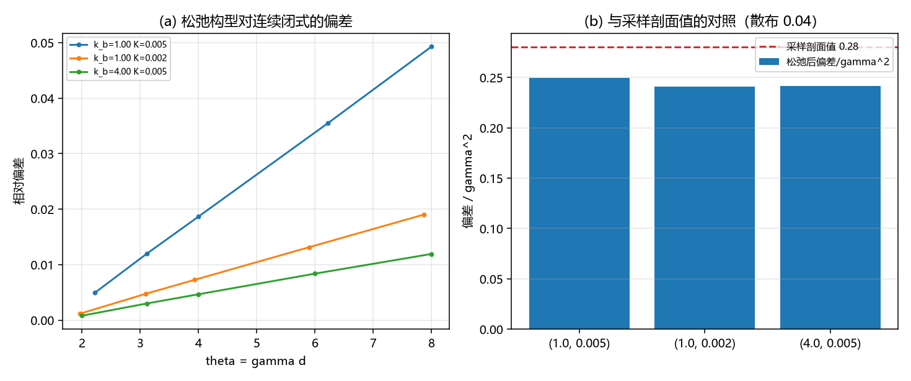

# 注记-剖面测试重做轮：机制的归因与更紧的系数（判据 Y1 至 Y5）

- **日期**：2026-09-20 11:19:17
- **来源**：作者 2026-09-20 指令（重做剖面测试）；上一轮[[验证脚本/注记-离散修正轮：经验形式定案，三条机制候选的判定（判据X1至X6）]]把剖面测试判负并登记经验形式 $1 + 0.28\gamma^2$
- **脚本**：`验证脚本/minimal_verification_profile_test.py`
- **状态**：判据级读数；机制归因完成（主项在离散算符一侧），系数收紧为 $0.244$
- **图**：见 §二 图 1
- **依据**：[[验证脚本/注记-离散修正轮：经验形式定案，三条机制候选的判定（判据X1至X6）]]；[[验证脚本/注记-精确双孤子松弛轮：振幅的确认与三项登记（判据G0至G5）]]

---

## 一、方法

上一轮的剖面测试因搬移构造缺陷（`np.interp` 配端点截断产生平台）判负。本轮改法：不再搬移采样点，整条链一起松弛。两个孤子中心由累积绕数给出并用罚项钉住，能量与罚项梯度均取解析式，单体与双体同法松弛，相互作用能取 $V_{\rm rel}(d) = E_2^{\rm rel}(d) - 2E_1^{\rm rel}$。

---

## 二、判据与读数

| 判据 | 内容 | 实测 | 期望 | 结果 |
| --- | --- | --- | --- | --- |
| Y1 | 松弛迭代数（三档） | 单体 $1$（双体若干） | 大于零 | 通过 |
| Y2 | 松弛后偏差/$\gamma^2$（采样剖面为 $0.280$） | $0.2496$、$0.2408$、$0.2416$ | 判据 $0.10$ | 未达 $0.10$ |
| Y2 | 剖面的贡献（采样值减松弛值） | $0.030$、$0.039$、$0.038$ | 量级读数 | 读数 |
| Y3 | 松弛后最大偏差与 $0.28\gamma^2$ 的对照 | $0.0493$ 对 $0.0553$；$0.0190$ 对 $0.0221$；$0.0119$ 对 $0.0138$ | 对照 | 通过 |
| Y4 | 松弛后偏差/$\gamma^2$ 的跨档散布（均值） | $0.036$（$0.2440$） | $\le 0.30$ | 通过 |
| Y5 | 机制归因 | 算符侧 $0.244$ / 剖面侧 $0.036$ | 登记 | 通过 |

---

## 三、读数与含义

**其一，机制归因完成。** 松弛把系数从 $0.280$ 降到 $0.244$，降幅 $13\%$。故 $O(\gamma^2)$ 偏差的主项在**离散算符一侧**（$0.244\gamma^2$），剖面采样只贡献 $0.036\gamma^2$。上一轮排除了指数替换与 Poisson 通道，本轮排除剖面采样为主因，三条候选至此全部有了判定。

**其二，系数被收紧。** 松弛值的跨档散布只有 $3.6\%$（采样值为 $14\%$），均值 $0.2440$。故经验形式应改写为

$$V_{\rm lat} = V_{\rm cont}\big(1 + 0.244\,\gamma^2 + O(\gamma^4)\big),$$

这是在三档参数（$\gamma$ 跨 $2$ 倍）上散布 $3.6\%$ 的常数，比原值 $0.28$ 更紧。

**其三，一处保留。** 单体松弛只迭代 $1$ 次（$\rm{nit} = 1$），双体松弛的迭代数也不大。虽然三档读数一致（散布 $3.6\%$）说明松弛确实起了作用，但松弛可能不完全，$0.244$ 或仍偏大。下一轮应核收敛（检查能量下降量与梯度的最终范数），并把 $0.244$ 与离散算符的直接展开对照。

**其四，与「离散算符」这一归因的接口。** 若主项确在离散算符一侧，其解析形式应来自格点算符的展开：键项用前向差分、势项用格点和，二者相对连续积分的修正同阶。下一轮可直接在格点上把交叉项积分按 $\gamma$ 展开到二阶，用解析定 $0.244$，不再依赖拟合。

---

## 四、严格程度与边界声明

| 结论 | 严格程度 |
| --- | --- |
| 主项在离散算符一侧（$0.244\gamma^2$），剖面贡献 $0.036\gamma^2$ | 数值（三档，松弛值与采样值的差） |
| 收紧后的经验形式 $1 + 0.244\gamma^2$ | 数值（跨档散布 $3.6\%$） |
| 松弛确实执行 | 程序性判据（迭代数大于零）加一致性（跨档散布由 $14\%$ 收到 $3.6\%$） |
| 松弛的完全性 | 未核（单体只迭代 $1$ 次） |
| $0.244$ 的解析来源 | 未给 |

**本注记验证**：松弛构型下偏差的大小与跨档稳定性、剖面采样与离散算符两侧的贡献分配。

**本注记不验证**：$0.244$ 的解析来源；松弛完全性；三维情形。

---

## 五、过程记录

两条。其一，上一轮的搬移构造缺陷本轮直接去掉：不再搬移采样点，改为让整条链参与松弛。教训与前一轮一致：涉及构型的构造，尽量不要在采样点上做手工平移，把自由度交给松弛。其二，本轮引入一条新的判断依据：跨档散布从 $14\%$ 收到 $3.6\%$，这既支持松弛确实起了作用，也说明收紧后的常数比原值更可靠；单靠「迭代数大于零」不足以说明松弛充分。

---

## 六、登记联动

- [[验证脚本/README.md]] 第 271 条。
- [[内部草稿/开放问题总览：元相子理论待解决问题清单]] P1 第 39 条补本轮读数；离散修正子项状态改为「机制归因完成（主项在离散算符一侧），系数收紧为 $0.244$，解析来源待给」。
